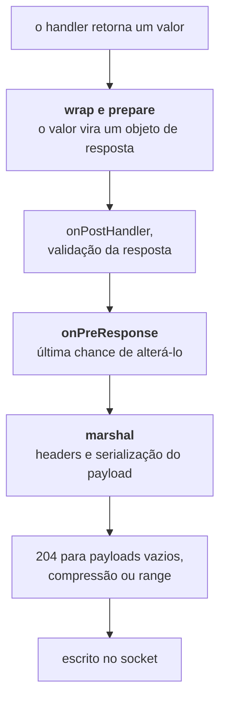

<TutorialLang />

# Marshalling de respostas

_Este tutorial é compatível com o hapi v21 e versões mais recentes_

## <a name="overview"></a> Visão geral

Um handler retorna um valor: uma string, um objeto, um stream, um erro. O marshalling de respostas é tudo o que o hapi faz para transformar esse valor em uma resposta HTTP: escolher o status code, definir os headers, serializar o payload, comprimi-lo e escrevê-lo no socket.

Entender como isso funciona mostra onde colocar cada código. Um formato de erro consistente, uma página de erro em HTML, headers de cache, compressão, um tipo de resposta próprio como CSV, um contador de bytes para métricas: cada um deles pertence a um ponto específico do pipeline de marshalling. As referências da API do [objeto de resposta](/api#response-object) e do [response toolkit](/api#response-toolkit) listam todos os métodos.

## <a name="pipeline"></a> Do valor retornado aos bytes

O marshalling acontece em duas fases, com o ponto de extensão `onPreResponse` entre elas:



A etapa de marshal roda em uma ordem fixa, que define quais configurações enxergam quais headers:

1. `content-type` a partir do tipo do payload
2. headers de CORS e de segurança, se a rota os habilitar
3. ETag e `last-modified` a partir de [`h.entity()`](/api#h-entity-options), depois a verificação de 304 em rotas GET
4. `cache-control` a partir da opção `cache` da rota
5. `set-cookie` a partir de [`h.state()`](/api#h-state-name-value-options) e de cookies com `autoValue`
6. serialização do payload e `content-length`
7. o método `response()` do auth scheme, por último, para que ele consiga ler todos os headers acima

Essa divisão importa na prática:

- **Antes do `onPreResponse`**, a resposta é um objeto de resposta ou um erro do [boom](/module/boom), e você pode inspecioná-la, alterá-la ou substituí-la. Erros gerados durante o wrap e o prepare, como um arquivo que não existe, chegam ao `onPreResponse` como erros do boom.
- **Depois do `onPreResponse`**, o hapi serializa o payload e calcula os headers. Um erro nessa fase, como um objeto que o `JSON.stringify()` não consegue tratar, vira um 500 que o `onPreResponse` nunca vê. Mantenha os payloads como dados simples para que o marshalling não possa falhar.

A ordem das etapas do [ciclo de vida da requisição](/api#request-lifecycle) é explicada no tutorial [Lifecycle hooks](/tutorials/pt_BR/lifecycle-hooks).

## <a name="return-values"></a> O que você retorna, o que o hapi envia

| O handler retorna   | Status               | `content-type` padrão             | Observações                                                                                                                                                                                |
| ------------------- | -------------------- | --------------------------------- | ------------------------------------------------------------------------------------------------------------------------------------------------------------------------------------------ |
| string              | 200, ou 204 se vazia | `text/html; charset=utf-8`        | Use `.type('text/plain')` para texto puro                                                                                                                                                  |
| objeto ou array     | 200                  | `application/json; charset=utf-8` | Serializado com `JSON.stringify()` e as [opções `json`](#json) da rota                                                                                                                     |
| `Buffer`            | 200                  | `application/octet-stream`        |                                                                                                                                                                                            |
| readable stream     | 200                  | `application/octet-stream`        | Enviado em chunks. Não pode estar em object mode. Copia `statusCode` e `headers` se o stream os tiver                                                                                      |
| `null`              | 204                  | nenhum                            | Defina `response.emptyStatusCode` da rota como `200` para enviar 200                                                                                                                       |
| `undefined`         | 500                  |                                   | Um handler precisa retornar algo; o hapi registra no log "handler method did not return a value"                                                                                           |
| `Error`             | 500                  | `application/json; charset=utf-8` | A mensagem fica oculta para o cliente                                                                                                                                                      |
| erro do boom        | o status do erro     | `application/json; charset=utf-8` | `{ statusCode, error, message }`; mensagens de 5xx ficam ocultas                                                                                                                           |
| `h.response(value)` | o mesmo de `value`   | o mesmo de `value`                | Encadeie `.code()`, `.header()`, `.type()` e os outros métodos do [objeto de resposta](/api#response-object)                                                                               |
| `h.redirect(uri)`   | 302                  | `text/html; charset=utf-8`        | Corpo vazio. `.permanent()` gera 301, `.rewritable(false)` gera 307, os dois juntos geram 308. 307 e 308 fazem o cliente repetir o mesmo método, então um POST redirecionado continua POST |

- `Readable.from(array)` cria um stream em object mode, que o hapi rejeita com 500. Passe `{ objectMode: false }` ou retorne um stream de bytes, como `Fs.createReadStream()`.
- Um stream com as propriedades `statusCode` e `headers`, como uma resposta HTTP do [wreck](/module/wreck), repassa seu status e seus headers. Isso transforma um proxy básico em um handler de uma linha, e também significa que um 404 do upstream vira o seu 404.

## <a name="shaping"></a> Montando uma resposta com h.response()

Retorne um valor simples quando os padrões servem. Quando não servem, envolva o valor com [`h.response()`](/api#h-response-value) e encadeie o que precisar:

```ts
import Hapi from '@hapi/hapi';

const server = Hapi.server({ port: 4000 });

server.route<{ Payload: { name: string } }>({
    method: 'POST',
    path: '/users',
    handler: (request, h) => {
        const user = { id: '2133d32a', name: request.payload.name };

        return h.response(user).created(`/users/${user.id}`).header('x-request-id', request.info.id);
    },
});

server.route({
    method: 'GET',
    path: '/robots.txt',
    handler: (request, h) => {
        return h.response('User-agent: *\nDisallow: /admin\n').type('text/plain');
    },
});
```

`.created()` define o status 201 e o header `location` em uma única chamada.

## <a name="errors"></a> Erros

Todo erro acaba virando um objeto do boom. O hapi envolve um `Error` comum com `Boom.boomify()`, que atribui o status 500, e o boom esconde do cliente a mensagem de qualquer erro 5xx. Seus usuários veem `An internal server error occurred`, e o hapi emite o erro real como um evento `'request'` no canal `'error'`; veja [Logging](/tutorials/pt_BR/logging) para registrá-lo. Lance um erro do boom, como `Boom.notFound('No such user')`, quando o cliente deve ver a mensagem.

A resposta de um erro do boom vem da sua propriedade `output`:

```ts
import Boom from '@hapi/boom';

const error = Boom.notFound('No such user');

error.output.statusCode; // 404
error.output.payload; // { statusCode: 404, error: 'Not Found', message: 'No such user' }
error.output.headers; // {}, or headers such as WWW-Authenticate from auth errors
```

### <a name="a-consistent-error-format"></a> Um formato de erro consistente

APIs muitas vezes precisam dos erros em um formato próprio, e não no do boom. Converta-os no `onPreResponse`, por onde passam todos os erros, inclusive os 404 de rotas desconhecidas e os erros lançados por plugins:

```ts
import Boom from '@hapi/boom';
import Hapi from '@hapi/hapi';

const server = Hapi.server({ port: 4000 });

server.ext('onPreResponse', (request, h) => {
    const { response } = request;
    if (!Boom.isBoom(response)) {
        return h.continue;
    }

    const { statusCode, payload, headers } = response.output;
    const reply = h.response({
        error: {
            status: statusCode,
            code: payload.error,
            message: payload.message,
            requestId: request.info.id,
        },
    });

    reply.code(statusCode);
    for (const [name, value] of Object.entries(headers)) {
        if (value !== undefined) {
            reply.header(name, String(value));
        }
    }

    return reply;
});
```

Copie `output.headers` para a nova resposta. Erros de autenticação trazem `WWW-Authenticate` ali, e `Boom.methodNotAllowed()` pode trazer `Allow`. `payload.message` já é a mensagem segura: em erros 5xx o boom já a trocou pelo texto genérico.

### <a name="html-error-pages"></a> Páginas de erro em HTML

Um site que renderiza HTML pode retornar uma página de erro a partir do mesmo hook; o tutorial [Views](/tutorials/pt_BR/views#errors) mostra como fazer isso com o @hapi/vision. Em uma aplicação que serve tanto páginas quanto uma API, pule a página nas rotas da API, por exemplo com `request.path.startsWith('/api/')`, para que os clientes da API continuem recebendo JSON.

## <a name="custom"></a> Tipos de resposta próprios

Plugins que enviam arquivos e templates não retornam strings. O [@hapi/inert](/module/inert) e o [@hapi/vision](/module/vision) criam suas respostas com [`request.generateResponse()`](/api#request-generateresponse-source-options), que recebe um valor de origem e processors opcionais. `prepare` e `marshal` rodam nas duas fases do pipeline, e `close` roda quando a resposta termina, tenha ela sido enviada ou substituída:

| Plugin | `variety` | `prepare` roda antes do `onPreResponse`                                        | `marshal` roda depois do `onPreResponse`                                                         |
| ------ | --------- | ------------------------------------------------------------------------------ | ------------------------------------------------------------------------------------------------ |
| inert  | `'file'`  | abre o arquivo; define `content-length`, `content-type`, `last-modified`, ETag | retorna um read stream, ou um arquivo pré-comprimido (`.gz`, ou outras extensões de `lookupMap`) |
| vision | `'view'`  | carrega e compila o template                                                   | renderiza o template com seu contexto; define `content-type`                                     |

A divisão é proposital. Um arquivo inexistente falha no `prepare`, então chega ao `onPreResponse` como um 404 que o seu tratador de erros pode formatar. O trabalho caro, ler o arquivo ou renderizar o template, acontece no `marshal`, depois que o `onPreResponse` teve a chance de substituir a resposta. O inert também passa `close`, que fecha o arquivo mesmo quando um hook `onPreResponse` substituiu a resposta; uma resposta própria que abre um recurso também precisa de um.

Você pode usar o mesmo mecanismo para os seus próprios formatos. Aqui está uma resposta em CSV:

```ts
import Hapi from '@hapi/hapi';

import type { Request } from '@hapi/hapi';

const field = (value: string) => (/[",\n]/.test(value) ? `"${value.replaceAll('"', '""')}"` : value);

const csv = (request: Request, rows: string[][]) => {
    return request
        .generateResponse(rows, {
            variety: 'csv',
            marshal: async () => rows.map((row) => row.map(field).join(',')).join('\n'),
        })
        .type('text/csv');
};

const server = Hapi.server({ port: 4000 });

server.route({
    method: 'GET',
    path: '/users.csv',
    handler: (request, h) => {
        return csv(request, [
            ['id', 'name'],
            ['2133d32a', 'John Doe'],
        ]);
    },
});
```

`field()` coloca entre aspas os valores que contêm vírgula, aspas ou quebra de linha, para que eles não possam dividir uma linha. Para chamá-la como `h.csv(rows)` em qualquer handler, adicione-a ao response toolkit com um decorator; veja o tutorial [Decorators](/tutorials/pt_BR/decorators).

## <a name="json"></a> Serialização de JSON

Objetos são serializados com `JSON.stringify()`. As [opções `json`](/api#route-options-json) da rota controlam como:

```ts
import Hapi from '@hapi/hapi';

const server = Hapi.server({
    port: 4000,
    routes: {
        json: {
            space: process.env.NODE_ENV === 'production' ? 0 : 2,
        },
    },
});

server.route({
    method: 'GET',
    path: '/widget-config',
    options: {
        json: { escape: true },
    },
    handler: (request, h) => {
        return { title: '</script><script>alert(1)</script>' };
    },
});
```

- `space` indenta a saída. JSON legível ajuda durante o desenvolvimento e custa bytes em produção.
- `escape: true` escreve `<`, `>` e `&` como `\u003c`, `\u003e` e `\u0026`, e também escapa os separadores de linha U+2028 e U+2029. Use em qualquer rota cujo JSON seja embutido em uma página HTML, para que um valor contendo `</script>` não consiga fechar a tag script ao redor.
- `replacer` é passado para o `JSON.stringify()`, e `suffix` é adicionado ao final da saída. Uma resposta específica pode sobrescrevê-los com `.spaces()`, `.replacer()` e `.suffix()`.

Não dependa do `replacer` para remover segredos como hashes de senha. Monte o objeto de resposta com os campos que você pretende enviar e use a [validação de resposta](#validation) para pegar erros.

## <a name="caching"></a> Cache e requisições condicionais

A [opção `cache`](/api#route-options-cache) da rota define o `cache-control` durante o marshalling:

```ts
server.route({
    method: 'GET',
    path: '/articles/{id}',
    options: {
        cache: { expiresIn: 60 * 1000, privacy: 'public' },
    },
    handler: (request, h) => {
        const article = { id: request.params.id, version: 7, body: '...' };

        const notModified = h.entity({ etag: `${article.id}-${article.version}` });
        if (notModified) {
            return notModified;
        }

        return article;
    },
});
```

- `cache` gera `cache-control: max-age=60, must-revalidate, public`. O hapi troca para `private` por conta própria quando a requisição é autenticada. Cookies definidos com `h.state()` não alteram isso, e plugins de sessão como o yar e o @hapi/cookie definem os seus dessa forma, então em uma rota que define um cookie use `privacy: 'private'` ou não use `cache`. Caso contrário, um cache compartilhado pode guardar o cookie de um usuário e entregá-lo a outro.
- [`h.entity()`](/api#h-entity-options) compara a ETag com o header `If-None-Match` da requisição. Quando elas coincidem, ele retorna uma resposta 304 e o handler pula a montagem do corpo. Quando não coincidem, ele define o header `etag` e não retorna nada.

Baseie a ETag em algo barato que mude sempre que o conteúdo mudar, como um número de versão ou um timestamp de atualização. Fazer o hash do corpo inteiro economiza banda, mas não o trabalho de montá-lo.

## <a name="compression"></a> Compressão

O hapi comprime uma resposta com gzip ou deflate quando todas estas condições são verdadeiras:

- o cliente envia um header `Accept-Encoding` compatível,
- o content type é comprimível (texto, JSON, JavaScript, SVG e similares; não imagens nem arquivos compactados),
- o payload tem pelo menos [`compression.minBytes`](/api#server-options-compression-minbytes), 1024 bytes por padrão, ou seu tamanho é desconhecido, como acontece com streams.

O hapi também adiciona `vary: accept-encoding`, para que os caches mantenham as cópias comprimidas e não comprimidas separadas. Para suportar Brotli, registre um encoder com [`server.encoder()`](/api#server-encoder-encoding-encoder):

```ts
import Zlib from 'node:zlib';

import Hapi from '@hapi/hapi';

const server = Hapi.server({ port: 4000 });

server.encoder('br', (options) => Zlib.createBrotliCompress(options));
```

Agora o hapi prefere `br` quando o cliente o aceita. A [opção `compression`](/api#route-options-compression) de uma rota passa configurações para um encoder, como `compression: { br: { params: { [Zlib.constants.BROTLI_PARAM_QUALITY]: 4 } } }` para trocar tamanho por velocidade. Quando um payload já está comprimido, como um arquivo `.gz` lido do disco, marque-o com `.compressed('gzip')` para que o hapi defina o header e não mexa nos bytes.

## <a name="validation"></a> Validação de resposta

A [validação de resposta](/api#route-options-response) verifica o payload contra um schema antes do `onPreResponse`. Ela pega handlers que retornam o formato errado, incluindo campos que nunca deveriam sair do servidor:

```ts
import Hapi from '@hapi/hapi';
import Joi from 'joi';

const server = Hapi.server({ port: 4000 });

const User = Joi.object({
    id: Joi.string().required(),
    name: Joi.string().required(),
});

server.route({
    method: 'GET',
    path: '/users/{id}',
    options: {
        response: {
            schema: User,
            sample: process.env.NODE_ENV === 'production' ? 10 : 100,
            failAction: process.env.NODE_ENV === 'production' ? 'log' : 'error',
        },
    },
    handler: (request, h) => {
        return { id: request.params.id, name: 'John Doe' };
    },
});
```

- Com o padrão `failAction: 'error'`, um payload que não passa no schema vira um 500. Use isso em desenvolvimento e nos testes, para que os erros apareçam de forma clara.
- `failAction: 'log'` envia o payload original e registra a falha no log com as tags `validation`, `response` e `error`. Em produção, isso evita que um erro no schema vire uma indisponibilidade, mas o payload ainda é enviado, incluindo qualquer campo que o schema rejeitou.
- `sample` valida apenas uma porcentagem das respostas, o que limita o custo em rotas com muito tráfego.

Para remover campos desconhecidos em vez de rejeitá-los, defina `modify: true` e `options: { stripUnknown: true }`, e remova `sample`. Com `modify`, a validação passa a fazer parte da lógica da resposta, então o hapi valida todas as respostas e não aceita `sample`.

## <a name="measuring"></a> Medindo respostas

Um objeto de resposta emite [eventos](/api#response-events) enquanto é escrito: `'peek'` para cada chunk e `'finish'` no final. Um plugin pode usá-los para registrar o tamanho das respostas:

```ts
import Boom from '@hapi/boom';
import Hapi from '@hapi/hapi';

const server = Hapi.server({ port: 4000 });

server.ext('onPreResponse', (request, h) => {
    const { response } = request;
    if (Boom.isBoom(response)) {
        return h.continue;
    }

    let bytes = 0;
    response.events.on('peek', (chunk) => {
        bytes += Buffer.byteLength(chunk);
    });
    response.events.once('finish', () => {
        request.log(['metrics'], { path: request.path, bytes });
    });

    return h.continue;
});
```

`'peek'` vê o payload antes da compressão, então `bytes` é o tamanho sem compressão. As respostas de erro são ignoradas aqui: um erro do boom vira um novo objeto de resposta durante o marshalling, depois que este hook roda. Para medir o tempo de uma requisição inteira, use a extensão `onPostResponse` ou o evento `'response'` do servidor, explicados em [Lifecycle hooks](/tutorials/pt_BR/lifecycle-hooks) e [Logging](/tutorials/pt_BR/logging).
