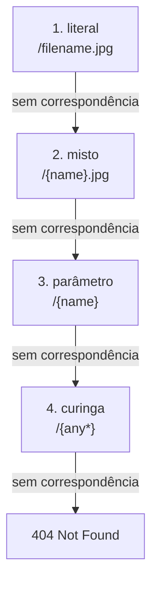

<TutorialLang />

# Roteamento

_Este tutorial é compatível com o hapi v21 e versões mais recentes_

## <a name="overview"></a> Visão geral

Uma rota precisa de três coisas: um `method`, um `path` e um `handler`. Você a adiciona com [`server.route()`](/api#server-route-route):

```ts
server.route({
    method: 'GET',
    path: '/',
    handler: (request, h) => {
        return 'Hello World!';
    },
});
```

`server.route()` também aceita um array de objetos de rota, então você pode registrar várias rotas em uma única chamada.

## <a name="methods"></a> Métodos

`method` é qualquer método HTTP exceto `HEAD` (rotas GET respondem a requisições HEAD), um array de métodos, ou `'*'` para todos eles:

```ts
server.route({
    method: ['PUT', 'POST'],
    path: '/',
    handler: (request, h) => {
        return 'I did something!';
    },
});
```

Uma rota `GET` também responde a requisições `HEAD`, então você nunca precisa de uma rota `HEAD` separada.

## <a name="path"></a> Caminho

Envolva um segmento do caminho com `{}` para capturá-lo como um parâmetro nomeado. O valor fica disponível em `request.params`:

```ts
import * as Hoek from '@hapi/hoek';

server.route<{ Params: { user: string } }>({
    method: 'GET',
    path: '/hello/{user}',
    handler: (request, h) => {
        return `Hello ${Hoek.escapeHtml(request.params.user)}!`;
    },
});
```

Uma requisição para `/hello/ferris` responde `Hello ferris!`.

- O hapi faz o URI-decode dos valores dos parâmetros, então `/hello/a%20b` resulta em `request.params.user === 'a b'`.
- O valor vem direto da URL. Faça o escape antes de colocá-lo em HTML, como a chamada `escapeHtml()` do [Hoek](/module/hoek) faz acima, ou valide-o com [joi](/tutorials/pt_BR/validation).
- Desde o hapi 21.4.10, os valores de `request.params` têm o tipo `unknown` por padrão. O argumento de tipo `server.route<{ Params: { user: string } }>()` declara o formato, então `request.params.user` é uma `string` no handler. O mesmo argumento de tipo aceita `Query`, `Payload`, `Headers` e as outras partes da requisição mostradas abaixo.

### <a name="optionalParameters"></a> Tipos de parâmetro

| Caminho             | Corresponde a                                 | `request.params`                    |
| ------------------- | --------------------------------------------- | ----------------------------------- |
| `/hello/{user}`     | `/hello/ferris`                               | `{ user: 'ferris' }`                |
| `/hello/{user?}`    | `/hello`, `/hello/ferris`                     | `{}` ou `{ user: 'ferris' }`        |
| `/hello/{user*2}`   | `/hello/john/doe` (exatamente dois segmentos) | `{ user: 'john/doe' }`              |
| `/files/{path*}`    | `/files`, `/files/a`, `/files/a/b/c`          | `{}` ou `{ path: 'a/b/c' }`         |
| `/{filename}.{ext}` | `/photo.jpg`                                  | `{ filename: 'photo', ext: 'jpg' }` |

Regras que o hapi aplica quando você adiciona a rota:

- `{user*}` e um opcional de segmento inteiro `{user?}` precisam ser o último segmento do caminho. `{user*2}` e um opcional de segmento parcial, como `/a{user?}/b`, podem aparecer em qualquer lugar.
- Dois parâmetros no mesmo segmento precisam de um separador literal entre eles: `{filename}.{ext}` é válido, `{filename}{ext}` não é.
- O nome de um parâmetro só pode aparecer uma vez por caminho.
- Duas rotas com o mesmo método e um caminho equivalente entram em conflito, e `server.route()` lança um erro. `/{name}` e `/{other}` são equivalentes.

### <a name="multiParameters"></a> Parâmetros de múltiplos segmentos

Um parâmetro de múltiplos segmentos guarda os segmentos correspondentes unidos por `/`, então divida-o para obter as partes:

```ts
server.route<{ Params: { user: string } }>({
    method: 'GET',
    path: '/hello/{user*2}',
    handler: (request, h) => {
        const [first, last] = request.params.user.split('/');

        return `Hello ${first} ${last}!`;
    },
});
```

Uma requisição para `/hello/john/doe` responde `Hello john doe!`.

### <a name="specificity"></a> Qual rota vence

O hapi não testa as rotas na ordem em que você as adicionou. Para cada segmento do caminho, ele testa os tipos de correspondência do mais específico para o menos específico, e passa para o próximo tipo quando o resto do caminho não corresponde:



Com estas quatro rotas registradas:

| Requisição      | Rota que responde |
| --------------- | ----------------- |
| `/filename.jpg` | `/filename.jpg`   |
| `/photo.jpg`    | `/{name}.jpg`     |
| `/photo`        | `/{name}`         |
| `/a/b`          | `/{any*}`         |

Os caminhos diferenciam maiúsculas de minúsculas por padrão: com as rotas acima, `/Filename.jpg` é respondido por `/{name}.jpg`. Defina [`router.isCaseSensitive`](/api#server-options-router) como `false` no servidor para mudar isso.

## <a name="query"></a> Parâmetros de query

`request.query` contém a query string já interpretada. Para `/?name=ferris&location=chicago`:

```ts
server.route<{ Query: { name: string } }>({
    method: 'GET',
    path: '/',
    handler: (request, h) => {
        return `Hello ${request.query.name}!`;
    },
});
```

O parser embutido do hapi não entende chaves aninhadas: `/?foo[bar]=baz` resulta em `{ 'foo[bar]': 'baz' }`. Para interpretar chaves aninhadas, defina o `query.parser` do servidor com um parser como o [qs](https://github.com/ljharb/qs):

```ts
import Hapi from '@hapi/hapi';
import Qs from 'qs';

const server = Hapi.server({
    port: 3000,
    host: 'localhost',
    query: {
        parser: (query) => Qs.parse(query),
    },
});

server.route({
    method: 'GET',
    path: '/',
    handler: (request, h) => {
        return request.query;
    },
});

await server.start();
console.log('Server running on %s', server.info.uri);
```

Agora `/?foo[bar]=baz` responde `{ "foo": { "bar": "baz" } }`. O parser recebe a query que o hapi já interpretou, como `{ 'foo[bar]': 'baz' }`, e não a string bruta. Qualquer função serve, desde que retorne um objeto que mapeie nomes de parâmetros para valores.

## <a name="requestpayload"></a> Payload da requisição

O corpo da requisição, já interpretado, fica em `request.payload`. O hapi interpreta corpos JSON, form-encoded e de texto com base no header `Content-Type`. Corpos multipart precisam da opção de rota `payload: { multipart: true }`; sem ela, recebem `415 Unsupported Media Type`:

```ts
server.route<{ Payload: { username: string; password: string } }>({
    method: 'POST',
    path: '/signup',
    handler: (request, h) => {
        return `Welcome ${request.payload.username}!`;
    },
});
```

O argumento de tipo só informa o formato ao TypeScript. Nada é verificado em tempo de execução até você adicionar a [validação do payload](/tutorials/pt_BR/validation).

## <a name="handler"></a> Handler

O handler recebe dois argumentos:

- `request` contém tudo sobre a requisição recebida: `params`, `query`, `payload`, `headers`, `auth` e mais. Veja o [objeto de requisição](/api#request).
- `h` é o [response toolkit](/api#response-toolkit), com métodos como `h.response()` e `h.redirect()`.

O que o handler retorna vira a resposta:

| O handler retorna                           | Resposta                                                                     |
| ------------------------------------------- | ---------------------------------------------------------------------------- |
| uma string                                  | `200`, `text/html; charset=utf-8`                                            |
| um objeto ou array                          | `200`, `application/json; charset=utf-8`                                     |
| um `Buffer`                                 | `200`, `application/octet-stream`                                            |
| um readable stream                          | `200`, o stream encaminhado ao cliente                                       |
| `h.response(value)` com chamadas encadeadas | controle total, por exemplo `h.response('created').code(201)`                |
| um erro lançado                             | uma resposta de erro, `500` a menos que seja um erro do [boom](/module/boom) |

Um handler precisa retornar um valor, uma promise, ou lançar um erro. [Marshalling de respostas](/tutorials/pt_BR/response-marshalling) explica como o hapi transforma esses valores nos bytes que envia.

Arrow functions não podem usar `this`, então um handler escrito como arrow function lê o valor definido por [`server.bind()`](/api#server-bind-context) a partir de [`h.context`](/api#h-context).

## <a name="options"></a> Opções

Tudo além de method, path e handler vai nas `options` da rota:

```ts
import Joi from 'joi';

server.route<{ Payload: { username: string; password: string } }>({
    method: 'POST',
    path: '/signup',
    options: {
        auth: false,
        validate: {
            payload: Joi.object({
                username: Joi.string().min(1).max(20).required(),
                password: Joi.string().min(7).required(),
            }),
        },
    },
    handler: (request, h) => {
        return `Welcome ${request.payload.username}!`;
    },
});
```

| Opção      | O que controla                                      | Saiba mais                                              |
| ---------- | --------------------------------------------------- | ------------------------------------------------------- |
| `auth`     | qual strategy de autenticação se aplica             | [Autenticação](/tutorials/pt_BR/auth)                   |
| `validate` | verificações de params, query, payload e headers    | [Validação](/tutorials/pt_BR/validation)                |
| `cache`    | headers `Cache-Control` da resposta                 | [Cache](/tutorials/pt_BR/caching)                       |
| `payload`  | interpretação do corpo, limites de tamanho, uploads | [opções de payload da rota](/api#route-options-payload) |
| `pre`      | métodos que rodam antes do handler                  | [opções pre da rota](/api#route-options-pre)            |
| `ext`      | lifecycle hooks só para esta rota                   | [Lifecycle hooks](/tutorials/pt_BR/lifecycle-hooks)     |

A lista completa está na [referência de opções de rota](/api#route-options).

## <a name="missing"></a> Tratamento de 404

Quando nenhuma rota corresponde, o hapi responde com um erro `404` em JSON. Para enviar sua própria resposta, adicione uma rota pega-tudo. O curinga `{any*}` é a correspondência menos específica, então ele só responde às requisições que nenhuma outra rota atende:

```ts
server.route({
    method: '*',
    path: '/{any*}',
    handler: (request, h) => {
        return h.response('404 Error! Page Not Found!').code(404);
    },
});
```

A rota pega-tudo só cobre caminhos sem correspondência. Um `404` lançado por uma rota que correspondeu, como um handler que lança `Boom.notFound()`, nunca chega até ela. Para personalizar todo `404`, seja qual for a origem, altere a resposta em um hook `onPreResponse`; veja [Lifecycle hooks](/tutorials/pt_BR/lifecycle-hooks).
