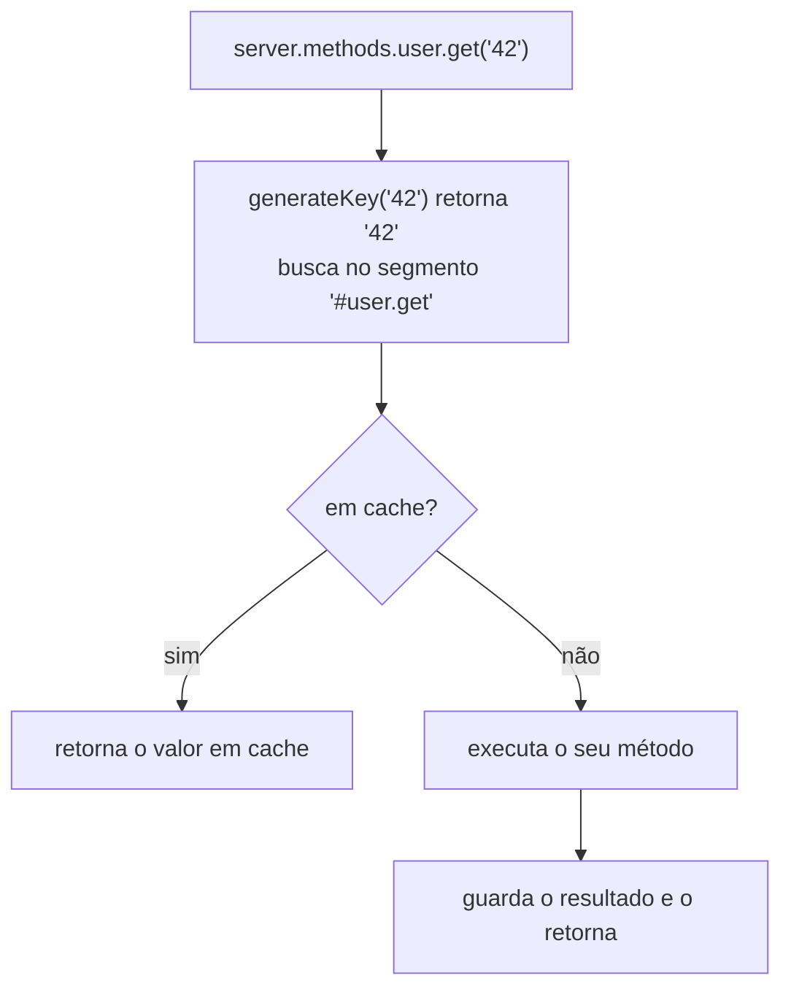

<TutorialLang />

# Métodos de servidor

_Este tutorial é compatível com o hapi v21 e versões mais recentes_

## <a name="overview"></a> Visão geral

Um método de servidor é uma função que você registra no servidor com [`server.method()`](/api#server-method-name-method-options) e chama de qualquer lugar que tenha acesso ao servidor: handlers de rota, plugins, extensões. Use um quando:

- várias rotas ou plugins precisam da mesma função, e você não quer que cada um a importe.
- a função é cara e o resultado pode ser guardado em cache. Uma única opção ativa o [cache](/tutorials/pt_BR/caching) do hapi para ela.

```ts
import Hapi from '@hapi/hapi';

declare module '@hapi/hapi' {
    interface ServerMethods {
        add: (x: number, y: number) => number;
    }
}

const server = Hapi.server({ port: 3000 });

server.method('add', (x: number, y: number) => x + y);

server.route({
    method: 'GET',
    path: '/',
    handler: (request, h) => {
        return { sum: request.server.methods.add(1, 2) };
    },
});

await server.start();
```

- `server.methods.add` é a função registrada. Em um handler, `request.server.methods` chega até ela sem precisar da variável `server` no escopo.
- O hapi não sabe quais métodos você registra, então o TypeScript precisa deles na interface `ServerMethods` do hapi. O bloco `declare module` pode ficar em qualquer módulo do seu projeto.
- Os métodos são globais no servidor: um método registrado dentro de um plugin fica disponível para todos os outros plugins e rotas.

## <a name="server.method"></a> server.method()

`server.method()` recebe argumentos posicionais ou um único objeto (ou um array de objetos, para registrar vários de uma vez):

```ts
server.method('add', add, {});

server.method({
    name: 'add',
    method: add,
    options: {},
});
```

### <a name="name"></a> Nome

Um nome com pontos registra um método aninhado:

```ts
server.method('math.add', add);

server.methods.math.add(1, 2);
```

Declare-o como um objeto aninhado em `ServerMethods`: `math: { add: (x: number, y: number) => number }`. Cada segmento do nome precisa ser um identificador JavaScript válido.

### <a name="method"></a> Método

O método pode receber quaisquer argumentos e pode ser `async`. Retorne o resultado ou lance um erro.

```ts
server.method('user.get', async (id: string) => {
    return await db.users.findById(id);
});
```

## <a name="options"></a> Opções

| Opção                 | Use para                                                                           |
| --------------------- | ---------------------------------------------------------------------------------- |
| [`cache`](#cache)     | guardar em cache os resultados do método                                           |
| [`generateKey`](#key) | montar a chave de cache quando os argumentos não são strings, números ou booleanos |
| [`bind`](#bind)       | definir `this` dentro do método                                                    |

### <a name="cache"></a> Cache

Com a opção `cache`, a chamada ao método passa primeiro por um cache:



```ts
server.method('user.get', getUser, {
    cache: {
        expiresIn: 60 * 1000,
        staleIn: 30 * 1000,
        staleTimeout: 100,
        generateTimeout: 2000,
    },
});
```

O que você precisa saber:

- `generateTimeout` é obrigatório. É quanto tempo quem chama espera pelo seu método antes de receber um `503`.
- Um método com cache sempre retorna uma promise, mesmo quando o próprio método é síncrono. Declare-o em `ServerMethods` com um tipo de retorno `Promise` e use `await`.
- O hapi guarda os itens em um segment chamado `'#'` mais o nome do método. Defina `cache: 'my_cache'` para usar um [cliente de cache nomeado](/tutorials/pt_BR/caching#client) em vez do cache em memória padrão.
- As outras opções (`expiresAt`, `staleIn`, `staleTimeout`, `segment`) são as mesmas de [`server.cache()`](/api#server-cache-options). O tutorial [Cache](/tutorials/pt_BR/caching#stale) mostra como os valores stale são servidos.

#### <a name="changing-the-ttl-per-result"></a> Mudando o TTL por resultado

O hapi passa um argumento extra depois dos seus: um objeto `flags`. Defina `flags.ttl` para mudar por quanto tempo esse resultado específico fica em cache, ou `0` para não guardá-lo:

```ts
const getUser = async function (id: string, flags: { ttl: number }) {
    const user = await db.users.findById(id);
    if (!user) {
        flags.ttl = 0; // don't cache "not found"
    }

    return user;
};
```

O hapi não exporta um tipo para `flags`, então o exemplo o tipa inline.

#### <a name="removing-a-cached-result"></a> Removendo um resultado do cache

Todo método com cache ganha uma função `cache.drop()`. Chame-a com os mesmos argumentos para remover aquele resultado, por exemplo depois de uma atualização:

```ts
await db.users.update(id, changes);
await server.methods.user.get.cache?.drop(id);
```

O hapi tipa `cache` como opcional porque métodos sem cache não o têm, por isso o `?.`.

### <a name="key"></a> Gerando uma chave própria

O hapi monta a chave de cache juntando os argumentos com `:`, o que só funciona para strings, números e booleanos. Chamar um método com cache usando qualquer outro tipo de argumento falha com um erro `500`. Forneça `generateKey` para outros argumentos:

```ts
const sum = function (numbers: number[]) {
    return numbers.reduce((total, item) => total + item, 0);
};

server.method('sum', sum, {
    cache: {
        expiresIn: 60 * 1000,
        generateTimeout: 100,
    },
    generateKey: (numbers: number[]) => numbers.join(','),
});
```

`generateKey` recebe os mesmos argumentos do método e precisa retornar uma string.

### <a name="bind"></a> Bind

`bind` define `this` dentro do método. Use-o para entregar uma dependência ao método, como um cliente de banco de dados, sem adicioná-la aos argumentos (onde ela também passaria a fazer parte da chave de cache):

```ts
const lookup = async function (this: typeof db, id: string) {
    return await this.users.findById(id);
};

server.method('lookup', lookup, { bind: db });
```

- O parâmetro `this` do TypeScript declara o tipo de `this`. Ele é apagado na compilação e não é um dos argumentos do método.
- `bind` não tem efeito em arrow functions, que mantêm o próprio `this`.
- Sem `bind`, `this` é o contexto definido com [`server.bind()`](/api#server-bind-context) no plugin ou servidor atual.

## <a name="server.methods"></a> server.methods

Todos os métodos registrados ficam em [`server.methods`](/api#server-methods), que também está disponível como `request.server.methods` nos handlers:

```ts
server.route<{ Params: { id: string } }>({
    method: 'GET',
    path: '/users/{id}',
    handler: async (request, h) => {
        return await request.server.methods.user.get(request.params.id);
    },
});
```

Cada método usado neste tutorial precisa de uma entrada em `ServerMethods`. Envolva os métodos com cache no tipo `CachedServerMethod` do hapi, que adiciona `cache.drop()` e `cache.stats`:

```ts
import type { CachedServerMethod } from '@hapi/hapi';

declare module '@hapi/hapi' {
    interface ServerMethods {
        add: (x: number, y: number) => number;
        math: {
            add: (x: number, y: number) => number;
        };
        lookup: (id: string) => Promise<User | null>;
        sum: CachedServerMethod<(numbers: number[]) => Promise<number>>;
        user: {
            get: CachedServerMethod<(id: string) => Promise<User | null>>;
        };
    }
}
```
