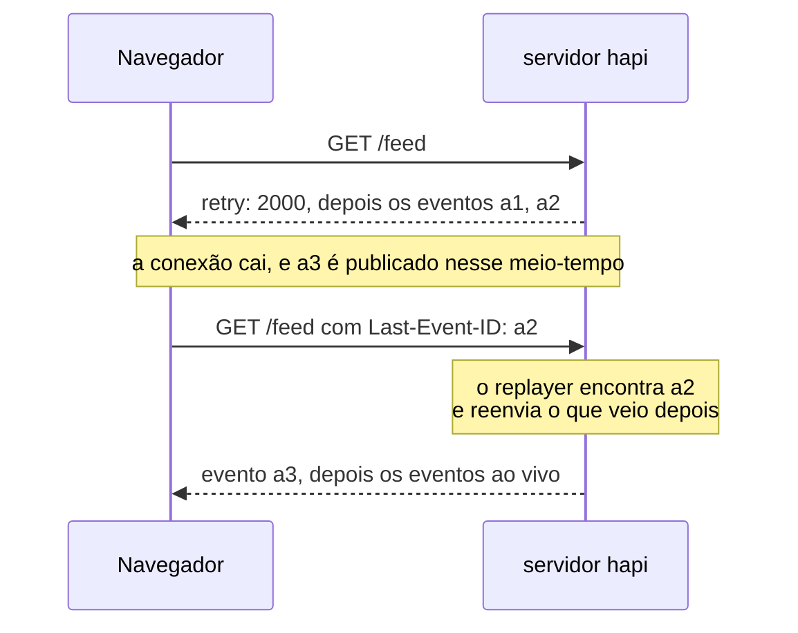
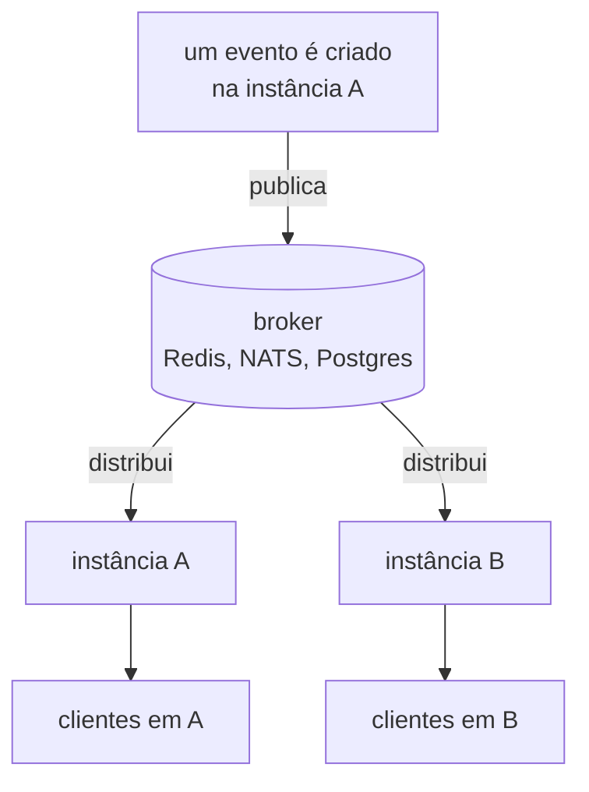

<TutorialLang />

# Server-Sent Events

_Este tutorial é compatível com o hapi v21 e versões mais recentes_

## <a name="overview"></a> Visão geral

Server-Sent Events (SSE) é uma forma de o servidor enviar um stream de eventos ao cliente por uma única resposta HTTP comum. O navegador abre o stream com a API nativa `EventSource`, que também reconecta sozinha quando a conexão cai. O [@hapi/sse](/module/sse) adiciona SSE ao hapi.

## <a name="when"></a> Quando usar SSE

|                             | SSE                                                     | [WebSockets](/tutorials/pt_BR/websockets)                                                      | Polling                                 |
| --------------------------- | ------------------------------------------------------- | ---------------------------------------------------------------------------------------------- | --------------------------------------- |
| Direção                     | só do servidor para o cliente                           | nos dois sentidos                                                                              | o cliente pergunta, o servidor responde |
| Transporte                  | uma resposta HTTP normal                                | um upgrade de protocolo                                                                        | requisições HTTP normais                |
| Reconexão                   | embutida no `EventSource`, retoma a partir do último id | o cliente do nes reconecta e refaz as assinaturas, mas as mensagens enviadas offline se perdem | não é necessária                        |
| Funciona através de proxies | sim, com o buffering desligado                          | o proxy precisa suportar upgrades                                                              | sim                                     |
| Latência                    | imediata                                                | imediata                                                                                       | até o intervalo de polling              |

Escolha SSE quando o servidor tem novidades e o cliente só escuta: progresso de jobs, notificações, dashboards ao vivo, acompanhamento de logs e a saída token a token de um modelo de IA. Quando o cliente também precisa enviar um fluxo constante de mensagens, use WebSockets. Um cliente que só envia de vez em quando pode usar SSE para o stream e requisições `POST` comuns para o resto.

## <a name="setup"></a> Configuração

```sh
npm install @hapi/sse
```

```ts
import Hapi from '@hapi/hapi';
import { SsePlugin } from '@hapi/sse';

const server = Hapi.server({ port: 3000 });

await server.register(SsePlugin);
```

O plugin oferece duas formas de abrir um stream:

| Uso                           | Modo handler: `handler: { sse: { stream } }`            | Assinaturas: `server.sse.subscription()`            |
| ----------------------------- | ------------------------------------------------------- | --------------------------------------------------- |
| Quem produz os eventos        | sua função `stream`, para aquela conexão                | qualquer código, por meio de `server.sse.publish()` |
| Stream típico                 | progresso de um job, uma resposta de IA, um log ao vivo | notificações, um feed ao vivo, uma sala de chat     |
| Eventos por conexão           | diferentes para cada cliente                            | o mesmo evento vai para todos os assinantes         |
| Retomada depois de reconectar | você lê `session.lastEventId` e continua                | um replayer reenvia o que o cliente perdeu          |

## <a name="handler"></a> Modo handler: um stream por requisição

Uma rota com o handler `sse` executa sua função `stream` uma vez por conexão. Tudo o que você envia com `push()` chega ao cliente na hora:

```ts
server.route({
    method: 'GET',
    path: '/jobs/{id}/progress',
    handler: {
        sse: {
            stream: async (request, session) => {
                for await (const update of watchJob(String(request.params.id))) {
                    session.push(update, 'progress', String(update.percent));
                }

                await session.complete();
            },
        },
    },
});
```

Cada `push(data, event, id)` vira um evento na conexão. Objetos são enviados como JSON:

```text
event: progress
id: 50
data: {"percent":50}
```

`complete()` envia um evento `complete` final e encerra a resposta. Encerrar a resposta não basta para parar o navegador, porque o `EventSource` trata toda conexão fechada como uma conexão que caiu e reconecta. O próprio cliente precisa fechar a conexão quando recebe `complete`:

```ts
const source = new EventSource('/jobs/7/progress');

source.addEventListener('progress', (event) => {
    const { percent } = JSON.parse(event.data);
    console.log(`${percent}%`);
});

source.addEventListener('complete', () => source.close());
```

Sem o `close()`, o navegador reconecta depois do intervalo `retry` e o stream começa de novo.

O Node.js não tem um `EventSource` global, a não ser que você o inicie com `--experimental-eventsource`. No Node, use essa flag ou o pacote [`eventsource`](https://www.npmjs.com/package/eventsource); o código do cliente é o mesmo do navegador.

## <a name="subscriptions"></a> Assinaturas: um evento para muitos clientes

Uma assinatura é uma rota à qual os clientes se conectam e na qual o seu código publica. O caminho pode ter parâmetros, então cada usuário ou sala ganha seu próprio stream:

```ts
import Joi from 'joi';

server.sse.subscription('/rooms/{room}/messages');

server.route<{ Params: { room: string }; Payload: { text: string } }>({
    method: 'POST',
    path: '/rooms/{room}/messages',
    options: {
        validate: {
            params: Joi.object({ room: Joi.string().alphanum().max(50).required() }),
            payload: Joi.object({ text: Joi.string().max(2000).required() }),
        },
    },
    handler: async (request, h) => {
        const message = { text: request.payload.text, at: new Date().toISOString() };
        const delivered = await server.sse.publish(`/rooms/${request.params.room}/messages`, message, {
            event: 'message',
            matchMode: 'literal',
        });

        return { delivered };
    },
});
```

- `matchMode: 'literal'` envia o evento só para os clientes daquele caminho exato, então uma mensagem postada em `/rooms/lobby/messages` chega ao lobby e a nenhuma outra sala. Veja [`server.sse.publish()`](/module/sse#server-sse-publish-path-data-opts).
- A rota publica só os campos que ela [validou](/tutorials/pt_BR/validation), nunca o payload bruto. Dê a ela a mesma [autenticação de rota](/tutorials/pt_BR/auth) de qualquer rota que grava dados.
- `publish()` retorna o número de clientes para os quais o evento foi entregue.

As assinaturas também aceitam `filter`, `onSubscribe`, `refuse` e `maxSessions`; veja [`server.sse.subscription()`](/module/sse#server-sse-subscription-path-config).

## <a name="reconnect"></a> Reconexões e `Last-Event-ID`

Quando uma conexão cai, o navegador espera o tempo de `retry` que o servidor enviou e então reconecta, mandando o id do último evento que recebeu em um header `Last-Event-ID`:



O navegador envia o header, mas só o seu servidor pode agir sobre ele, e os dois modos funcionam de forma diferente:

- **Assinaturas:** dê à assinatura um replayer, que guarda os eventos recentes em memória e reenvia tudo o que veio depois do último id do cliente. Um replayer mantém um único histórico para a assinatura inteira, compartilhado por todos os caminhos e todos os clientes, então use-o em assinaturas sem parâmetros no caminho, como um `/feed` público. Para streams por usuário ou por sala, retome a partir do seu banco de dados, como no modo handler.

    ```ts
    import { FiniteReplayer } from '@hapi/sse';

    server.sse.subscription('/feed', {
        replay: new FiniteReplayer({ size: 100 }),
    });

    await server.sse.publish('/feed', item, { event: 'news', id: item.id });
    ```

- **Modo handler:** leia `session.lastEventId` em `stream` e continue a partir dali, por exemplo consultando no banco as linhas mais novas que aquele id.

Se o último id do cliente não está mais no buffer, por exemplo depois de o servidor reiniciar, o replayer reenvia tudo o que tem guardado, então dê aos seus eventos ids que o cliente possa usar para descartar duplicados. [Event replay](/module/sse#event-replay) descreve o que cada replayer guarda. Os buffers de replay ficam na memória de um único processo; veja [Escalando entre instâncias](#scaling).

## <a name="disconnect"></a> Limpeza quando um stream termina

Um stream fica aberto até que um dos lados o feche, então tudo o que você inicia para uma conexão precisa parar quando o stream termina, seja porque o cliente saiu, porque o stream foi concluído ou porque o servidor está desligando:

```ts
import type { Session } from '@hapi/sse';

const openStreams = new Map<Session, () => void>();

server.route({
    method: 'GET',
    path: '/jobs/{id}/progress',
    handler: {
        sse: {
            stream: async (request, session) => {
                const watcher = watchJob(String(request.params.id));
                openStreams.set(session, () => watcher.stop());
                request.events.once('disconnect', () => watcher.stop());

                try {
                    for await (const update of watcher) {
                        session.push(update, 'progress', String(update.percent));
                    }

                    if (session.isOpen) {
                        await session.complete();
                    }
                } finally {
                    watcher.stop();
                    openStreams.delete(session);
                }
            },
        },
    },
});

server.ext('onPreStop', () => {
    for (const [session, stop] of openStreams) {
        stop();
        session.close();
    }
});
```

- **O cliente sai:** `request.events` emite `'disconnect'`, o que para o watcher e encerra o loop.
- **O stream termina no servidor:** o bloco `finally` roda, então o `Map` nunca guarda um stream encerrado.
- **O servidor desliga:** o [server hook](/tutorials/pt_BR/lifecycle-hooks#server-hooks) `onPreStop` para todos os watchers e fecha todos os streams, então `server.stop()` termina sem esperar esgotar o seu `timeout`.
- **Assinaturas:** use o `onUnsubscribe` da assinatura, ou o hook `onSessionClose` do plugin para todos os streams de assinatura. O plugin remove o cliente da assinatura sozinho.

## <a name="proxies"></a> Proxies, buffering e timeouts de inatividade

A maioria dos problemas de SSE em produção vem de algo entre o servidor e o navegador que segura os eventos ou fecha uma conexão parada. O plugin resolve parte disso:

| Problema                                                                  | O que o plugin faz                                        | O que você faz                                                                                    |
| ------------------------------------------------------------------------- | --------------------------------------------------------- | ------------------------------------------------------------------------------------------------- |
| Um proxy faz buffering da resposta e entrega os eventos em rajadas        | envia `X-Accel-Buffering: no` e `Cache-Control: no-cache` | desligue o buffering de resposta nos proxies que não respeitam esses headers                      |
| A compressão segura os eventos até acumular bytes suficientes             | faz flush do gzip e do deflate depois de cada escrita     | nada; os eventos chegam um a um mesmo com compressão                                              |
| Um balanceador de carga ou proxy fecha conexões inativas por tempo demais | envia uma linha de comentário `:` a cada 15 segundos      | mantenha `keepAlive.interval` abaixo do menor timeout de inatividade no caminho                   |
| Os navegadores permitem só 6 conexões HTTP/1.1 por domínio                | nada                                                      | sirva o site por HTTP/2, normalmente no proxy, para que os streams compartilhem uma única conexão |

## <a name="auth"></a> Autenticação

Um stream SSE é uma rota normal do hapi, então a [autenticação de rota](/tutorials/pt_BR/auth) de sempre se aplica, scopes incluídos. Para assinaturas, passe-a na opção `auth`:

```ts
server.sse.subscription('/users/{userId}/notifications', {
    auth: { strategy: 'session', access: { scope: 'user-{params.userId}' } },
});

await server.sse.publish(`/users/${userId}/notifications`, notification, {
    event: 'notification',
    matchMode: 'literal',
});
```

Com o scope `user-{params.userId}`, um usuário só consegue abrir o próprio stream de notificações; qualquer outra pessoa recebe um `403`. Veja [Scopes](/tutorials/pt_BR/auth#scopes). Publique com `matchMode: 'literal'` para que cada notificação chegue só ao stream do seu usuário.

O `EventSource` não consegue definir headers de requisição, então um bearer token em `Authorization` não é uma opção. As alternativas:

| Abordagem                              | Vantagem                                      | Cuidado com                                                                                                       |
| -------------------------------------- | --------------------------------------------- | ----------------------------------------------------------------------------------------------------------------- |
| Sessão por cookie, como `@hapi/cookie` | o navegador a envia, inclusive nas reconexões | streams cross-origin precisam de `new EventSource(url, { withCredentials: true })` e CORS com credenciais         |
| Token na query string                  | funciona com qualquer cliente                 | as URLs acabam nos access logs do servidor e do proxy; use um token de vida curta feito só para esse stream       |
| `fetch()` com um corpo em streaming    | pode enviar qualquer header                   | você perde a reconexão e o tratamento de `Last-Event-ID` do `EventSource` e precisa escrevê-los por conta própria |

Para uma aplicação de navegador no seu próprio domínio, um cookie é a opção mais simples.

## <a name="scaling"></a> Escalando entre instâncias

Duas instâncias do servidor não compartilham memória. Um stream SSE é uma conexão aberta mantida por um processo: um cliente conectado à instância A existe só em A, e a instância B não tem como escrever nele. Um evento publicado em A chega só aos clientes de A. Isso vale para toda biblioteca de SSE e todo provedor de hospedagem: cada processo só consegue escrever nas conexões que ele mesmo mantém.

Os clientes conectados, os buffers de replay e, por padrão, o registro dos streams concluídos ficam todos nessa memória de cada processo. Escalar horizontalmente exige troca de mensagens entre as instâncias. Um backend de pub/sub como Redis, NATS ou o `LISTEN`/`NOTIFY` do Postgres distribui cada evento para todas as instâncias, e cada instância o escreve nos seus próprios streams abertos:



Com Redis:

```ts
import { createClient } from 'redis';

interface RoomMessage {
    room: string;
    text: string;
    at: string;
}

const publisher = createClient({ url: process.env.REDIS_URL });
const subscriber = publisher.duplicate();
publisher.on('error', (err) => server.log(['redis', 'error'], err));
subscriber.on('error', (err) => server.log(['redis', 'error'], err));
await Promise.all([publisher.connect(), subscriber.connect()]);

await subscriber.subscribe('rooms', async (raw) => {
    const message: RoomMessage = JSON.parse(raw);
    await server.sse.publish(`/rooms/${message.room}/messages`, message, { event: 'message', matchMode: 'literal' });
});

const publishToRoom = async (message: RoomMessage) => {
    await publisher.publish('rooms', JSON.stringify(message));
};
```

A rota `POST` chama `publishToRoom()` em vez de `server.sse.publish()`, e todas as instâncias, inclusive a que tratou a requisição, publicam nos seus próprios streams.

- Com o broker no lugar, todas as instâncias publicam todos os eventos, então o replayer de cada instância guarda o mesmo histórico e um cliente que reconecta pode retomar em qualquer instância. Faltam só os eventos de antes de a instância iniciar, o que os ids seguros contra duplicados de [Reconexões](#reconnect) já cobrem.
- Aponte a opção `completion.cache` do plugin para um cache compartilhado, como o catbox-redis, para que um stream de assinatura concluído seja reconhecido em todas as instâncias.
- `maxDuration` fecha cada stream depois de um tempo definido (com jitter), e o cliente reconecta. Assim, streams de longa duração voltam a se distribuir depois que você adiciona instâncias, em vez de ficarem nas antigas.

## <a name="next"></a> Próximos passos

- [Referência da API do @hapi/sse](/module/sse): todas as opções, `Session`, replayers, [backpressure](/module/sse#backpressure) para clientes lentos e as [defesas de segurança embutidas](/module/sse#security).
- [WebSockets](/tutorials/pt_BR/websockets) quando o cliente também precisa enviar mensagens.
- [Lifecycle hooks](/tutorials/pt_BR/lifecycle-hooks) para o `onPreStop` e outros server hooks.
