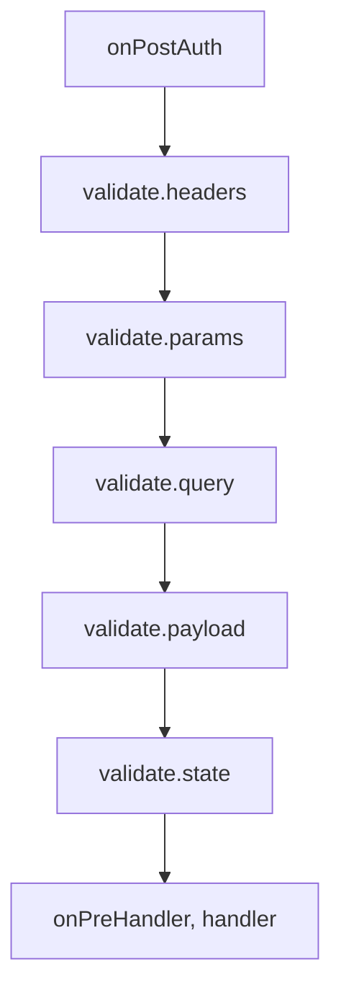

<TutorialLang />

# Validação

_Este tutorial é compatível com o hapi v21 e versões mais recentes, e com o joi v16 e versões mais recentes_

## <a name="overview"></a> Visão geral

O hapi verifica os headers, os parâmetros de caminho, a query, o payload e os cookies de uma requisição antes de o seu handler rodar, e pode verificar a resposta antes de ela ser enviada. Você descreve o que é permitido, normalmente com um schema do [joi](https://joi.dev), e o hapi rejeita todo o resto.

## <a name="joi"></a> Joi

Instale o joi e importe-o:

```sh
npm install joi
```

```ts
import Joi from 'joi';
```

O joi já inclui os próprios tipos TypeScript, então não há um pacote `@types` separado para instalar.

## <a name="input"></a> Validação de entrada

As regras de entrada ficam em `options.validate` da rota. O hapi as executa nesta ordem, depois da autenticação e antes do handler, e para na primeira que falhar (veja [failAction](#failaction)):



| Chave     | Valida                    | Substituído em caso de sucesso |
| --------- | ------------------------- | ------------------------------ |
| `headers` | `request.headers`         | `request.headers`              |
| `params`  | `request.params`          | `request.params`               |
| `query`   | `request.query`           | `request.query`                |
| `payload` | `request.payload`         | `request.payload`              |
| `state`   | `request.state` (cookies) | `request.state`                |

Cada chave aceita:

| Valor                                | Significado                                                                                    |
| ------------------------------------ | ---------------------------------------------------------------------------------------------- |
| `true` ou não definido (padrão)      | qualquer coisa é permitida                                                                     |
| `false`                              | nenhum valor é permitido                                                                       |
| um schema do joi                     | o valor precisa corresponder ao schema                                                         |
| uma função                           | seu próprio validador, veja [Validadores próprios](#alternatives)                              |
| um objeto simples com schemas do joi | permitido só depois de `server.validator(Joi)`; caso contrário, `server.route()` lança um erro |

A validação substitui o valor da requisição pelo valor validado, então as conversões de tipo e os valores padrão do joi chegam ao seu handler. Uma query `?limit=5` chega como a string `'5'`, e depois de `Joi.number()` o handler vê o número `5`. O valor original fica em [`request.orig`](/api#request-orig).

### <a name="pathparams"></a> Parâmetros de caminho

```ts
server.route<{ Params: { name: string } }>({
    method: 'GET',
    path: '/hello/{name}',
    handler: (request, h) => {
        return `Hello ${request.params.name}!`;
    },
    options: {
        validate: {
            params: Joi.object({
                name: Joi.string().min(3).max(10),
            }),
        },
    },
});
```

`/hello/jennifer` responde `Hello jennifer!`. `/hello/a` e `/hello/thisnameiswaytoolong` respondem:

```json
{
    "statusCode": 400,
    "error": "Bad Request",
    "message": "Invalid request params input"
}
```

### <a name="queryparams"></a> Parâmetros de query

```ts
server.route<{ Query: { limit: number } }>({
    method: 'GET',
    path: '/posts',
    handler: (request, h) => {
        return posts.slice(0, request.query.limit);
    },
    options: {
        validate: {
            query: Joi.object({
                limit: Joi.number().integer().min(1).max(100).default(10),
            }),
        },
    },
});
```

- `limit` precisa ser um inteiro de 1 a 100, e assume 10 quando o cliente não o envia.
- `/posts?limit=15&offset=15` falha com `400`: um schema `Joi.object()` rejeita as chaves que não lista. Liste todos os parâmetros que você aceita, ou adicione `.unknown()` ao schema para deixar outras chaves passarem.
- O argumento de tipo `Query: { limit: number }` informa ao TypeScript o que o handler recebe. O hapi não o infere a partir do schema do joi, então mantenha os dois sincronizados você mesmo.

### <a name="payloadparams"></a> Payload

```ts
server.route({
    method: 'POST',
    path: '/post',
    handler: (request, h) => {
        return 'Blog post added';
    },
    options: {
        validate: {
            payload: Joi.object({
                post: Joi.string().min(1).max(140),
                date: Joi.date().required(),
            }),
        },
    },
});
```

`post` precisa ter de 1 a 140 caracteres, e `date` é obrigatório e precisa ser algo que o JavaScript consiga interpretar como data, como `'2026-10-25'`. O joi faz a conversão, então o handler recebe um objeto `Date`. Uma falha responde `400` com a mensagem `Invalid request payload input`.

### <a name="headers"></a> Headers

```ts
server.route({
    method: 'GET',
    path: '/hello/{name}',
    handler: (request, h) => {
        return `Hello ${request.params.name}!`;
    },
    options: {
        validate: {
            headers: Joi.object({
                cookie: Joi.string().required(),
            }),
            options: {
                allowUnknown: true,
            },
        },
    },
});
```

Navegadores e proxies adicionam muitos headers, então schemas de headers quase sempre precisam de `allowUnknown: true`. `validate.options` passa opções do joi para todos os schemas de entrada da rota. Os nomes dos headers ficam em minúsculas em `request.headers`, então escreva-os em minúsculas no schema.

### <a name="failaction"></a> Quando a validação falha

`validate.failAction` decide o que acontece:

| `failAction`       | Resultado                                                                                           |
| ------------------ | --------------------------------------------------------------------------------------------------- |
| `'error'` (padrão) | `400` com uma mensagem genérica como `Invalid request query input`                                  |
| `'log'`            | registra um evento `request` com as tags `validation`, `error` e a origem, depois executa o handler |
| `'ignore'`         | executa o handler                                                                                   |
| uma função         | `(request, h, err)`: lance um erro ou retorne uma resposta de takeover                              |

Com `'log'` e `'ignore'` o handler recebe o valor original, sem validação: `?limit=500` chega como a string `'500'`, e não como número.

O `400` padrão esconde qual campo falhou, para que os clientes não consigam sondar seus schemas. Durante o desenvolvimento, ou em uma API em que os clientes precisam dos detalhes, relance o erro detalhado a partir de uma função `failAction`:

```ts
server.route({
    method: 'GET',
    path: '/posts',
    handler: (request, h) => posts,
    options: {
        validate: {
            query: Joi.object({
                limit: Joi.number().integer().max(100),
            }),
            failAction: (request, h, err) => {
                throw err;
            },
        },
    },
});
```

Agora `/posts?limit=500` responde com a mensagem do joi e as chaves que falharam:

```json
{
    "statusCode": 400,
    "error": "Bad Request",
    "message": "\"limit\" must be less than or equal to 100",
    "validation": { "source": "query", "keys": ["limit"] }
}
```

Para aplicar um mesmo `failAction` a todas as rotas, defina-o na opção `routes.validate` do servidor. Veja [`failAction`](/api#failaction-configuration) na referência da API.

## <a name="output"></a> Validação de resposta

`options.response` verifica o que o handler retorna, depois do handler e antes do `onPreResponse`. Use-a para garantir que um endpoint segue o contrato documentado. Plugins como o [hapi-swagger](https://github.com/glennjones/hapi-swagger) também leem esses schemas para documentar a saída de cada endpoint.

```ts
const bookSchema = Joi.object({
    title: Joi.string().required(),
    author: Joi.string().required(),
    isbn: Joi.string().length(10),
    pageCount: Joi.number(),
    datePublished: Joi.date().iso(),
});

server.route({
    method: 'GET',
    path: '/books',
    handler: async (request, h) => {
        return await getBooks();
    },
    options: {
        response: {
            schema: Joi.array().items(bookSchema),
            failAction: 'log',
        },
    },
});
```

| Opção        | O que faz                                                                                                      |
| ------------ | -------------------------------------------------------------------------------------------------------------- |
| `schema`     | regra para todas as respostas, com os mesmos valores das regras de entrada                                     |
| `status`     | regras por status code, como `{ 201: created, 202: Joi.object({ original, updated }) }`; sobrescreve `schema`  |
| `failAction` | `'error'` (padrão) responde `500`; também aceita `'log'`, `'ignore'` ou uma função                             |
| `sample`     | porcentagem das respostas a validar, de `0` a `100`, para economizar CPU em rotas com muito tráfego            |
| `modify`     | quando `true`, o valor validado substitui a resposta, então as conversões do joi e o `stripUnknown` se aplicam |
| `options`    | opções do joi para esses schemas, como `stripUnknown`                                                          |

O que a validação de resposta ignora ou rejeita:

- Respostas de erro (status `400` ou maior) não são validadas, a menos que `status` tenha um schema para aquele código.
- Só valores simples (objetos, arrays, strings) podem ser validados. Uma resposta de stream ou de arquivo com um schema de resposta falha com `500`.

`modify: true` com `stripUnknown: true` é uma forma prática de evitar que campos como hashes de senha vazem de um endpoint:

```ts
server.route({
    method: 'GET',
    path: '/me',
    handler: (request, h) => {
        return { id: '2133d32a', name: 'John Doe', passwordHash: '$2a$10$...' };
    },
    options: {
        response: {
            schema: Joi.object({
                id: Joi.string(),
                name: Joi.string(),
            }).options({ stripUnknown: true }),
            modify: true,
        },
    },
});
```

O cliente recebe `{ "id": "2133d32a", "name": "John Doe" }`.

## <a name="alternatives"></a> Validadores próprios

Qualquer regra pode ser uma função `async (value, options)` em vez de um schema do joi:

- Lance um erro para reprovar a validação. O `failAction` trata o erro.
- Retorne um valor para substituir o que está sendo validado. O original fica em `request.orig`.
- Não retorne nada para manter o valor como está.

```ts
server.route({
    method: 'GET',
    path: '/items',
    handler: (request, h) => request.query,
    options: {
        validate: {
            query: async (value) => {
                if (typeof value !== 'object' || value === null || !('ids' in value) || typeof value.ids !== 'string') {
                    throw new Error('ids is required');
                }

                return { ids: value.ids.split(',') };
            },
        },
    },
});
```

`/items?ids=1,2,3` responde `{ "ids": ["1", "2", "3"] }`. Um erro lançado vira um `400`, assim como uma falha do joi.
