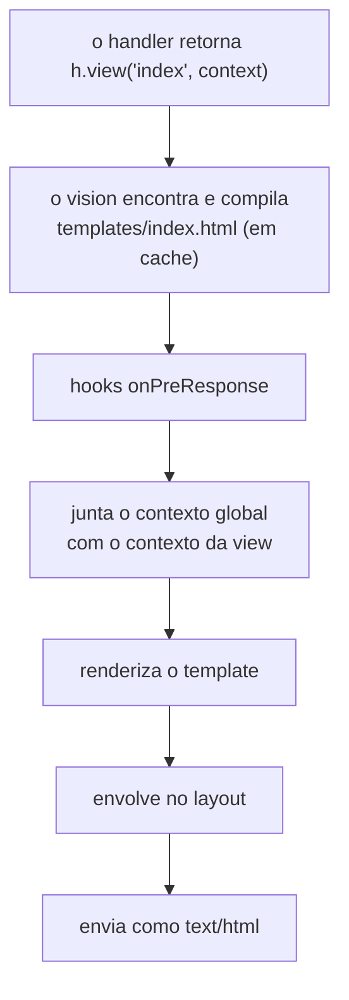

<TutorialLang />

# Views

_Este tutorial é compatível com o hapi v21 e versões mais recentes_

## <a name="overview"></a> Visão geral

O hapi renderiza templates HTML por meio do plugin [vision](/module/vision). O vision funciona com qualquer template engine que tenha uma função `compile`, incluindo handlebars, pug e ejs (engines com um `compile` diferente, como o nunjucks, precisam do pequeno wrapper descrito em [Engines](#engines)), e suporta partials, helpers e layouts.

## <a name="vision"></a> Vision

Instale o vision e uma engine:

```sh
npm install @hapi/vision handlebars
```

Registrar o vision adiciona:

| O quê                                 | Use para                                                           |
| ------------------------------------- | ------------------------------------------------------------------ |
| `server.views(options)`               | configurar engines, pastas de templates e layouts                  |
| `h.view(template, context)`           | renderizar um template a partir de um handler                      |
| handler `view`                        | uma rota que só renderiza um template                              |
| `server.render()`, `request.render()` | renderizar um template para uma string, por exemplo para um e-mail |

Importar `@hapi/vision` também adiciona esses recursos aos tipos TypeScript do hapi. A API completa está na [referência da API do vision](/module/vision).

## <a name="server"></a> Configurando o servidor

```ts
import Hapi from '@hapi/hapi';
import Vision from '@hapi/vision';
import Handlebars from 'handlebars';

const server = Hapi.server({ port: 3000 });

await server.register(Vision);

server.views({
    engines: {
        html: Handlebars,
    },
    relativeTo: import.meta.dirname,
    path: 'templates',
});

server.route({
    method: 'GET',
    path: '/',
    handler: (request, h) => {
        return h.view('index', { title: 'My home page' });
    },
});

await server.start();
```

- `engines` associa uma extensão de arquivo a uma engine: arquivos terminados em `.html` são renderizados com handlebars.
- `path` é a pasta que guarda os templates, resolvida a partir de `relativeTo`. Módulos ES não têm `__dirname`; `import.meta.dirname` é a pasta do arquivo atual.
- `h.view('index', ...)` renderiza `templates/index.html`. Com uma única engine registrada, você pode omitir a extensão.

### <a name="lifecycle"></a> Como uma view é renderizada

`h.view()` não renderiza nada na hora. Ele retorna uma resposta de view, e o vision a renderiza enquanto o hapi envia a resposta:



O que essa ordem significa na prática:

- Um template inexistente falha com `500` assim que o handler retorna, antes de qualquer hook `onPreResponse`.
- Um hook `onPreResponse` roda antes da renderização, então ainda pode substituir uma view por outra resposta, como uma página de erro. Veja [Páginas de erro](#errors) abaixo.
- [Marshalling de respostas](/tutorials/pt_BR/response-marshalling) explica essa divisão entre prepare e render para todos os tipos de resposta.

## <a name="options"></a> Opções de server.views()

| Opção                 | Padrão                | Efeito                                                                       |
| --------------------- | --------------------- | ---------------------------------------------------------------------------- |
| `engines`             | obrigatório           | extensão para engine, como `{ html: Handlebars, pug: Pug }`                  |
| `path`                | nenhum                | pasta (ou array de pastas) com os templates                                  |
| `relativeTo`          | diretório de trabalho | pasta base para todas as outras opções de caminho                            |
| `partialsPath`        | nenhum                | pasta com os partials                                                        |
| `helpersPath`         | nenhum                | pasta com os módulos de helpers                                              |
| `layout`              | `false`               | `true` para usar `layout.html`, ou o nome de outro arquivo de layout         |
| `layoutPath`          | nenhum                | pasta com os layouts                                                         |
| `context`             | nenhum                | contexto incluído em todas as views; um objeto ou uma função da requisição   |
| `isCached`            | `true`                | `false` lê e compila os templates a cada requisição; útil em desenvolvimento |
| `defaultExtension`    | a única engine        | extensão usada quando `h.view()` recebe um nome sem extensão                 |
| `compileMode`         | `'sync'`              | `'async'` para engines cujo `compile` recebe um callback                     |
| `allowAbsolutePaths`  | `false`               | permite nomes de template absolutos                                          |
| `allowInsecureAccess` | `false`               | permite `../` nos nomes de template                                          |

As opções definidas em `server.views()` se aplicam a todas as engines:

```ts
server.views({
    engines: { html: Handlebars },
    relativeTo: import.meta.dirname,
    path: 'templates',
    isCached: process.env.NODE_ENV === 'production',
});
```

Aqui os templates são carregados de `templates/`, e fora de produção o vision os lê e compila de novo a cada requisição, então as alterações nos templates aparecem sem reiniciar o servidor.

### <a name="engines"></a> Engines

Uma engine é qualquer objeto com uma função `compile`:

| `compileMode`     | Assinatura de `compile`                       | Retorna                                                                                                |
| ----------------- | --------------------------------------------- | ------------------------------------------------------------------------------------------------------ |
| `'sync'` (padrão) | `compile(template, compileOptions)`           | `render(context, runtimeOptions)`, que retorna o HTML                                                  |
| `'async'`         | `compile(template, compileOptions, callback)` | chama `callback(err, render)`; `render(context, runtimeOptions, callback)` chama `callback(err, html)` |

`compileOptions` e `runtimeOptions` são opções de `server.views()` repassadas para a sua engine. Uma engine cuja API não corresponde pode ser envolvida em um objeto com essa função `compile`.

Com mais de uma engine registrada, `h.view()` precisa da extensão (`h.view('index.pug')`), a menos que você defina `defaultExtension` com a que mais usa.

### <a name="paths"></a> Caminhos

Com esta estrutura de pastas:

```
templates/
    index.html
    layout/
        layout.html
    helpers/
        fortune.js
```

a configuração é:

```ts
server.views({
    engines: {
        html: Handlebars,
    },
    relativeTo: import.meta.dirname,
    path: 'templates',
    layoutPath: 'templates/layout',
    helpersPath: 'templates/helpers',
});
```

### <a name="global"></a> Contexto global

`context` é incluído no contexto de todas as views, e o contexto da própria view prevalece quando os dois definem a mesma chave. Passe uma função para calculá-lo por requisição, por exemplo para mostrar o usuário logado em todas as páginas:

```ts
server.views({
    engines: {
        html: Handlebars,
    },
    relativeTo: import.meta.dirname,
    path: 'templates',
    context: (request) => ({
        siteName: 'My personal site',
        user: request?.auth.credentials?.user ?? null,
    }),
});
```

`request` é undefined quando você renderiza fora de uma requisição com `server.render()`, e é por isso que a função o verifica.

### <a name="helpers"></a> Helpers de view

Em engines que suportam helpers, como o handlebars, cada módulo em `helpersPath` vira um helper com o nome do arquivo. Este helper, salvo como `templates/helpers/fortune.js`, retorna uma frase da sorte aleatória:

```js
export default function () {
    const fortunes = [
        'Heisenberg may have slept here...',
        'Wanna buy a duck?',
        'Say no, then negotiate.',
        'Time and tide wait for no man.',
        'To teach is to learn.',
        'Never ask the barber if you need a haircut.',
        'You will forget that you ever knew me.',
        'You will be run over by a beer truck.',
        'Fortune favors the lucky.',
        'Have a nice day!',
    ];

    const x = Math.floor(Math.random() * fortunes.length);
    return fortunes[x];
}
```

Os helpers continuam sendo arquivos JavaScript: o vision os carrega com `require()` e ignora qualquer arquivo cuja extensão o Node.js não registrou em `require.extensions`, o que não inclui `.ts`.

Use-o em `templates/index.html`:

```html
<h1>Your fortune</h1>
<p>{{fortune}}</p>
```

### <a name="layouts"></a> Layouts

Os layouts do vision vêm desativados por padrão, porque muitas engines têm o próprio sistema de layouts. Use um ou outro. Para ativar os do vision:

```ts
server.views({
    engines: {
        html: Handlebars,
    },
    relativeTo: import.meta.dirname,
    path: 'templates',
    layout: true,
    layoutPath: 'templates/layout',
});
```

`templates/layout/layout.html` marca com `content` onde cada view entra:

```html
<html>
    <body>
        {{{content}}}
    </body>
</html>
```

e uma view contém só a sua parte:

```html
<div>Content</div>
```

| Para                           | Faça                                                      |
| ------------------------------ | --------------------------------------------------------- |
| usar outro layout padrão       | `layout: 'another_default'` em `server.views()`           |
| usar outro layout em uma view  | `h.view('myview', context, { layout: 'another_layout' })` |
| renderizar uma view sem layout | `h.view('myview', context, { layout: false })`            |

Seu contexto não pode ter uma chave `content` enquanto os layouts estiverem ativos; o vision usa esse nome para a view renderizada e falha com `500`. Mude o nome com a opção `layoutKeyword`.

## <a name="render"></a> Renderizando uma view

### <a name="hview"></a> h.view()

Use [`h.view()`](/module/vision#h-view-template-context-options) quando o handler tem trabalho a fazer antes, como carregar dados:

```ts
server.route({
    method: 'GET',
    path: '/',
    handler: (request, h) => {
        return h.view('index', { title: 'My home page' });
    },
});
```

`h.view()` retorna um objeto de resposta comum, então você pode encadear `.code()`, `.header()` e os outros métodos do [objeto de resposta](/api#response-object).

### <a name="viewhandler"></a> Handler de view

Quando uma rota só renderiza um template, use o handler `view`:

```ts
server.route({
    method: 'GET',
    path: '/',
    handler: {
        view: {
            template: 'index',
            context: {
                title: 'My home page',
            },
        },
    },
});
```

`handler: { view: 'index' }` é a forma curta. O handler de view sempre adiciona `params`, `payload`, `query` e `pre` ao contexto, então um template em `/users/{id}` pode exibir `params.id` sem nenhum código no handler.

## <a name="errors"></a> Páginas de erro

O hapi responde aos erros com JSON. Um site que renderiza HTML normalmente quer uma página de erro em HTML. Como a renderização acontece depois do `onPreResponse`, um hook nesse ponto pode trocar qualquer erro por uma view:

```ts
import Boom from '@hapi/boom';

server.ext('onPreResponse', (request, h) => {
    const response = request.response;
    if (!Boom.isBoom(response)) {
        return h.continue;
    }

    const { statusCode, payload } = response.output;

    return h.view('error', { statusCode, message: payload.message }).code(statusCode);
});
```

Agora uma requisição para uma página inexistente recebe `templates/error.html`, renderizado dentro do layout, com status `404`. O hook também pega os erros lançados pelos handlers e as falhas de validação. Veja [Lifecycle hooks](/tutorials/pt_BR/lifecycle-hooks) para saber mais sobre o `onPreResponse`.
