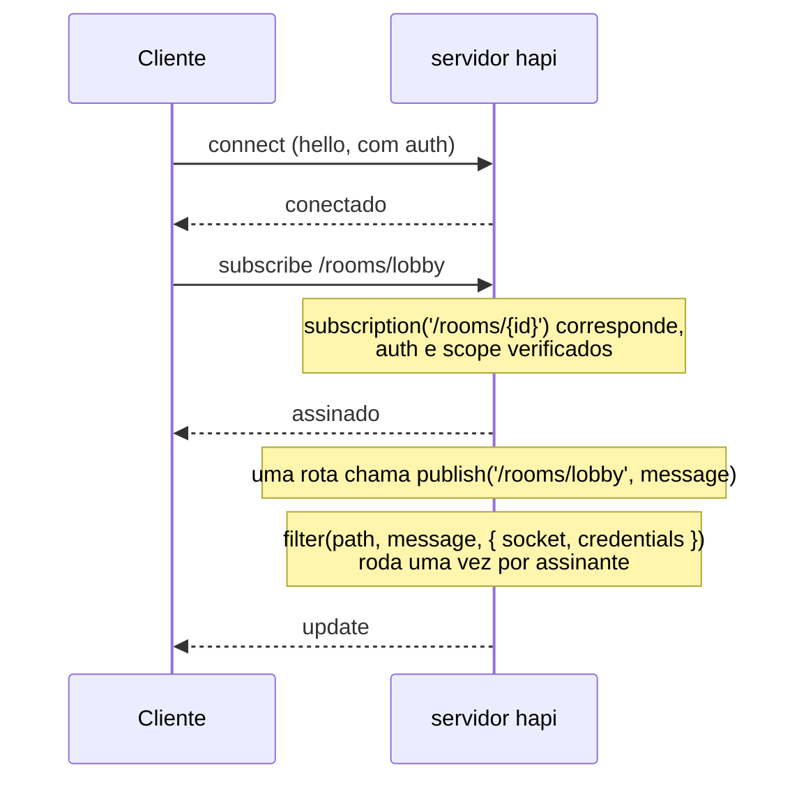
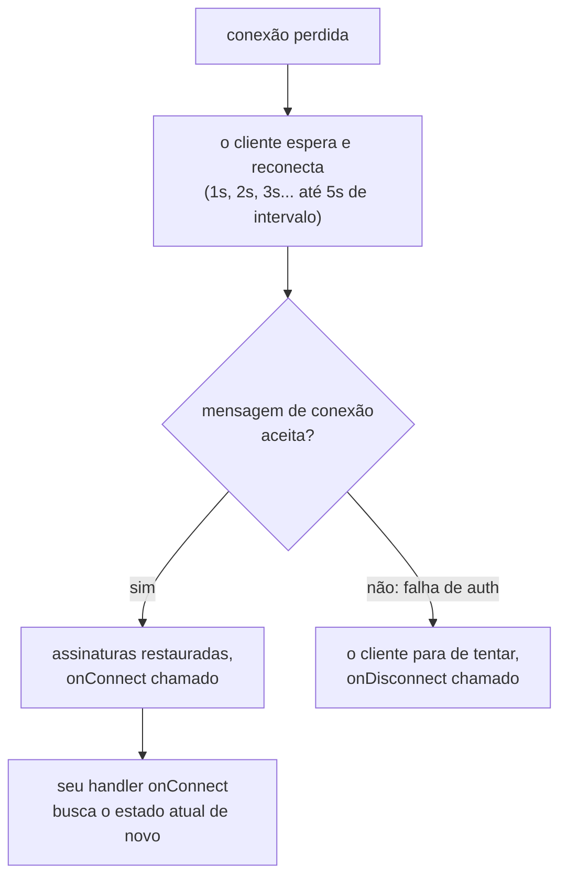
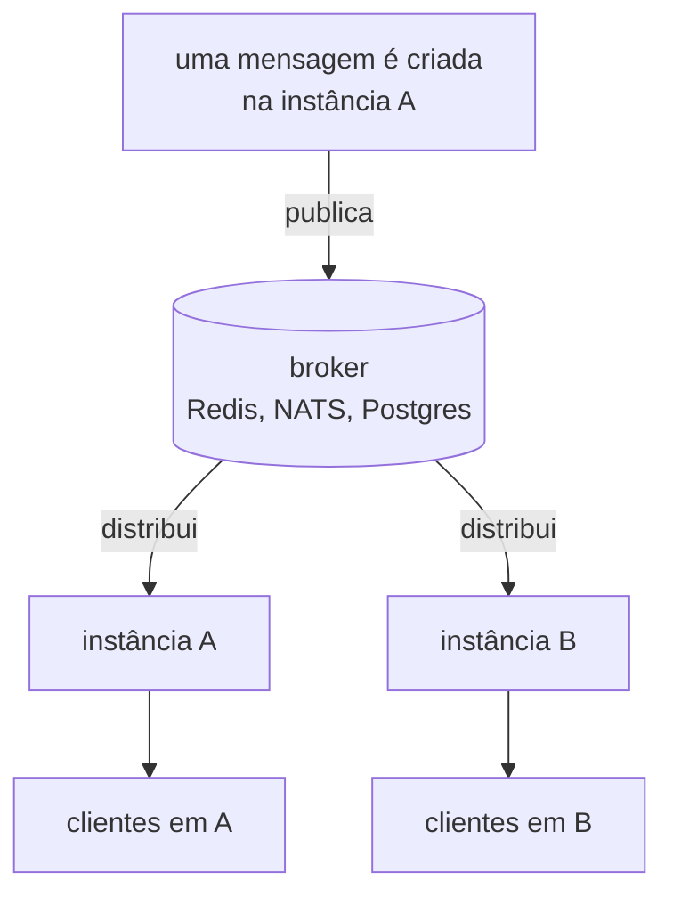

<TutorialLang />

# WebSockets

_Este tutorial é compatível com o hapi v21 e versões mais recentes_

## <a name="overview"></a> Visão geral

O [@hapi/nes](/module/nes) adiciona um endpoint WebSocket a um servidor hapi. Um cliente conectado pode fazer três coisas por esse único socket:

- **Chamar suas rotas.** `client.request()` executa uma rota normal do hapi, com sua validação, scopes de autenticação e handler, e devolve a resposta pelo socket.
- **Assinar atualizações.** O cliente assina um caminho como `/rooms/lobby`, e o servidor publica nele.
- **Receber envios do servidor.** O servidor manda uma mensagem para um socket ou faz broadcast para todos eles.

## <a name="when"></a> Quando usar WebSockets

| Abordagem                                  | Direção                                 | Bom para                                                                                    |
| ------------------------------------------ | --------------------------------------- | ------------------------------------------------------------------------------------------- |
| Polling de uma rota normal                 | o cliente pergunta, o servidor responde | atualizações a cada poucos minutos, ou quando tempo real não acrescenta nada                |
| [Server-Sent Events](/tutorials/pt_BR/sse) | só do servidor para o cliente           | feeds ao vivo, progresso, notificações; HTTP comum, funciona através da maioria dos proxies |
| WebSockets com nes                         | nos dois sentidos, uma conexão          | chat, colaboração, jogos: os clientes enviam com frequência e esperam respostas do servidor |

Se o cliente só escuta, SSE é mais simples de operar. Escolha WebSockets quando o cliente também envia com frequência, ou quando você quer uma única conexão para requisições e atualizações, o que faz diferença em redes móveis.

## <a name="setup"></a> Configuração

```sh
npm install @hapi/nes
```

Um servidor de sala de chat: as mensagens são postadas por uma rota, todos os assinantes da sala as recebem, e uma segunda rota retorna o histórico recente.

```ts
import Hapi from '@hapi/hapi';
import Joi from 'joi';
import Nes from '@hapi/nes';

interface ChatMessage {
    room: string;
    text: string;
    at: string;
}

const history = new Map<string, ChatMessage[]>();

const server = Hapi.server({ port: 4000 });

await server.register(Nes);

server.subscription('/rooms/{id}');

const roomParams = Joi.object({ id: Joi.string().alphanum().max(50).required() });

server.route<{ Params: { id: string }; Payload: { text: string } }>({
    method: 'POST',
    path: '/rooms/{id}/messages',
    options: {
        validate: {
            params: roomParams,
            payload: Joi.object({ text: Joi.string().max(2000).required() }),
        },
    },
    handler: (request, h) => {
        const message: ChatMessage = {
            room: request.params.id,
            text: request.payload.text,
            at: new Date().toISOString(),
        };

        const messages = history.get(message.room) ?? [];
        history.set(message.room, [...messages, message].slice(-50));

        server.publish(`/rooms/${message.room}`, message);
        return h.response(message).code(201);
    },
});

server.route<{ Params: { id: string } }>({
    method: 'GET',
    path: '/rooms/{id}/messages',
    options: { validate: { params: roomParams } },
    handler: (request, h) => history.get(request.params.id) ?? [],
});

await server.start();
```

O nes escuta na mesma porta das suas rotas HTTP. As rotas também funcionam por HTTP comum, então outros serviços podem postar em uma sala sem abrir um socket. A rota `POST` publica só os campos que ela [validou](/tutorials/pt_BR/validation), nunca o payload bruto.

O cliente no Node.js:

```ts
import Nes from '@hapi/nes';

const client = new Nes.Client('ws://localhost:4000');
await client.connect();

await client.subscribe('/rooms/lobby', (message) => {
    console.log('lobby:', message);
});

await client.request({ method: 'POST', path: '/rooms/lobby/messages', payload: { text: 'hello' } });
```

No navegador, importe o arquivo do cliente sozinho para que o seu bundle não traga junto o plugin do servidor:

```ts
import { Client } from '@hapi/nes/lib/client.js';

const client = new Client(`wss://${location.host}`);
await client.connect();
```

Os handlers de assinatura recebem a mensagem como `unknown`. O servidor pode publicar qualquer coisa, então verifique o formato antes de usá-la, do mesmo jeito que faria com a resposta de um `fetch()`.

## <a name="requests"></a> Chamando rotas pelo socket

`client.request()` passa a rota por todo o [ciclo de vida da requisição](/api#request-lifecycle) do hapi: validação, scopes de `auth.access`, extensões e o handler. O nes faz isso com [`server.inject()`](/api#await-server-inject-options), passando as credenciais com que o socket se autenticou ao conectar. As opções da requisição e o formato da resposta estão em [`client.request()`](/module/nes#await-client-request-options).

Dentro do handler, `request.socket` é o socket do nes nas requisições feitas pelo socket, e `null` nas requisições HTTP normais, então verifique-o antes de usar.

Use requisições pelo socket quando o cliente já tem uma conexão aberta e você quer evitar uma segunda ida e volta HTTP. Para uma página que na maior parte do tempo só escuta, requisições HTTP normais mais uma assinatura são mais fáceis de depurar.

## <a name="push"></a> Enviando atualizações

O nes oferece três formas de mandar uma mensagem para os clientes:

| Método                          | Quem recebe                                   | Use para                                                  |
| ------------------------------- | --------------------------------------------- | --------------------------------------------------------- |
| `server.publish(path, message)` | sockets que assinam um caminho correspondente | quase tudo: salas, documentos, feeds                      |
| `socket.send(message)`          | um socket                                     | respostas e avisos por conexão                            |
| `server.broadcast(message)`     | todos os sockets conectados                   | casos raros: avisos de manutenção, recarregamento forçado |

Assinaturas costumam ser o que você quer, porque o cliente diz o que lhe interessa e o servidor envia só isso.



Um `filter` de assinatura decide, por socket, se a atualização é enviada. Passe em `internal` os dados de que o filtro precisa mas que o cliente não deve ver:

```ts
server.subscription('/documents/{id}', {
    filter: (path, message, options) => {
        return options.internal === options.credentials?.id;
    },
});

server.publish('/documents/42', { title: 'Q3 plan' }, { internal: '2133d32a' });
```

Só o dono do documento recebe a atualização, e o id do dono nunca chega a um cliente. O filtro compara com `credentials.id`, que a [strategy bearer](/tutorials/pt_BR/auth#jwt) do tutorial [Autenticação](/tutorials/pt_BR/auth) define.

O filtro roda para cada assinante a cada publicação, então limite-o a verificações em memória. Para mudar o que cada usuário vê, o filtro pode retornar `{ override: message }` em vez de `true`.

## <a name="auth"></a> Autenticação

O nes não tem autenticação própria. Ele reaproveita as suas [strategies de autenticação](/tutorials/pt_BR/auth) do hapi: o socket se autentica ao conectar, e toda requisição e assinatura feita nesse socket usa essas credenciais.

A opção `auth.type` do plugin decide como o cliente prova quem é:

| `auth.type`         | Como o cliente se autentica                                                                                                          | Indicado para                                                |
| ------------------- | ------------------------------------------------------------------------------------------------------------------------------------ | ------------------------------------------------------------ |
| `'direct'` (padrão) | envia headers de autenticação HTTP normais dentro da mensagem de conexão: `client.connect({ auth: { headers: { authorization } } })` | APIs com bearer tokens ou basic auth                         |
| `'token'`           | chama `GET /nes/auth` por HTTP primeiro, recebe um token selado e o passa para `client.connect({ auth: token })`                     | clientes que não podem depender de cookies, como apps mobile |
| `'cookie'`          | chama `GET /nes/auth` por HTTP primeiro, o que define um cookie criptografado que o navegador envia no upgrade do WebSocket          | aplicações de navegador que já usam sessões por cookie       |

Com `'direct'`, o nes passa os headers pela strategy em `auth.route`, ou pela [strategy padrão](/tutorials/pt_BR/auth#default) do servidor quando `auth.route` não está definido. Com a [strategy bearer](/tutorials/pt_BR/auth#jwt) do tutorial [Autenticação](/tutorials/pt_BR/auth) como padrão:

```ts
const client = new Nes.Client('wss://api.example.com');
await client.connect({ auth: { headers: { authorization: `Bearer ${token}` } } });
```

- **Conectar sem credenciais.** Se o mode da strategy de autenticação é `'required'`, um cliente que conecta sem `auth` é rejeitado com `Connection requires authentication`. Caso contrário, ele conecta sem autenticação, e só as rotas e assinaturas que exigem autenticação o recusam.
- **Tokens que expiram.** A strategy do `@hapi/jwt` verifica o token de novo enquanto o socket está aberto, no máximo uma vez a cada `auth.minAuthVerifyInterval` (por padrão, o intervalo de heartbeat). Quando o token expira, o servidor fecha o socket, a reconexão do cliente é rejeitada com `Token maximum age exceeded` e o cliente para de tentar. Envie um token novo antes que o antigo expire:

    ```ts
    await client.reauthenticate({ headers: { authorization: `Bearer ${freshToken}` } });
    ```

    Strategies cujo scheme não tem um método `verify()` mantêm as credenciais do momento da conexão durante toda a vida do socket.

- **Protegendo assinaturas.** Uma assinatura sem opções `auth` usa a strategy padrão e o mode dela, mas não os scopes do `access` padrão. Esses continuam protegendo as requisições pelo socket. Dê a cada assinatura protegida o seu próprio `auth.scope`, que aceita qualquer um dos scopes listados; os prefixos `+` e `!` que os [scopes de rota](/tutorials/pt_BR/auth#scopes) suportam não estão disponíveis.
- **Defina `auth.password` para `'token'` e `'cookie'`.** Sem ele, o nes escolhe uma senha aleatória quando o processo inicia, então tokens e cookies param de funcionar depois de um restart, e uma instância não consegue ler o que outra instância selou.
- **Defina `origin` com autenticação por cookie.** Upgrades de WebSocket não passam por verificação de CORS, e subdomínios irmãos contam como o mesmo site, então o `SameSite=Strict` do cookie do nes não os impede. `origin` recusa upgrades vindos de qualquer outra origem, inclusive de clientes que não enviam o header `Origin`, como o cliente Node.js acima.

```ts
import Hapi from '@hapi/hapi';
import Nes from '@hapi/nes';

import type { Nes as NesTypes } from '@hapi/nes';

const cookiePassword = process.env.NES_COOKIE_PASSWORD;
if (!cookiePassword || cookiePassword.length < 32) {
    throw new Error('NES_COOKIE_PASSWORD must be set to at least 32 characters');
}

const server = Hapi.server({ port: 4000 });

const nesOptions = {
    auth: { type: 'cookie', password: cookiePassword } satisfies NesTypes.PluginOptions['auth'],
    origin: ['https://app.example.com'],
};

await server.register({ plugin: Nes, options: nesOptions });
```

## <a name="reconnect"></a> Reconexões e atualizações perdidas

Redes móveis derrubam conexões com frequência, e o cliente reconecta sozinho:



- O cliente continua tentando com os intervalos acima até reconectar, a menos que você limite `retries` em `client.connect()`.
- Ao reconectar, o cliente reenvia suas assinaturas, então seus handlers continuam funcionando sem nenhum código extra.
- **As atualizações publicadas enquanto o cliente estava desconectado se perdem.** O nes não as enfileira. Se perder uma atualização importa, carregue o estado atual em `onConnect`:

```ts
const refreshRoom = async (room: string) => {
    const { payload } = await client.request<ChatMessage[]>(`/rooms/${room}/messages`);
    render(payload);
};

client.onConnect = () => {
    refreshRoom('lobby').catch((err) => console.error('Could not refresh the room', err));
};
```

- O servidor envia um ping para cada cliente a cada 15 segundos e o derruba se ele não responder em 5 segundos; o cliente desconecta e reconecta se os pings param de chegar. Balanceadores de carga e proxies que fecham conexões inativas precisam de um timeout de inatividade maior que o intervalo de ping, ou as conexões vão cair sem motivo aparente.

## <a name="scaling"></a> Escalando entre instâncias

Duas instâncias do servidor não compartilham memória. Uma conexão WebSocket mantida pela instância A não existe na instância B, então `server.publish()` ou `server.broadcast()` em A chega só aos clientes conectados a A. Com duas instâncias atrás de um balanceador de carga, uma mensagem postada em A nunca chega a um cliente conectado a B. Isso vale para toda biblioteca de WebSocket e todo provedor de hospedagem: cada processo só consegue escrever nas conexões que ele mesmo mantém.

Escalar horizontalmente exige troca de mensagens entre as instâncias. Um backend de pub/sub como Redis, NATS ou o `LISTEN`/`NOTIFY` do Postgres distribui cada mensagem para todas as instâncias, e cada instância a entrega às suas próprias conexões:



Com Redis:

```ts
import { createClient } from 'redis';

const publisher = createClient({ url: process.env.REDIS_URL });
const subscriber = publisher.duplicate();
publisher.on('error', (err) => server.log(['redis', 'error'], err));
subscriber.on('error', (err) => server.log(['redis', 'error'], err));
await Promise.all([publisher.connect(), subscriber.connect()]);

await subscriber.subscribe('chat', (raw) => {
    const message: ChatMessage = JSON.parse(raw);
    server.publish(`/rooms/${message.room}`, message);
});

const publishToRoom = async (message: ChatMessage) => {
    await publisher.publish('chat', JSON.stringify(message));
};
```

A rota `POST` chama `publishToRoom()` em vez de `server.publish()`, e todas as instâncias, inclusive a que tratou a requisição, publicam nos seus próprios sockets.

- As conexões WebSocket ficam na instância à qual se conectaram, então o socket em si não precisa de sticky sessions. Para os tipos de autenticação `'token'` e `'cookie'`, defina o mesmo `auth.password` em todas as instâncias, já que a requisição a `/nes/auth` pode cair em uma instância diferente da do socket.
- `server.eachSocket()` também é local ao processo.

## <a name="cleanup"></a> Limpeza

O estado por conexão vive enquanto o socket vive. Libere-o quando o socket for embora:

- `onDisconnection` nas opções do plugin roda quando qualquer socket fecha.
- `onUnsubscribe` nas opções de `server.subscription()` roda quando um cliente cancela a assinatura ou desconecta, e é o lugar para parar o trabalho feito só para aquele assinante, como um loop de polling.
- `server.stop()` fecha todos os sockets. Os clientes veem uma desconexão e começam a reconectar, que é o que você quer durante um rolling deploy: eles voltam em outra instância.

## <a name="typescript"></a> TypeScript

O nes traz seus próprios tipos para o plugin e para o cliente. Importar `@hapi/nes` adiciona `server.subscription()`, `server.publish()`, `server.broadcast()`, `server.eachSocket()` e `request.socket` aos tipos do hapi. `client.request()` recebe o tipo do payload como argumento de tipo, como em `client.request<ChatMessage[]>(path)`; ele não é verificado em tempo de execução, então valide os dados que você não controla.

## <a name="next"></a> Próximos passos

- [Referência da API do @hapi/nes](/module/nes): todas as opções do plugin, [autenticação do socket](/module/nes#socket-auth) e a API completa do cliente.
- [Server-Sent Events](/tutorials/pt_BR/sse) quando o cliente só escuta.
- [Autenticação](/tutorials/pt_BR/auth) para as strategies e scopes que o nes reaproveita.
