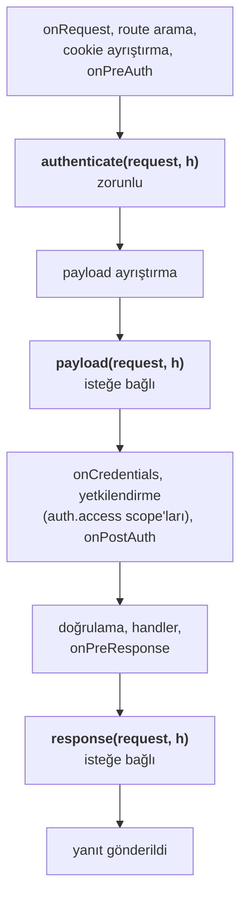
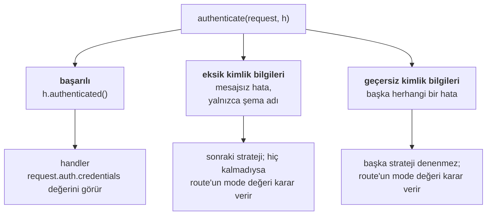
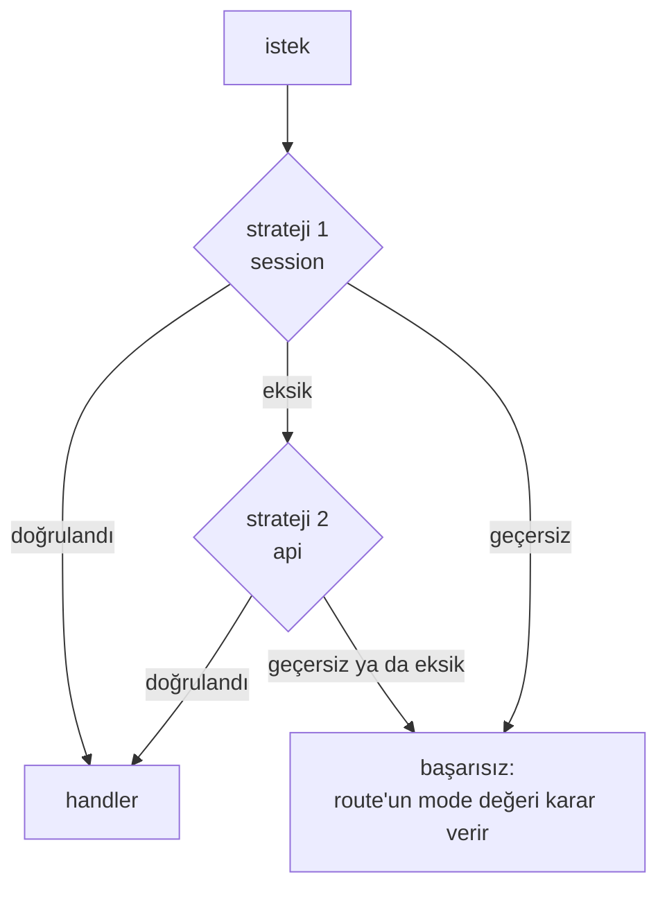
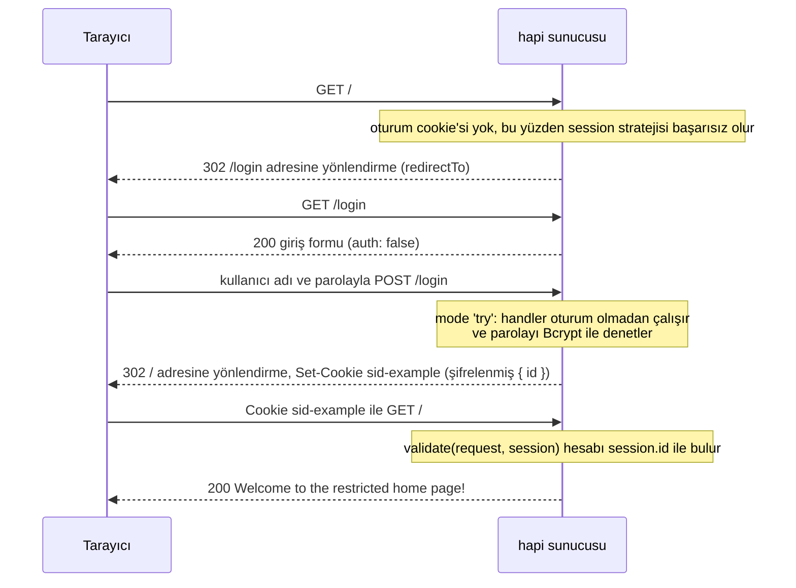
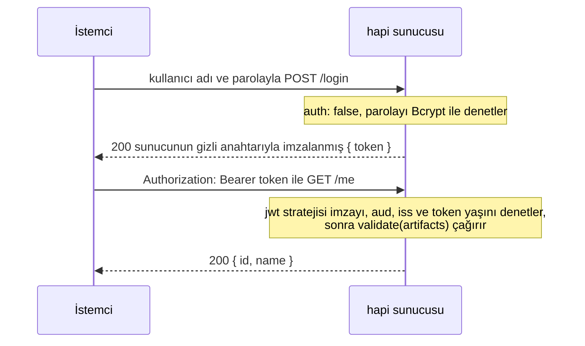

<TutorialLang />

# Kimlik Doğrulama

_Bu eğitim hapi v21 ve sonraki sürümlerle uyumludur_

## <a name="overview"></a> Genel Bakış

Modern web uygulamalarının çoğu bir tür kimlik doğrulama kullanır. hapi'de kimlik doğrulama iki parçadan oluşur: `schemes` (şemalar) ve `strategies` (stratejiler):

- `scheme`, "HTTP basic auth" ya da "oturum cookie'si" gibi genel bir kimlik doğrulama yöntemidir. `@hapi/basic` ve `@hapi/cookie` gibi plugin'lerin her biri bir şema kaydeder.
- `strategy`, adı ve yapılandırması olan bir şemadır; örneğin "kullanıcılar tablomla denetlenen basic auth". Route'lar stratejilere adlarıyla başvurur.

`@hapi/basic` örneğinde plugin bir şema kaydeder, sen bu şemadan bir strateji yapılandırırsın ve bir route o stratejiyi kullanır:

```ts
// Registers the 'basic' scheme.
await server.register(Basic);

server.auth.strategy('simple', 'basic', { validate });

server.route({
    method: 'GET',
    path: '/',
    options: { auth: 'simple' },
    handler: (request, h) => 'welcome',
});
```

## <a name="schemes"></a> Şemalar

`scheme`, imzası `function (server, options)` olan bir fonksiyondur. `server`, şemanın eklendiği sunucudur; `options` ise bu şemadan bir strateji oluşturulurken verilen yapılandırma nesnesidir. Fonksiyon bir şema nesnesi döndürür ve hapi bu nesnenin metotlarını [istek yaşam döngüsünün](/api#request-lifecycle) üç noktasında çağırır:



`payload` ve `response` yalnızca `authenticate` tarafından kabul edilen isteklerde çalışır.

Kendi şemanı yazabilir ya da `@hapi/basic` veya `@hapi/cookie` gibi hapi kimlik doğrulama plugin'lerinden birini kullanabilirsin. Aşağıda bir istek header'ından API token'ı okuyan eksiksiz bir şema var:

```ts
import Boom from '@hapi/boom';
import Hapi from '@hapi/hapi';

import type { ServerAuthScheme } from '@hapi/hapi';

declare module '@hapi/hapi' {
    interface UserCredentials {
        id: string;
        name: string;
    }
}

interface TokenOptions {
    tokens: Map<string, { id: string; name: string }>;
}

const tokenScheme: ServerAuthScheme<TokenOptions> = (server, options) => {
    return {
        authenticate: (request, h) => {
            const token = request.headers['x-api-token'];
            if (typeof token !== 'string') {
                throw Boom.unauthorized(null, 'token');
            }

            const user = options?.tokens.get(token);
            if (!user) {
                throw Boom.unauthorized('Invalid token', 'token');
            }

            return h.authenticated({ credentials: { user }, artifacts: { token } });
        },
        response: (request, h) => {
            if (!Boom.isBoom(request.response)) {
                request.response.header('x-authenticated-user', request.auth.credentials.user?.id ?? '');
            }

            return h.continue;
        },
    };
};

const server = Hapi.server({ port: 4000 });

server.auth.scheme('token', tokenScheme);
server.auth.strategy('api', 'token', {
    tokens: new Map([['a1b2c3', { id: '2133d32a', name: 'John Doe' }]]),
});

server.route({
    method: 'GET',
    path: '/me',
    options: { auth: 'api' },
    handler: (request, h) => {
        return request.auth.credentials.user;
    },
});

await server.start();
```

`ServerAuthScheme<TokenOptions>`, şemanın aldığı `options` değerinin tipini belirler. Token'ların düz bir nesnede değil de `Map` içinde tutulması bilinçli bir tercihtir: istemcinin gönderdiği bir anahtarı düz bir nesnede aramak kalıtılan özellikleri de bulur, yani `constructor` ya da `toString` değerinde bir token kimlik doğrulamayı geçerdi. `declare module` bloğu TypeScript'e kimlik bilgilerinin neleri içerdiğini söyler: hapi genişletmen için boş bir `UserCredentials` arayüzü dışa aktarır ve bundan sonra `request.auth.credentials.user` her handler'da tiplenmiş olur.

### <a name="authenticate"></a> authenticate

`authenticate` metodunun imzası `function (request, h)` şeklindedir ve bir şemadaki tek _zorunlu_ metottur. `request`, bir route handler'ının aldığı [request nesnesinin](/api#request) aynısıdır; `h` ise standart [response toolkit'tir](/api#response-toolkit).

`authenticate` üç şekilde sona erer ve her biri farklı bir yere çıkar:



- **Başarılı:** `h.authenticated({ credentials, artifacts })` döndür. `credentials`, kimliği doğrulanmış kullanıcıyı temsil eder. `artifacts` isteğe bağlıdır ve ham token gibi diğer kimlik doğrulama verilerini taşır. İkisine de daha sonra `request.auth.credentials` ve `request.auth.artifacts` üzerinden erişilir.
- **Eksik kimlik bilgileri:** mesajı olmayan ve şema adını taşıyan bir hata fırlat; örneğin `Boom.unauthorized(null, 'token')`. hapi isteği bu şema için kimlik bilgisi taşımıyor sayar, route'un sıradaki stratejisine geçer ve şema adı `WWW-Authenticate` header'ına eklenir.
- **Geçersiz kimlik bilgileri:** başka herhangi bir hata fırlat; örneğin `Boom.unauthorized('Invalid token', 'token')`. hapi diğer stratejileri denemeyi bırakır. Mesajı _ve_ şema adı olmayan bir `Boom.unauthorized()` da geçersiz sayılır.

Başarısızlıktan sonra ne olacağı route'un [`mode`](#mode) değerine bağlıdır.

Hata fırlatmak yerine `h.unauthenticated(error, data)` döndürebilirsin. Bu, `error` fırlatmakla aynı şekilde davranır, ama `data` sayesinde başarısız isteğe `credentials` ve `artifacts` ekleyebilirsin; `'try'` modundaki bir route bunları okuyabilir. `data` olmadan `return h.unauthenticated(error)` ile `throw error` aynıdır. Kuralların tamamı için [`server.auth.scheme()`](/api#server-auth-scheme-name-scheme) sayfasına bak. Bu hataları oluşturmanın önerilen yolu [boom](/module/boom)'dur.

### <a name="payload"></a> payload

`payload` metodunun imzası `function (request, h)` şeklindedir. Payload ayrıştırıldıktan sonra çalışır, bu yüzden payload'ın kendisini denetleyebilir; örneğin istek gövdesi üzerinden hesaplanmış bir imzayı.

Payload geçerliyse `h.continue` döndür, geçersizse bir hata fırlat. Route'lar payload kimlik doğrulamasını [`payload` route seçeneğiyle](#route) açar. Buna her zaman ihtiyaç duyan bir şema, metotlarının yanında `options: { payload: true }` döndürebilir; bu da route'ların onu kapatmasını engeller.

### <a name="response"></a> response

`response` metodunun imzası `function (request, h)` şeklindedir. `onPreResponse` sonrasında, yanıt header'ları yazılmadan hemen önce çalışır; bu yüzden `request.response` üzerine kimlik doğrulama header'ları ekleyebilir. Yukarıdaki token şeması bunu bir `x-authenticated-user` header'ı eklemek için kullanır.

`response` çalıştığında hapi her hatayı zaten bir response nesnesine dönüştürmüştür, yani hata yanıtları da bu header'ı alır. `Boom.isBoom()` denetimi `request.response` tipini response nesnesine daraltır ve böylece `.header()` tip denetiminden geçer. İşin bittiğinde `h.continue` döndür. Başarısız olmak için bir hata fırlat.

## <a name="strategies"></a> Stratejiler

Bir şema, `server.auth.strategy(name, scheme, [options])` ile ondan bir strateji oluşturana kadar hiçbir şey yapmaz:

- `name` stratejinin adıdır. Route'lar stratejiyi bu adla seçer.
- `scheme`, kayıtlı bir şemanın adıdır.
- `options`, şema fonksiyonuna `options` argümanı olarak verilir.

Bir şema, her biri kendi yapılandırmasına sahip birçok stratejinin temelini oluşturabilir:

```ts
server.auth.strategy('session', 'cookie', {
    cookie: {
        name: 'sid-example',
        password: '!wsYhFA*C2U6nz=Bu^%A@^F#SF3&kSR6',
        isSecure: false,
    },
});

server.auth.strategy('admin-session', 'cookie', {
    cookie: {
        name: 'sid-admin',
        password: 'Q7v!kW2#pL9@zR4$mT6^xB1&nD8*cF3%',
        isSecure: false,
    },
    redirectTo: '/admin/login',
    requestDecoratorName: 'adminCookieAuth',
});
```

Her `@hapi/cookie` stratejisi bir `request.cookieAuth` yardımcısı ekler ve hapi aynı request decoration'ını iki kez eklemeyi reddeder; bu yüzden ikinci stratejinin, yardımcısına başka bir ad vermek için `requestDecoratorName` seçeneğine ihtiyacı vardır. Onun route'ları `request.adminCookieAuth.set()` çağırır. `@types/hapi__cookie` paketi (bkz. [cookie](#cookie)) yalnızca `cookieAuth` için tip sağlar, bu yüzden TypeScript'te yeniden adlandırılmış yardımcıyı da bildir:

```ts
declare module '@hapi/hapi' {
    interface Request {
        adminCookieAuth: Request['cookieAuth'];
    }
}
```

## <a name="default"></a> Varsayılan Strateji

`server.auth.default()`, aksini belirtmeyen her route'un kullanacağı stratejiyi ayarlar. Bir strateji adı ya da bir route'un [auth seçenekleriyle](#route) aynı biçimde bir nesne alır. Varsayılan, `auth` seçeneğinde strateji adı geçmeyen her route'a uygulanır; buna `server.auth.default()` çağrılmadan _önce_ eklenen route'lar da dahildir. İstisna, `auth` değeri yalnızca `mode` ya da `access` belirten route'lardır: hapi bunları route eklenirken varsayılanla birleştirir, bu yüzden önce `server.auth.default()` çağır.

```ts
server.auth.default('session');

server.route({
    method: 'GET',
    path: '/account',
    handler: (request, h) => 'protected by the session strategy',
});

server.route({
    method: 'GET',
    path: '/health',
    options: { auth: false },
    handler: (request, h) => 'public',
});
```

## <a name="route"></a> Route Yapılandırması

Bir route, kimlik doğrulamayı `options.auth` özelliğiyle ayarlar:

```ts
server.route({
    method: 'GET',
    path: '/feed',
    options: {
        auth: {
            mode: 'try',
            strategies: ['session', 'api'],
        },
    },
    handler: (request, h) => {
        if (!request.auth.isAuthenticated) {
            return 'public feed';
        }

        return `personal feed, signed in with ${request.auth.strategy}`;
    },
});
```

`options.auth` şunlardan biri olabilir:

- Route için kimlik doğrulamayı kapatmak üzere `false`.
- `'session'` gibi bir strateji adı.
- `mode`, `strategy` ya da `strategies` ve `payload` içeren bir nesne.

### <a name="mode"></a> mode

`mode`, kimlik bilgisi olmayan ya da kimlik bilgileri hatalı olan bir isteğe ne olacağını belirler:

| `mode`                    | Kimlik bilgisi yok                  | Geçersiz kimlik bilgileri           | Geçerli kimlik bilgileri |
| ------------------------- | ----------------------------------- | ----------------------------------- | ------------------------ |
| `'required'` (varsayılan) | 401                                 | 401                                 | handler çalışır          |
| `'optional'`              | handler çalışır, kimlik doğrulanmaz | 401                                 | handler çalışır          |
| `'try'`                   | handler çalışır, kimlik doğrulanmaz | handler çalışır, kimlik doğrulanmaz | handler çalışır          |

"Kimlik bilgisi yok" ve "geçersiz kimlik bilgileri", iki tür [`authenticate` başarısızlığıdır](#authenticate). Handler bir başarısızlıktan sonra çalıştığında `request.auth.isAuthenticated` değeri `false` olur ve `request.auth.error` nedeni taşır: hiçbir strateji kimlik bilgisi bulamadıysa `Missing authentication`, bir strateji kimlik bilgilerini reddettiyse o stratejinin fırlattığı hata.

### <a name="strategy-and-strategies"></a> strategy ve strategies

Tek bir strateji için `strategy: 'session'`, birden fazlası için `strategies: ['session', 'api']` kullan. hapi bunları sırayla dener ve bir sonrakine yalnızca her biri eksik kimlik bilgisi bildirdiği sürece geçer:



### <a name="payload-1"></a> payload

`payload`, route için şemanın [`payload` metodunu](#payload) açar:

- `false`: payload'ın kimliği doğrulanmaz.
- `'required'` ya da `true`: payload'ın kimliği doğrulanmak zorundadır.
- `'optional'`: payload yalnızca istemci payload kimlik doğrulama bilgisi gönderdiyse denetlenir.

Yalnızca şeması bir `payload` metoduna sahip olan stratejilerle çalışır.

## <a name="scopes"></a> Scope'lar

Kimlik doğrulama, isteği _kimin_ yaptığını belirler. Scope'lar ise o kişinin _ne_ yapabileceğini belirler. Bir strateji `credentials.scope` içine scope string'lerinden oluşan bir liste koyar, bir route kabul ettiği scope'ları `options.auth.access.scope` içinde listeler ve hapi ikisini, `onCredentials` sonrasında ve handler'ın çalışmasından önceki yetkilendirme adımında karşılaştırır. Eşleşen bir scope'u olmayan istek `403 Insufficient scope` alır ve handler hiç çalışmaz.

Scope'lar genellikle stratejinin `validate` fonksiyonundan gelir. [basic](#basic) örneğindeki kullanıcılara birer `roles` dizisi verildiğinde:

```ts
const validate: Basic.Validate = async (request, username, password) => {
    const user = users.get(username);
    if (!user || !(await Bcrypt.compare(password, user.password))) {
        return { isValid: false, credentials: null };
    }

    return { isValid: true, credentials: { id: user.id, name: user.name, scope: user.roles } };
};
```

Roller başka bir yerde tutuluyorsa, bir `onCredentials` hook'u bunları kimlik doğrulamadan sonra ekleyebilir; bkz. [Yaşam Döngüsü Hook'ları](/tutorials/tr_TR/lifecycle-hooks#credentials).

Ardından route'lar kabul ettikleri scope'ları bildirir:

```ts
server.route({
    method: 'GET',
    path: '/reports',
    options: { auth: { strategy: 'simple', access: { scope: ['admin', 'analyst'] } } },
    handler: (request, h) => 'any admin or analyst',
});

server.route({
    method: 'DELETE',
    path: '/users/{id}',
    options: { auth: { strategy: 'simple', access: { scope: ['+admin', '!suspended'] } } },
    handler: (request, h) => 'an admin who is not suspended',
});

server.route({
    method: 'PUT',
    path: '/users/{id}/profile',
    options: { auth: { strategy: 'simple', access: { scope: ['admin', 'user-{params.id}'] } } },
    handler: (request, h) => 'an admin, or the user whose id is in the path',
});
```

| Route scope'u          | `credentials.scope` şunu sağlamalı                                                                |
| ---------------------- | ------------------------------------------------------------------------------------------------- |
| `'admin'`              | `admin` içermeli                                                                                  |
| `['admin', 'analyst']` | bunlardan en az birini içermeli                                                                   |
| `'+admin'`             | listede başka ne olursa olsun `admin` içermeli                                                    |
| `'!suspended'`         | `suspended` içermemeli                                                                            |
| `'user-{params.id}'`   | `/users/42` isteği için `user-42` içermeli; `query`, `payload` ve `credentials` de kullanılabilir |

Gözden kaçması kolay scope kuralları:

- Scope'lar yalnızca kimliği doğrulanmış isteklerde denetlenir. `'optional'` ya da `'try'` modundaki bir route'ta kimlik bilgisi olmayan bir istek yine handler'a ulaşır ve `request.auth.isAuthorized` değeri `false` olur. Yalnızca bazı kullanıcıların yapabileceği bir işlemden önce bunu denetle.
- `access.entity`, bir route'u kullanıcılara ya da uygulamalara kısıtlar: `'user'`, `credentials.user` değerinin ayarlanmış olmasını; `'app'` ise olmamasını gerektirir. Aynı strateji hem insanların hem de makine istemcilerinin kimliğini doğruluyorsa bunu kullan.
- `access` bir kurallar listesi olabilir; bir isteğin bunlardan yalnızca birini sağlaması yeterlidir.
- `server.auth.default()` aynı `access` seçeneklerini kabul eder, yani bir scope her route'a uygulanabilir.

Kuralların tamamı için [`route.options.auth.access`](/api#route-options-auth-access) sayfasına bak.

## <a name="basic"></a> basic

İnceleyeceğimiz ilk `scheme`, [@hapi/basic](/module/basic) plugin'idir. Adından da anlaşılacağı gibi `@hapi/basic`, kullanıcıları doğrulamak için basic authentication kullanır. `@hapi/basic` kurulumuna bir örnek:

```ts
import Basic from '@hapi/basic';
import Bcrypt from 'bcrypt';
import Hapi from '@hapi/hapi';

const users = new Map([
    [
        'john',
        {
            username: 'john',
            password: '$2a$10$iqJSHD.BGr0E2IxQwYgJmeP3NvhPrXAeLSaGCj6IR/XU5QtjVu5Tm', // 'secret'
            name: 'John Doe',
            id: '2133d32a',
        },
    ],
]);

const validate: Basic.Validate = async (request, username, password) => {
    const user = users.get(username);
    if (!user) {
        return { credentials: null, isValid: false };
    }

    const isValid = await Bcrypt.compare(password, user.password);
    const credentials = { id: user.id, name: user.name };

    return { isValid, credentials };
};

const start = async () => {
    const server = Hapi.server({ port: 4000 });

    await server.register(Basic);

    server.auth.strategy('simple', 'basic', { validate });

    server.route({
        method: 'GET',
        path: '/',
        options: {
            auth: 'simple',
        },
        handler: function (request, h) {
            return 'welcome';
        },
    });

    await server.start();

    console.log('server running at: ' + server.info.uri);
};

start();
```

Önce `users` veritabanını tanımlarsın; bu örnekte [Şemalar](#schemes) bölümünde açıklanan nedenle kullanıcı adına göre anahtarlanmış bir `Map`. Ardından bir doğrulama fonksiyonu tanımlarsın. Bu, [@hapi/basic](/module/basic)'e özgü bir özelliktir ve kullanıcının geçerli kimlik bilgileri verdiğini doğrulamanı sağlar. Fonksiyonun tipini `Basic.Validate` olarak belirtmek, TypeScript'in `request`, `username` ve `password` tiplerini çıkarmasını ve döndürdüğün nesneyi denetlemesini sağlar. Bu doğrulama fonksiyonunda, kullanıcının girdiği parolayı veritabanındaki hash'lenmiş parolayla karşılaştırmak için `Bcrypt` kullanırsın.

Sonra plugin'i kaydedersin; bu, `basic` adında bir şema oluşturur. Bu işlem plugin içinde [server.auth.scheme()](/api#server-auth-scheme-name-scheme) ile yapılır.

Plugin kaydedildikten sonra, `basic` adlı şemana başvuran `simple` adında bir strateji oluşturmak için [server.auth.strategy()](/api#server-auth-strategy-name-scheme-options) kullanırsın. Ayrıca şemaya iletilen ve davranışını yapılandırmanı sağlayan bir seçenekler nesnesi de verirsin.

Son olarak bir route'a kimlik doğrulama için `simple` adlı stratejiyi kullanmasını söylersin.

## <a name="cookie"></a> cookie

[@hapi/cookie](/module/cookie), kullanıcının kimliği doğrulandıktan sonra oturumu kullanıcının tarayıcısında şifrelenmiş bir cookie içinde saklayan bir plugin'dir. `cookie.ttl` olmadan cookie tarayıcı kapanana kadar geçerli kalır; kullanıcının tarayıcı oturumları arasında oturum açık kalması için `ttl` ayarla.

Bu örnekte ana sayfa route'u "/" kısıtlıdır ve yalnızca kullanıcı oturum açtıktan sonra erişilebilir. Tarayıcı giriş formuna yönlendirilir, kullanıcı adını ve parolayı gönderir, ardından oturum cookie'siyle ana sayfaya ulaşır:



```ts
import Bcrypt from 'bcrypt';
import Cookie from '@hapi/cookie';
import Hapi from '@hapi/hapi';

const users = [
    {
        username: 'john',
        password: '$2a$10$iqJSHD.BGr0E2IxQwYgJmeP3NvhPrXAeLSaGCj6IR/XU5QtjVu5Tm', // 'secret'
        name: 'John Doe',
        id: '2133d32a',
    },
];

const start = async () => {
    const server = Hapi.server({ port: 4000 });

    await server.register(Cookie);

    server.auth.strategy('session', 'cookie', {
        cookie: {
            name: 'sid-example',
            password: '!wsYhFA*C2U6nz=Bu^%A@^F#SF3&kSR6',
            isSecure: false,
        },
        redirectTo: '/login',
        validate: async (request, session) => {
            if (!session || !('id' in session)) {
                return { isValid: false };
            }

            const account = users.find((user) => user.id === session.id);
            if (!account) {
                return { isValid: false };
            }

            return { isValid: true, credentials: { id: account.id, name: account.name } };
        },
    });

    server.auth.default('session');

    server.route([
        {
            method: 'GET',
            path: '/',
            handler: function (request, h) {
                return 'Welcome to the restricted home page!';
            },
        },
        {
            method: 'GET',
            path: '/login',
            handler: function (request, h) {
                return ` <html>
                            <head>
                                <title>Login page</title>
                            </head>
                            <body>
                                <h3>Please Log In</h3>
                                <form method="post" action="/login">
                                    Username: <input type="text" name="username"><br>
                                    Password: <input type="password" name="password"><br/>
                                <input type="submit" value="Login"></form>
                            </body>
                        </html>`;
            },
            options: {
                auth: false,
            },
        },
    ]);

    server.route<{ Payload: { username: string; password: string } }>({
        method: 'POST',
        path: '/login',
        handler: async (request, h) => {
            const { username, password } = request.payload;
            const account = users.find((user) => user.username === username);

            if (!account || !(await Bcrypt.compare(password, account.password))) {
                return h.redirect('/login');
            }

            request.cookieAuth.set({ id: account.id });

            return h.redirect('/');
        },
        options: {
            auth: {
                mode: 'try',
            },
        },
    });

    await server.start();

    console.log('server running at: ' + server.info.uri);
};

start();
```

`@hapi/cookie` kendi tipleriyle gelmez. TypeScript kullanıyorsan tipleri `npm install --save-dev @types/hapi__cookie` ile kur. Bu tipler hapi'nin `Request` tipine `request.cookieAuth` ekler ve `cookie` stratejisinin seçeneklerini tipler. Oturum `validate` fonksiyonuna düz bir `object` olarak gelir; TypeScript'in `session.id` değerini okumasını sağlayan şey `'id' in session` denetimidir. `POST /login` route'u form alanlarını `server.route()` çağrısına verilen bir tip argümanıyla bildirir; bu yalnızca bir tiptir, çalışma zamanında zorlamak için [payload doğrulaması](/tutorials/tr_TR/validation) ekle.

Önce `@hapi/cookie` plugin'ini `server.register` ile kaydedersin; bu, `cookie` şemasını ekler. Ardından `server.auth.strategy` ile bu şemadan `session` stratejisini oluşturur ve üç seçenek verirsin:

- `cookie`, cookie'nin kendisini yapılandırır. `name` cookie'nin adıdır: `sid-example`. `password` cookie'yi şifreler ve en az 32 karakter uzunluğunda olmalıdır. `isSecure: false`, cookie'nin düz HTTP üzerinden gitmesine izin verir; bu geliştirmede sorun değildir, production'da varsayılan değer olan `true` olarak bırak.
- `redirectTo`, korumalı bir route isteyen ve kimliği doğrulanmamış bir kullanıcının sunucu tarafından gönderileceği yerdir.
- `validate`, cookie taşıyan her istekte çalışır ve oturumun hâlâ geçerli olduğunu denetler. Burada hesabı cookie'de saklanan `id` ile arar; böylece silinmiş bir hesabın oturumu bir sonraki isteğinde kapanır.

`server.auth.default('session')` her route'u `session` stratejisiyle korur. `GET /login`, `auth: false` ile bunun dışında kalır, böylece formu herkes görebilir.

`POST /login`, `mode: 'try'` kullanır; böylece kullanıcının henüz bir oturumu olmasa da handler çalışır. Handler hesabı `username` ile bulur ve gönderilen parolayı `Bcrypt` ile saklanan hash'le karşılaştırır. Denetimlerden biri başarısız olursa kullanıcı giriş sayfasına geri döner. İkisi de geçerse `request.cookieAuth.set()`, `{ id }` değerini şifrelenmiş cookie'de saklar ve kullanıcı ana sayfaya yönlendirilir.

## <a name="jwt"></a> jwt

[@hapi/jwt](/module/jwt), `Authorization: Bearer <token>` header'ında JSON Web Token taşıyan isteklerin kimliğini doğrular. `@hapi/cookie` gibi sunucuda oturum saklamaz; fark, kimliğin nasıl taşındığındadır:

|                  | `@hapi/cookie`                            | `@hapi/jwt`                                                             |
| ---------------- | ----------------------------------------- | ----------------------------------------------------------------------- |
| Gönderildiği yer | tarayıcının eklediği bir cookie           | istemcinin ayarladığı `Authorization` header'ı                          |
| İçerik           | şifrelenmiş: istemci okuyamaz             | imzalı ama token'a sahip olan herkes okuyabilir                         |
| Uygun olduğu yer | kendi alan adındaki tarayıcı uygulamaları | mobil uygulamalardan, diğer sunuculardan ve SPA'lardan çağrılan API'ler |

JWT payload'ına asla gizli bilgi koyma; imzalama değiştirmeyi engeller ama okumayı engellemez.

İstemci bir kez oturum açar, sonra token'ı her istekle gönderir:



```ts
import Bcrypt from 'bcrypt';
import Hapi from '@hapi/hapi';
import Jwt from '@hapi/jwt';

const users = [
    {
        username: 'john',
        password: '$2a$10$iqJSHD.BGr0E2IxQwYgJmeP3NvhPrXAeLSaGCj6IR/XU5QtjVu5Tm', // 'secret'
        name: 'John Doe',
        id: '2133d32a',
    },
];

const secret = 'hR7#mX2!vQ9@kL4$wP8^zT1&nB6*cJ3%';

const start = async () => {
    const server = Hapi.server({ port: 4000 });

    await server.register(Jwt);

    server.auth.strategy('bearer', 'jwt', {
        keys: secret,
        verify: {
            aud: 'urn:audience:my-api',
            iss: 'urn:issuer:my-api',
            sub: false,
            maxAgeSec: 4 * 60 * 60,
        },
        validate: async (artifacts, request, h) => {
            const account = users.find((user) => user.id === artifacts.decoded.payload.id);
            if (!account) {
                return { isValid: false };
            }

            return { isValid: true, credentials: { id: account.id, name: account.name } };
        },
    });

    server.auth.default('bearer');

    server.route<{ Payload: { username: string; password: string } }>({
        method: 'POST',
        path: '/login',
        options: { auth: false },
        handler: async (request, h) => {
            const { username, password } = request.payload;
            const account = users.find((user) => user.username === username);

            if (!account || !(await Bcrypt.compare(password, account.password))) {
                return h.response({ error: 'Invalid username or password' }).code(401);
            }

            const token = Jwt.token.generate(
                { aud: 'urn:audience:my-api', iss: 'urn:issuer:my-api', id: account.id },
                secret,
            );

            return { token };
        },
    });

    server.route({
        method: 'GET',
        path: '/me',
        handler: (request, h) => {
            return request.auth.credentials;
        },
    });

    await server.start();

    console.log('server running at: ' + server.info.uri);
};

start();
```

Plugin'i kaydedersin, bu `jwt` şemasını ekler; ardından bu şemadan `bearer` stratejisini oluşturursun:

- `keys`, token'ların imzalandığı gizli anahtardır. Token'ları aynı sunucu hem üretip hem denetliyorsa paylaşılan bir gizli anahtar yeterlidir. Bunun yerine bir kimlik sağlayıcısından gelen token'ları kabul etmek için `keys` sağlayıcının açık anahtarlarını gösterebilir; bkz. [@hapi/jwt API](/module/jwt) içindeki `keys` seçenekleri.
- `verify`, bir token'ın taşıması gereken claim'leri listeler. `aud` (audience) ve `iss` (issuer), token üretirken kullandığın değerlerle eşleşmelidir. `maxAgeSec`, `iat` (issued at) değeri dört saatten eski olan token'ları reddeder. Bu örnekteki token'larda `exp` yoktur; seninkilerde varsa `exp` ve `nbf` varsayılan olarak denetlenir.
- `validate` yalnızca imza ve claim'ler geçtikten sonra çalışır. Çözülmüş token'ı `artifacts.decoded.payload` olarak alır ve `request.auth.credentials` içine neyin gireceğine karar verir. Burada hesabın hâlâ var olduğunu da denetler, çünkü bir token, hesap silinse bile süresi dolana kadar geçerli kalır.

`POST /login`, `auth: false` ile kimlik doğrulamanın dışında kalır, parolayı denetler ve stratejinin doğruladığı `aud` ve `iss` değerleriyle `Jwt.token.generate()` ile üretilen bir token döndürür. İstemci ardından `Authorization: Bearer <token>` ile `GET /me` çağırır. `artifacts.decoded.payload` tiplenmemiştir, çünkü hapi bir token'a hangi claim'leri koyduğunu bilemez; bunları denetleyip tiplenmiş kimlik bilgileri oluşturduğun yer `validate`'tir.

Diğer hapi kimlik doğrulama plugin'leri hakkında daha fazla bilgi için [plugin bölümüne](/plugins) bak.
