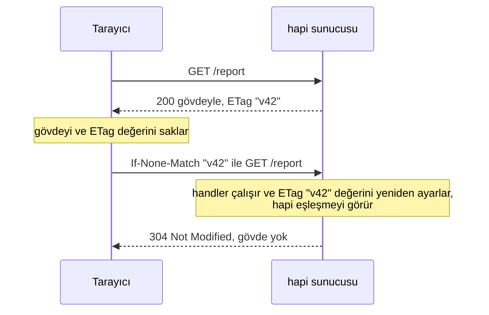
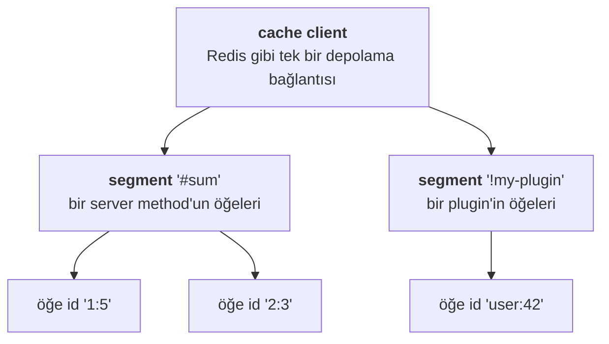
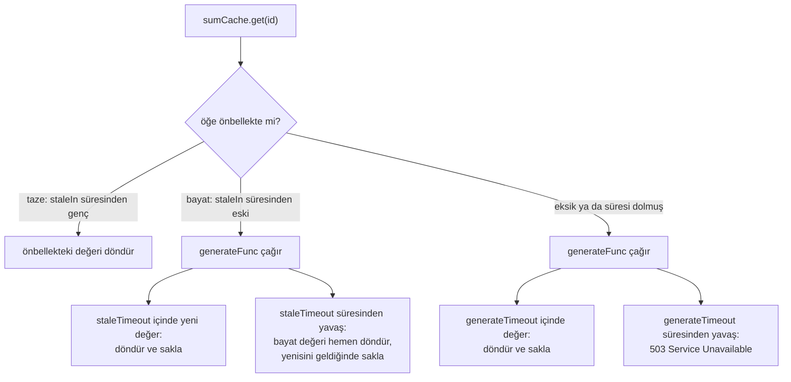

<TutorialLang />

# Önbellekleme

_Bu eğitim hapi v21 ve sonraki sürümlerle uyumludur_

## <a name="overview"></a> Genel Bakış

hapi iki düzeyde önbellekleme yapar ve çoğu uygulama ikisini de kullanır:

| Düzey                          | Kopyanın tutulduğu yer                                        | Neyi kazandırır                                     | Nasıl yapılandırılır                                                                          |
| ------------------------------ | ------------------------------------------------------------- | --------------------------------------------------- | --------------------------------------------------------------------------------------------- |
| [İstemci tarafı](#client-side) | tarayıcı ya da aradaki bir CDN veya proxy                     | isteğin tamamını: istemci hapi'ye hiç ulaşmaz       | HTTP header'ları: `Cache-Control`, `ETag`, `Last-Modified`                                    |
| [Sunucu tarafı](#server-side)  | bellek, Redis ya da başka bir [catbox](/module/catbox) deposu | pahalı işi: bir veritabanı sorgusu, bir API çağrısı | `server.cache()` ya da önbelleğe alınmış bir [server method](/tutorials/tr_TR/server-methods) |

## <a name="client-side"></a> İstemci Tarafında Önbellekleme

HTTP header'ları, istemcilere bir yanıtı yeniden kullanıp kullanamayacaklarını ve ne kadar süreyle kullanabileceklerini söyler. MDN'nin [HTTP önbellekleme rehberi](https://developer.mozilla.org/en-US/docs/Web/HTTP/Caching) bu header'ları ayrıntılı olarak açıklar. Bu bölüm hapi'nin onları nasıl ayarladığını gösterir.

### <a name="cache-control"></a> Cache-Control

Route'un `cache` seçeneğini ayarla, `Cache-Control` header'ını hapi senin için yazsın:

```ts
server.route({
    path: '/hapi/{ttl?}',
    method: 'GET',
    handler: function (request, h) {
        const response = h.response({ be: 'hapi' });

        if (request.params.ttl) {
            response.ttl(Number(request.params.ttl));
        }

        return response;
    },
    options: {
        cache: {
            expiresIn: 30 * 1000,
            privacy: 'private',
        },
    },
});
```

`response.ttl(msec)`, tek bir yanıt için `expiresIn` değerini geçersiz kılar. hapi'nin gönderdiği header yanıta bağlıdır:

| İstek                                                        | `Cache-Control` header'ı                       |
| ------------------------------------------------------------ | ---------------------------------------------- |
| `GET /hapi`                                                  | `max-age=30, must-revalidate, private`         |
| `GET /hapi/5000` (`response.ttl(5000)` çağırır)              | `max-age=5, must-revalidate, private`          |
| 200 ya da 204 dışında bir yanıt durumu, örneğin 404 veya 500 | `no-cache` (route'un `cache.otherwise` değeri) |

Bilmen gerekenler:

- İstek kimliği doğrulanmış bir istekse, route `privacy: 'public'` dese bile hapi her zaman `private` ekler. CDN gibi paylaşılan önbellekler `private` yanıtları asla saklamaz.
- `h.state()` ile ayarlanan cookie'ler header'ı değiştirmez: hapi bunları `Cache-Control` oluşturulduktan sonra yazar. Cookie ayarlayan ve önbelleğe alınan route'larda `privacy: 'private'` değerini kendin ayarla.
- Yalnızca route'un `cache.statuses` listesindeki durum kodları (varsayılan `[200, 204]`) `max-age` alır. Hata yanıtları yanlışlıkla önbelleğe alınmaz.

Tüm `cache` ayarları için [route seçeneklerine](/api#route-options-cache) bak.

### <a name="last-modified"></a> Koşullu istekler: ETag ve Last-Modified

Koşullu bir istek, istemcinin "bu, benim kopyamdan bu yana değişti mi?" diye sormasını ve tam gövde yerine boş bir `304 Not Modified` almasını sağlar:



`ETag` değerini [`response.etag()`](/api#response-object) ile ayarla; genellikle bir sürüm numarasından ya da içeriğin hash'inden:

```ts
return h.response(report).etag(String(report.version));
```

Ya da `Last-Modified` ayarla; hapi bunu istemcinin `If-Modified-Since` header'ıyla karşılaştırır:

```ts
return h.response(report).header('Last-Modified', report.updatedAt.toUTCString());
```

Bilmen gerekenler:

- hapi `304` yanıtını yalnızca `GET` route'larında (ve metodu `*` olan route'larda) verir.
- Handler yine her istekte çalışır. Koşullu istekler bant genişliğinden tasarruf sağlar, sunucu işinden değil. İkisinden de tasarruf etmek için bunları [sunucu tarafı önbelleklemeyle](#server-side) birlikte kullan.
- [inert](/module/inert), statik dosyalar için `ETag` ve `Last-Modified` değerlerini otomatik olarak ayarlar.

## <a name="server-side"></a> Sunucu Tarafında Önbellekleme

hapi değerleri sunucuda [catbox](/module/catbox) aracılığıyla önbelleğe alır. catbox, birbirinin yerine kullanılabilen depolama adaptörlerine sahip bir anahtar-değer deposudur: bellek (varsayılan), [Redis](/module/catbox-redis) ve [Memcached](/module/catbox-memcached).

### <a name="catbox"></a> catbox

Önbelleğe alınan öğeler üç düzeyde düzenlenir:



catbox bu öğelere iki arayüz sunar:

- **[Client](/module/catbox#client)**: düşük seviyeli depolama bağlantısı. hapi senin için bir bellek client'ı oluşturur; diğerlerini sunucunun `cache` seçeneğinde eklersin.
- **[Policy](/module/catbox#policy)**: bir client'ın, süre dolma kuralları ve eksik değerleri üreten isteğe bağlı bir fonksiyonu olan bir segment'i. Kodun policy'leri kullanır; bunlar [`server.cache()`](/api#server-cache-options) ile ya da bir [server method](#servermethods) önbelleğe alınarak oluşturulur.

### <a name="client"></a> Client

Varsayılan bellek client'ının yanına `my_cache` adında bir Redis client'ı ekle:

```ts
import Hapi from '@hapi/hapi';
import { Engine as CatboxRedis } from '@hapi/catbox-redis';

const server = Hapi.server({
    port: 8000,
    cache: [
        {
            name: 'my_cache',
            provider: {
                constructor: CatboxRedis,
                options: {
                    partition: 'my_cached_data',
                    host: 'redis-cluster.domain.com',
                    port: 6379,
                    database: 0,
                    tls: {},
                },
            },
        },
    ],
});
```

- `name`, policy'lerin bu client'ı `cache: 'my_cache'` ile seçmesini sağlar. Bunun yerine varsayılan bellek client'ını değiştirmek için `name` değerini belirtme.
- `partition`, bu uygulamanın anahtarlarını aynı Redis veritabanını paylaşan diğerlerinden ayrı tutar. Redis'te bir anahtar önekine dönüşür. Varsayılanı `'catbox'` değeridir.
- Önbellek client'ları sunucu başlarken, [`server.initialize()`](/api#await-server-initialize) ya da [`server.start()`](/api#await-server-start) içinde bağlanır. Policy'ler bundan önce okuma veya yazma yapamaz.

### <a name="policy" /> Policy

[`server.cache(options)`](/api#server-cache-options) bir policy oluşturur. Bu örnek yavaş bir toplama işleminin sonucunu on saniye boyunca önbellekte tutar:

```ts
import Hapi from '@hapi/hapi';
import * as Hoek from '@hapi/hoek';

const add = async (a: string, b: string) => {
    await Hoek.wait(1000); // Simulates a slow database call

    return Number(a) + Number(b);
};

const start = async () => {
    const server = Hapi.server({ port: 8000 });

    const sumCache = server.cache({
        segment: 'sums',
        expiresIn: 10 * 1000,
        generateFunc: async (id) => {
            const key = typeof id === 'string' ? id : id.id;
            const [a, b] = key.split(':');

            return await add(a, b);
        },
        generateTimeout: 2000,
    });

    server.route<{ Params: { a: string; b: string } }>({
        path: '/add/{a}/{b}',
        method: 'GET',
        handler: async function (request, h) {
            const { a, b } = request.params;

            return await sumCache.get(`${a}:${b}`);
        },
    });

    await server.start();

    console.log('Server running at:', server.info.uri);
};

start();
```

`GET /add/1/5` yaklaşık bir saniye sonra `6` yanıtını verir. On saniye içinde tekrarlarsan yanıt önbellekten anında gelir.

| Seçenek           | Anlamı                                                                                                                                                                                                  |
| ----------------- | ------------------------------------------------------------------------------------------------------------------------------------------------------------------------------------------------------- |
| `segment`         | Bu policy'nin öğelerini adlandırır. Sunucu kökünde zorunludur. Bir plugin içinde varsayılanı `'!' + plugin name` (plugin adı) olur. İki policy, `shared: true` ayarlamadıkça aynı segment'i paylaşamaz. |
| `cache`           | Kullanılacak client; örneğin `'my_cache'`. Varsayılanı bellek client'ıdır.                                                                                                                              |
| `expiresIn`       | Bir öğenin saklandıktan sonra ne kadar yaşayacağı, milisaniye cinsinden. Bunun yerine `expiresAt: 'HH:MM'` her şeyin günün belirli bir saatinde dolmasını sağlar.                                       |
| `generateFunc`    | `get()` hiçbir şey bulamadığında değeri oluşturur. catbox sonucu saklar.                                                                                                                                |
| `generateTimeout` | `get()` fonksiyonunun `503 Service Unavailable` ile başarısız olmadan önce `generateFunc` için ne kadar bekleyeceği. `generateFunc` ile birlikte zorunludur; `false` sonsuza kadar bekler.              |

`get()` fonksiyonuna verilen id ya bir string ya da `id` string'i içeren bir nesnedir ve `generateFunc` onu değiştirilmeden alır. catbox bunun tipini `string | { id: string }` olarak belirler, bu yüzden örnek, onu yeniden `a` ve `b` olarak bölmeden önce tipini daraltır.

### <a name="stale"></a> Yeniden üretilirken bayat değerleri sunmak

Süresi dolmuş bir öğe, bir sonraki çağıranı `generateFunc` için bekletir. Bu beklemeden kaçınmak için öğeleri süreleri dolmadan önce `staleIn` ile bayat olarak işaretle. Bayat bir öğe sunulmaya devam ederken catbox onu arka planda yeniden üretir:



```ts
const reportCache = server.cache({
    segment: 'reports',
    expiresIn: 60 * 60 * 1000,
    staleIn: 10 * 60 * 1000,
    staleTimeout: 100,
    generateTimeout: 5000,
    generateFunc: async (id) => await buildReport(id),
});
```

catbox `staleIn < expiresIn` koşulunu zorunlu kılar, `staleIn` ayarlandığında `staleTimeout` ister ve `staleTimeout < expiresIn - staleIn` koşulunu gerektirir. Aynı id için eşzamanlı `get()` çağrıları tek bir `generateFunc` çağrısını paylaşır; böylece eksik bir öğe için gelen bir istek yığını veritabanını bir kez sorgular. `dropOnError` ve `generateOnReadError` gibi hata yönetimi ayarları için [policy seçeneklerine](/module/catbox#policy) bak.

### <a name="servermethods"></a> Server method'lar

Çoğu zaman önbelleğe alınmış bir [server method](/tutorials/tr_TR/server-methods), elle oluşturulmuş bir policy'den daha kısadır. hapi policy'yi oluşturur, segment'ini `'#sum'` olarak adlandırır ve öğe id'sini argümanlardan üretir:

```ts
import Hapi from '@hapi/hapi';
import * as Hoek from '@hapi/hoek';

declare module '@hapi/hapi' {
    interface ServerMethods {
        sum: (a: string, b: string) => Promise<number>;
    }
}

const add = async (a: string, b: string) => {
    await Hoek.wait(1000);

    return Number(a) + Number(b);
};

const start = async () => {
    const server = Hapi.server({ port: 8000 });

    server.method('sum', add, {
        cache: {
            expiresIn: 10 * 1000,
            generateTimeout: 2000,
        },
    });

    server.route<{ Params: { a: string; b: string } }>({
        path: '/add/{a}/{b}',
        method: 'GET',
        handler: async function (request, h) {
            const { a, b } = request.params;

            return await server.methods.sum(a, b);
        },
    });

    await server.start();
};

start();
```

- `declare module` bloğu hapi'nin `ServerMethods` arayüzüne `sum` ekler, böylece `server.methods.sum` bir tipe sahip olur.
- hapi öğe id'sini `string`, `number` ve `boolean` argümanlarından üretir; örneğin `'1:5'`. Diğer argüman tipleri bir [`generateKey`](/tutorials/tr_TR/server-methods#key) fonksiyonu gerektirir.

## <a name="clientandserver"></a> İstemci ve Sunucu Önbellekleme

İki düzeyi birleştir: sunucu önbelleği her değeri ne zaman sakladığını kaydeder ve bu zaman, yanıt için doğru `Last-Modified` değeridir. `getDecoratedValue: true` ayarla; önbelleğe alınan metot çıplak değer yerine `{ value, cached, report }` döndürür. Değer yeni üretildiyse `cached` değeri `null` olur:

```ts
import Hapi from '@hapi/hapi';
import * as Hoek from '@hapi/hoek';

declare module '@hapi/hapi' {
    interface ServerMethods {
        sum: (a: string, b: string) => Promise<{ value: number; cached: { stored: number } | null }>;
    }
}

const add = async (a: string, b: string) => {
    await Hoek.wait(1000);

    return Number(a) + Number(b);
};

const start = async () => {
    const server = Hapi.server({ port: 8000 });

    const cache = {
        expiresIn: 10 * 1000,
        generateTimeout: 2000,
        getDecoratedValue: true,
    };

    server.method('sum', add, { cache });

    server.route<{ Params: { a: string; b: string } }>({
        path: '/add/{a}/{b}',
        method: 'GET',
        handler: async function (request, h) {
            const { a, b } = request.params;
            const { value, cached } = await server.methods.sum(a, b);
            const lastModified = cached ? new Date(cached.stored) : new Date();

            return h.response({ sum: value }).header('Last-Modified', lastModified.toUTCString());
        },
    });

    await server.start();
};

start();
```

`cached` ve `report` değerlerinin neler içerdiğini görmek için [policy API](/module/catbox#api-1) sayfasına bak.
