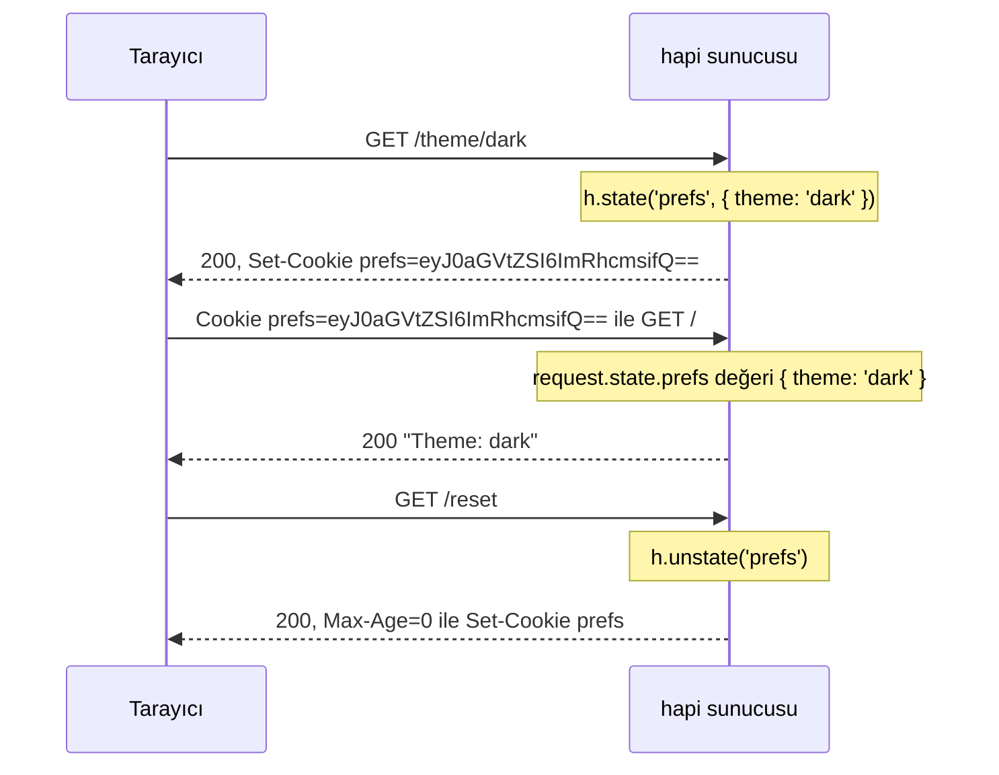

<TutorialLang />

# Cookie'ler

_Bu eğitim hapi v21 ve sonraki sürümlerle uyumludur_

## <a name="overview"></a> Genel Bakış

hapi isteğin `Cookie` header'ını `request.state` içine okur ve `Set-Cookie` header'larını `h.state()` üzerinden yazar. Her cookie `server.state()` ile bir kez bildirilir; bu çağrı cookie'nin kodlamasını ve güvenlik bayraklarını ayarlar, böylece handler'lar yalnızca değerlerle uğraşır:



Bu alışverişin arkasındaki sunucunun tamamı:

```ts
import Hapi from '@hapi/hapi';

const server = Hapi.server({ port: 3000 });

server.state('prefs', {
    encoding: 'base64json',
    ttl: 365 * 24 * 60 * 60 * 1000,
    isSecure: process.env.NODE_ENV === 'production',
    path: '/',
});

server.route<{ Params: { theme: string } }>({
    method: 'GET',
    path: '/theme/{theme}',
    handler: (request, h) => {
        h.state('prefs', { theme: request.params.theme });
        return 'saved';
    },
});

server.route({
    method: 'GET',
    path: '/',
    handler: (request, h) => {
        const prefs = request.state.prefs;
        const theme = typeof prefs === 'object' && prefs !== null && 'theme' in prefs ? prefs.theme : 'light';

        return `Theme: ${theme}`;
    },
});

server.route({
    method: 'GET',
    path: '/reset',
    handler: (request, h) => {
        return h.response('reset').unstate('prefs');
    },
});

await server.start();
```

`request.state` tipi `Record<string, unknown>` olarak belirlenmiştir, çünkü bir cookie istemci ne gönderirse onu taşır. `/` handler'ı `theme` değerini okumadan önce değerin yapısını denetler ve gerekirse varsayılana döner.

## <a name="server"></a> Sunucuyu yapılandırma

### <a name="server.state"></a> server.state()

[`server.state(name, [options])`](/api#server-state-name-options) bir cookie bildirir. Varsayılanlar güvenlidir, bu yüzden çoğu uygulama yalnızca `encoding`, `ttl` ve `path` ayarlar:

| Seçenek        | Varsayılan | Anlamı                                                                                                                                                                                         |
| -------------- | ---------- | ---------------------------------------------------------------------------------------------------------------------------------------------------------------------------------------------- |
| `ttl`          | `null`     | Milisaniye cinsinden ömür. `null`, tarayıcı kapandığında silinen bir oturum cookie'si oluşturur.                                                                                               |
| `encoding`     | `'none'`   | Değerin nasıl saklandığı: `'none'` (bir string), `'base64'`, `'base64json'` (herhangi bir JSON değeri), `'form'` ya da `'iron'` (şifrelenmiş, bkz. [aşağısı](#iron)).                          |
| `path`         | `null`     | Tarayıcının cookie'yi gönderdiği URL yolu. `null` bu özniteliği eklemez; tarayıcılar da cookie'yi ayarlayan isteğin dizinini kullanır. Sitenin tamamında geçerli cookie'ler için `'/'` ayarla. |
| `isSecure`     | `true`     | Yalnızca HTTPS üzerinden gönderilir. Geliştirme sırasında düz HTTP için `false` ayarla.                                                                                                        |
| `isHttpOnly`   | `true`     | Tarayıcıdaki JavaScript'ten gizlenir; bu da onu cross-site scripting'e karşı korur.                                                                                                            |
| `isSameSite`   | `'Strict'` | Başka sitelerden gelen isteklerde gönderilmez. `'Lax'`, başka sitelerden üst düzey gezinmeye izin verir; `false` özniteliği eklemez.                                                           |
| `clearInvalid` | `false`    | Değeri ayrıştırılamadığında tarayıcıya cookie'yi silmesini söyler.                                                                                                                             |
| `strictHeader` | `true`     | [RFC 6265](https://tools.ietf.org/html/rfc6265) kurallarını bozan adları ve değerleri reddeder.                                                                                                |

`domain`, `autoValue` ve imzalama gibi diğer seçenekler için [`server.state()`](/api#server-state-name-options) sayfasına bak. Her cookie için varsayılanları değiştirmek istiyorsan aynı seçenekleri sunucunun [`state`](/api#server-options-state) seçeneği olarak ver.

### <a name="iron"></a> Şifrelenmiş cookie'ler

`encoding: 'iron'`, değeri [iron](/module/iron) ile şifreler ve imzalar. İstemci onu okuyamaz ve değiştirilmişse hapi onu reddeder. Kullanıcıya göstermeyeceğin her şey için bunu kullan; örneğin bir oturum id'si:

```ts
const password = process.env.COOKIE_PASSWORD;
if (!password || password.length < 32) {
    throw new Error('COOKIE_PASSWORD must be set to at least 32 characters');
}

server.state('session', {
    encoding: 'iron',
    password,
    ttl: 24 * 60 * 60 * 1000,
    path: '/',
});
```

Giriş oturumları için [@hapi/cookie](/module/cookie) bunun üzerine kuruludur: şifrelenmiş bir oturum cookie'sini bir [kimlik doğrulama stratejisi](/tutorials/tr_TR/auth#cookie) olarak yönetir.

### <a name="options.state"></a> route.options.state

Route'lar ayrıştırmayı [`options.state`](/api#route-options-state) ile denetler:

| Seçenek      | Varsayılan | Anlamı                                                                                    |
| ------------ | ---------- | ----------------------------------------------------------------------------------------- |
| `parse`      | `true`     | Cookie'leri `request.state` içine ayrıştırır. Cookie okumayan route'larda `false` ayarla. |
| `failAction` | `'error'`  | Bir cookie ayrıştırılamadığında ya da şifresi çözülemediğinde ne olacağı.                 |

Bir cookie, değeri kodlamasıyla eşleşmediğinde ya da bir iron cookie'si değiştirildiğinde veya başka bir parolayla şifrelendiğinde başarısız olur:

| `failAction` | Sonuç                                                   |
| ------------ | ------------------------------------------------------- |
| `'error'`    | istek `400 Bad Request` ile başarısız olur              |
| `'log'`      | istek o cookie olmadan devam eder ve hapi hatayı loglar |
| `'ignore'`   | istek o cookie olmadan devam eder                       |

Cookie'de `clearInvalid: true` varsa yanıt hatalı cookie'yi tarayıcıdan da siler. Bunu `'log'` ya da `'ignore'` ile birlikte kullan; böylece eskimiş bir cookie taşıyan istek (örneğin parola değişikliğinden önce şifrelenmiş bir cookie) bir kez 400 ile başarısız olmak yerine başarılı olur.

## <a name="setting"></a> Cookie ayarlama

### <a name="h.state"></a> h.state()

[`h.state(name, value, [options])`](/api#h-state-name-value-options), bir handler'dan, bir [pre-handler'dan](/api#route-options-pre) ya da bir [yaşam döngüsü hook'undan](/tutorials/tr_TR/lifecycle-hooks) cookie ayarlar. Zincirleme kullanım için aynı metot response nesnesinde de bulunur:

```ts
h.state('prefs', { theme: 'dark' });

return h.response('Hello').state('prefs', { theme: 'dark' });
```

## <a name="override"></a> Seçenekleri geçersiz kılma

Üçüncü argüman, cookie'nin bildirilen seçeneklerini yalnızca bu yanıt için geçersiz kılar:

```ts
return h.response('Hello').state('prefs', 'dark', { encoding: 'none' });
```

## <a name="value"></a> Cookie değerini okuma

`request.state`, ayrıştırılan her cookie'yi adına göre anahtarlanmış olarak tutar. Tarayıcı aynı ada sahip iki cookie gönderirse değer bir dizi olur. Değerleri genel bakış örneğindeki gibi oku: önce yapıyı denetle, sonra kullan.

## <a name="clear"></a> Cookie silme

[`h.unstate(name)`](/api#h-unstate-name-options) ya da response üzerindeki `unstate()`, tarayıcıya cookie'yi silmesini söyler:

```ts
return h.response('Bye').unstate('prefs');
```
