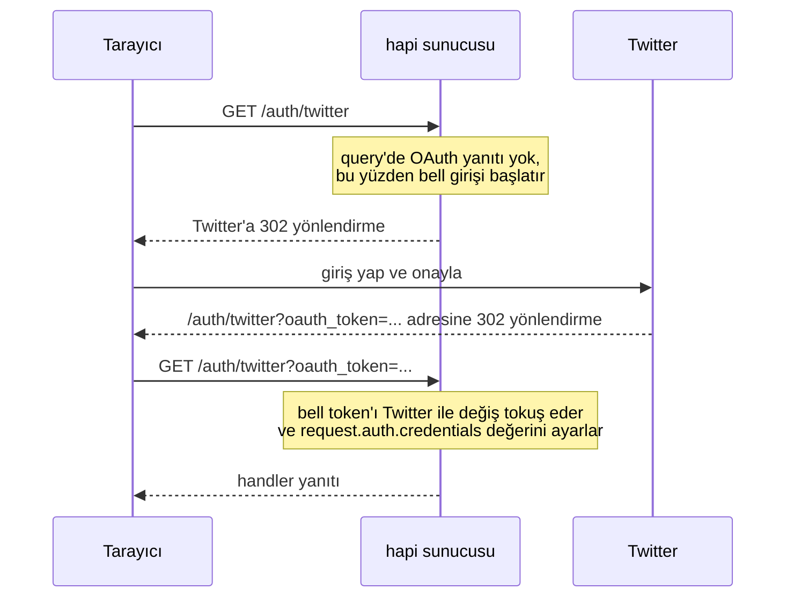

<TutorialLang />

# Express'ten Geçiş

_Bu rehber hapi v21 ve sonraki sürümlerle uyumludur_

## <a name="overview" ></a> Genel Bakış

Bu rehber, Express'te yaptığın şeyleri hapi'de nasıl yapacağını gösteriyor. Örneklerde Express 5 kullanılıyor.

En büyük fark şu: Express özellikleri, kurup `app.use()` ile sıraladığın middleware'ler aracılığıyla ekler; hapi ise bunların çoğunu çekirdeğine dahil eder ve route bazında yapılandırır. hapi'nin bir plugin'e ihtiyaç duyduğu yerlerde plugin hapi ekibinden gelir. hapi'nin kendi çalışma zamanı bağımlılıklarının hepsi aynı ekibin bakımını yaptığı `@hapi/*` paketleridir.

| Express'te kullandığın          | hapi'de kullandığın                                                                                                                                                       |
| ------------------------------- | ------------------------------------------------------------------------------------------------------------------------------------------------------------------------- |
| `express.json()`, `body-parser` | yerleşik: [payload ayrıştırma](#bodyparser)                                                                                                                               |
| `cookie-parser`                 | yerleşik: [`server.state()`](#config)                                                                                                                                     |
| `express-validator`             | yerleşik: [joi](https://joi.dev) ile route [`validate`](#joi) seçeneği                                                                                                    |
| `passport`                      | auth altyapısı yerleşik; şemalar `@hapi/basic`, `@hapi/cookie`, `@hapi/jwt` ve [bell](#bell) gibi plugin'lerden gelir ([Kimlik Doğrulama](/tutorials/tr_TR/auth) eğitimi) |
| `cors`                          | yerleşik: route [`cors`](/api#route-options-cors) seçeneği                                                                                                                |
| `helmet`                        | kısmen yerleşik: route [`security`](/api#route-options-security) seçeneği (Content-Security-Policy yok)                                                                   |
| `compression`                   | yerleşik, varsayılan olarak açık                                                                                                                                          |
| `app.set('view engine')`        | [vision](#vision) plugin'i                                                                                                                                                |
| `express.static()`              | [inert](#inert) plugin'i                                                                                                                                                  |
| özel middleware                 | [extension point'ler](#extension) ve [plugin'ler](#creating)                                                                                                              |
| hata yönetimi middleware'i      | bir `onPreResponse` [extension'ı](#extension); `next(err)` yerine [boom](#boom) hataları fırlat                                                                           |

## <a name="setup" ></a> Kurulum

### <a name="installation" ></a> Yükleme

|                    | Express                                 | hapi                     |
| ------------------ | --------------------------------------- | ------------------------ |
| Yükleme            | `npm install express`                   | `npm install @hapi/hapi` |
| TypeScript tipleri | `npm install --save-dev @types/express` | dahil                    |

### <a name="server" ></a> Sunucu Oluşturmak

Express:

```ts
import express from 'express';

const app = express();

app.listen(3000, function () {
    console.log('Server is running on port 3000');
});
```

hapi:

```ts
import Hapi from '@hapi/hapi';

const init = async () => {
    const server = Hapi.server({
        port: 3000,
        host: 'localhost',
    });

    await server.start();
    console.log('Server running on port 3000');
};

init();
```

hapi'de `server` nesnesi uygulamanın merkezidir. Seçenekleri (port, host, varsayılan route ayarları) sunucunun nasıl davranacağını belirler; route'lar, plugin'ler ve extension'ların hepsi ona eklenir. `server.start()` bir promise döndürür.

## <a name="routes" ></a> Route'lar

Express:

```ts
app.get('/hello', function (req, res) {
    res.send('Hello World!');
});
```

hapi:

```ts
server.route({
    method: 'GET',
    path: '/hello',
    handler: (request, h) => {
        return 'Hello World!';
    },
});
```

|                     | Express                           | hapi                                                  |
| ------------------- | --------------------------------- | ----------------------------------------------------- |
| Route tanımlamak    | `app.METHOD(path, handler)`       | `server.route({ method, path, handler })`             |
| Yanıt göndermek     | `res.send()` çağır                | değeri döndür                                         |
| Hangi route çalışır | eşleşen ve ilk kaydedilen route   | kayıt sırasından bağımsız olarak en özel eşleşme      |
| Çakışan route'lar   | ikisi de kaydedilir; ilki kazanır | iki route çakıştığında `server.route()` hata fırlatır |

hapi en özel route'u seçtiği için `'/home'` her zaman `'/{any*}'`'a karşı kazanır ve hangi route'un yanıt vereceğine asla kayıt sırası karar vermez. Kurallar için [Routing](/tutorials/tr_TR/routing) eğitimine bak.

### <a name="methods" ></a> Metotlar

| Express                | hapi                                                     |
| ---------------------- | -------------------------------------------------------- |
| `app.get(path, ...)`   | `method: 'GET'`                                          |
| metot başına bir route | `method: ['PUT', 'POST']`                                |
| `app.all(path, ...)`   | `method: '*'`                                            |
| `app.head(path, ...)`  | izin verilmez: her `GET` route'u `HEAD`'e de yanıt verir |

```ts
server.route({
    method: ['PUT', 'POST'],
    path: '/',
    handler: function (request, h) {
        return 'I did something!';
    },
});
```

### <a name="path" ></a> Path

hapi'de parametreler süslü parantez içine yazılır:

|                        | Express 5        | hapi              |
| ---------------------- | ---------------- | ----------------- |
| Parametre              | `/users/:userId` | `/users/{userId}` |
| İsteğe bağlı parametre | `/hello{/:user}` | `/hello/{user?}`  |
| Joker                  | `/files/*path`   | `/files/{path*}`  |

hapi'de `{user*}` ve tüm segmenti kaplayan `{user?}` son segment olmalıdır; `{user*2}` ve `/a{user?}/b` gibi segmentin bir kısmını kaplayan isteğe bağlı parametreler her yerde bulunabilir.

### <a name="parameters" ></a> Parametreler

Express:

```ts
app.get('/hello/:name', function (req, res) {
    const name = req.params.name;
    res.send('Hello ' + name);
});
```

hapi:

```ts
server.route({
    method: 'GET',
    path: '/hello/{name}',
    handler: function (request, h) {
        const name = request.params.name;
        return 'Hello ' + name;
    },
});
```

| Express      | hapi              |
| ------------ | ----------------- |
| `req.params` | `request.params`  |
| `req.query`  | `request.query`   |
| `req.body`   | `request.payload` |

### <a name="handler" ></a> Handler

Bir Express handler'ı `req` ve `res` alır ve yanıt vermek için `res` üzerindeki metotları çağırır. Bir hapi handler'ı ise `request` ile [response toolkit](/api#response-toolkit) olan `h`'yi alır ve yanıtı döndürür:

| Express                        | hapi                                                      |
| ------------------------------ | --------------------------------------------------------- |
| `res.send('text')`             | `return 'text'`                                           |
| `res.json(object)`             | `return object`                                           |
| `res.status(201).send(object)` | `return h.response(object).code(201)`                     |
| `res.set('x-name', 'value')`   | `return h.response(object).header('x-name', 'value')`     |
| `res.redirect('/')`            | `return h.redirect('/')`                                  |
| `res.cookie('name', 'value')`  | `h.state('name', 'value')`, bkz. [cookie'ler](#config)    |
| `res.sendFile(file)`           | `return h.file(file)`, bkz. [inert](#inert)               |
| `res.render('index', context)` | `return h.view('index', context)`, bkz. [vision](#vision) |
| `next(err)`                    | `throw Boom.notFound()`, bkz. [boom](#boom)               |

Handler'ın bir durum kodu ya da header ayarlaması gerektiğinde değeri `h.response()` ile sarmalar:

```ts
server.route({
    method: 'POST',
    path: '/user',
    handler: function (request, h) {
        const user = {
            firstName: 'John',
            lastName: 'Doe',
            id: 123,
        };

        return h.response(user).code(201).header('location', '/user/123');
    },
});
```

hapi döndürülen nesneyi JSON olarak serileştirir ve `content-type` değerini ayarlar. hapi'nin döndürülen bir değeri nasıl yanıta dönüştürdüğünü öğrenmek için [Yanıt Hazırlama](/tutorials/tr_TR/response-marshalling) eğitimine bak.

## <a name="plugins" ></a> Middleware ile Plugin'ler ve Extension'lar

Express middleware'leri `app.use()` çağırdığın sırayla çalıştırır. Bir middleware başka birine bağımlıysa onları doğru sırada elle tutarsın ve yanlış bir sıra istek anında hata verir.

hapi her isteği sabit bir adımlar dizisinden, yani [istek yaşam döngüsünden](/api#request-lifecycle) geçirir. Middleware'leri sıralamak yerine kodunu adlandırılmış bir adıma bağlarsın. Aşağıdaki her adım, aynı işi yapan Express middleware'ini de gösteriyor:

| hapi adımı                     | Extension point                  | Express karşılığı            |
| ------------------------------ | -------------------------------- | ---------------------------- |
| istek alındı                   | `onRequest`                      | routing öncesi `app.use()`   |
| route arama, cookie ayrıştırma |                                  | `app.get()`, `cookie-parser` |
| kimlik doğrulama öncesi        | `onPreAuth`                      |                              |
| kimlik doğrulama               |                                  | `passport`                   |
| payload ayrıştırma             |                                  | `express.json()`             |
| kimlik doğrulama sonrası       | `onCredentials`, `onPostAuth`    |                              |
| doğrulama                      |                                  | `express-validator`          |
| handler öncesi                 | `onPreHandler`                   |                              |
| handler                        |                                  | route callback'i             |
| handler sonrası                | `onPostHandler`, `onPreResponse` | hata yönetimi middleware'i   |
| yanıt gönderildikten sonra     | `onPostResponse`                 |                              |

Extension point'ler, `server.ext()` ile kendi kodunu eklediğin yerlerdir. Diğer adımları hapi her route'un yapılandırmasına göre çalıştırır.

Plugin'ler yeniden kullanılabilir middleware'lerin yerini alır. Plugin, sunucuya route'lar, extension'lar ve decoration'lar kaydeden adlandırılmış bir birimdir. Bir plugin ihtiyaç duyduğu diğer plugin'leri `dependencies` özelliğinde bildirebilir; biri eksikse hapi istek anında hata vermek yerine başlamayı reddeder. [Plugin'ler](/tutorials/tr_TR/plugins) eğitimine bak.

### <a name="extension" ></a> Extension Point'ler

Her istek için çalışan bir middleware bir extension'a dönüşür:

Express:

```ts
app.use(function (req, res, next) {
    console.log(req.method, req.url);
    next();
});
```

hapi:

```ts
server.ext('onRequest', function (request, h) {
    console.log(request.method, request.path);
    return h.continue;
});
```

`return h.continue`, `next()`'in rolünü üstlenir: istek bir sonraki adıma geçer. Bunun yerine bir takeover yanıtı (`h.response(...).takeover()`) döndürmek ya da bir hata fırlatmak isteği orada sonlandırır.

hapi'nin sekiz istek extension point'i vardır: `onRequest`, `onPreAuth`, `onCredentials`, `onPostAuth`, `onPreHandler`, `onPostHandler`, `onPreResponse` ve `onPostResponse`. Hangisinin ne zaman kullanılacağını [Yaşam Döngüsü Hook'ları](/tutorials/tr_TR/lifecycle-hooks) eğitimi anlatıyor, seçenekleri ise [`server.ext()`](/api#server-ext-events) listeliyor.

### <a name="creating" ></a> Plugin Oluşturmak

Her isteğe bir yardımcı ekleyen bir middleware, bir [decoration](/tutorials/tr_TR/decorators) ekleyen bir plugin'e dönüşür. Plugin, bir `name` (ya da `pkg`) ve bir `async register(server, options)` fonksiyonu olan bir nesnedir.

Express:

```ts
import type { NextFunction, Request, Response } from 'express';

declare global {
    namespace Express {
        interface Request {
            getDate(): Date;
        }
    }
}

const getDate = function (req: Request, res: Response, next: NextFunction) {
    req.getDate = function () {
        const date = new Date();
        return date;
    };

    next();
};
```

hapi:

```ts
import type { Plugin } from '@hapi/hapi';

declare module '@hapi/hapi' {
    interface ResponseToolkit {
        getDate(): Date;
    }
}

const getDate: Plugin<void> = {
    name: 'getDate',
    version: '1.0.0',
    register: async function (server, options) {
        const currentDate = function () {
            const date = new Date();
            return date;
        };

        server.decorate('toolkit', 'getDate', currentDate);
    },
};
```

- Express middleware'i `req.getDate`'i her istekte yeniden ayarlar. hapi plugin'i ise `server.decorate()`'i kayıt sırasında bir kez çağırır ve ardından her handler'da `h.getDate()` bulunur.
- TypeScript yeni metodu ancak sen bildirdiğinde tanır: Express'te global `Express.Request` arayüzü üzerinden, hapi'de ise onu `@hapi/hapi`'nin `ResponseToolkit` arayüzüne ekleyerek.

### <a name="load" ></a> Plugin Yüklemek

Express:

```ts
app.use(getDate);
```

hapi:

```ts
await server.register({
    plugin: getDate,
});
```

### <a name="options" ></a> Seçenekler

Bir Express middleware'i seçenekleri, middleware'i döndüren bir fonksiyon olarak alır. Bir hapi plugin'i ise seçeneklerini `register`'ın ikinci argümanı olarak alır.

Express:

```ts
import type { NextFunction, Request, Response } from 'express';

declare global {
    namespace Express {
        interface Request {
            getDate(): string;
        }
    }
}

export default function (options: { name: string }) {
    return function getDate(req: Request, res: Response, next: NextFunction) {
        req.getDate = function () {
            const date = 'Hello ' + options.name + ', the date is ' + new Date();
            return date;
        };

        next();
    };
}
```

hapi:

```ts
import type { Plugin } from '@hapi/hapi';

declare module '@hapi/hapi' {
    interface ResponseToolkit {
        getDate(): string;
    }
}

const getDate: Plugin<{ name: string }> = {
    name: 'getDate',
    version: '1.0.0',
    register: async function (server, options) {
        const currentDate = function () {
            const date = 'Hello ' + options.name + ', the date is ' + new Date();
            return date;
        };

        server.decorate('toolkit', 'getDate', currentDate);
    },
};
```

Seçenekleri plugin'i kaydederken verirsin. `Plugin<{ name: string }>` tip argümanı `register` içindeki `options`'ı tipler ve TypeScript, seçenekleri buna uymayan bir `server.register()` çağrısını işaretler; hapi bunları çalışma zamanında kontrol etmez:

Express:

```ts
import getDate from './mw/getDate.ts';

app.use(getDate({ name: 'Tom' }));
```

hapi:

```ts
await server.register({
    plugin: getDate,
    options: {
        name: 'Tom',
    },
});
```

## <a name="bodyparser" ></a> body-parser

hapi istek payload'unu handler çalışmadan önce, hiçbir middleware olmadan ayrıştırır. Sonuç `request.payload` içindedir.

| İçerik tipi                         | Express                         | hapi                                          |
| ----------------------------------- | ------------------------------- | --------------------------------------------- |
| `application/json`                  | `app.use(express.json())`       | varsayılan olarak ayrıştırılır                |
| `application/x-www-form-urlencoded` | `app.use(express.urlencoded())` | varsayılan olarak ayrıştırılır                |
| `text/*`                            | `app.use(express.text())`       | varsayılan olarak ayrıştırılır                |
| `multipart/form-data`               | `multer` gibi ayrı bir paket    | `payload: { multipart: true }` route seçeneği |

Express:

```ts
import express from 'express';

const app = express();

app.use(express.urlencoded());

app.post('/hello', function (req, res) {
    const name = req.body.name;
    res.send('Hello ' + name);
});
```

hapi:

```ts
server.route<{ Payload: { name: string } }>({
    method: 'POST',
    path: '/hello',
    handler: function (request, h) {
        const name = request.payload.name;
        return 'Hello ' + name;
    },
});
```

hapi istemcilerin ne göndereceğini bilemeyeceği için `request.payload`'un sabit bir yapısı yoktur. `server.route<{ Payload: { name: string } }>()` tip argümanı TypeScript'e handler'ın ne alacağını söyler. Bu yalnızca bir tiptir: payload'u çalışma zamanında kontrol etmek için [doğrulama](#joi) ekle. Boyut sınırları, zaman aşımları ve dosya yüklemeleri route'un [`payload` seçenekleriyle](/api#route-options-payload) ayarlanır.

## <a name="config" ></a> cookie-parser

hapi cookie'leri middleware olmadan okur ve yazar. Express cookie seçeneklerini her `res.cookie()` çağrısında alırken, hapi her cookie'yi `server.state()` ile bir kez tanımlar ve ardından her route onu adıyla ayarlar.

| Seçenek          | Express `res.cookie()`               | hapi `server.state()`                |
| ---------------- | ------------------------------------ | ------------------------------------ |
| Secure bayrağı   | `secure`, varsayılan olarak kapalı   | `isSecure`, varsayılan olarak açık   |
| HttpOnly bayrağı | `httpOnly`, varsayılan olarak kapalı | `isHttpOnly`, varsayılan olarak açık |
| SameSite         | `sameSite`                           | `isSameSite`, varsayılan `'Strict'`  |
| Ömür             | `maxAge` (ms)                        | `ttl` (ms)                           |
| İmzalı değer     | `signed`                             | `sign: { password }`                 |
| Şifreli değer    | yerleşik değil                       | `encoding: 'iron'`                   |

Tüm seçenekler için [`server.state()`](/api#server-state-name-options) referansına ve [Cookie'ler](/tutorials/tr_TR/cookies) eğitimine bak.

### <a name="setCookie" ></a> Cookie Ayarlamak

Express:

```ts
import express from 'express';
import cookieParser from 'cookie-parser';

const app = express();

app.use(cookieParser());

app.get('/', function (req, res) {
    res.cookie('username', 'tom', { secure: true, httpOnly: true });
    res.send('Hello');
});
```

hapi:

```ts
import Hapi from '@hapi/hapi';

const server = Hapi.server({ port: 8000 });

server.state('username', {
    ttl: null,
    isSecure: true,
    isHttpOnly: true,
});

server.route({
    method: 'GET',
    path: '/',
    handler: function (request, h) {
        h.state('username', 'tom');
        return 'Hello';
    },
});
```

### <a name="getCookie" ></a> Cookie Değerini Okumak

Express:

```ts
app.get('/whoami', (req, res) => {
    res.send(req.cookies.username);
});
```

hapi:

```ts
server.route({
    method: 'GET',
    path: '/whoami',
    handler: (request, h) => {
        const username = request.state.username;
        if (typeof username !== 'string') {
            return 'No username cookie';
        }

        return username;
    },
});
```

`request.state` istemcinin gönderdiği cookie'leri olduğu gibi tutar, bu yüzden hapi her değeri `unknown` olarak tipler. Kullanmadan önce tipini kontrol et.

## <a name="bell" ></a> Passport -> bell

Express üçüncü taraf girişleri Passport ile yönetir. hapi ise Twitter, Facebook, Google ve GitHub dahil 30'dan fazla OAuth sağlayıcısı için yerleşik yapılandırmalara sahip olan ve özel sağlayıcıları da destekleyen [bell](/module/bell)'i kullanır. [bell sağlayıcı listesine](/module/bell/providers) bak.

Passport iki route'a ihtiyaç duyar: biri girişi başlatmak, diğeri sağlayıcının callback'i için. bell ikisi için tek bir route kullanır:



Express:

```
npm install passport passport-twitter
```

TypeScript kullanıyorsan ayrıca `npm install --save-dev @types/passport @types/passport-twitter` çalıştır.

```ts
import passport from 'passport';
import { Strategy as TwitterStrategy } from 'passport-twitter';

passport.use(
    new TwitterStrategy(
        {
            consumerKey: TWITTER_CONSUMER_KEY,
            consumerSecret: TWITTER_CONSUMER_SECRET,
            callbackURL: '/auth/twitter/callback',
        },
        function (token, tokenSecret, profile, cb) {
            User.findOrCreate({ twitterId: profile.id }, function (err, user) {
                return cb(err, user);
            });
        },
    ),
);

passport.serializeUser(function (user, cb) {
    cb(null, user);
});

passport.deserializeUser(function (user: Express.User, cb) {
    cb(null, user);
});

app.get('/auth/twitter', passport.authenticate('twitter'));
app.get('/auth/twitter/callback', passport.authenticate('twitter', { failureRedirect: '/login' }), function (req, res) {
    res.redirect('/');
});
```

hapi:

```
npm install @hapi/bell
```

```ts
import Hapi from '@hapi/hapi';
import Bell from '@hapi/bell';

const server = Hapi.server({ port: 8000 });

await server.register(Bell);

server.auth.strategy('twitter', 'bell', {
    provider: 'twitter',
    password: 'cookie_encryption_password_secure',
    clientId: TWITTER_CONSUMER_KEY,
    clientSecret: TWITTER_CONSUMER_SECRET,
    isSecure: false,
});

server.route({
    method: '*',
    path: '/auth/twitter', // The callback endpoint registered with the provider
    handler: function (request, h) {
        if (!request.auth.isAuthenticated) {
            return `Authentication failed due to: ${request.auth.error.message}`;
        }

        // Look up or register the account, start a local session, and redirect.
        // request.auth.credentials holds the provider's profile and tokens.

        return h.redirect('/home');
    },
    options: {
        auth: {
            strategy: 'twitter',
            mode: 'try',
        },
    },
});
```

| Seçenek        | Nedir                                                                                                                          |
| -------------- | ------------------------------------------------------------------------------------------------------------------------------ |
| `provider`     | yerleşik sağlayıcı yapılandırmasının adı                                                                                       |
| `password`     | bell'in iki istek arasında tuttuğu geçici cookie'yi şifreler; en az 32 karakter                                                |
| `clientId`     | sağlayıcıdan alınan OAuth client ID                                                                                            |
| `clientSecret` | sağlayıcıdan alınan OAuth client secret                                                                                        |
| `isSecure`     | cookie'nin Secure bayrağı. `false` geliştirme sırasında düz HTTP'ye izin verir; production'da varsayılan `true` değerini bırak |

`mode: 'try'`, giriş başarısız olduğunda handler'ın çalışmasını sağlar; böylece handler çıplak bir 401 yerine hatayı gösterebilir. Girişi başlatan istekteki query parametreleri `request.auth.credentials.query` üzerinde geri gelir; böylece bir dönüş URL'ini sağlayıcıya gidiş dönüş boyunca taşıyabilirsin.

## <a name="joi" ></a> express-validator -> joi

hapi istekleri ve yanıtları route'un yapılandırmasından, [joi](https://joi.dev) şemalarını kullanarak doğrular. express-validator yalnızca istekleri kontrol eder; hapi ise handler'ının döndürdüğü değeri de kontrol edebilir. Daha fazlası için [Doğrulama](/tutorials/tr_TR/validation) eğitimine bak.

### <a name="input" ></a> Girdi Doğrulama

Express:

```
npm install express-validator
```

```ts
import express from 'express';
import { body, validationResult } from 'express-validator';

app.use(express.json());
app.use(express.urlencoded());

app.post('/post', body('post', 'Post too long').isLength({ max: 140 }), function (req, res) {
    const errors = validationResult(req);
    if (!errors.isEmpty()) {
        res.status(400).send(errors.array());
    } else {
        res.send('Blog post added!');
    }
});
```

hapi:

```
npm install joi
```

```ts
import Joi from 'joi';

server.route({
    method: 'POST',
    path: '/post',
    handler: (request, h) => {
        return 'Blog post added!';
    },
    options: {
        validate: {
            payload: Joi.object({
                post: Joi.string().max(140),
            }),
        },
    },
});
```

- Handler yalnızca payload doğrulamadan geçtiğinde çalışır. Aksi halde hapi kendiliğinden 400 ile yanıt verir, bu yüzden handler'da hata dalı yoktur.
- Kurallar zincirlenir, örneğin `Joi.string().min(1).max(140)`.
- `validate` ayrıca `params`, `query`, `headers` ve `state` şemalarını da kabul eder.

### <a name="output" ></a> Çıktı Doğrulama

```ts
const bookSchema = Joi.object({
    title: Joi.string().required(),
    author: Joi.string().required(),
    isbn: Joi.string().length(10),
    pageCount: Joi.number(),
    datePublished: Joi.date().iso(),
});

server.route({
    method: 'GET',
    path: '/books',
    handler: async function (request, h) {
        return await getBooks();
    },
    options: {
        response: {
            schema: Joi.array().items(bookSchema),
            failAction: 'log',
        },
    },
});
```

`response.schema`, handler'ın döndürdüğü kitap listesini kontrol eder. `failAction: 'log'` ile şemaya uymayan bir yanıt yine de gönderilir ve hata loglanır; varsayılan `'error'` ise onu bir 500 ile değiştirir.

## <a name="vision" ></a> app.set('view engine') -> vision

hapi şablonları [vision](/module/vision) plugin'i aracılığıyla render eder. Aynı anda birden fazla şablon motorunu, ayrıca partial'ları, helper'ları ve layout'ları destekler. Daha fazlası için [View'lar](/tutorials/tr_TR/views) eğitimine bak.

### <a name="viewengine" ></a> View Engine'i Ayarlamak

Express:

```ts
app.set('view engine', 'pug');
```

hapi:

```ts
import Vision from '@hapi/vision';
import Pug from 'pug';

await server.register(Vision);

server.views({
    engines: {
        pug: Pug,
    },
    relativeTo: import.meta.dirname,
    path: 'views',
});
```

Express şablonları varsayılan olarak `./views` içinde arar. hapi'de klasörü `relativeTo` ve `path` ile ayarlarsın.

### <a name="view" ></a> View Render Etmek

Express:

```ts
app.get('/', function (req, res) {
    res.render('index', { title: 'Homepage', message: 'Welcome' });
});
```

hapi, `h.view()` ile:

```ts
server.route({
    method: 'GET',
    path: '/',
    handler: function (request, h) {
        return h.view('index', { title: 'Homepage', message: 'Welcome' });
    },
});
```

hapi, route yalnızca bir şablon render ediyorsa `view` handler'ı ile:

```ts
server.route({
    method: 'GET',
    path: '/',
    handler: {
        view: {
            template: 'index',
            context: {
                title: 'Homepage',
                message: 'Welcome',
            },
        },
    },
});
```

## <a name="inert" ></a> express.static() -> inert

hapi statik dosyaları [inert](/module/inert) plugin'i aracılığıyla sunar. inert, `file` ve `directory` handler'larını ve `h.file()` metodunu ekler. Daha fazlası için [Dosya Sunma](/tutorials/tr_TR/serving-files) eğitimine bak.

Aşağıdaki iki örnek de inert'i kaydeden ve dosya path'lerinin göreli olduğu klasörü ayarlayan şu kurulumu kullanıyor:

```ts
import Path from 'node:path';
import Hapi from '@hapi/hapi';
import Inert from '@hapi/inert';

const server = Hapi.server({
    port: 3000,
    routes: {
        files: {
            relativeTo: Path.join(import.meta.dirname, 'public'),
        },
    },
});

await server.register(Inert);
```

### <a name="single" ></a> Tek Dosya Sunmak

Express:

```ts
app.get('/image', function (req, res) {
    res.sendFile('image.jpg', { root: './public' });
});
```

hapi, `h.file()` ile:

```ts
server.route({
    method: 'GET',
    path: '/image',
    handler: function (request, h) {
        return h.file('image.jpg');
    },
});
```

hapi, `file` handler'ı ile:

```ts
server.route({
    method: 'GET',
    path: '/image',
    handler: {
        file: 'image.jpg',
    },
});
```

### <a name="static" ></a> Statik Dosya Sunucusu

Express:

```ts
app.use(express.static('public'));
```

hapi:

```ts
server.route({
    method: 'GET',
    path: '/{param*}',
    handler: {
        directory: {
            path: '.',
        },
    },
});
```

`{param*}` jokeri her path ile eşleşir ve `directory` handler'ı eşleşen dosyayı `public` klasöründen sunar; yani `/logo.png`, `public/logo.png` dosyasını döndürür. hapi en özel route'u seçtiği için diğer route'ların bu her şeyi yakalayan route'a karşı yine kazanır.

## <a name="boom" ></a> Hata Yönetimi -> boom

hapi hatalara [boom](/module/boom) hata nesnelerinden oluşturulan JSON ile yanıt verir. Express ise bir HTML sayfasıyla yanıt verir. Hiçbir route ile eşleşmeyen bir `GET /hello` için:

Express:

```text
Cannot GET /hello
```

hapi:

```json
{
    "statusCode": 404,
    "error": "Not Found",
    "message": "Not Found"
}
```

### <a name="custom" ></a> Özel Mesajlar

Express:

```ts
res.status(404).send({ status: 404, error: 'Page not found' });
```

hapi:

```ts
throw Boom.notFound('Page not found');
```

Fırlatılan hata şu yanıta dönüşür:

```json
{
    "statusCode": 404,
    "error": "Not Found",
    "message": "Page not found"
}
```

boom, `Boom.badRequest()`, `Boom.unauthorized()` ve `Boom.badImplementation()` gibi yaygın 4xx ve 5xx durum kodları için birer fonksiyon sunar. Birini bir handler, extension ya da plugin içinde herhangi bir yerde fırlat, hapi onu yanıta dönüştürür. boom hatası olmayan hatalar 500'e dönüşür ve mesajları istemciden gizlenir. Tam liste için [boom belgelerine](/module/boom) bak.
