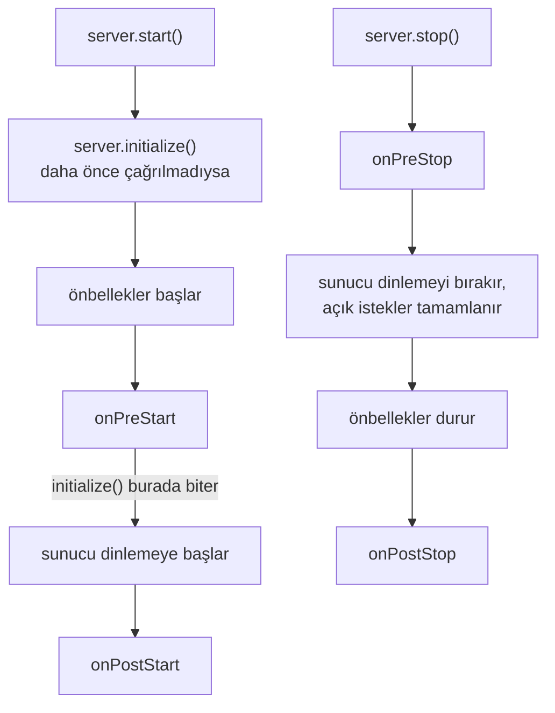
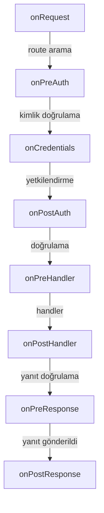

<TutorialLang />

# Yaşam Döngüsü Hook'ları

_Bu eğitim hapi v21 ve sonraki sürümlerle uyumludur_

## <a name="overview"></a> Genel Bakış

hapi her isteği aynı sabit adım dizisinden geçirir: route arama, kimlik doğrulama, doğrulama, handler ve diğerleri. API referansının extension point (genişletme noktası) dediği bir yaşam döngüsü hook'u, bu dizinin adlandırılmış bir noktasında kendi fonksiyonunu çalıştırmanı sağlar. Sunucunun kendisinde de başlatma ve kapatma için dört hook daha vardır.

Uygulama geneline yayılan özelliklerin çoğu hook'larla yapılır. Birçok resmi plugin büyük ölçüde birkaç hook'tan ibarettir:

| Plugin                 | Hook            | Orada ne yapar                                            |
| ---------------------- | --------------- | --------------------------------------------------------- |
| [yar](/module/yar)     | `onPreAuth`     | oturumu yükler, böylece kimlik doğrulama onu kullanabilir |
| [yar](/module/yar)     | `onPreResponse` | oturumu bir cookie'ye kaydeder                            |
| [crumb](/module/crumb) | `onPostAuth`    | CSRF token'ı eksik ya da yanlış olan istekleri reddeder   |
| [crumb](/module/crumb) | `onPreResponse` | HTML sayfalarının view context'ine CSRF token'ını ekler   |
| [nes](/module/nes)     | `onPreStart`    | WebSocket heartbeat'lerini başlatır                       |
| [nes](/module/nes)     | `onPreStop`     | açık WebSocket bağlantılarını kapatır                     |

Bir hook'u [`server.ext()`](/api#server-ext-events) ile eklersin; seçeneklerin tam listesi API referansında.

## <a name="server-hooks"></a> Sunucu hook'ları: başlatma ve kapatma

Sunucu hook'ları, sunucu başlarken ya da dururken bir kez çalışır. Her biri `server` nesnesini alır ve hiçbir şey ya da bir promise döndürür. Fırlatılan bir hata başlatmayı veya kapatmayı durdurur.



[`server.start()`](/api#await-server-start), sen çağırmadıysan önce `server.initialize()` çalıştırır. `initialize()` dinleme adımından önce durur; yani `onPreStart` çalıştırır ama hiçbir zaman port açmaz. Bu da onu, istekleri `server.inject()` ile gönderdiğin testlerde doğru çağrı yapar.

| Hook          | Ne zaman çalışır                   | Ne için kullanılır                                                                           |
| ------------- | ---------------------------------- | -------------------------------------------------------------------------------------------- |
| `onPreStart`  | sunucu dinlemeye başlamadan önce   | veritabanlarına bağlanmak ve yapılandırmayı denetlemek, böylece bir hata başlatmayı durdurur |
| `onPostStart` | sunucu dinlemeye başladıktan sonra | bağlanan portu gerektiren işler, örneğin service discovery'ye kayıt olmak                    |
| `onPreStop`   | sunucu dinlemeyi bırakmadan önce   | load balancer'lara ve uzun ömürlü bağlantılara ayrılmalarını söylemek                        |
| `onPostStop`  | açık istekler tamamlandıktan sonra | veritabanı havuzunu ve isteklerin kullandığı diğer kaynakları kapatmak                       |

Yaygın örnek bir veritabanı havuzudur. `onPreStart` içinde bağlanmak, veritabanı yoksa ilk isteğin değil `server.start()` çağrısının başarısız olmasını sağlar. `onPostStop` içinde kapatmak, devam eden isteklerin sorgularını bitirmesini bekler:

```ts
import Hapi from '@hapi/hapi';
import { Pool } from 'pg';

import type { Plugin } from '@hapi/hapi';

const database: Plugin<{ connectionString: string }> = {
    name: 'database',
    register(server, options) {
        const pool = new Pool({ connectionString: options.connectionString });

        server.ext('onPreStart', async () => {
            await pool.query('SELECT 1');
        });

        server.ext('onPostStop', async () => {
            await pool.end();
        });

        server.expose('pool', pool);
    },
};

const server = Hapi.server({ port: 4000 });

await server.register({
    plugin: database,
    options: { connectionString: 'postgres://localhost/app' },
});

await server.start();

process.on('SIGTERM', async () => {
    await server.stop({ timeout: 10_000 });
    process.exit(0);
});
```

`server.stop({ timeout })`, açık isteklere bağlantıları kapatılmadan önce tamamlanmaları için bu kadar süre tanır. Bu havuz gibi bir servisi handler'larla paylaşmak için bir [sunucu decoration'ı](/tutorials/tr_TR/decorators#server) kullan.

Sunucu hook'ları için iki kural:

- `onPreStart` hook'unu `initialize()` ya da `start()` çağırmadan önce ekle. Sonradan eklemek `Cannot add onPreStart (after) extension after the server was initialized` hatasını fırlatır.
- Bir plugin'in başlatma işi başka bir plugin'in hazır olmasını gerektiriyorsa, bunu bir [`server.dependency()`](/api#server-dependency-dependencies-after) callback'ine koy. hapi bu callback'i `onPreStart` sırasında, kayıt sırası ne olursa olsun adı verilen plugin'lerden sonra çalıştırır. Plugin'ler eğitimindeki [Bağımlılıklar](/tutorials/tr_TR/plugins#dependencies) bölümüne bak.

## <a name="request-hooks"></a> İstek hook'ları

İstek hook'ları her istek için çalışır. Sekiz hook, [istek yaşam döngüsünün](/api#request-lifecycle) adımları arasında yer alır:



`onRequest`, `onPreResponse` ve `onPostResponse`; 404'ler ile kimlik doğrulama veya doğrulama tarafından reddedilen istekler dahil her istekte çalışır. İstisna, iptal edilen ya da `h.close` ile kapatılan bir istektir; bu istek `onPreResponse` adımını atlar. `onCredentials`, route'ta kimlik doğrulama yapılandırılmışsa, hiç kimlik bilgisi bulunmasa bile çalışır. Diğerleri istek o noktaya ulaştığında çalışır.

| Hook             | Neye güvenebilirsin                                                                       | Tipik kullanım                                          |
| ---------------- | ----------------------------------------------------------------------------------------- | ------------------------------------------------------- |
| `onRequest`      | ham yol ve header'lar; henüz route yok; URL'yi değiştirebilir                             | istek id'leri, URL yeniden yazma, bakım modu            |
| `onPreAuth`      | `request.route` ve ayrıştırılmış cookie'ler                                               | kimlik doğrulamanın okuyacağı bir oturumu yüklemek      |
| `onCredentials`  | scope'lar denetlenmeden önce `request.auth.credentials`                                   | veritabanından roller ya da scope'lar eklemek           |
| `onPostAuth`     | kimlik doğrulama tamamlanmış, payload ayrıştırılmış ama doğrulanmamış                     | CSRF denetimleri, tenant'ı ya da hesabı yüklemek        |
| `onPreHandler`   | params, query ve payload doğrulanmış                                                      | doğrulanmış girdi gerektiren denetimler                 |
| `onPostHandler`  | handler'ın response nesnesi; başarısız bir handler doğrudan `onPreResponse` adımına atlar | başarılı yanıtları değiştirmek                          |
| `onPreResponse`  | hatalar dahil son `request.response`                                                      | hata sayfaları, yanıt header'ları, oturumları kaydetmek |
| `onPostResponse` | yanıt gönderilmiştir                                                                      | metrikler, erişim logları, temizlik                     |

### <a name="return-values"></a> Bir hook ne döndürür

Bir istek hook'u bir [yaşam döngüsü metodudur](/api#lifecycle-methods): `(request, h)` alır ve bir şey döndürmek zorundadır. Döndürdüğü şey sonra ne olacağına karar verir:

| Dönüş değeri                         | `onRequest`                   | `onPreAuth` ile `onPreHandler` arası                                 | `onPostHandler`, `onPreResponse`                              | `onPostResponse`                           |
| ------------------------------------ | ----------------------------- | -------------------------------------------------------------------- | ------------------------------------------------------------- | ------------------------------------------ |
| `h.continue`                         | sonraki adım çalışır          | sonraki adım çalışır                                                 | mevcut yanıt korunur                                          | yok sayılır                                |
| `h.response(value).takeover()`       | `onPreResponse` adımına atlar | route'un yanıt doğrulamasına, ardından `onPreResponse` adımına atlar | yanıtı değiştirir; aynı tipteki sonraki hook'lar atlanır      | yok sayılır                                |
| fırlatılan ya da döndürülen bir hata | `onPreResponse` adımına atlar | `onPreResponse` adımına atlar                                        | yanıtı değiştirir; aynı tipteki sonraki hook'lar atlanır      | fırlatılan ya da döndürülen boom: loglanır |
| başka herhangi bir değer             | 500 hatası                    | 500 hatası                                                           | yanıtı değiştirir; aynı tipteki sonraki hook'lar yine çalışır | yok sayılır                                |
| hiçbir şey (`undefined`)             | 500 hatası                    | 500 hatası                                                           | 500 hatası                                                    | yok sayılır                                |

[`h.continue`](/api#h-continue), bir hook'un "burada yapacak bir şey yok" deme yoludur. Takeover ise handler'dan önceki bir hook'un isteği kendisinin yanıtlama yoludur; `onRequest` içinden yapılan bir takeover bile `onPreResponse` adımından geçer. Kuralların tamamı API referansındaki [yaşam döngüsü akışı](/api#lifecycle-workflow) bölümünde.

## <a name="patterns"></a> Kalıplar

### <a name="request-id"></a> İstek id'leri ve süre ölçümü

Bir istek id'si, istemcinin hata raporunu loglarınla ilişkilendirir. Bu plugin istemciden bir id kabul eder ya da bir tane oluşturur, onu bir header'da geri döndürür ve her isteğin ne kadar sürdüğünü kaydeder:

```ts
import { randomUUID } from 'node:crypto';
import Boom from '@hapi/boom';

import type { Plugin } from '@hapi/hapi';

declare module '@hapi/hapi' {
    interface PluginsStates {
        'request-tracing': { id: string };
    }
}

const requestTracing: Plugin<void> = {
    name: 'request-tracing',
    register(server) {
        server.ext('onRequest', (request, h) => {
            const incoming = request.headers['x-request-id'];
            request.plugins['request-tracing'] = { id: typeof incoming === 'string' ? incoming : randomUUID() };
            return h.continue;
        });

        server.ext('onPreResponse', (request, h) => {
            const { response } = request;
            const { id } = request.plugins['request-tracing'];
            if (Boom.isBoom(response)) {
                response.output.headers['x-request-id'] = id;
            } else {
                response.header('x-request-id', id);
            }

            return h.continue;
        });

        server.ext('onPostResponse', (request, h) => {
            const { response } = request;
            const statusCode = Boom.isBoom(response) ? response.output.statusCode : response.statusCode;
            const duration = request.info.completed - request.info.received;

            request.log(['metrics'], {
                id: request.plugins['request-tracing'].id,
                path: request.path,
                statusCode,
                duration,
            });
            return h.continue;
        });
    },
};
```

- Bir plugin, istek başına verisini [`request.plugins`](/api#request-plugins) içinde kendi adı altında tutar; `declare module` bloğu bu girdinin tipini hapi'nin `PluginsStates` arayüzü üzerinden belirler. [`request.app`](/api#request-app) ise uygulamanın kendi kodu içindir.
- İstek başarısız olduğunda `request.response` bir boom hatasıdır, bu yüzden `onPreResponse`, `.header()` çağırmak yerine header'ı `response.output.headers` üzerine ayarlar.
- `onPostResponse` yanıt gönderildikten sonra çalışır; istemci onu hiç beklemez ve dönüş değeri yok sayılır. hapi `onPostResponse` hook'larını art arda çalıştırır, yani yavaş bir hook kendisinden sonraki hook'ları yine de geciktirir. Metrikleri ağ üzerinden göndermek gibi yavaş işleri bir kuyruğa devret ve dön.
- hapi [`request.info.received`](/api#request-info) ve `request.info.completed` değerlerini zaten kaydeder, bu yüzden başlangıç zamanını kendin saklamana gerek yoktur.

### <a name="rewrite"></a> URL'leri yeniden yazmak

`onRequest`, route aramasından önce çalışan tek hook'tur; dolayısıyla bir yeniden yazmanın isteği hangi route'un işleyeceğini değiştirebildiği tek yer burasıdır. Yeniden yazmayı [`request.setUrl()`](/api#request-seturl-url-striptrailingslash) yapar:

```ts
server.ext('onRequest', (request, h) => {
    if (request.path.startsWith('/api/v1/')) {
        request.setUrl(request.url.pathname.replace('/api/v1/', '/api/') + request.url.search);
    }

    return h.continue;
});
```

Eski istemciler `/api/v1/users?page=2` çağırmaya devam eder ve `/api/users` route'u onlara query string'i bozmadan yanıt verir.

### <a name="maintenance"></a> Bakım modu

`onRequest` içinden verilen bir takeover yanıtı, herhangi bir route çalışmadan her isteği yanıtlar:

```ts
let maintenance = false;

server.ext('onRequest', (request, h) => {
    if (!maintenance || request.path === '/health') {
        return h.continue;
    }

    return h.response({ message: 'Down for maintenance' }).code(503).header('retry-after', '600').takeover();
});
```

Sağlık denetimi erişilebilir kalır, böylece load balancer'ın planlı bir kesintiyi çökmeden ayırt edebilir.

### <a name="credentials"></a> Rolleri yüklemek: onCredentials mı onPostAuth mı

İki hook da kimlik doğrulamadan sonra çalışır. Fark, aralarındaki yetkilendirme adımıdır; bu adım route'un [`auth.access.scope`](/api#route-options-auth-access-scope) değerini denetler (bkz. [Scope'lar](/tutorials/tr_TR/auth#scopes)).

Yetkilendirmenin görmesi gereken bir şey eklediğinde `onCredentials` kullan. Bir token çoğu zaman kullanıcıyı tanımlar ama rollerini taşımaz; bu yüzden rolleri veritabanından yükler ve scope olarak eklersin:

```ts
server.ext('onCredentials', async (request, h) => {
    if (!request.auth.isAuthenticated) {
        return h.continue;
    }

    const { user } = request.auth.credentials;
    if (user) {
        request.auth.credentials.scope = await loadRoles(user.id);
    }

    return h.continue;
});

server.route<{ Params: { id: string } }>({
    method: 'DELETE',
    path: '/projects/{id}',
    options: { auth: { access: { scope: 'admin' } } },
    handler: (request, h) => deleteProject(request.params.id),
});
```

`onCredentials`, route'ta kimlik doğrulama yapılandırılmışsa her zaman çalışır; buna kimlik bilgisi bulunmayan ve `request.auth.credentials` değerinin `null` olduğu `'try'` ve `'optional'` route'ları da dahildir. Bu yüzden önce `request.auth.isAuthenticated` değerini denetle. `user.id`, [Kimlik Doğrulama](/tutorials/tr_TR/auth#schemes) eğitiminde gösterilen `UserCredentials` bildirimine dayanır.

Kullanıcının neye izni olduğunu değiştirmeyen ya da kimlik doğrulaması olmayan route'larda da çalışması gereken işler için `onPostAuth` kullan; örneğin `Host` header'ında adı geçen tenant'ı yüklemek. `onCredentials`, `auth: false` olan bir route'ta hiçbir zaman çalışmaz.

### <a name="errors"></a> Tutarlı hata yanıtları

`onPreResponse` dışarı çıkan her yanıtı görür, bu yüzden hataların nasıl göründüğünü değiştirdiğin yer burasıdır. Bir hatayı kendi yanıtıyla değiştiren bir hook, hatanın header'larını korumak zorundadır; örneğin bir 401'deki `WWW-Authenticate`:

```ts
import Boom from '@hapi/boom';

server.ext(
    'onPreResponse',
    (request, h) => {
        const { response } = request;
        if (!Boom.isBoom(response)) {
            return h.continue;
        }

        const { statusCode, payload, headers } = response.output;
        const reply = h.response({ error: payload.message }).code(statusCode);
        for (const [name, value] of Object.entries(headers)) {
            if (value !== undefined) {
                reply.header(name, String(value));
            }
        }

        return reply;
    },
    { before: ['request-tracing'] },
);
```

Yeni yanıt hatanın yerini alır ve bundan sonra çalışan `onPreResponse` hook'ları yeni yanıtı görür. `before: ['request-tracing']` ile [istek id hook'u](#request-id) bundan sonra çalışır ve header'ını yeni yanıta ekler. Bu olmadan istek id hook'u header'ını önce hataya koyardı ve onu yalnızca yukarıdaki header kopyalama korurdu. Sıralama en çok yanıtı değiştiren hook'lar için önemlidir. [Yanıt Hazırlama](/tutorials/tr_TR/response-marshalling#errors) eğitiminde eksiksiz bir hata biçimi ve HTML hata sayfaları var.

## <a name="ordering"></a> Sıralama ve kapsam

Varsayılan olarak aynı tipteki hook'lar, sunucu hook'ları, plugin hook'ları ve route hook'ları birlikte sayılarak eklendikleri sırayla çalışır. Üç seçenek, bir hook'un hangi istekleri göreceğini ve ne zaman çalışacağını değiştirir.

**`before` ve `after`** plugin adları alır ve plugin'inin hook'unu onlarınkine göre sıralar. yar'ın yüklediği oturumu okuyan bir plugin şunu kullanır:

```ts
server.ext('onPreAuth', loadPreferences, { after: ['@hapi/yar'] });
```

**`sandbox: 'plugin'`**, bir hook'u yalnızca kendi plugin'inin eklediği route'larla sınırlar. hapi route'u bilmeden önce çalışan `onRequest` dışındaki tüm istek hook'larında çalışır:

```ts
import type { Plugin } from '@hapi/hapi';

const adminPanel: Plugin<void> = {
    name: 'admin-panel',
    register(server) {
        server.ext('onPreHandler', auditAdminAccess, { sandbox: 'plugin' });

        server.route({ method: 'GET', path: '/admin', handler: (request, h) => 'admin' });
    },
};
```

**Route düzeyindeki hook'lar** route'un [`options.ext`](/api#route-options-ext) değerine yazılır ve yalnızca o route için çalışır:

```ts
server.route({
    method: 'POST',
    path: '/uploads',
    options: {
        ext: {
            onPreHandler: { method: checkStorageQuota },
        },
    },
    handler: (request, h) => saveUpload(request.payload),
});
```

`server.ext()` bir dizi de alır; bu, bir plugin'in hook'larını tek bir yerde bir arada tutar:

```ts
server.ext([
    { type: 'onRequest', method: assignRequestId },
    { type: 'onPreResponse', method: addRequestIdHeader },
    { type: 'onPostResponse', method: recordMetrics },
]);
```

## <a name="typing"></a> Hook'ları tiplemek

`server.ext()` içinde satır içi yazılan hook'lar tip açıklaması gerektirmez: TypeScript `request` ve `h` tiplerini hook adından, sunucu hook'ları için de `server` tipini çıkarır. Ayrı tanımlanan bir hook bir `Lifecycle.Method`'dur:

```ts
import Boom from '@hapi/boom';

import type { Lifecycle } from '@hapi/hapi';

const checkStorageQuota: Lifecycle.Method = async (request, h) => {
    if (!request.auth.isAuthenticated) {
        throw Boom.unauthorized();
    }

    const quota = await getQuota(request.auth.credentials.user?.id);
    if (quota.used >= quota.limit) {
        throw Boom.forbidden('Storage quota exceeded');
    }

    return h.continue;
};
```

Hook'larının isteğe kaydettiği verileri tiplemek için [istek id örneğinde](#request-id) olduğu gibi `PluginsStates` arayüzünü ya da uygulama kodunda `request.app` için `RequestApplicationState` arayüzünü genişlet. `user?.id`, [Kimlik Doğrulama](/tutorials/tr_TR/auth#schemes) eğitiminde gösterilen `UserCredentials` bildirimine dayanır.
