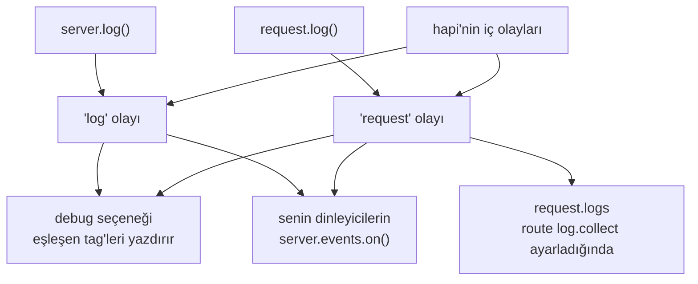

<TutorialLang />

# Loglama

_Bu eğitim hapi v21 ve sonraki sürümlerle uyumludur_

## <a name="overview"></a> Genel Bakış

Kendi kodundaki hataları konsola yazdıran varsayılan [`debug`](#debug) ayarı dışında hapi hiçbir yere log yazmaz. Her log çağrısını `server.events` üzerinde bir olaya dönüştürür ve bu olaylarla ne yapılacağına sen karar verirsin: yazdırmak, bir loglama servisine göndermek ya da istek başına toplamak.



## <a name="methods"></a> Yerleşik Metotlar

İki loglama metodu vardır. Kodunun çalıştığı yere uyanı seç:

| Metot                                                             | Ne zaman kullanılır                                                    | Yaydığı olay |
| ----------------------------------------------------------------- | ---------------------------------------------------------------------- | ------------ |
| [`request.log(tags, [data])`](/api#request-log-tags-data)         | bir istek kapsamdayken: bir handler, bir extension, bir auth şeması    | `'request'`  |
| [`server.log(tags, [data])`](/api#server-log-tags-data-timestamp) | kapsamda istek yokken: başlatma, bir plugin'in `register()` fonksiyonu | `'log'`      |

İkisi de aynı iki ana argümanı alır:

- `tags`: `['error', 'database', 'read']` gibi bir string ya da string dizisi. hapi log seviyeleri yerine tag'ler kullanır, böylece herhangi bir kombinasyona göre filtreleyebilirsin: `database` tag'li her şey ya da yalnızca `error` ve `database` birlikte olanlar.
- `data`: isteğe bağlı. Bir mesaj, bir nesne ya da bir `Error`. Bunun yerine bir fonksiyon verirsen hapi onu yalnızca bir dinleyici olayı aldığında çağırır; böylece kimse dinlemiyorsa pahalı verinin hiçbir maliyeti olmaz.

### <a name="request.log"></a> request.log()

```ts
server.route({
    method: 'GET',
    path: '/users/{id}',
    handler: async (request, h) => {
        request.log(['users', 'read'], { id: request.params.id });

        return { id: request.params.id };
    },
});
```

Bu şekilde loglanan her olay isteğin id'sini taşır, böylece bir isteğe ait olayları bir arada gruplayabilirsin.

### <a name="server.log"></a> server.log()

```ts
import Hapi from '@hapi/hapi';

const server = Hapi.server({ port: 3000 });

await server.start();

server.log(['startup'], `Server running at ${server.info.uri}`);
```

## <a name="display"></a> Logları Almak ve Göstermek

[`server.events`](/api#server-events) üzerinde dinle. hapi senin çağrılarının yanında aynı kanallarda kendi olaylarını da yayar:

| Olay         | `event.channel` | Kaynağı                                                                    |
| ------------ | --------------- | -------------------------------------------------------------------------- |
| `'log'`      | `'app'`         | senin `server.log()` çağrıların                                            |
| `'log'`      | `'internal'`    | hapi: sunucu yükü nedeniyle reddedilen istekler, istemci bağlantı hataları |
| `'request'`  | `'app'`         | senin `request.log()` çağrıların                                           |
| `'request'`  | `'internal'`    | hapi: kimlik doğrulama hataları, handler hataları, geçersiz header'lar     |
| `'request'`  | `'error'`       | hapi: 500 ile sonuçlanan her istek için bir kez                            |
| `'response'` | yok             | hapi: her istek için bir kez, yanıt gönderildikten sonra                   |

İç tag'lerin tam listesi API referansında [`'log'`](/api#log-event) ve [`'request'`](/api#request-event) olayları altında yer alır.

Tipik bir kurulum uygulama olaylarını yazdırır, 500'leri raporlar ve her istek için bir satır erişim logu yazar:

```ts
server.events.on('log', (event, tags) => {
    console.log(event.timestamp, event.tags, event.data ?? event.error);
});

server.events.on({ name: 'request', channels: 'app' }, (request, event, tags) => {
    console.log(request.info.id, event.tags, event.data ?? event.error);
});

server.events.on({ name: 'request', channels: 'error' }, (request, event, tags) => {
    console.error(`Request ${request.info.id} failed:`, event.error);
});

server.events.on('response', (request) => {
    const duration = request.info.completed - request.info.received;

    console.log(`${request.method.toUpperCase()} ${request.path} ${request.raw.res.statusCode} ${duration}ms`);
});
```

- `tags`, her tag için bir `true` anahtarı olan bir nesnedir; bu yüzden `if (tags.error)` hızlı bir denetimdir.
- `event.data` ve `event.error` hiçbir zaman birlikte gelmez: `data` olarak verilen bir `Error`, `event.error` olarak gelir.
- `{ name: 'request', channels: 'error' }` ölçüt nesnesi tek bir kanala abone olur. Bu olmadan üç kanalın hepsini alırsın.

hapi `'response'` olayını yanıt gönderildikten sonra yayar ve bir dinleyicinin döndürdüğü promise'leri beklemez. hapi'nin sırayla beklemesi gereken asenkron işler için bir `onPostResponse` extension'ı kullan; bkz. [Yaşam Döngüsü Hook'ları](/tutorials/tr_TR/lifecycle-hooks).

### <a name="collecting-the-logs-of-one-request"></a> Tek bir isteğin loglarını toplamak

Bir isteğin olaylarını isteğin içinden okumak için route'ta `log.collect` ayarla. O istek için loglanan her olay `request.logs` içine düşer:

```ts
server.route({
    method: 'GET',
    path: '/',
    options: {
        log: {
            collect: true,
        },
    },
    handler: function (request, h) {
        request.log(['step'], 'loaded user');
        request.log(['step'], 'loaded orders');

        return { steps: request.logs.length };
    },
});
```

`log.collect` olmadan `request.logs` boş kalır.

## <a name="debug"></a> Debug Modu (yalnızca geliştirme için)

[`debug`](/api#server-options-debug) sunucu seçeneği, eşleşen olayları dinleyici kodu yazmadan `console.error()` ile konsola yazdırır. Yalnızca neyin yazdırıldığını değiştirir, neyin yayıldığını değil.

| Seçenek         | Varsayılan           | Yazdırdığı                                                                                                                  |
| --------------- | -------------------- | --------------------------------------------------------------------------------------------------------------------------- |
| `debug.request` | `['implementation']` | bu tag'lerden herhangi birini taşıyan `'request'` olayları. Varsayılan, kodundaki hataların neden olduğu 500'leri yazdırır. |
| `debug.log`     | yok                  | bu tag'lerden herhangi birini taşıyan `'log'` olayları.                                                                     |
| `debug: false`  |                      | hiçbir şey                                                                                                                  |

Her liste tag'ler, her olay için `'*'` ya da hiçbiri için `false` alır. Geliştirme sırasında her istek hatasını yazdırmak için:

```ts
import Hapi from '@hapi/hapi';

const server = Hapi.server({ debug: { request: ['error'] } });
```

## <a name="plugins"></a> Loglama Plugin'leri

Production'da loglama için bu olayları senin yerine dinleyen bir plugin kullan; örneğin yapılandırılmış JSON loglar için [hapi-pino](https://www.npmjs.com/package/hapi-pino), [New Relic](https://newrelic.com/instant-observability/hapi/2124da5b-0174-457a-be5a-e0068673b2b5) ya da diğer [hapi loglama plugin'lerinden](/plugins#logging) herhangi biri.
