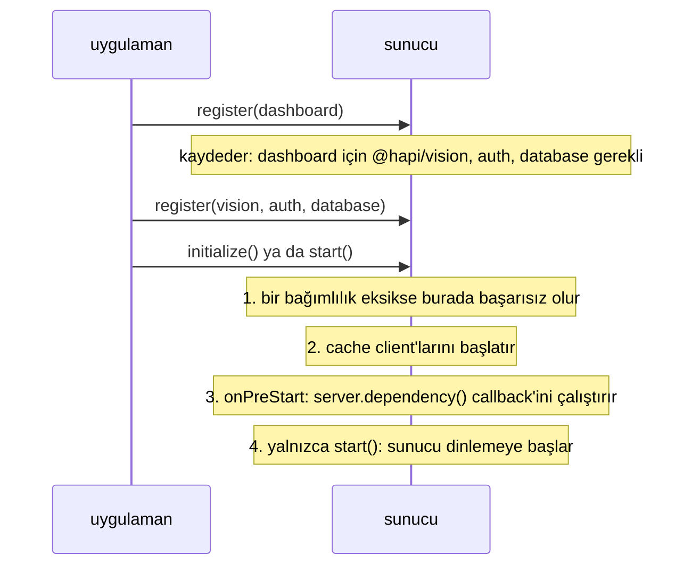

<TutorialLang />

# Plugin'ler

_Bu eğitim hapi v21 ve sonraki sürümlerle uyumludur_

## <a name="overview"></a> Genel Bakış

Plugin, bir hapi uygulamasının bir sunucuya kaydedilebilecek şekilde paketlenmiş bir parçasıdır: bir route kümesi, bir kimlik doğrulama şeması, bir logger, bir şablon motoru. hapi ekosisteminin çoğu plugin olarak yayınlanır ([inert](/module/inert), [vision](/module/vision), [@hapi/basic](/module/basic)); kendi uygulamanı plugin'lere bölmek de her parçayı yalıtılmış ve test edilebilir tutar.

Bir plugin, sunucuyu `register` fonksiyonunda alır ve onu normal sunucu API'siyle değiştirir. Plugin yazarları için en önemlileri:

| Sunucu API'si                                                            | Plugin'in eklediği                                                      | Eğitim                                                      |
| ------------------------------------------------------------------------ | ----------------------------------------------------------------------- | ----------------------------------------------------------- |
| [`server.route()`](/api#server-route-route)                              | route'lar                                                               | [Routing](/tutorials/tr_TR/routing)                         |
| [`server.ext()`](/api#server-ext-events)                                 | her isteğin bir adımında ya da sunucu başlarken ve dururken çalışan kod | [Yaşam Döngüsü Hook'ları](/tutorials/tr_TR/lifecycle-hooks) |
| [`server.decorate()`](/api#server-decorate-type-property-method-options) | `server`, `request` ya da `h` üzerinde yeni metotlar                    | [Decorator'lar](/tutorials/tr_TR/decorators)                |
| [`server.auth.scheme()`](/api#server-auth-scheme-name-scheme)            | bir kimlik doğrulama şeması                                             | [Kimlik Doğrulama](/tutorials/tr_TR/auth)                   |
| [`server.method()`](/api#server-method-name-method-options)              | paylaşılan, önbelleğe alınabilir fonksiyonlar                           | [Server Method'lar](/tutorials/tr_TR/server-methods)        |
| [`server.expose()`](/api#server-expose-key-value-options)                | diğer plugin'lerin `server.plugins[name]` üzerinden okuduğu değerler    |                                                             |

## <a name="create"></a> Plugin oluşturmak

Plugin, bir `name` ve asenkron bir `register(server, options)` fonksiyonu olan bir nesnedir:

```ts
import type { Plugin } from '@hapi/hapi';

const myPlugin: Plugin<void> = {
    name: 'myPlugin',
    version: '1.0.0',
    register: async function (server, options) {
        server.route({
            method: 'GET',
            path: '/test',
            handler: function (request, h) {
                return 'hello, world';
            },
        });
    },
};
```

Kaydedildikten sonra `GET /test`, `'hello, world'` yanıtını verir.

`Plugin<T>`, plugin seçeneklerinin tipini alır. Bu plugin'in seçeneği yoktur, bu yüzden tipi `Plugin<void>` olur. Plugin tiplendiğinde TypeScript `register` içindeki `server` ve `options` tiplerini çıkarır ve plugin'in bir `name` ya da `pkg` değerine sahip olduğunu denetler.

Plugin nesnesinin özellikleri:

| Özellik        | Anlamı                                                                                                            |
| -------------- | ----------------------------------------------------------------------------------------------------------------- |
| `register`     | Zorunlu. Plugin'i kurar. Kayıt onu bekler ve hata fırlatırsa başarısız olur.                                      |
| `name`         | `pkg` ayarlanmadıysa zorunlu. Sunucuda benzersiz olmalıdır. Yayınlanan plugin'ler npm paket adlarını kullanır.    |
| `version`      | Bilgi amaçlı. Diğer plugin'ler onu okuyabilir ve [bağımlılıklar](#dependencies) bir sürüm aralığı isteyebilir.    |
| `pkg`          | `name` ve `version` değerlerini elle ayarlamak yerine kullanılan `package.json` dosyan.                           |
| `dependencies` | Kaydedilmiş olması da gereken plugin'ler. Bkz. [bağımlılıklar](#dependencies).                                    |
| `requirements` | Desteklenen `node` ve `hapi` sürüm aralıkları; örneğin `{ hapi: '>=21' }`. Bunların dışında kayıt başarısız olur. |
| `multiple`     | `true`, plugin'in aynı sunucuya birden fazla kez kaydedilmesine izin verir.                                       |
| `once`         | `true`, tekrarlanan kayıtları hata yerine sessizce hiçbir şey yapmayan işlemlere dönüştürür.                      |

### <a name="module"></a> Bir plugin'i modül olarak yayınlamak

Bir plugin modülü plugin nesnesini default export olarak ya da `plugin` adında bir named export olarak dışa aktarır. `pkg`, adı ve sürümü `package.json` dosyasından okur:

```ts
import Pkg from './package.json' with { type: 'json' };

import type { Plugin } from '@hapi/hapi';

export const plugin: Plugin<void> = {
    pkg: Pkg,
    register: async function (server, options) {
        server.route({
            method: 'GET',
            path: '/test',
            handler: function (request, h) {
                return 'hello, world';
            },
        });
    },
};
```

hapi her iki export biçimini de kabul eder: `server.register()` bir plugin nesnesi ya da `plugin` özelliği bir plugin nesnesi olan bir modül alır.

### <a name="register"></a> Plugin seçenekleri

`options`, çağıranın kayıt sırasında verdiği değerin değiştirilmemiş hâlidir. Tipini `Plugin<Options>` ile belirt:

```ts
import Pkg from './package.json' with { type: 'json' };

import type { Plugin } from '@hapi/hapi';

interface Options {
    name: string;
}

export const plugin: Plugin<Options> = {
    pkg: Pkg,
    register: async function (server, options) {
        server.route({
            method: 'GET',
            path: '/test',
            handler: function (request, h) {
                return `Hello ${options.name}`;
            },
        });
    },
};
```

`options.name` bir `string` olur ve TypeScript, seçenekleri `Options` ile eşleşmeyen bir `server.register()` çağrısını işaretler; hapi bunları çalışma zamanında denetlemez.

## <a name="loading"></a> Plugin yüklemek

Plugin'leri [`server.register()`](/api#await-server-register-plugins-options) ile kaydet. Plugin'in kendisini, `plugin` ve `options` içeren bir nesneyi ya da bunlardan oluşan bir diziyi ver:

```ts
import Hapi from '@hapi/hapi';
import { plugin as MyPlugin } from 'myplugin';
import { plugin as YourPlugin } from 'yourplugin';

const start = async function () {
    const server = Hapi.server();

    await server.register(YourPlugin);

    await server.register({
        plugin: MyPlugin,
        options: {
            name: 'Bob',
        },
    });

    await server.register([{ plugin: YourPlugin }, { plugin: MyPlugin, options: { name: 'Bob' } }]);
};
```

Bir dizideki plugin'ler sırayla, birbiri ardına kaydedilir. Her `register` fonksiyonu bir sonraki başlamadan önce tamamlanır.

### <a name="registration"></a> Kayıt seçenekleri

`server.register()` çağrısının ikinci argümanı, hapi'nin plugin'i nasıl kaydedeceğini yapılandırır. Plugin'e _verilmez_:

| Seçenek         | Etkisi                                                                               |
| --------------- | ------------------------------------------------------------------------------------ |
| `routes.prefix` | Plugin'in eklediği her route'un başına bir yol ekler. `/test`, `/plugins/test` olur. |
| `routes.vhost`  | Plugin'in eklediği her route'a bir virtual host uygular.                             |
| `once`          | `true`, plugin zaten kayıtlıysa hata fırlatmak yerine onu atlar.                     |

```ts
import Hapi from '@hapi/hapi';
import { plugin as MyPlugin } from 'myplugin';

const start = async function () {
    const server = Hapi.server();

    await server.register(MyPlugin, {
        routes: {
            prefix: '/plugins',
        },
    });
};
```

Önekler iç içe geçer: `/api` önekiyle kaydedilmiş bir plugin, `/v1` önekiyle bir alt plugin kaydederse alt plugin'in route'ları `/api/v1` ile başlar. Tam liste için [`server.register()`](/api#await-server-register-plugins-options) sayfasına bak.

## <a name="scope"></a> Bir plugin neyi etkileyebilir, neyi etkileyemez

Her plugin kendi [`server.realm`](/api#server-realm) değerini alır: plugin'in içinde kalan ayarlar için bir kapsayıcı. Bir plugin'in yaptığı diğer her şey sunucunun tamamını değiştirir:

| Değişiklik                                                                                                   | Kapsam                                                     |
| ------------------------------------------------------------------------------------------------------------ | ---------------------------------------------------------- |
| kayıt seçeneklerinden gelen route öneki ve vhost                                                             | plugin'in route'ları ve alt plugin'leri                    |
| [`server.bind()`](/api#server-bind-context), [`server.path()`](/api#server-path-relativeto)                  | plugin'in eklediği route'lar, handler'lar ve extension'lar |
| `options.sandbox: 'plugin'` ile istek [yaşam döngüsü hook'ları](/tutorials/tr_TR/lifecycle-hooks)            | plugin'in route'ları                                       |
| `sandbox` olmadan istek yaşam döngüsü hook'ları                                                              | **sunucudaki her route**                                   |
| [decoration'lar](/tutorials/tr_TR/decorators), server method'lar, auth stratejileri, `server.auth.default()` | **sunucunun tamamı**                                       |

Kendi hatalarını biçimlendirmek için bir `onPreResponse` hook'u ekleyen bir plugin `sandbox: 'plugin'` vermelidir; yoksa diğer tüm plugin'lerin hatalarını da yeniden biçimlendirir.

## <a name="dependencies"></a> Bağımlılıklar

Başka bir plugin'e ihtiyaç duyan bir plugin, kayıt sırasına güvenmek yerine bunu bildirir:

```ts
import type { Plugin } from '@hapi/hapi';

declare module '@hapi/hapi' {
    interface PluginProperties {
        database: { migrate: () => Promise<void> };
    }
}

export const plugin: Plugin<void> = {
    name: 'dashboard',
    dependencies: ['@hapi/vision', 'auth'],
    register: async function (server, options) {
        server.dependency('database', async (server) => {
            await server.plugins.database.migrate();
        });
    },
};
```

hapi bağımlılıkları plugin kaydedilirken değil, sunucu başlatılırken (initialize) denetler; bu yüzden plugin'ler herhangi bir sırayla kaydedilebilir:



- `dependencies` bir ad listesi ya da adları `{ '@hapi/vision': '7.x' }` gibi sürüm aralıklarına eşleyen bir nesnedir.
- [`server.dependency(names, after)`](/api#server-dependency-dependencies-after) aynı şeyi `register` içinden bildirir ve bir `after` fonksiyonu kabul eder. hapi `after` fonksiyonunu sunucu başlarken, listelenen her plugin kaydedildikten sonra çalıştırır. Bunu başka bir plugin'in API'sine ihtiyaç duyan kurulum işleri için kullan.
- hapi döngüsel `after` bağımlılıklarında hata fırlatır.

`server.plugins.database`, `database` plugin'inin [`server.expose()`](/api#server-expose-key-value-options) ile yayınladığı değerdir. hapi onun yapısını bilemez, bu yüzden `declare module` bloğu onu hapi'nin `PluginProperties` arayüzüne ekler.
