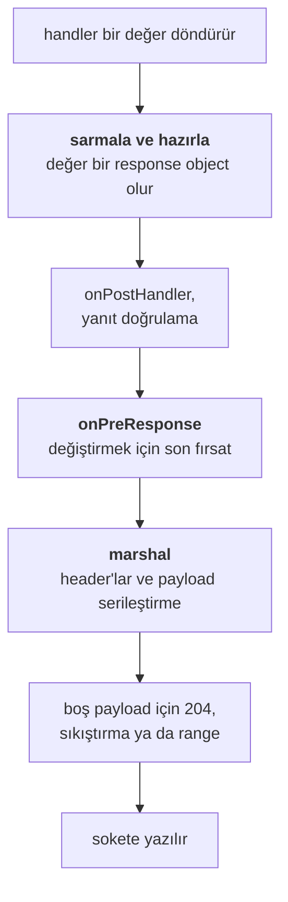

<TutorialLang />

# Yanıt Hazırlama

_Bu eğitim hapi v21 ve sonraki sürümlerle uyumludur_

## <a name="overview"></a> Genel Bakış

Bir handler bir değer döndürür: bir string, bir nesne, bir stream ya da bir hata. Yanıt hazırlama (response marshalling), hapi'nin bu değeri bir HTTP yanıtına dönüştürmek için yaptığı her şeydir: durum kodunu seçmek, header'ları ayarlamak, payload'u serileştirmek, sıkıştırmak ve sokete yazmak.

Bunun nasıl çalıştığını bilmek, kodu nereye koyacağını söyler. Tutarlı bir hata formatı, bir HTML hata sayfası, önbellek header'ları, sıkıştırma, CSV gibi özel bir yanıt tipi, metrikler için bir bayt sayacı: bunların her biri marshalling akışında belirli bir noktaya aittir. [Response nesnesi](/api#response-object) ve [response toolkit](/api#response-toolkit) API referansları tüm metotları listeler.

## <a name="pipeline"></a> Dönüş değerinden baytlara

Marshalling, aralarında `onPreResponse` extension point'i bulunan iki aşamada gerçekleşir:



Marshal adımı sabit bir sırayla çalışır ve bu sıra hangi ayarın hangi header'ları görebileceğini belirler:

1. payload tipinden `content-type`
2. route etkinleştirdiyse CORS ve güvenlik header'ları
3. [`h.entity()`](/api#h-entity-options) ile ETag ve `last-modified`, ardından GET route'larında 304 kontrolü
4. route'un `cache` seçeneğinden `cache-control`
5. [`h.state()`](/api#h-state-name-value-options) ve `autoValue` tanımlı cookie'lerden `set-cookie`
6. payload serileştirme ve `content-length`
7. auth şemasının `response()` metodu; en sonda çalışır, böylece yukarıdaki tüm header'ları okuyabilir

Bu ayrımın pratikte önemi şudur:

- **`onPreResponse` öncesinde** yanıt, bir response nesnesi ya da bir [boom](/module/boom) hatasıdır; onu inceleyebilir, değiştirebilir ya da tamamen başkasıyla değiştirebilirsin. Sarmalama ve hazırlama sırasında oluşan hatalar, örneğin var olmayan bir dosya, `onPreResponse`'a boom hatası olarak ulaşır.
- **`onPreResponse` sonrasında** hapi payload'u serileştirir ve header'ları hesaplar. Bu aşamadaki bir hata, örneğin `JSON.stringify()`'ın işleyemediği bir nesne, `onPreResponse`'un hiç görmediği bir 500'e dönüşür. Marshalling'in başarısız olmaması için payload'ları düz veri olarak tut.

[İstek yaşam döngüsü](/api#request-lifecycle) adımlarının sırası [Yaşam Döngüsü Hook'ları](/tutorials/tr_TR/lifecycle-hooks) eğitiminde anlatılıyor.

## <a name="return-values"></a> Ne döndürürsün, hapi ne gönderir

| Handler'ın döndürdüğü | Durum              | Varsayılan `content-type`         | Notlar                                                                                                                                                                                    |
| --------------------- | ------------------ | --------------------------------- | ----------------------------------------------------------------------------------------------------------------------------------------------------------------------------------------- |
| string                | 200, boşsa 204     | `text/html; charset=utf-8`        | Düz metin için `.type('text/plain')` kullan                                                                                                                                               |
| nesne ya da dizi      | 200                | `application/json; charset=utf-8` | `JSON.stringify()` ve route'un [`json` seçenekleri](#json) ile serileştirilir                                                                                                             |
| `Buffer`              | 200                | `application/octet-stream`        |                                                                                                                                                                                           |
| readable stream       | 200                | `application/octet-stream`        | Chunked olarak gönderilir. Object mode'da olmamalıdır. Stream'de `statusCode` ve `headers` varsa onları kopyalar                                                                          |
| `null`                | 204                | yok                               | 200 göndermek için route'un `response.emptyStatusCode` değerini `200` yap                                                                                                                 |
| `undefined`           | 500                |                                   | Bir handler bir şey döndürmek zorundadır; hapi "handler method did not return a value" mesajını loglar                                                                                    |
| `Error`               | 500                | `application/json; charset=utf-8` | Mesaj istemciden gizlenir                                                                                                                                                                 |
| boom hatası           | hatanın durum kodu | `application/json; charset=utf-8` | `{ statusCode, error, message }`; 5xx mesajları gizlenir                                                                                                                                  |
| `h.response(value)`   | `value` ile aynı   | `value` ile aynı                  | `.code()`, `.header()`, `.type()` ve diğer [response nesnesi](/api#response-object) metotlarını zincirle                                                                                  |
| `h.redirect(uri)`     | 302                | `text/html; charset=utf-8`        | Gövde boştur. `.permanent()` 301, `.rewritable(false)` 307, ikisi birlikte 308 verir. 307 ve 308 istemcinin aynı metodu tekrarlamasını sağlar, yani yönlendirilen bir POST yine POST olur |

- `Readable.from(array)` object mode'da bir stream oluşturur ve hapi bunu 500 ile reddeder. `{ objectMode: false }` geç ya da `Fs.createReadStream()` gibi bir bayt stream'i döndür.
- [wreck](/module/wreck)'ten gelen bir HTTP yanıtı gibi `statusCode` ve `headers` özelliklerine sahip bir stream, kendi durum kodunu ve header'larını aynen aktarır. Bu sayede basit bir proxy tek satırlık bir handler olur; ama aynı zamanda upstream'deki bir 404 senin 404'ün olur.

## <a name="shaping"></a> h.response() ile yanıtı şekillendirmek

Varsayılanlar uyuyorsa düz bir değer döndür. Uymuyorsa değeri [`h.response()`](/api#h-response-value) ile sarmala ve ihtiyacın olanı zincirle:

```ts
import Hapi from '@hapi/hapi';

const server = Hapi.server({ port: 4000 });

server.route<{ Payload: { name: string } }>({
    method: 'POST',
    path: '/users',
    handler: (request, h) => {
        const user = { id: '2133d32a', name: request.payload.name };

        return h.response(user).created(`/users/${user.id}`).header('x-request-id', request.info.id);
    },
});

server.route({
    method: 'GET',
    path: '/robots.txt',
    handler: (request, h) => {
        return h.response('User-agent: *\nDisallow: /admin\n').type('text/plain');
    },
});
```

`.created()` tek çağrıda durum kodunu 201 yapar ve `location` header'ını ayarlar.

## <a name="errors"></a> Hatalar

Her hata sonunda bir boom nesnesine dönüşür. hapi düz bir `Error`'ı `Boom.boomify()` ile sarmalar ve ona 500 durum kodunu verir; boom da herhangi bir 5xx hatanın mesajını istemciden gizler. Kullanıcıların `An internal server error occurred` görür, hapi ise gerçek hatayı `'error'` kanalında bir `'request'` olayı olarak yayar; bunu kaydetmek için [Loglama](/tutorials/tr_TR/logging) eğitimine bak. İstemcinin mesajı görmesi gerekiyorsa `Boom.notFound('No such user')` gibi bir boom hatası fırlat.

Bir boom hatasının yanıtı `output` özelliğinden gelir:

```ts
import Boom from '@hapi/boom';

const error = Boom.notFound('No such user');

error.output.statusCode; // 404
error.output.payload; // { statusCode: 404, error: 'Not Found', message: 'No such user' }
error.output.headers; // {}, or headers such as WWW-Authenticate from auth errors
```

### <a name="a-consistent-error-format"></a> Tutarlı bir hata formatı

API'ler genellikle hataları boom'un formatında değil kendi formatlarında döndürmek ister. Dönüşümü `onPreResponse` içinde yap; bilinmeyen route'lar için oluşan 404'ler ve plugin'lerin fırlattığı hatalar dahil her hata buradan geçer:

```ts
import Boom from '@hapi/boom';
import Hapi from '@hapi/hapi';

const server = Hapi.server({ port: 4000 });

server.ext('onPreResponse', (request, h) => {
    const { response } = request;
    if (!Boom.isBoom(response)) {
        return h.continue;
    }

    const { statusCode, payload, headers } = response.output;
    const reply = h.response({
        error: {
            status: statusCode,
            code: payload.error,
            message: payload.message,
            requestId: request.info.id,
        },
    });

    reply.code(statusCode);
    for (const [name, value] of Object.entries(headers)) {
        if (value !== undefined) {
            reply.header(name, String(value));
        }
    }

    return reply;
});
```

`output.headers`'ı yeni yanıta kopyala. Auth hataları orada `WWW-Authenticate` taşır, `Boom.methodNotAllowed()` da `Allow` taşıyabilir. `payload.message` zaten güvenli mesajdır: 5xx hatalarda boom onu genel metinle değiştirmiştir.

### <a name="html-error-pages"></a> HTML hata sayfaları

HTML render eden bir site, aynı hook'tan bunun yerine bir hata sayfası döndürebilir; [View'lar](/tutorials/tr_TR/views#errors) eğitimi bunu @hapi/vision ile gösteriyor. Hem sayfa hem API sunan bir uygulamada, API istemcileri JSON almaya devam etsin diye API route'ları için sayfayı atla; örneğin `request.path.startsWith('/api/')` ile.

## <a name="custom"></a> Özel yanıt tipleri

Dosya ve şablon gönderen plugin'ler string döndürmez. [@hapi/inert](/module/inert) ve [@hapi/vision](/module/vision), yanıtlarını bir kaynak değer ve isteğe bağlı işlemciler alan [`request.generateResponse()`](/api#request-generateresponse-source-options) ile oluşturur. `prepare` ve `marshal` akışın iki aşamasında çalışır; `close` ise yanıt işi bittiğinde, gönderilmiş ya da başka bir yanıtla değiştirilmiş olsun, çalışır:

| Plugin | `variety` | `prepare`, `onPreResponse` öncesinde çalışır                                  | `marshal`, `onPreResponse` sonrasında çalışır                                                                    |
| ------ | --------- | ----------------------------------------------------------------------------- | ---------------------------------------------------------------------------------------------------------------- |
| inert  | `'file'`  | dosyayı açar; `content-length`, `content-type`, `last-modified`, ETag ayarlar | bir okuma stream'i ya da önceden sıkıştırılmış bir dosya (`.gz` ya da `lookupMap`'teki diğer uzantılar) döndürür |
| vision | `'view'`  | şablonu yükler ve derler                                                      | şablonu context'iyle render eder; `content-type` ayarlar                                                         |

Bu ayrım bilinçlidir. Eksik bir dosya `prepare` aşamasında hata verir, böylece `onPreResponse`'a hata handler'ının formatlayabileceği bir 404 olarak ulaşır. Pahalı iş, yani dosyayı okumak ya da şablonu render etmek, `marshal` aşamasında, `onPreResponse` yanıtı değiştirme fırsatını bulduktan sonra yapılır. inert ayrıca `close` da verir; bu, bir `onPreResponse` hook'u yanıtı değiştirse bile dosyayı kapatır. Bir kaynak açan özel bir yanıtın da buna ihtiyacı vardır.

Aynı mekanizmayı kendi formatların için kullanabilirsin. İşte bir CSV yanıtı:

```ts
import Hapi from '@hapi/hapi';

import type { Request } from '@hapi/hapi';

const field = (value: string) => (/[",\n]/.test(value) ? `"${value.replaceAll('"', '""')}"` : value);

const csv = (request: Request, rows: string[][]) => {
    return request
        .generateResponse(rows, {
            variety: 'csv',
            marshal: async () => rows.map((row) => row.map(field).join(',')).join('\n'),
        })
        .type('text/csv');
};

const server = Hapi.server({ port: 4000 });

server.route({
    method: 'GET',
    path: '/users.csv',
    handler: (request, h) => {
        return csv(request, [
            ['id', 'name'],
            ['2133d32a', 'John Doe'],
        ]);
    },
});
```

`field()`, virgül, tırnak ya da satır sonu içeren değerleri tırnak içine alır, böylece bu değerler bir satırı bölemez. Bunu herhangi bir handler'dan `h.csv(rows)` olarak çağırmak için bir decorator ile response toolkit'e ekle; [Decorator'lar](/tutorials/tr_TR/decorators) eğitimine bak.

## <a name="json"></a> JSON serileştirme

Nesneler `JSON.stringify()` ile serileştirilir. Bunun nasıl yapılacağını route'un [`json` seçenekleri](/api#route-options-json) belirler:

```ts
import Hapi from '@hapi/hapi';

const server = Hapi.server({
    port: 4000,
    routes: {
        json: {
            space: process.env.NODE_ENV === 'production' ? 0 : 2,
        },
    },
});

server.route({
    method: 'GET',
    path: '/widget-config',
    options: {
        json: { escape: true },
    },
    handler: (request, h) => {
        return { title: '</script><script>alert(1)</script>' };
    },
});
```

- `space` çıktıyı girintiler. Okunabilir JSON geliştirme sırasında işe yarar, production'da ise bayt harcar.
- `escape: true`, `<`, `>` ve `&` karakterlerini `\u003c`, `\u003e` ve `\u0026` olarak yazar; ayrıca U+2028 ve U+2029 satır ayırıcılarını da escape eder. JSON'u bir HTML sayfasına gömülen her route'ta bunu kullan; böylece `</script>` içeren bir değer çevresindeki script tag'ini kapatamaz.
- `replacer`, `JSON.stringify()`'a aktarılır; `suffix` ise çıktının sonuna eklenir. Tek bir yanıt bunları `.spaces()`, `.replacer()` ve `.suffix()` ile geçersiz kılabilir.

Parola hash'leri gibi gizli bilgileri kaldırmak için `replacer`'a güvenme. Yanıt nesnesini göndermek istediğin alanlardan oluştur ve hataları yakalamak için [yanıt doğrulama](#validation) kullan.

## <a name="caching"></a> Önbellek ve koşullu istekler

Route'un [`cache` seçeneği](/api#route-options-cache), marshalling sırasında `cache-control` değerini ayarlar:

```ts
server.route({
    method: 'GET',
    path: '/articles/{id}',
    options: {
        cache: { expiresIn: 60 * 1000, privacy: 'public' },
    },
    handler: (request, h) => {
        const article = { id: request.params.id, version: 7, body: '...' };

        const notModified = h.entity({ etag: `${article.id}-${article.version}` });
        if (notModified) {
            return notModified;
        }

        return article;
    },
});
```

- `cache`, `cache-control: max-age=60, must-revalidate, public` üretir. İstek kimliği doğrulanmışsa hapi bunu kendiliğinden `private` yapar. `h.state()` ile ayarlanan cookie'ler ise bunu değiştirmez; yar ve @hapi/cookie gibi oturum plugin'leri de cookie'lerini bu şekilde ayarlar. Bu yüzden cookie ayarlayan bir route'ta `privacy: 'private'` kullan ya da hiç `cache` kullanma. Aksi halde paylaşılan bir önbellek bir kullanıcının cookie'sini saklayıp başka bir kullanıcıya verebilir.
- [`h.entity()`](/api#h-entity-options), ETag'i isteğin `If-None-Match` header'ıyla karşılaştırır. Eşleşirlerse bir 304 yanıtı döndürür ve handler gövdeyi oluşturmayı atlar. Eşleşmezlerse `etag` header'ını ayarlar ve hiçbir şey döndürmez.

ETag'i, içerik her değiştiğinde değişen ucuz bir şeye dayandır; örneğin bir sürüm numarası ya da güncelleme zaman damgası. Gövdenin tamamını hash'lemek bant genişliğinden tasarruf sağlar ama gövdeyi oluşturma işinden kurtarmaz.

## <a name="compression"></a> Sıkıştırma

hapi, şu koşulların hepsi sağlandığında yanıtı gzip ya da deflate ile sıkıştırır:

- istemci uygun bir `Accept-Encoding` header'ı gönderir,
- içerik tipi sıkıştırılabilir (metin, JSON, JavaScript, SVG ve benzerleri; resimler ya da arşivler değil),
- payload en az [`compression.minBytes`](/api#server-options-compression-minbytes) büyüklüğündedir (varsayılan 1024 bayt) ya da stream'lerde olduğu gibi boyutu bilinmiyordur.

hapi ayrıca `vary: accept-encoding` ekler, böylece önbellekler sıkıştırılmış ve sıkıştırılmamış kopyaları birbirinden ayrı tutar. Brotli desteği için [`server.encoder()`](/api#server-encoder-encoding-encoder) ile bir encoder kaydet:

```ts
import Zlib from 'node:zlib';

import Hapi from '@hapi/hapi';

const server = Hapi.server({ port: 4000 });

server.encoder('br', (options) => Zlib.createBrotliCompress(options));
```

Artık istemci kabul ettiğinde hapi `br`'yi tercih eder. Bir route'un [`compression` seçeneği](/api#route-options-compression) bir encoder'a ayar aktarır; örneğin boyuttan feragat edip hız kazanmak için `compression: { br: { params: { [Zlib.constants.BROTLI_PARAM_QUALITY]: 4 } } }`. Payload zaten sıkıştırılmışsa, örneğin diskten okunan bir `.gz` dosyası, onu `.compressed('gzip')` ile işaretle; böylece hapi header'ı ayarlar ve baytlara dokunmaz.

## <a name="validation"></a> Yanıt doğrulama

[Yanıt doğrulama](/api#route-options-response), payload'u `onPreResponse` öncesinde bir şemaya göre kontrol eder. Yanlış şekilde veri döndüren handler'ları yakalar; sunucudan asla çıkmaması gereken alanlar da buna dahildir:

```ts
import Hapi from '@hapi/hapi';
import Joi from 'joi';

const server = Hapi.server({ port: 4000 });

const User = Joi.object({
    id: Joi.string().required(),
    name: Joi.string().required(),
});

server.route({
    method: 'GET',
    path: '/users/{id}',
    options: {
        response: {
            schema: User,
            sample: process.env.NODE_ENV === 'production' ? 10 : 100,
            failAction: process.env.NODE_ENV === 'production' ? 'log' : 'error',
        },
    },
    handler: (request, h) => {
        return { id: request.params.id, name: 'John Doe' };
    },
});
```

- Varsayılan `failAction: 'error'` ile şemaya uymayan bir payload 500'e dönüşür. Hataların açıkça ortaya çıkması için bunu geliştirme ve testlerde kullan.
- `failAction: 'log'` orijinal payload'u gönderir ve hatayı `validation`, `response` ve `error` tag'leriyle loglar. Production'da bu, bir şema hatasının kesintiye dönüşmesini engeller; ama payload, şemanın reddettiği alanlar dahil yine de gönderilir.
- `sample` yanıtların yalnızca belli bir yüzdesini doğrular; bu da yoğun route'larda maliyeti sınırlar.

Bilinmeyen alanları reddetmek yerine kaldırmak için `modify: true` ve `options: { stripUnknown: true }` ayarla ve `sample`'ı kaldır. `modify` ile doğrulama yanıt mantığının bir parçası olur; bu yüzden hapi her yanıtı doğrular ve `sample` kabul etmez.

## <a name="measuring"></a> Yanıtları ölçmek

Bir response nesnesi yazılırken [olaylar](/api#response-events) yayar: her chunk için `'peek'` ve sonda `'finish'`. Bir plugin bunları yanıt boyutlarını kaydetmek için kullanabilir:

```ts
import Boom from '@hapi/boom';
import Hapi from '@hapi/hapi';

const server = Hapi.server({ port: 4000 });

server.ext('onPreResponse', (request, h) => {
    const { response } = request;
    if (Boom.isBoom(response)) {
        return h.continue;
    }

    let bytes = 0;
    response.events.on('peek', (chunk) => {
        bytes += Buffer.byteLength(chunk);
    });
    response.events.once('finish', () => {
        request.log(['metrics'], { path: request.path, bytes });
    });

    return h.continue;
});
```

`'peek'` payload'u sıkıştırmadan önce görür, bu yüzden `bytes` sıkıştırılmamış boyuttur. Hata yanıtları burada atlanır: bir boom hatası marshalling sırasında, bu hook çalıştıktan sonra yeni bir response nesnesine dönüşür. Bir isteğin tamamını zamanlamak için `onPostResponse` extension'ını ya da sunucunun `'response'` olayını kullan; bunlar [Yaşam Döngüsü Hook'ları](/tutorials/tr_TR/lifecycle-hooks) ve [Loglama](/tutorials/tr_TR/logging) eğitimlerinde anlatılıyor.
