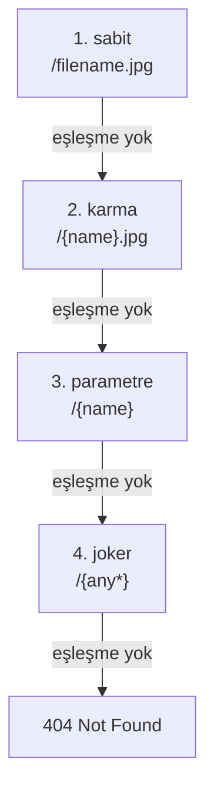

<TutorialLang />

# Routing

_Bu eğitim hapi v21 ve sonraki sürümlerle uyumludur_

## <a name="overview"></a> Genel Bakış

Bir route'un üç şeye ihtiyacı vardır: bir `method`, bir `path` ve bir `handler`. Route'u [`server.route()`](/api#server-route-route) ile eklersin:

```ts
server.route({
    method: 'GET',
    path: '/',
    handler: (request, h) => {
        return 'Hello World!';
    },
});
```

`server.route()` bir route nesneleri dizisini de kabul eder, böylece tek çağrıda birçok route kaydedebilirsin.

## <a name="methods"></a> Metotlar

`method`, `HEAD` dışındaki herhangi bir HTTP metodu (GET route'ları HEAD isteklerine de yanıt verir), bir metot dizisi ya da hepsi için `'*'` olabilir:

```ts
server.route({
    method: ['PUT', 'POST'],
    path: '/',
    handler: (request, h) => {
        return 'I did something!';
    },
});
```

`GET` için tanımlanan bir route `HEAD` isteklerine de yanıt verir, bu yüzden ayrı bir `HEAD` route'una hiç ihtiyacın olmaz.

## <a name="path"></a> Path

Bir path segmentini adlandırılmış bir parametre olarak yakalamak için onu `{}` içine al. Değeri `request.params` üzerinden erişilebilir olur:

```ts
import * as Hoek from '@hapi/hoek';

server.route<{ Params: { user: string } }>({
    method: 'GET',
    path: '/hello/{user}',
    handler: (request, h) => {
        return `Hello ${Hoek.escapeHtml(request.params.user)}!`;
    },
});
```

`/hello/ferris` isteği `Hello ferris!` yanıtını döner.

- hapi parametre değerlerinin URI kodlamasını çözer, yani `/hello/a%20b` için `request.params.user === 'a b'` olur.
- Değer doğrudan URL'den gelir. HTML'e koymadan önce, yukarıdaki [Hoek](/module/hoek) `escapeHtml()` çağrısında olduğu gibi escape et ya da [joi](/tutorials/tr_TR/validation) ile doğrula.
- hapi 21.4.10'dan itibaren `request.params` değerleri varsayılan olarak `unknown` tipindedir. `server.route<{ Params: { user: string } }>()` tip argümanı yapıyı bildirir, böylece handler içinde `request.params.user` bir `string` olur. Aynı tip argümanı `Query`, `Payload`, `Headers` ve aşağıdaki diğer istek parçalarını da kabul eder.

### <a name="optionalParameters"></a> Parametre tipleri

| Path                | Eşleşir                                    | `request.params`                    |
| ------------------- | ------------------------------------------ | ----------------------------------- |
| `/hello/{user}`     | `/hello/ferris`                            | `{ user: 'ferris' }`                |
| `/hello/{user?}`    | `/hello`, `/hello/ferris`                  | `{}` ya da `{ user: 'ferris' }`     |
| `/hello/{user*2}`   | `/hello/john/doe` (tam olarak iki segment) | `{ user: 'john/doe' }`              |
| `/files/{path*}`    | `/files`, `/files/a`, `/files/a/b/c`       | `{}` ya da `{ path: 'a/b/c' }`      |
| `/{filename}.{ext}` | `/photo.jpg`                               | `{ filename: 'photo', ext: 'jpg' }` |

Route'u eklediğinde hapi'nin uyguladığı kurallar:

- `{user*}` ve tüm segmenti kaplayan isteğe bağlı `{user?}` path'in son segmenti olmalıdır. `{user*2}` ve `/a{user?}/b` gibi segmentin bir kısmını kaplayan isteğe bağlı parametreler her yerde bulunabilir.
- Aynı segmentteki iki parametrenin arasında sabit bir ayırıcı olmalıdır: `{filename}.{ext}` geçerlidir, `{filename}{ext}` değildir.
- Bir parametre adı bir path içinde yalnızca bir kez kullanılabilir.
- Aynı metoda ve eşdeğer bir path'e sahip iki route çakışır ve `server.route()` hata fırlatır. `/{name}` ve `/{other}` eşdeğerdir.

### <a name="multiParameters"></a> Çok segmentli parametreler

Çok segmentli bir parametre, eşleşen segmentleri `/` ile birleştirilmiş olarak tutar; parçaları almak için onu böl:

```ts
server.route<{ Params: { user: string } }>({
    method: 'GET',
    path: '/hello/{user*2}',
    handler: (request, h) => {
        const [first, last] = request.params.user.split('/');

        return `Hello ${first} ${last}!`;
    },
});
```

`/hello/john/doe` isteği `Hello john doe!` yanıtını döner.

### <a name="specificity"></a> Hangi route kazanır

hapi route'ları eklediğin sırayla denemez. Her path segmenti için eşleşme türlerini en özelden en genele doğru dener ve path'in geri kalanı eşleşmediğinde bir sonraki türe geçer:



Bu dört route kayıtlıyken:

| İstek           | Yanıt veren route |
| --------------- | ----------------- |
| `/filename.jpg` | `/filename.jpg`   |
| `/photo.jpg`    | `/{name}.jpg`     |
| `/photo`        | `/{name}`         |
| `/a/b`          | `/{any*}`         |

Path'ler varsayılan olarak büyük/küçük harfe duyarlıdır: yukarıdaki route'larla `/Filename.jpg` isteğine `/{name}.jpg` yanıt verir. Bunu değiştirmek için sunucuda [`router.isCaseSensitive`](/api#server-options-router) değerini `false` yap.

## <a name="query"></a> Query parametreleri

`request.query`, ayrıştırılmış query string'i tutar. `/?name=ferris&location=chicago` için:

```ts
server.route<{ Query: { name: string } }>({
    method: 'GET',
    path: '/',
    handler: (request, h) => {
        return `Hello ${request.query.name}!`;
    },
});
```

hapi'nin yerleşik ayrıştırıcısı iç içe anahtarları anlamaz: `/?foo[bar]=baz` sonucu `{ 'foo[bar]': 'baz' }` olur. İç içe anahtarları ayrıştırmak için sunucunun `query.parser` ayarına [qs](https://github.com/ljharb/qs) gibi bir ayrıştırıcı ver:

```ts
import Hapi from '@hapi/hapi';
import Qs from 'qs';

const server = Hapi.server({
    port: 3000,
    host: 'localhost',
    query: {
        parser: (query) => Qs.parse(query),
    },
});

server.route({
    method: 'GET',
    path: '/',
    handler: (request, h) => {
        return request.query;
    },
});

await server.start();
console.log('Server running on %s', server.info.uri);
```

Artık `/?foo[bar]=baz` isteği `{ "foo": { "bar": "baz" } }` yanıtını döner. Ayrıştırıcı ham string'i değil, hapi'nin zaten ayrıştırdığı query'yi alır; örneğin `{ 'foo[bar]': 'baz' }`. Parametre adlarını değerlere eşleyen bir nesne döndürdüğü sürece herhangi bir fonksiyon iş görür.

## <a name="requestpayload"></a> İstek payload'u

Ayrıştırılmış istek gövdesi `request.payload` üzerindedir. hapi, `Content-Type` header'ına göre JSON, form-encoded ve metin gövdelerini ayrıştırır. Multipart gövdeler için `payload: { multipart: true }` route seçeneği gerekir; bu seçenek yoksa `415 Unsupported Media Type` alırlar:

```ts
server.route<{ Payload: { username: string; password: string } }>({
    method: 'POST',
    path: '/signup',
    handler: (request, h) => {
        return `Welcome ${request.payload.username}!`;
    },
});
```

Tip argümanı yalnızca TypeScript'e yapıyı söyler. [Payload doğrulama](/tutorials/tr_TR/validation) ekleyene kadar çalışma zamanında hiçbir şey onu kontrol etmez.

## <a name="handler"></a> Handler

Handler iki argüman alır:

- `request`, gelen istekle ilgili her şeyi tutar: `params`, `query`, `payload`, `headers`, `auth` ve daha fazlası. [Request nesnesi](/api#request) referansına bak.
- `h`, `h.response()` ve `h.redirect()` gibi metotları olan [response toolkit](/api#response-toolkit)'tir.

Handler'ın döndürdüğü değer yanıt olur:

| Handler'ın döndürdüğü                     | Yanıt                                                      |
| ----------------------------------------- | ---------------------------------------------------------- |
| bir string                                | `200`, `text/html; charset=utf-8`                          |
| bir nesne ya da dizi                      | `200`, `application/json; charset=utf-8`                   |
| bir `Buffer`                              | `200`, `application/octet-stream`                          |
| bir readable stream                       | `200`, stream istemciye aktarılır                          |
| zincirleme çağrılarla `h.response(value)` | tam kontrol, örneğin `h.response('created').code(201)`     |
| fırlatılan bir hata                       | bir hata yanıtı; [boom](/module/boom) hatası değilse `500` |

Bir handler bir değer ya da promise döndürmeli veya hata fırlatmalıdır. hapi'nin bu değerleri gönderdiği baytlara nasıl dönüştürdüğü [Yanıt Hazırlama](/tutorials/tr_TR/response-marshalling) eğitiminde anlatılıyor.

Arrow function'lar `this` kullanamaz; bu yüzden arrow function olarak yazılmış bir handler, [`server.bind()`](/api#server-bind-context) ile ayarlanan değeri bunun yerine [`h.context`](/api#h-context) üzerinden okur.

## <a name="options"></a> Seçenekler

Method, path ve handler dışındaki her şey route'un `options` alanına girer:

```ts
import Joi from 'joi';

server.route<{ Payload: { username: string; password: string } }>({
    method: 'POST',
    path: '/signup',
    options: {
        auth: false,
        validate: {
            payload: Joi.object({
                username: Joi.string().min(1).max(20).required(),
                password: Joi.string().min(7).required(),
            }),
        },
    },
    handler: (request, h) => {
        return `Welcome ${request.payload.username}!`;
    },
});
```

| Seçenek    | Neyi kontrol eder                                 | Daha fazlası                                                |
| ---------- | ------------------------------------------------- | ----------------------------------------------------------- |
| `auth`     | hangi kimlik doğrulama stratejisinin uygulanacağı | [Kimlik Doğrulama](/tutorials/tr_TR/auth)                   |
| `validate` | params, query, payload ve header kontrolleri      | [Doğrulama](/tutorials/tr_TR/validation)                    |
| `cache`    | yanıtın `Cache-Control` header'ları               | [Önbellekleme](/tutorials/tr_TR/caching)                    |
| `payload`  | gövde ayrıştırma, boyut sınırları, yüklemeler     | [route payload seçenekleri](/api#route-options-payload)     |
| `pre`      | handler'dan önce çalışan metotlar                 | [route pre seçenekleri](/api#route-options-pre)             |
| `ext`      | yalnızca bu route için yaşam döngüsü hook'ları    | [Yaşam Döngüsü Hook'ları](/tutorials/tr_TR/lifecycle-hooks) |

Tam liste [route seçenekleri referansında](/api#route-options).

## <a name="missing"></a> 404 yönetimi

Hiçbir route eşleşmediğinde hapi bir `404` JSON hatasıyla yanıt verir. Bunun yerine kendi yanıtını göndermek için her şeyi yakalayan bir route ekle. `{any*}` jokeri en genel eşleşmedir, bu yüzden yalnızca başka hiçbir route'un almadığı isteklere yanıt verir:

```ts
server.route({
    method: '*',
    path: '/{any*}',
    handler: (request, h) => {
        return h.response('404 Error! Page Not Found!').code(404);
    },
});
```

Her şeyi yakalayan route yalnızca eşleşmeyen path'leri kapsar. Eşleşen bir route'un fırlattığı bir `404`, örneğin `Boom.notFound()` fırlatan bir handler, ona hiç ulaşmaz. Hangi kaynaktan gelirse gelsin her `404`'ü özelleştirmek için yanıtı bir `onPreResponse` hook'unda değiştir; [Yaşam Döngüsü Hook'ları](/tutorials/tr_TR/lifecycle-hooks) eğitimine bak.
