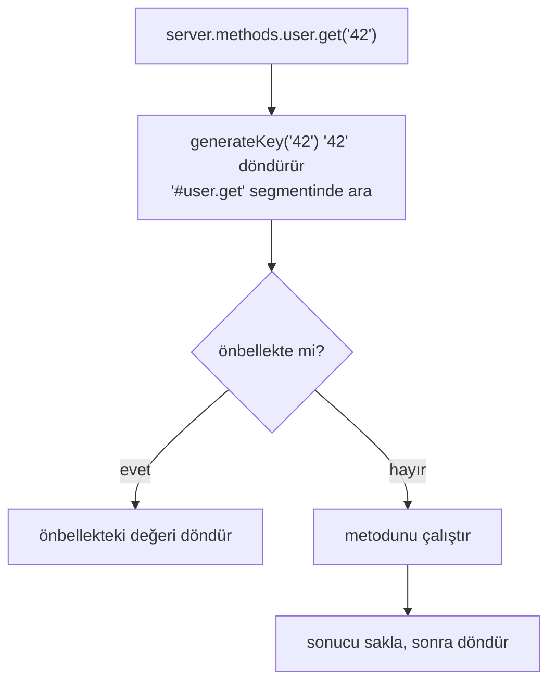

<TutorialLang />

# Server Method'lar

_Bu eğitim hapi v21 ve sonraki sürümlerle uyumludur_

## <a name="overview"></a> Genel Bakış

Server method, sunucuya [`server.method()`](/api#server-method-name-method-options) ile kaydettiğin ve sunucuya erişimi olan her yerden çağırabildiğin bir fonksiyondur: route handler'ları, plugin'ler, extension'lar. Şu durumlarda kullan:

- birkaç route ya da plugin aynı fonksiyona ihtiyaç duyuyor ve her birinin onu ayrı ayrı import etmesini istemiyorsun.
- fonksiyon pahalı ve sonucu önbelleğe alınabilir. Tek bir seçenek, onun için hapi'nin [önbelleğini](/tutorials/tr_TR/caching) açar.

```ts
import Hapi from '@hapi/hapi';

declare module '@hapi/hapi' {
    interface ServerMethods {
        add: (x: number, y: number) => number;
    }
}

const server = Hapi.server({ port: 3000 });

server.method('add', (x: number, y: number) => x + y);

server.route({
    method: 'GET',
    path: '/',
    handler: (request, h) => {
        return { sum: request.server.methods.add(1, 2) };
    },
});

await server.start();
```

- `server.methods.add` kaydedilen fonksiyondur. Bir handler içinde `request.server.methods` ile, kapsamda `server` değişkeni olmadan ona ulaşırsın.
- hapi hangi metotları kaydettiğini bilmez, bu yüzden TypeScript'in onları hapi'nin `ServerMethods` arayüzünde görmesi gerekir. `declare module` bloğu projendeki herhangi bir modülde olabilir.
- Metotlar sunucu genelindedir: bir plugin içinde kaydedilen bir metot diğer tüm plugin'ler ve route'lar tarafından kullanılabilir.

## <a name="server.method"></a> server.method()

`server.method()` ya sıralı argümanlar ya da tek bir nesne alır (birden fazlasını aynı anda kaydetmek için bir nesne dizisi de olabilir):

```ts
server.method('add', add, {});

server.method({
    name: 'add',
    method: add,
    options: {},
});
```

### <a name="name"></a> Ad

Nokta içeren bir ad, iç içe bir metot kaydeder:

```ts
server.method('math.add', add);

server.methods.math.add(1, 2);
```

Bunu `ServerMethods` içinde iç içe bir nesne olarak bildir: `math: { add: (x: number, y: number) => number }`. Adın her segmenti geçerli bir JavaScript tanımlayıcısı olmalıdır.

### <a name="method"></a> Metot

Metot herhangi bir argüman alabilir ve `async` olabilir. Sonucu döndür ya da bir hata fırlat.

```ts
server.method('user.get', async (id: string) => {
    return await db.users.findById(id);
});
```

## <a name="options"></a> Seçenekler

| Seçenek               | Ne için kullanılır                                                                 |
| --------------------- | ---------------------------------------------------------------------------------- |
| [`cache`](#cache)     | metodun sonuçlarını önbelleğe almak                                                |
| [`generateKey`](#key) | argümanlar string, number ya da boolean olmadığında önbellek anahtarını oluşturmak |
| [`bind`](#bind)       | metot içinde `this` değerini ayarlamak                                             |

### <a name="cache"></a> Önbellek

`cache` seçeneği varsa metodu çağırmak önce bir önbellekten geçer:



```ts
server.method('user.get', getUser, {
    cache: {
        expiresIn: 60 * 1000,
        staleIn: 30 * 1000,
        staleTimeout: 100,
        generateTimeout: 2000,
    },
});
```

Bilmen gerekenler:

- `generateTimeout` zorunludur. Çağıranın `503` almadan önce metodunu ne kadar bekleyeceğini belirler.
- Önbelleğe alınan bir metot, metodun kendisi senkron olsa bile her zaman bir promise döndürür. Onu `ServerMethods` içinde `Promise` dönüş tipiyle bildir ve `await` ile çağır.
- hapi öğeleri `'#'` ile metot adının birleşiminden oluşan bir segmentte saklar. Varsayılan bellek önbelleği yerine [adlandırılmış bir önbellek client'ı](/tutorials/tr_TR/caching#client) kullanmak için `cache: 'my_cache'` ayarla.
- Diğer seçenekler (`expiresAt`, `staleIn`, `staleTimeout`, `segment`) [`server.cache()`](/api#server-cache-options) ile aynıdır. Bayat değerlerin nasıl sunulduğunu [Önbellekleme](/tutorials/tr_TR/caching#stale) eğitimi gösteriyor.

#### <a name="changing-the-ttl-per-result"></a> TTL'i sonuç bazında değiştirmek

hapi seninkilerden sonra fazladan bir argüman geçer: bir `flags` nesnesi. Bu tek sonucun ne kadar süre önbellekte kalacağını değiştirmek için `flags.ttl` değerini ayarla; hiç önbelleğe alınmasın istiyorsan `0` yap:

```ts
const getUser = async function (id: string, flags: { ttl: number }) {
    const user = await db.users.findById(id);
    if (!user) {
        flags.ttl = 0; // don't cache "not found"
    }

    return user;
};
```

hapi `flags` için bir tip export etmez, bu yüzden örnek onu satır içinde tipliyor.

#### <a name="removing-a-cached-result"></a> Önbellekteki bir sonucu kaldırmak

Önbelleğe alınan her metot bir `cache.drop()` fonksiyonu alır. O sonucu kaldırmak için onu aynı argümanlarla çağır; örneğin bir güncellemeden sonra:

```ts
await db.users.update(id, changes);
await server.methods.user.get.cache?.drop(id);
```

Önbelleksiz metotlarda olmadığı için hapi `cache`'i isteğe bağlı olarak tipler; `?.` bu yüzden var.

### <a name="key"></a> Özel bir anahtar üretmek

hapi önbellek anahtarını argümanları `:` ile birleştirerek oluşturur; bu yalnızca string, number ve boolean için işe yarar. Önbelleğe alınan bir metodu başka tipte bir argümanla çağırmak `500` hatasıyla sonuçlanır. Diğer argümanlar için `generateKey` ver:

```ts
const sum = function (numbers: number[]) {
    return numbers.reduce((total, item) => total + item, 0);
};

server.method('sum', sum, {
    cache: {
        expiresIn: 60 * 1000,
        generateTimeout: 100,
    },
    generateKey: (numbers: number[]) => numbers.join(','),
});
```

`generateKey` metotla aynı argümanları alır ve bir string döndürmelidir.

### <a name="bind"></a> Bind

`bind`, metot içinde `this` değerini ayarlar. Bunu metoda, örneğin bir veritabanı client'ı gibi bir bağımlılığı, argümanlara eklemeden vermek için kullan (argümanlara eklersen önbellek anahtarının da parçası olur):

```ts
const lookup = async function (this: typeof db, id: string) {
    return await this.users.findById(id);
};

server.method('lookup', lookup, { bind: db });
```

- TypeScript'in `this` parametresi `this`'in tipini bildirir. Derleme sırasında silinir ve metodun argümanlarından biri değildir.
- `bind`, kendi `this` değerini koruyan arrow function'larda etkisizdir.
- `bind` yoksa `this`, mevcut plugin ya da sunucuda [`server.bind()`](/api#server-bind-context) ile ayarlanan context'tir.

## <a name="server.methods"></a> server.methods

Kaydedilen tüm metotlar [`server.methods`](/api#server-methods) üzerindedir; handler'larda bu `request.server.methods` olarak da erişilebilir:

```ts
server.route<{ Params: { id: string } }>({
    method: 'GET',
    path: '/users/{id}',
    handler: async (request, h) => {
        return await request.server.methods.user.get(request.params.id);
    },
});
```

Bu eğitimde kullanılan her metodun `ServerMethods` içinde bir girdisi olmalı. Önbelleğe alınan metotları, `cache.drop()` ve `cache.stats` ekleyen hapi'nin `CachedServerMethod` tipiyle sarmala:

```ts
import type { CachedServerMethod } from '@hapi/hapi';

declare module '@hapi/hapi' {
    interface ServerMethods {
        add: (x: number, y: number) => number;
        math: {
            add: (x: number, y: number) => number;
        };
        lookup: (id: string) => Promise<User | null>;
        sum: CachedServerMethod<(numbers: number[]) => Promise<number>>;
        user: {
            get: CachedServerMethod<(id: string) => Promise<User | null>>;
        };
    }
}
```
