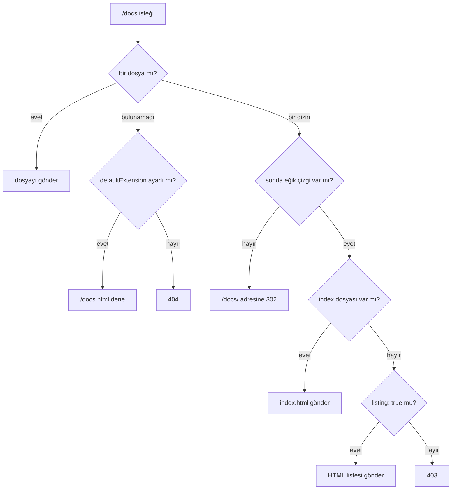

<TutorialLang />

# Statik İçerik Sunma

_Bu eğitim hapi v21 ve sonraki sürümlerle uyumludur_

## <a name="overview"></a> Genel Bakış

hapi diskteki dosyaları [inert](/module/inert) plugin'i aracılığıyla sunar. Kur:

```sh
npm install @hapi/inert
```

## <a name="inert"></a> Inert

inert'i kaydetmek dosya göndermenin üç yolunu ekler:

| Ne                    | Ne için kullanılır                                                   |
| --------------------- | -------------------------------------------------------------------- |
| `h.file(path)`        | kendi mantığını çalıştırdıktan sonra handler içinden dosya göndermek |
| `file` handler'ı      | her zaman tek bir dosya sunan bir route                              |
| `directory` handler'ı | bir klasördeki her dosyayı sunan bir route                           |

`@hapi/inert`'i import etmek bunları hapi'nin TypeScript tiplerine de ekler, böylece `h.file()` ile `file` ve `directory` handler'ları tip kontrolünden geçer.

## <a name="path"></a> Göreli path'ler

Sunucuda `routes.files.relativeTo` değerini bir kez ayarla; route'larındaki her dosya path'i o klasöre göre çözümlenir:

```ts
import Path from 'node:path';
import Hapi from '@hapi/hapi';
import Inert from '@hapi/inert';

const server = Hapi.server({
    routes: {
        files: {
            relativeTo: Path.join(import.meta.dirname, 'public'),
        },
    },
});

await server.register(Inert);

server.route({
    method: 'GET',
    path: '/picture.jpg',
    handler: (request, h) => {
        return h.file('picture.jpg');
    },
});

await server.start();
console.log('Server running at:', server.info.uri);
```

`routes.files.relativeTo` varsayılan olarak process'in çalışma dizinidir. Sunucunun `routes` altındaki her seçenek tüm route'lara uygulanır ve bir route bunu kendi `options.files` alanında geçersiz kılabilir.

## <a name="hfile"></a> `h.file(path, [options])`

[`h.file()`](/module/inert#h-file-path-options) bir dosyayı yanıt olarak gönderir. Path'ler `relativeTo` klasörüyle sınırlıdır: bu klasörün dışına çözümlenen bir path, örneğin `'../secrets.json'` ya da diskte başka bir yerdeki mutlak bir path, `403 Forbidden` yanıtı alır. Bu, bir istek parametresinin rastgele dosyaları okumasını engeller:

```ts
server.route<{ Params: { filename: string } }>({
    method: 'GET',
    path: '/download/{filename}',
    handler: (request, h) => {
        return h.file(request.params.filename, { mode: 'attachment' });
    },
});
```

`/download/report.pdf`, `public/report.pdf` dosyasını indirme olarak gönderir; `/download/..%2Fserver.ts` ise `403` alır. Klasörün dışından bilerek bir dosya göndermek için `confine: false` geç, ama bunu asla kullanıcı girdisinden oluşturulmuş bir path ile yapma.

## <a name="filehandler"></a> File handler'ı

Bir route her zaman aynı dosyayı sunuyorsa, handler fonksiyonu yazmak yerine `file` handler'ını kullan:

```ts
server.route({
    method: 'GET',
    path: '/picture.jpg',
    handler: {
        file: 'picture.jpg',
    },
});
```

### <a name="fileoptions"></a> File handler seçenekleri

Nesne biçimi `h.file()` ile aynı seçenekleri alır:

```ts
server.route({
    method: 'GET',
    path: '/script.js',
    handler: {
        file: {
            path: 'script.js',
            filename: 'client.js',
            mode: 'attachment',
            lookupCompressed: true,
        },
    },
});
```

| Seçenek            | Etkisi                                                                                                                                                                                                                                                                                                  |
| ------------------ | ------------------------------------------------------------------------------------------------------------------------------------------------------------------------------------------------------------------------------------------------------------------------------------------------------- |
| `path`             | gönderilecek dosya; `(request) => path` fonksiyonunu da kabul eder                                                                                                                                                                                                                                      |
| `mode`             | `'attachment'` (indirme) ya da `'inline'`; `Content-Disposition` header'ını ayarlar                                                                                                                                                                                                                     |
| `filename`         | `Content-Disposition` içindeki dosya adı; burada `script.js` yerine `client.js`                                                                                                                                                                                                                         |
| `lookupCompressed` | `script.js.gz` varsa ve istemci gzip kabul ediyorsa onu sunar; `lookupMap` varsayılan `{ gzip: '.gz' }` değerinin yerine geçer, bu yüzden her encoding'i listele, örneğin `{ gzip: '.gz', br: '.br' }` (`br` ayrıca [`server.encoder()`](/tutorials/tr_TR/response-marshalling#compression) gerektirir) |
| `confine`          | `true` (varsayılan) path'leri `relativeTo` içinde tutar; `false` her path'e izin verir                                                                                                                                                                                                                  |
| `etagMethod`       | `'hash'` (varsayılan), `'simple'` (boyut ve değiştirilme zamanı, daha ucuz) ya da `false`                                                                                                                                                                                                               |

Tam liste [inert API](/module/inert#the-file-handler) sayfasında.

## <a name="directoryhandler"></a> Directory handler'ı

`directory` handler'ı tek bir route'tan bütün bir klasörü sunar. Path bir parametreyle bitmelidir ve parametrenin değeri aranacak dosyadır. Parametre, route'un ne kadar derine kadar sunacağını belirler: `{param}` bir seviye sunar, `{param?}` klasörün kökünü de sunar, `{param*}` her derinliği sunar, `{param*2}` ise tam olarak iki seviye sunar:

```ts
server.route({
    method: 'GET',
    path: '/{param*}',
    handler: {
        directory: {
            path: 'directory-path-here',
        },
    },
});
```

### <a name="directoryoptions"></a> Directory handler seçenekleri

inert her istek için dosyayı şöyle çözümler:



| Seçenek            | Varsayılan | Etkisi                                                                                                       |
| ------------------ | ---------- | ------------------------------------------------------------------------------------------------------------ |
| `path`             | zorunlu    | klasör, sırayla denenen bir klasör dizisi ya da `(request) => path` fonksiyonu                               |
| `index`            | `true`     | bir dizin için `index.html` sunar; bir string ya da dizi başka index dosyalarını adlandırır; `false` kapatır |
| `listing`          | `false`    | index dosyası olmayan bir dizin için HTML listesi gösterir                                                   |
| `showHidden`       | `false`    | gizli dosyaları listelere dahil eder ve sunar                                                                |
| `redirectToSlash`  | `true`     | `docs` bir dizin olduğunda `/docs` adresini `/docs/` adresine yönlendirir                                    |
| `defaultExtension` | yok        | `/about` bulunamadığında `/about.html` dener                                                                 |
| `lookupCompressed` | `false`    | önceden sıkıştırılmış `.gz` dosyalarını sunar; `file` handler seçeneğiyle aynıdır                            |

`index: ['index.html', 'default.html']` ile bir dizin isteği önce `index.html`, sonra `default.html` dener.

## <a name="fileserver"></a> Statik dosya sunucusu

`public` klasörünü sitenin kökünde sunan eksiksiz bir sunucu:

```ts
import Path from 'node:path';
import Hapi from '@hapi/hapi';
import Inert from '@hapi/inert';

const server = Hapi.server({
    port: 3000,
    routes: {
        files: {
            relativeTo: Path.join(import.meta.dirname, 'public'),
        },
    },
});

await server.register(Inert);

server.route({
    method: 'GET',
    path: '/{param*}',
    handler: {
        directory: {
            path: '.',
            defaultExtension: 'html',
        },
    },
});

await server.start();
console.log('Server running at:', server.info.uri);
```

- `path: '.'` handler'ı `relativeTo` klasörüne, yani `public` klasörüne yönlendirir.
- `/` adresi `public/index.html` dosyasını sunar; `/docs` ise `/docs/` adresine yönlendirir ve bu adres `public/docs/index.html` dosyasını sunar.
- `defaultExtension: 'html'`, `/about` adresinin `public/about.html` dosyasını sunmasını sağlar, böylece URL'lerinde `.html` gerekmez.
- `/{param*}` mümkün olan en genel path olduğu için, eklediğin diğer route'lar, örneğin `/api/users`, kendi isteklerine yanıt vermeye devam eder. [Hangi route kazanır](/tutorials/tr_TR/routing#specificity) bölümüne bak.
