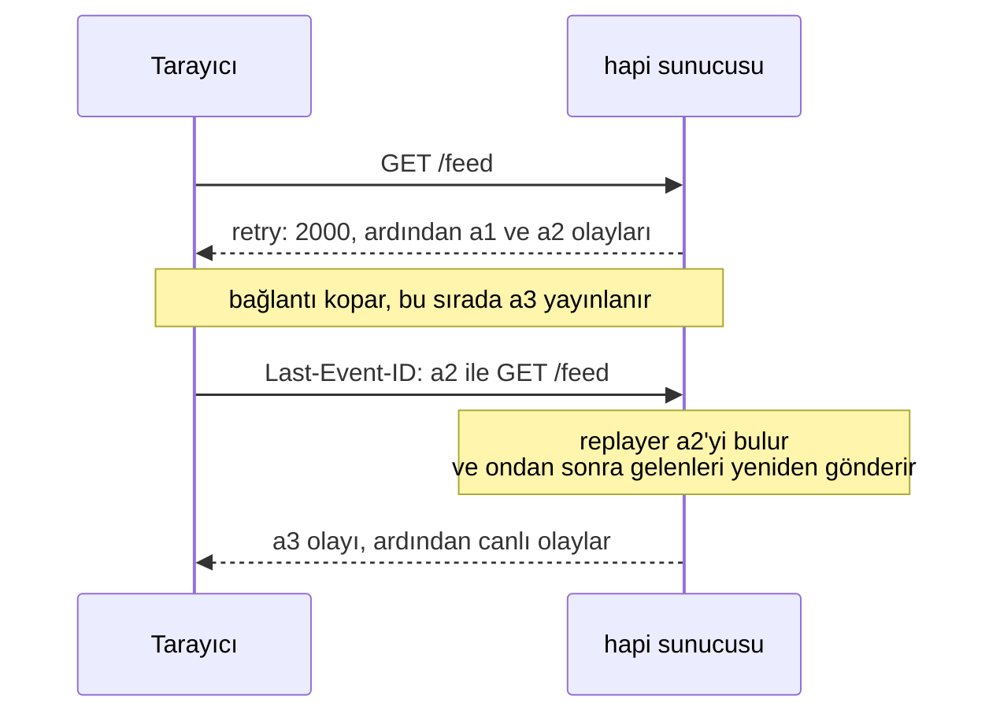
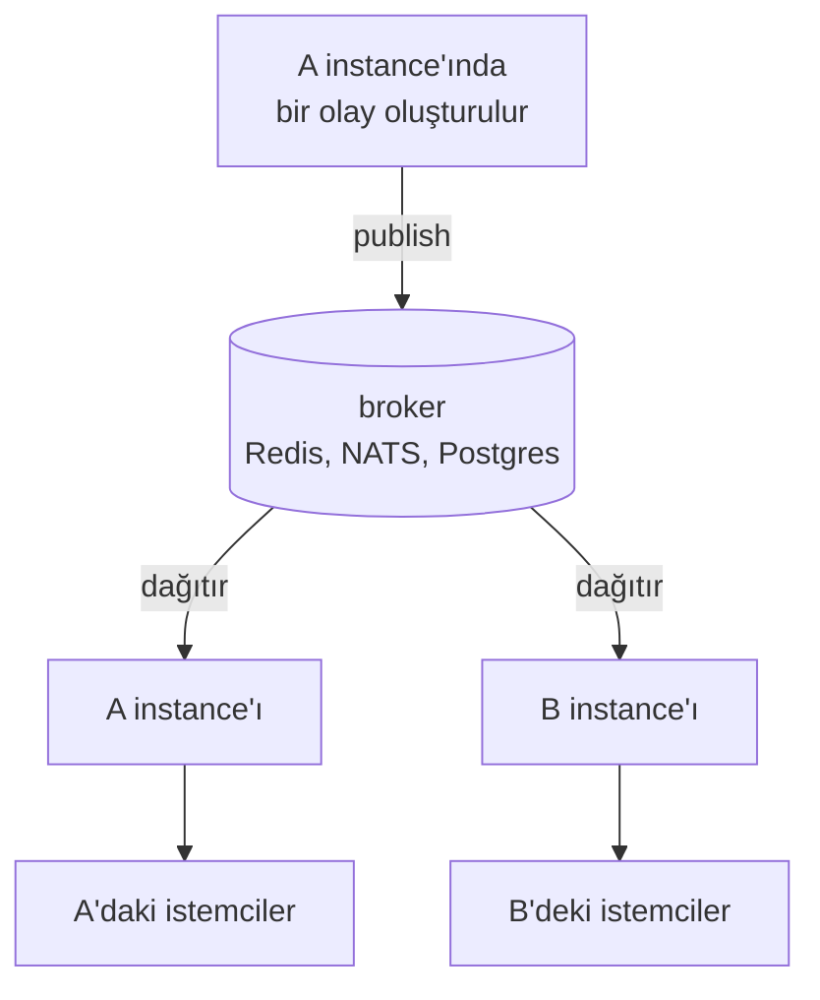

<TutorialLang />

# Server-Sent Events

_Bu eğitim hapi v21 ve sonraki sürümlerle uyumludur_

## <a name="overview"></a> Genel Bakış

Server-Sent Events (SSE), sunucunun tek bir sıradan HTTP yanıtı üzerinden istemciye bir olay akışı göndermesinin bir yoludur. Tarayıcı bu akışı yerleşik `EventSource` API'siyle açar; bu API bağlantı koptuğunda kendiliğinden yeniden bağlanır. [@hapi/sse](/module/sse), hapi'ye SSE desteği ekler.

## <a name="when"></a> SSE ne zaman kullanılır

|                                  | SSE                                                          | [WebSocket'ler](/tutorials/tr_TR/websockets)                                                          | Polling                        |
| -------------------------------- | ------------------------------------------------------------ | ----------------------------------------------------------------------------------------------------- | ------------------------------ |
| Yön                              | yalnızca sunucudan istemciye                                 | iki yönlü                                                                                             | istemci sorar, sunucu yanıtlar |
| Taşıma                           | normal bir HTTP yanıtı                                       | bir protokol yükseltmesi (upgrade)                                                                    | normal HTTP istekleri          |
| Yeniden bağlanma                 | `EventSource` içinde yerleşik, son olay id'sinden devam eder | nes istemcisi yeniden bağlanır ve aboneliklerini yeniler; çevrimdışıyken gönderilen mesajlar kaybolur | gerekmez                       |
| Proxy'lerin arkasında çalışır mı | evet, buffering kapatıldığında                               | proxy upgrade desteklemelidir                                                                         | evet                           |
| Gecikme                          | anında                                                       | anında                                                                                                | polling aralığına kadar        |

Sunucunun söyleyecek bir şeyi olduğunda ve istemci yalnızca dinlediğinde SSE'yi seç: iş ilerlemesi, bildirimler, canlı dashboard'lar, log takibi ve bir yapay zekâ modelinin token token ürettiği çıktı. İstemcinin de sürekli mesaj göndermesi gerekiyorsa WebSocket kullan. Yalnızca ara sıra veri gönderen bir istemci, akış için SSE'yi, geri kalanı için düz `POST` isteklerini kullanabilir.

## <a name="setup"></a> Kurulum

```sh
npm install @hapi/sse
```

```ts
import Hapi from '@hapi/hapi';
import { SsePlugin } from '@hapi/sse';

const server = Hapi.server({ port: 3000 });

await server.register(SsePlugin);
```

Plugin bir akış açmanın iki yolunu sunar:

| Kullanım                               | Handler modu: `handler: { sse: { stream } }`               | Abonelikler: `server.sse.subscription()`                |
| -------------------------------------- | ---------------------------------------------------------- | ------------------------------------------------------- |
| Olayları kim üretir                    | o bağlantı için senin `stream` fonksiyonun                 | herhangi bir kod, `server.sse.publish()` ile            |
| Tipik akış                             | tek bir işin ilerlemesi, bir yapay zekâ yanıtı, log takibi | bildirimler, canlı bir akış, bir sohbet odası           |
| Bağlantı başına olaylar                | her istemci için farklı                                    | aynı olay her aboneye gider                             |
| Yeniden bağlandıktan sonra devam etmek | `session.lastEventId` değerini okur ve devam edersin       | bir replayer istemcinin kaçırdıklarını yeniden gönderir |

## <a name="handler"></a> Handler modu: istek başına bir akış

`sse` handler'ını kullanan bir route, `stream` fonksiyonunu her bağlantı için bir kez çalıştırır. `push()` ile gönderdiğin her şey istemciye o anda ulaşır:

```ts
server.route({
    method: 'GET',
    path: '/jobs/{id}/progress',
    handler: {
        sse: {
            stream: async (request, session) => {
                for await (const update of watchJob(String(request.params.id))) {
                    session.push(update, 'progress', String(update.percent));
                }

                await session.complete();
            },
        },
    },
});
```

Her `push(data, event, id)` çağrısı ağ üzerinde bir olay olur. Nesneler JSON olarak gönderilir:

```text
event: progress
id: 50
data: {"percent":50}
```

`complete()` son bir `complete` olayı gönderir ve yanıtı sonlandırır. Yanıtı sonlandırmak tarayıcıyı durdurmaya yetmez, çünkü `EventSource` kapanan her bağlantıyı kopmuş sayar ve yeniden bağlanır. `complete` olayını gördüğünde bağlantıyı istemcinin kendisi kapatmalıdır:

```ts
const source = new EventSource('/jobs/7/progress');

source.addEventListener('progress', (event) => {
    const { percent } = JSON.parse(event.data);
    console.log(`${percent}%`);
});

source.addEventListener('complete', () => source.close());
```

`close()` olmazsa tarayıcı `retry` süresinden sonra yeniden bağlanır ve akış baştan başlar.

Node.js, `--experimental-eventsource` ile başlatılmadıkça global bir `EventSource` sunmaz. Node'da bu bayrağı ya da [`eventsource`](https://www.npmjs.com/package/eventsource) paketini kullan; istemci kodu tarayıcıdakiyle aynıdır.

## <a name="subscriptions"></a> Abonelikler: bir olay, birçok istemci

Abonelik, istemcilerin bağlandığı ve senin kodunun olay yayınladığı bir route'tur. Path parametre içerebilir, böylece her kullanıcı ya da oda kendi akışını alır:

```ts
import Joi from 'joi';

server.sse.subscription('/rooms/{room}/messages');

server.route<{ Params: { room: string }; Payload: { text: string } }>({
    method: 'POST',
    path: '/rooms/{room}/messages',
    options: {
        validate: {
            params: Joi.object({ room: Joi.string().alphanum().max(50).required() }),
            payload: Joi.object({ text: Joi.string().max(2000).required() }),
        },
    },
    handler: async (request, h) => {
        const message = { text: request.payload.text, at: new Date().toISOString() };
        const delivered = await server.sse.publish(`/rooms/${request.params.room}/messages`, message, {
            event: 'message',
            matchMode: 'literal',
        });

        return { delivered };
    },
});
```

- `matchMode: 'literal'` olayı yalnızca tam olarak o path'e bağlı istemcilere gönderir; böylece `/rooms/lobby/messages` adresine gönderilen bir mesaj lobby odasına ulaşır, başka hiçbir odaya ulaşmaz. Bkz. [`server.sse.publish()`](/module/sse#server-sse-publish-path-data-opts).
- Route yalnızca [doğruladığı](/tutorials/tr_TR/validation) alanları yayınlar, ham payload'u asla yayınlamaz. Veri yazan diğer route'larda olduğu gibi ona da [route kimlik doğrulaması](/tutorials/tr_TR/auth) ekle.
- `publish()`, olayın ulaştırıldığı istemci sayısını döndürür.

Abonelikler ayrıca `filter`, `onSubscribe`, `refuse` ve `maxSessions` seçeneklerini de alır; bkz. [`server.sse.subscription()`](/module/sse#server-sse-subscription-path-config).

## <a name="reconnect"></a> Yeniden bağlanma ve `Last-Event-ID`

Bağlantı koptuğunda tarayıcı, sunucunun gönderdiği `retry` süresi kadar bekler, sonra aldığı son olayın id'sini bir `Last-Event-ID` header'ında göndererek yeniden bağlanır:



Header'ı tarayıcı gönderir ama ona göre davranabilecek tek taraf senin sunucundur ve iki mod bu konuda farklıdır:

- **Abonelikler:** aboneliğe bir replayer ver. Replayer son olayları bellekte tutar ve istemcinin son id'sinden sonraki her şeyi yeniden gönderir. Bir replayer tüm abonelik için, her path ve her istemci tarafından paylaşılan tek bir geçmiş tutar; bu yüzden onu herkese açık bir `/feed` gibi path parametresi olmayan aboneliklerde kullan. Kullanıcı ya da oda başına akışlarda, handler modunda olduğu gibi kaldığın yerden veritabanından devam et.

    ```ts
    import { FiniteReplayer } from '@hapi/sse';

    server.sse.subscription('/feed', {
        replay: new FiniteReplayer({ size: 100 }),
    });

    await server.sse.publish('/feed', item, { event: 'news', id: item.id });
    ```

- **Handler modu:** `stream` içinde `session.lastEventId` değerini oku ve oradan devam et; örneğin veritabanından o id'den daha yeni satırları sorgulayarak.

İstemcinin son id'si artık buffer'da değilse, örneğin sunucu yeniden başladıktan sonra, replayer elindeki her şeyi yeniden gönderir; bu yüzden olaylarına istemcinin tekrarları ayıklamak için kullanabileceği id'ler ver. Her replayer'ın neyi tuttuğu [Event replay](/module/sse#event-replay) bölümünde anlatılıyor. Replay buffer'ları tek bir sürecin belleğinde yaşar; bkz. [Instance'lar arasında ölçekleme](#scaling).

## <a name="disconnect"></a> Akış sona erdiğinde temizlik

Bir akış, taraflardan biri onu kapatana kadar açık kalır. Bu yüzden bir bağlantı için başlattığın her şey, akış sona erdiğinde durmalıdır: istemci ayrıldığında, akış tamamlandığında ya da sunucu kapanırken:

```ts
import type { Session } from '@hapi/sse';

const openStreams = new Map<Session, () => void>();

server.route({
    method: 'GET',
    path: '/jobs/{id}/progress',
    handler: {
        sse: {
            stream: async (request, session) => {
                const watcher = watchJob(String(request.params.id));
                openStreams.set(session, () => watcher.stop());
                request.events.once('disconnect', () => watcher.stop());

                try {
                    for await (const update of watcher) {
                        session.push(update, 'progress', String(update.percent));
                    }

                    if (session.isOpen) {
                        await session.complete();
                    }
                } finally {
                    watcher.stop();
                    openStreams.delete(session);
                }
            },
        },
    },
});

server.ext('onPreStop', () => {
    for (const [session, stop] of openStreams) {
        stop();
        session.close();
    }
});
```

- **İstemci ayrılır:** `request.events` bir `'disconnect'` olayı yayar; bu da watcher'ı durdurur ve döngüyü bitirir.
- **Akış sunucuda sona erer:** `finally` bloğu çalışır, böylece `Map` hiçbir zaman bitmiş bir akışı tutmaz.
- **Sunucu kapanır:** `onPreStop` [sunucu hook'u](/tutorials/tr_TR/lifecycle-hooks#server-hooks) her watcher'ı durdurur ve her akışı kapatır, böylece `server.stop()` kendi `timeout` süresini beklemeden tamamlanır.
- **Abonelikler:** aboneliğin `onUnsubscribe` seçeneğini ya da her abonelik akışı için plugin'in `onSessionClose` hook'unu kullan. Plugin istemciyi abonelikten kendiliğinden çıkarır.

## <a name="proxies"></a> Proxy'ler, buffering ve boşta kalma zaman aşımları

Production'daki SSE sorunlarının çoğu, sunucu ile tarayıcı arasındaki bir şeyin olayları bekletmesinden ya da sessiz bir bağlantıyı kapatmasından kaynaklanır. Plugin bunun bir kısmını halleder:

| Sorun                                                                        | Plugin'in yaptığı                                             | Senin yapacağın                                                                                |
| ---------------------------------------------------------------------------- | ------------------------------------------------------------- | ---------------------------------------------------------------------------------------------- |
| Bir proxy yanıtı buffer'a alır ve olayları toplu hâlde iletir                | `X-Accel-Buffering: no` ve `Cache-Control: no-cache` gönderir | bu header'lara uymayan proxy'lerde yanıt buffering'ini kapat                                   |
| Sıkıştırma, yeterli bayt birikene kadar olayları bekletir                    | her yazmadan sonra gzip ve deflate çıktısını flush eder       | hiçbir şey; olaylar sıkıştırılmış olsa bile tek tek gelir                                      |
| Bir load balancer ya da proxy çok uzun süre boşta kalan bağlantıları kapatır | her 15 saniyede bir `:` yorum satırı gönderir                 | `keepAlive.interval` değerini yol üzerindeki en kısa boşta kalma zaman aşımının altında tut    |
| Tarayıcılar alan adı başına yalnızca 6 HTTP/1.1 bağlantısına izin verir      | hiçbir şey                                                    | siteyi, genellikle proxy üzerinde, HTTP/2 ile sun; böylece akışlar tek bir bağlantıyı paylaşır |

## <a name="auth"></a> Kimlik Doğrulama

Bir SSE akışı normal bir hapi route'udur, bu yüzden scope'lar dahil her zamanki [route kimlik doğrulaması](/tutorials/tr_TR/auth) geçerlidir. Abonelikler için bunu `auth` seçeneğinde ver:

```ts
server.sse.subscription('/users/{userId}/notifications', {
    auth: { strategy: 'session', access: { scope: 'user-{params.userId}' } },
});

await server.sse.publish(`/users/${userId}/notifications`, notification, {
    event: 'notification',
    matchMode: 'literal',
});
```

`user-{params.userId}` scope'uyla bir kullanıcı yalnızca kendi bildirim akışını açabilir; başka herkes `403` alır. Bkz. [Scope'lar](/tutorials/tr_TR/auth#scopes). Her bildirimin yalnızca kendi kullanıcısının akışına ulaşması için `matchMode: 'literal'` ile yayınla.

`EventSource` istek header'ı ayarlayamaz, bu yüzden `Authorization` içinde bir bearer token kullanmak mümkün değildir. Seçenekler:

| Yaklaşım                               | İyi yanı                                     | Dikkat edilmesi gereken                                                                                        |
| -------------------------------------- | -------------------------------------------- | -------------------------------------------------------------------------------------------------------------- |
| `@hapi/cookie` gibi bir cookie oturumu | tarayıcı onu yeniden bağlanırken de gönderir | cross-origin akışlar `new EventSource(url, { withCredentials: true })` ve credentials destekli CORS gerektirir |
| Query string içinde token              | her istemciyle çalışır                       | URL'ler sunucu ve proxy erişim loglarına düşer; yalnızca bu akış için üretilmiş kısa ömürlü bir token kullan   |
| Akış gövdeli `fetch()`                 | her header'ı gönderebilir                    | `EventSource`'un yeniden bağlanma ve `Last-Event-ID` desteğini kaybedersin ve bunları kendin yazmalısın        |

Kendi alan adında çalışan bir tarayıcı uygulaması için en basit seçim cookie'dir.

## <a name="scaling"></a> Instance'lar arasında ölçekleme

İki sunucu instance'ı belleği paylaşmaz. Bir SSE akışı, tek bir sürecin tuttuğu açık bir bağlantıdır: A instance'ına bağlı bir istemci yalnızca A'da vardır ve B instance'ının ona yazmasının hiçbir yolu yoktur. A'da yayınlanan bir olay yalnızca A'nın istemcilerine ulaşır. Bu her SSE kütüphanesi ve her hosting sağlayıcısı için geçerlidir: her süreç yalnızca kendi sahip olduğu bağlantılara yazabilir.

Bağlı istemciler, replay buffer'ları ve varsayılan olarak tamamlanmış akışların kaydı, bu süreç başına bellekte yaşar. Ölçeklemek için instance'lar arasında mesaj iletimi gerekir. Redis, NATS ya da Postgres `LISTEN`/`NOTIFY` gibi bir pub/sub backend'i her olayı her instance'a dağıtır ve her instance olayı kendi açık akışlarına yazar:



Redis ile:

```ts
import { createClient } from 'redis';

interface RoomMessage {
    room: string;
    text: string;
    at: string;
}

const publisher = createClient({ url: process.env.REDIS_URL });
const subscriber = publisher.duplicate();
publisher.on('error', (err) => server.log(['redis', 'error'], err));
subscriber.on('error', (err) => server.log(['redis', 'error'], err));
await Promise.all([publisher.connect(), subscriber.connect()]);

await subscriber.subscribe('rooms', async (raw) => {
    const message: RoomMessage = JSON.parse(raw);
    await server.sse.publish(`/rooms/${message.room}/messages`, message, { event: 'message', matchMode: 'literal' });
});

const publishToRoom = async (message: RoomMessage) => {
    await publisher.publish('rooms', JSON.stringify(message));
};
```

`POST` route'u `server.sse.publish()` yerine `publishToRoom()` çağırır ve isteği işleyen de dahil her instance olayı kendi akışlarına yayınlar.

- Broker devredeyken her instance her olayı yayınlar; bu yüzden her instance'ın replayer'ı aynı geçmişi tutar ve yeniden bağlanan bir istemci herhangi bir instance'ta kaldığı yerden devam edebilir. Eksik olan yalnızca bir instance başlamadan önceki olaylardır; bunu da [Yeniden bağlanma](#reconnect) bölümündeki tekrarlara dayanıklı id'ler zaten karşılar.
- Plugin'in `completion.cache` seçeneğini catbox-redis gibi paylaşılan bir önbelleğe yönlendir; böylece tamamlanmış bir abonelik akışı her instance'ta tanınır.
- `maxDuration` her akışı belirli bir süreden sonra (rastgele bir sapmayla) kapatır ve istemci yeniden bağlanır. Böylece yeni instance'lar eklediğinde uzun ömürlü akışlar eski instance'larda kalmak yerine yeniden dağılır.

## <a name="next"></a> Sonraki adımlar

- [@hapi/sse API referansı](/module/sse): tüm seçenekler, `Session`, replayer'lar, yavaş istemciler için [backpressure](/module/sse#backpressure) ve [yerleşik güvenlik önlemleri](/module/sse#security).
- İstemcinin de mesaj göndermesi gerektiğinde [WebSocket'ler](/tutorials/tr_TR/websockets).
- `onPreStop` ve diğer sunucu hook'ları için [Yaşam Döngüsü Hook'ları](/tutorials/tr_TR/lifecycle-hooks).
