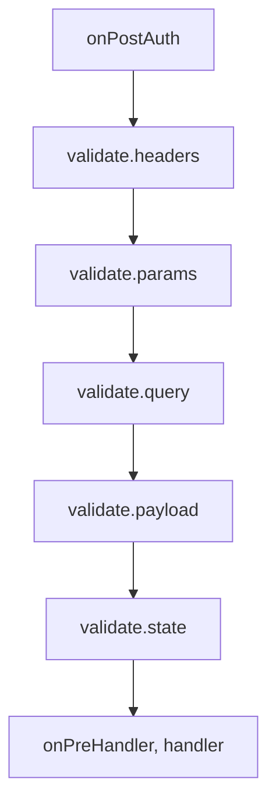

<TutorialLang />

# Doğrulama

_Bu eğitim hapi v21 ve sonraki sürümlerle, joi v16 ve sonraki sürümlerle uyumludur_

## <a name="overview"></a> Genel Bakış

hapi, handler'ın çalışmadan önce bir isteğin header'larını, path parametrelerini, query'sini, payload'unu ve cookie'lerini kontrol eder; yanıtı da gönderilmeden önce kontrol edebilir. Neyin izinli olduğunu genellikle bir [joi](https://joi.dev) şemasıyla tanımlarsın, hapi de geri kalan her şeyi reddeder.

## <a name="joi"></a> Joi

joi'yi kur ve import et:

```sh
npm install joi
```

```ts
import Joi from 'joi';
```

joi kendi TypeScript tiplerini içerir, bu yüzden ayrıca kurman gereken bir `@types` paketi yoktur.

## <a name="input"></a> Girdi doğrulama

Girdi kuralları route'un `options.validate` alanına yazılır. hapi bunları kimlik doğrulamadan sonra ve handler'dan önce şu sırayla çalıştırır ve başarısız olan ilk kuralda durur (bkz. [failAction](#failaction)):



| Anahtar   | Doğruladığı                  | Başarılı olunca yerine konan |
| --------- | ---------------------------- | ---------------------------- |
| `headers` | `request.headers`            | `request.headers`            |
| `params`  | `request.params`             | `request.params`             |
| `query`   | `request.query`              | `request.query`              |
| `payload` | `request.payload`            | `request.payload`            |
| `state`   | `request.state` (cookie'ler) | `request.state`              |

Her anahtar şunları kabul eder:

| Değer                                  | Anlamı                                                                                           |
| -------------------------------------- | ------------------------------------------------------------------------------------------------ |
| `true` ya da ayarlanmamış (varsayılan) | her şeye izin verilir                                                                            |
| `false`                                | hiçbir değere izin verilmez                                                                      |
| bir joi şeması                         | değer şemaya uymalıdır                                                                           |
| bir fonksiyon                          | kendi doğrulayıcın, bkz. [Özel doğrulayıcılar](#alternatives)                                    |
| joi şemalarından oluşan düz bir nesne  | yalnızca `server.validator(Joi)` sonrasında izinlidir; aksi halde `server.route()` hata fırlatır |

Doğrulama, istekteki değeri doğrulanmış değerle değiştirir; böylece joi'nin tip dönüşümleri ve varsayılan değerleri handler'ına ulaşır. `?limit=5` query'si `'5'` string'i olarak gelir ve `Joi.number()` sonrasında handler `5` sayısını görür. Orijinal değer [`request.orig`](/api#request-orig) üzerinde kalır.

### <a name="pathparams"></a> Path parametreleri

```ts
server.route<{ Params: { name: string } }>({
    method: 'GET',
    path: '/hello/{name}',
    handler: (request, h) => {
        return `Hello ${request.params.name}!`;
    },
    options: {
        validate: {
            params: Joi.object({
                name: Joi.string().min(3).max(10),
            }),
        },
    },
});
```

`/hello/jennifer` isteği `Hello jennifer!` yanıtını döner. `/hello/a` ve `/hello/thisnameiswaytoolong` ise şu yanıtı alır:

```json
{
    "statusCode": 400,
    "error": "Bad Request",
    "message": "Invalid request params input"
}
```

### <a name="queryparams"></a> Query parametreleri

```ts
server.route<{ Query: { limit: number } }>({
    method: 'GET',
    path: '/posts',
    handler: (request, h) => {
        return posts.slice(0, request.query.limit);
    },
    options: {
        validate: {
            query: Joi.object({
                limit: Joi.number().integer().min(1).max(100).default(10),
            }),
        },
    },
});
```

- `limit` 1 ile 100 arasında bir tam sayı olmalıdır; istemci onu göndermezse varsayılan değer 10'dur.
- `/posts?limit=15&offset=15` isteği `400` ile başarısız olur: bir `Joi.object()` şeması listelemediği anahtarları reddeder. Kabul ettiğin her parametreyi listele ya da diğer anahtarları geçirmek için şemaya `.unknown()` ekle.
- `Query: { limit: number }` tip argümanı TypeScript'e handler'ın ne alacağını söyler. hapi bunu joi şemasından çıkarmaz, bu yüzden ikisini senkron tutmak sana kalır.

### <a name="payloadparams"></a> Payload

```ts
server.route({
    method: 'POST',
    path: '/post',
    handler: (request, h) => {
        return 'Blog post added';
    },
    options: {
        validate: {
            payload: Joi.object({
                post: Joi.string().min(1).max(140),
                date: Joi.date().required(),
            }),
        },
    },
});
```

`post` 1 ile 140 karakter arasında olmalıdır; `date` zorunludur ve JavaScript'in tarih olarak ayrıştırabileceği bir değer olmalıdır, örneğin `'2026-10-25'`. joi onu dönüştürür, böylece handler bir `Date` nesnesi alır. Başarısız olursa `Invalid request payload input` mesajıyla `400` döner.

### <a name="headers"></a> Header'lar

```ts
server.route({
    method: 'GET',
    path: '/hello/{name}',
    handler: (request, h) => {
        return `Hello ${request.params.name}!`;
    },
    options: {
        validate: {
            headers: Joi.object({
                cookie: Joi.string().required(),
            }),
            options: {
                allowUnknown: true,
            },
        },
    },
});
```

Tarayıcılar ve proxy'ler çok sayıda header ekler, bu yüzden header şemaları neredeyse her zaman `allowUnknown: true` gerektirir. `validate.options`, joi seçeneklerini route'taki tüm girdi şemalarına aktarır. Header adları `request.headers` içinde küçük harflidir, bu yüzden onları şemada da küçük harfle yaz.

### <a name="failaction"></a> Doğrulama başarısız olduğunda

Ne olacağına `validate.failAction` karar verir:

| `failAction`           | Sonuç                                                                                                       |
| ---------------------- | ----------------------------------------------------------------------------------------------------------- |
| `'error'` (varsayılan) | `Invalid request query input` gibi genel bir mesajla `400`                                                  |
| `'log'`                | `validation`, `error` ve kaynak tag'lerini taşıyan bir `request` olayını loglar, sonra handler'ı çalıştırır |
| `'ignore'`             | handler'ı çalıştırır                                                                                        |
| bir fonksiyon          | `(request, h, err)`: bir hata fırlat ya da bir takeover yanıtı döndür                                       |

`'log'` ve `'ignore'` ile handler orijinal, doğrulanmamış değeri alır: `?limit=500` sayı olarak değil `'500'` string'i olarak gelir.

Varsayılan `400`, hangi alanın başarısız olduğunu gizler; böylece istemciler şemalarını yoklayamaz. Geliştirme sırasında ya da istemcilerin ayrıntılara ihtiyaç duyduğu bir API'de, ayrıntılı hatayı bir `failAction` fonksiyonundan yeniden fırlat:

```ts
server.route({
    method: 'GET',
    path: '/posts',
    handler: (request, h) => posts,
    options: {
        validate: {
            query: Joi.object({
                limit: Joi.number().integer().max(100),
            }),
            failAction: (request, h, err) => {
                throw err;
            },
        },
    },
});
```

Artık `/posts?limit=500` isteği joi'nin mesajı ve başarısız anahtarlarla yanıt verir:

```json
{
    "statusCode": 400,
    "error": "Bad Request",
    "message": "\"limit\" must be less than or equal to 100",
    "validation": { "source": "query", "keys": ["limit"] }
}
```

Tek bir `failAction`'ı tüm route'lara uygulamak için onu sunucunun `routes.validate` seçeneğinde ayarla. API referansındaki [`failAction`](/api#failaction-configuration) bölümüne bak.

## <a name="output"></a> Yanıt doğrulama

`options.response`, handler'ın döndürdüğü değeri handler'dan sonra ve `onPreResponse`'tan önce kontrol eder. Bir endpoint'in belgelenmiş sözleşmesine uyduğundan emin olmak için bunu kullan. [hapi-swagger](https://github.com/glennjones/hapi-swagger) gibi plugin'ler de her endpoint'in çıktısını belgelemek için bu şemaları okur.

```ts
const bookSchema = Joi.object({
    title: Joi.string().required(),
    author: Joi.string().required(),
    isbn: Joi.string().length(10),
    pageCount: Joi.number(),
    datePublished: Joi.date().iso(),
});

server.route({
    method: 'GET',
    path: '/books',
    handler: async (request, h) => {
        return await getBooks();
    },
    options: {
        response: {
            schema: Joi.array().items(bookSchema),
            failAction: 'log',
        },
    },
});
```

| Seçenek      | Ne yapar                                                                                                                   |
| ------------ | -------------------------------------------------------------------------------------------------------------------------- |
| `schema`     | her yanıt için kural; girdi kurallarıyla aynı değerleri alır                                                               |
| `status`     | durum kodu başına kurallar, örneğin `{ 201: created, 202: Joi.object({ original, updated }) }`; `schema`'yı geçersiz kılar |
| `failAction` | `'error'` (varsayılan) `500` yanıtı verir; ayrıca `'log'`, `'ignore'` ya da bir fonksiyon olabilir                         |
| `sample`     | yoğun route'larda CPU'dan tasarruf etmek için doğrulanacak yanıtların yüzdesi, `0` ile `100` arası                         |
| `modify`     | `true` olduğunda doğrulanmış değer yanıtın yerine geçer, böylece joi dönüşümleri ve `stripUnknown` uygulanır               |
| `options`    | bu şemalar için joi seçenekleri, örneğin `stripUnknown`                                                                    |

Yanıt doğrulamanın atladıkları ya da reddettikleri:

- Hata yanıtları (`400` ve üzeri durum kodları), `status` o kod için bir şema içermedikçe doğrulanmaz.
- Yalnızca düz değerler (nesneler, diziler, string'ler) doğrulanabilir. Yanıt şeması olan bir stream ya da dosya yanıtı `500` ile başarısız olur.

`modify: true` ile `stripUnknown: true` birlikte, parola hash'leri gibi alanların bir endpoint'ten dışarı sızmasını engellemenin pratik bir yoludur:

```ts
server.route({
    method: 'GET',
    path: '/me',
    handler: (request, h) => {
        return { id: '2133d32a', name: 'John Doe', passwordHash: '$2a$10$...' };
    },
    options: {
        response: {
            schema: Joi.object({
                id: Joi.string(),
                name: Joi.string(),
            }).options({ stripUnknown: true }),
            modify: true,
        },
    },
});
```

İstemci `{ "id": "2133d32a", "name": "John Doe" }` alır.

## <a name="alternatives"></a> Özel doğrulayıcılar

Her kural, joi şeması yerine `async (value, options)` biçiminde bir fonksiyon olabilir:

- Doğrulamayı başarısız kılmak için bir hata fırlat. Onu `failAction` ele alır.
- Doğrulanan değerin yerine geçecek bir değer döndür. Orijinal değer `request.orig` üzerinde kalır.
- Değeri değiştirmeden bırakmak için hiçbir şey döndürme.

```ts
server.route({
    method: 'GET',
    path: '/items',
    handler: (request, h) => request.query,
    options: {
        validate: {
            query: async (value) => {
                if (typeof value !== 'object' || value === null || !('ids' in value) || typeof value.ids !== 'string') {
                    throw new Error('ids is required');
                }

                return { ids: value.ids.split(',') };
            },
        },
    },
});
```

`/items?ids=1,2,3` isteği `{ "ids": ["1", "2", "3"] }` yanıtını döner. Fırlatılan bir hata, joi hatasında olduğu gibi `400`'e dönüştürülür.
