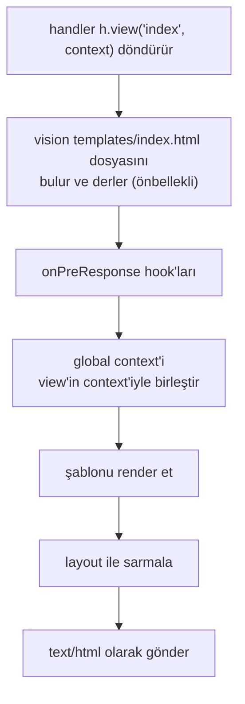

<TutorialLang />

# View'lar

_Bu eğitim hapi v21 ve sonraki sürümlerle uyumludur_

## <a name="overview"></a> Genel Bakış

hapi HTML şablonlarını [vision](/module/vision) plugin'i aracılığıyla render eder. Vision, handlebars, pug ve ejs dahil `compile` fonksiyonu olan her şablon motoruyla çalışır (nunjucks gibi farklı bir `compile` fonksiyonuna sahip motorlar, [Motorlar](#engines) bölümünde anlatılan küçük bir sarmalayıcıya ihtiyaç duyar); partial'ları, helper'ları ve layout'ları da destekler.

## <a name="vision"></a> Vision

vision'ı ve bir motoru kur:

```sh
npm install @hapi/vision handlebars
```

vision'ı kaydetmek şunları ekler:

| Ne                                    | Ne için kullanılır                                          |
| ------------------------------------- | ----------------------------------------------------------- |
| `server.views(options)`               | motorları, şablon klasörlerini ve layout'ları yapılandırmak |
| `h.view(template, context)`           | bir handler'dan şablon render etmek                         |
| `view` handler'ı                      | yalnızca bir şablon render eden bir route                   |
| `server.render()`, `request.render()` | bir şablonu string'e render etmek, örneğin bir e-posta için |

`@hapi/vision`'ı import etmek bunları hapi'nin TypeScript tiplerine de ekler. API'nin tamamı [vision API referansında](/module/vision).

## <a name="server"></a> Sunucuyu yapılandırmak

```ts
import Hapi from '@hapi/hapi';
import Vision from '@hapi/vision';
import Handlebars from 'handlebars';

const server = Hapi.server({ port: 3000 });

await server.register(Vision);

server.views({
    engines: {
        html: Handlebars,
    },
    relativeTo: import.meta.dirname,
    path: 'templates',
});

server.route({
    method: 'GET',
    path: '/',
    handler: (request, h) => {
        return h.view('index', { title: 'My home page' });
    },
});

await server.start();
```

- `engines` bir dosya uzantısını bir motorla eşler: `.html` ile biten dosyalar handlebars ile render edilir.
- `path`, şablonları tutan klasördür ve `relativeTo`'ya göre çözümlenir. ES modüllerinde `__dirname` yoktur; `import.meta.dirname` mevcut dosyanın klasörüdür.
- `h.view('index', ...)`, `templates/index.html` dosyasını render eder. Tek bir motor kayıtlıysa uzantıyı yazmayabilirsin.

### <a name="lifecycle"></a> Bir view nasıl render edilir

`h.view()` hemen bir şey render etmez. Bir view yanıtı döndürür ve vision onu hapi yanıtı gönderirken render eder:



Bu sıranın pratikteki anlamı:

- Eksik bir şablon, handler döner dönmez, herhangi bir `onPreResponse` hook'undan önce `500` ile başarısız olur.
- Bir `onPreResponse` hook'u render işleminden önce çalışır, bu yüzden bir view'i hâlâ farklı bir yanıtla, örneğin bir hata sayfasıyla değiştirebilir. Aşağıdaki [Hata sayfaları](#errors) bölümüne bak.
- [Yanıt Hazırlama](/tutorials/tr_TR/response-marshalling) eğitimi bu hazırlama ve render ayrımını tüm yanıt tipleri için anlatıyor.

## <a name="options"></a> server.views() seçenekleri

| Seçenek               | Varsayılan     | Etkisi                                                                        |
| --------------------- | -------------- | ----------------------------------------------------------------------------- |
| `engines`             | zorunlu        | uzantıdan motora eşleme, örneğin `{ html: Handlebars, pug: Pug }`             |
| `path`                | yok            | şablonların bulunduğu klasör (ya da klasör dizisi)                            |
| `relativeTo`          | çalışma dizini | diğer tüm path seçenekleri için temel klasör                                  |
| `partialsPath`        | yok            | partial'ların bulunduğu klasör                                                |
| `helpersPath`         | yok            | helper modüllerinin bulunduğu klasör                                          |
| `layout`              | `false`        | `layout.html` kullanmak için `true` ya da başka bir layout dosyasının adı     |
| `layoutPath`          | yok            | layout'ların bulunduğu klasör                                                 |
| `context`             | yok            | her view'e birleştirilen context; bir nesne ya da isteği alan bir fonksiyon   |
| `isCached`            | `true`         | `false` şablonları her istekte okur ve derler; geliştirme sırasında işe yarar |
| `defaultExtension`    | tek motor      | `h.view()` uzantısız bir ad aldığında kullanılan uzantı                       |
| `compileMode`         | `'sync'`       | `compile` fonksiyonu callback alan motorlar için `'async'`                    |
| `allowAbsolutePaths`  | `false`        | mutlak şablon adlarına izin verir                                             |
| `allowInsecureAccess` | `false`        | şablon adlarında `../` kullanımına izin verir                                 |

`server.views()` üzerinde ayarlanan seçenekler tüm motorlara uygulanır:

```ts
server.views({
    engines: { html: Handlebars },
    relativeTo: import.meta.dirname,
    path: 'templates',
    isCached: process.env.NODE_ENV === 'production',
});
```

Burada şablonlar `templates/` klasöründen yüklenir; production dışında vision onları her istekte yeniden okuyup derler, böylece şablon değişiklikleri yeniden başlatmadan görünür.

### <a name="engines"></a> Motorlar

Motor, `compile` fonksiyonu olan herhangi bir nesnedir:

| `compileMode`         | `compile` imzası                              | Döndürdüğü                                                                                                    |
| --------------------- | --------------------------------------------- | ------------------------------------------------------------------------------------------------------------- |
| `'sync'` (varsayılan) | `compile(template, compileOptions)`           | HTML döndüren `render(context, runtimeOptions)`                                                               |
| `'async'`             | `compile(template, compileOptions, callback)` | `callback(err, render)` çağırır; `render(context, runtimeOptions, callback)` de `callback(err, html)` çağırır |

`compileOptions` ve `runtimeOptions`, motoruna aktarılan `server.views()` seçenekleridir. API'si uymayan bir motor, bu `compile` fonksiyonuna sahip bir nesneyle sarmalanabilir.

Birden fazla motor kayıtlıysa, en çok kullandığını `defaultExtension` olarak ayarlamadıkça `h.view()` uzantıya ihtiyaç duyar (`h.view('index.pug')`).

### <a name="paths"></a> Path'ler

Şu klasör yapısıyla:

```
templates/
    index.html
    layout/
        layout.html
    helpers/
        fortune.js
```

yapılandırma şöyledir:

```ts
server.views({
    engines: {
        html: Handlebars,
    },
    relativeTo: import.meta.dirname,
    path: 'templates',
    layoutPath: 'templates/layout',
    helpersPath: 'templates/helpers',
});
```

### <a name="global"></a> Global context

`context` her view'in context'ine birleştirilir; ikisi aynı anahtarı ayarladığında view'in kendi context'i kazanır. Bunu istek başına hesaplamak için bir fonksiyon ver; örneğin her sayfada oturum açmış kullanıcıyı göstermek için:

```ts
server.views({
    engines: {
        html: Handlebars,
    },
    relativeTo: import.meta.dirname,
    path: 'templates',
    context: (request) => ({
        siteName: 'My personal site',
        user: request?.auth.credentials?.user ?? null,
    }),
});
```

`server.render()` ile bir istek dışında render ettiğinde `request` undefined olur; fonksiyonun onu kontrol etmesinin nedeni budur.

### <a name="helpers"></a> View helper'ları

handlebars gibi helper destekleyen motorlarda `helpersPath` içindeki her modül, dosya adıyla adlandırılmış bir helper olur. `templates/helpers/fortune.js` olarak kaydedilen bu helper rastgele bir fal döndürür:

```js
export default function () {
    const fortunes = [
        'Heisenberg may have slept here...',
        'Wanna buy a duck?',
        'Say no, then negotiate.',
        'Time and tide wait for no man.',
        'To teach is to learn.',
        'Never ask the barber if you need a haircut.',
        'You will forget that you ever knew me.',
        'You will be run over by a beer truck.',
        'Fortune favors the lucky.',
        'Have a nice day!',
    ];

    const x = Math.floor(Math.random() * fortunes.length);
    return fortunes[x];
}
```

Helper'lar JavaScript dosyası olarak kalır: vision onları `require()` ile yükler ve uzantısı Node.js tarafından `require.extensions` ile kaydedilmemiş her dosyayı atlar; `.ts` de bunlardan biridir.

Onu `templates/index.html` içinde kullan:

```html
<h1>Your fortune</h1>
<p>{{fortune}}</p>
```

### <a name="layouts"></a> Layout'lar

Birçok motorun kendi layout sistemi olduğu için vision'ın layout'ları varsayılan olarak kapalıdır. İkisinden birini kullan. vision'ınkini açmak için:

```ts
server.views({
    engines: {
        html: Handlebars,
    },
    relativeTo: import.meta.dirname,
    path: 'templates',
    layout: true,
    layoutPath: 'templates/layout',
});
```

`templates/layout/layout.html`, her view'in nereye gideceğini `content` ile işaretler:

```html
<html>
    <body>
        {{{content}}}
    </body>
</html>
```

view ise yalnızca kendi parçasını tutar:

```html
<div>Content</div>
```

| Amaç                                       | Yapılacak                                                 |
| ------------------------------------------ | --------------------------------------------------------- |
| başka bir varsayılan layout kullanmak      | `server.views()` içinde `layout: 'another_default'`       |
| tek bir view için başka layout kullanmak   | `h.view('myview', context, { layout: 'another_layout' })` |
| tek bir view'i layout olmadan render etmek | `h.view('myview', context, { layout: false })`            |

Layout'lar açıkken context'inde `content` anahtarı olamaz; vision bu adı render edilen view için kullanır ve `500` ile başarısız olur. Adı `layoutKeyword` seçeneğiyle değiştir.

## <a name="render"></a> Bir view render etmek

### <a name="hview"></a> h.view()

Handler'ın önce yapacağı bir iş olduğunda, örneğin veri yüklemek gibi, [`h.view()`](/module/vision#h-view-template-context-options) kullan:

```ts
server.route({
    method: 'GET',
    path: '/',
    handler: (request, h) => {
        return h.view('index', { title: 'My home page' });
    },
});
```

`h.view()` normal bir response nesnesi döndürür, bu yüzden `.code()`, `.header()` ve diğer [response nesnesi](/api#response-object) metotlarını zincirleyebilirsin.

### <a name="viewhandler"></a> View handler'ı

Bir route yalnızca bir şablon render ediyorsa `view` handler'ını kullan:

```ts
server.route({
    method: 'GET',
    path: '/',
    handler: {
        view: {
            template: 'index',
            context: {
                title: 'My home page',
            },
        },
    },
});
```

`handler: { view: 'index' }` kısa biçimdir. View handler'ı context'e her zaman `params`, `payload`, `query` ve `pre` ekler; böylece `/users/{id}` üzerindeki bir şablon, hiç handler kodu yazmadan `params.id` değerini yazdırabilir.

## <a name="errors"></a> Hata sayfaları

hapi hatalara JSON ile yanıt verir. HTML render eden bir site genellikle bunun yerine bir HTML hata sayfası ister. Render işlemi `onPreResponse` sonrasında gerçekleştiği için oradaki bir hook herhangi bir hatayı bir view ile değiştirebilir:

```ts
import Boom from '@hapi/boom';

server.ext('onPreResponse', (request, h) => {
    const response = request.response;
    if (!Boom.isBoom(response)) {
        return h.continue;
    }

    const { statusCode, payload } = response.output;

    return h.view('error', { statusCode, message: payload.message }).code(statusCode);
});
```

Artık eksik bir sayfa için gelen istek, layout içinde render edilmiş `templates/error.html` dosyasını `404` durum koduyla alır. Hook ayrıca handler'ların fırlattığı hataları ve başarısız doğrulamaları da yakalar. `onPreResponse` hakkında daha fazlası için [Yaşam Döngüsü Hook'ları](/tutorials/tr_TR/lifecycle-hooks) eğitimine bak.
