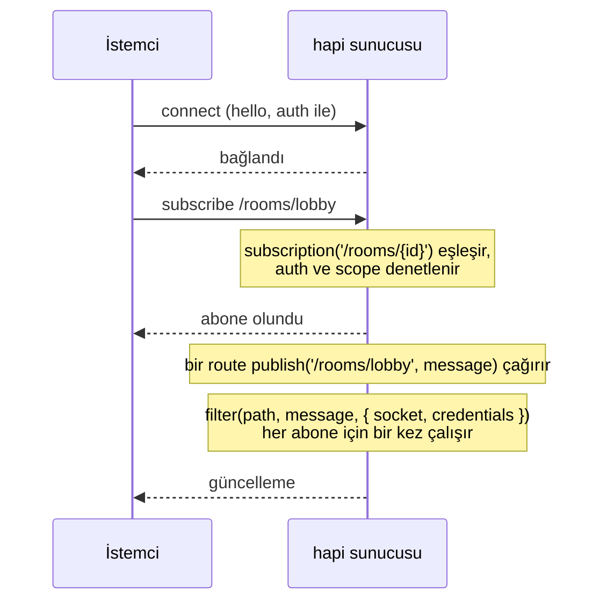
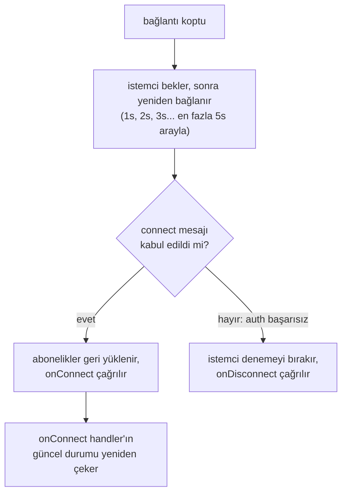
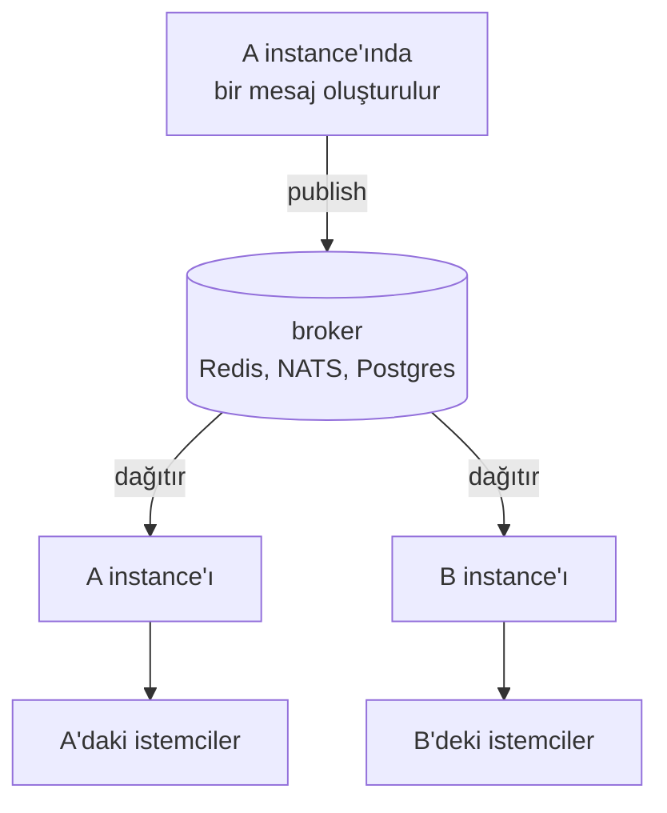

<TutorialLang />

# WebSocket'ler

_Bu eğitim hapi v21 ve sonraki sürümlerle uyumludur_

## <a name="overview"></a> Genel Bakış

[@hapi/nes](/module/nes), bir hapi sunucusuna WebSocket endpoint'i ekler. Bağlı bir istemci bu tek soket üzerinden üç şey yapabilir:

- **Route'larını çağırmak.** `client.request()`, doğrulaması, auth scope'ları ve handler'ıyla normal bir hapi route'unu çalıştırır ve yanıtı soket üzerinden döndürür.
- **Güncellemelere abone olmak.** İstemci `/rooms/lobby` gibi bir path'e abone olur, sunucu da o path'e yayın yapar.
- **Push mesajları almak.** Sunucu tek bir sokete mesaj gönderir ya da tüm soketlere broadcast yapar.

## <a name="when"></a> WebSocket ne zaman kullanılır

| Yaklaşım                                   | Yön                            | Uygun olduğu yer                                                                             |
| ------------------------------------------ | ------------------------------ | -------------------------------------------------------------------------------------------- |
| Normal bir route'u polling ile yoklamak    | istemci sorar, sunucu yanıtlar | birkaç dakikada bir gelen güncellemeler ya da gerçek zamanlılığın bir şey katmadığı durumlar |
| [Server-Sent Events](/tutorials/tr_TR/sse) | yalnızca sunucudan istemciye   | canlı akışlar, ilerleme, bildirimler; düz HTTP, çoğu proxy'nin arkasında çalışır             |
| nes ile WebSocket'ler                      | iki yönlü, tek bağlantı        | sohbet, ortak çalışma, oyunlar: istemciler sık gönderir ve karşılığında push bekler          |

İstemci yalnızca dinliyorsa SSE'yi işletmek daha basittir. İstemci de sık mesaj gönderiyorsa ya da hem istekler hem güncellemeler için tek bir bağlantı istiyorsan WebSocket'i seç; bu, mobil ağlarda önemlidir.

## <a name="setup"></a> Kurulum

```sh
npm install @hapi/nes
```

Bir sohbet odası sunucusu: mesajlar bir route üzerinden gönderilir, odanın her abonesi onları alır ve ikinci bir route son mesaj geçmişini döndürür.

```ts
import Hapi from '@hapi/hapi';
import Joi from 'joi';
import Nes from '@hapi/nes';

interface ChatMessage {
    room: string;
    text: string;
    at: string;
}

const history = new Map<string, ChatMessage[]>();

const server = Hapi.server({ port: 4000 });

await server.register(Nes);

server.subscription('/rooms/{id}');

const roomParams = Joi.object({ id: Joi.string().alphanum().max(50).required() });

server.route<{ Params: { id: string }; Payload: { text: string } }>({
    method: 'POST',
    path: '/rooms/{id}/messages',
    options: {
        validate: {
            params: roomParams,
            payload: Joi.object({ text: Joi.string().max(2000).required() }),
        },
    },
    handler: (request, h) => {
        const message: ChatMessage = {
            room: request.params.id,
            text: request.payload.text,
            at: new Date().toISOString(),
        };

        const messages = history.get(message.room) ?? [];
        history.set(message.room, [...messages, message].slice(-50));

        server.publish(`/rooms/${message.room}`, message);
        return h.response(message).code(201);
    },
});

server.route<{ Params: { id: string } }>({
    method: 'GET',
    path: '/rooms/{id}/messages',
    options: { validate: { params: roomParams } },
    handler: (request, h) => history.get(request.params.id) ?? [],
});

await server.start();
```

nes, HTTP route'larınla aynı portu dinler. Route'lar düz HTTP üzerinden de çalışır, böylece diğer servisler soket açmadan bir odaya mesaj gönderebilir. `POST` route'u yalnızca [doğruladığı](/tutorials/tr_TR/validation) alanları yayınlar, ham payload'u asla yayınlamaz.

Node.js'teki istemci:

```ts
import Nes from '@hapi/nes';

const client = new Nes.Client('ws://localhost:4000');
await client.connect();

await client.subscribe('/rooms/lobby', (message) => {
    console.log('lobby:', message);
});

await client.request({ method: 'POST', path: '/rooms/lobby/messages', payload: { text: 'hello' } });
```

Tarayıcıda, bundle'ın sunucu plugin'ini de içine almasın diye istemci dosyasını tek başına import et:

```ts
import { Client } from '@hapi/nes/lib/client.js';

const client = new Client(`wss://${location.host}`);
await client.connect();
```

Abonelik handler'ları mesajı `unknown` olarak alır. Sunucu her şeyi yayınlayabilir, bu yüzden bir `fetch()` yanıtında yapacağın gibi kullanmadan önce yapısını denetle.

## <a name="requests"></a> Route'ları soket üzerinden çağırmak

`client.request()`, route'u hapi'nin tüm [istek yaşam döngüsünden](/api#request-lifecycle) geçirir: doğrulama, `auth.access` scope'ları, extension'lar ve handler. nes bunu, soketin bağlanırken kimlik doğruladığı kimlik bilgilerini vererek [`server.inject()`](/api#await-server-inject-options) ile yapar. İstek seçenekleri ve yanıtın yapısı [`client.request()`](/module/nes#await-client-request-options) sayfasında.

Handler içinde `request.socket`, soket istekleri için nes soketidir, normal HTTP istekleri için ise `null` olur; bu yüzden kullanmadan önce denetle.

Bir istemcinin zaten açık bir bağlantısı varsa ve ikinci bir HTTP gidiş dönüşünden kaçınmak istiyorsan soket isteklerini kullan. Çoğunlukla dinleyen bir sayfada normal HTTP istekleri ile bir aboneliğin birlikte kullanımında hata ayıklamak daha kolaydır.

## <a name="push"></a> Güncellemeleri göndermek

nes istemcilere mesaj göndermenin üç yolunu sunar:

| Metot                           | Kim alır                               | Ne için kullanılır                                   |
| ------------------------------- | -------------------------------------- | ---------------------------------------------------- |
| `server.publish(path, message)` | eşleşen bir path'e abone olan soketler | neredeyse her şey: odalar, belgeler, akışlar         |
| `socket.send(message)`          | tek bir soket                          | yanıtlar ve bağlantıya özel bildirimler              |
| `server.broadcast(message)`     | bağlı her soket                        | nadiren: bakım uyarıları, zorunlu yeniden yüklemeler |

Genellikle istediğin şey aboneliklerdir, çünkü istemci neyle ilgilendiğini söyler ve sunucu yalnızca onu gönderir.



Bir abonelik `filter` fonksiyonu, güncellemenin gönderilip gönderilmeyeceğine soket başına karar verir. Filtrenin ihtiyaç duyduğu ama istemcinin görmemesi gereken veriyi `internal` içinde ver:

```ts
server.subscription('/documents/{id}', {
    filter: (path, message, options) => {
        return options.internal === options.credentials?.id;
    },
});

server.publish('/documents/42', { title: 'Q3 plan' }, { internal: '2133d32a' });
```

Güncellemeyi yalnızca belgenin sahibi alır ve sahip id'si hiçbir istemciye ulaşmaz. Filtre, Kimlik Doğrulama eğitimindeki [bearer stratejisinin](/tutorials/tr_TR/auth#jwt) ayarladığı `credentials.id` ile karşılaştırma yapar.

Filtre her yayında her abone için çalışır, bu yüzden onu bellek içi denetimlerle sınırlı tut. Her kullanıcının gördüğünü değiştirmek için filtre `true` yerine `{ override: message }` döndürebilir.

## <a name="auth"></a> Kimlik Doğrulama

nes'in kendi kimlik doğrulaması yoktur. hapi [auth stratejilerini](/tutorials/tr_TR/auth) yeniden kullanır: soket bağlanırken kimliğini doğrular ve o soket üzerindeki her istek ve abonelik bu kimlik bilgilerini kullanır.

Plugin'in `auth.type` seçeneği, istemcinin kimliğini nasıl kanıtlayacağını belirler:

| `auth.type`             | İstemci kimliğini nasıl doğrular                                                                                                   | Uygun olduğu yer                                          |
| ----------------------- | ---------------------------------------------------------------------------------------------------------------------------------- | --------------------------------------------------------- |
| `'direct'` (varsayılan) | normal HTTP auth header'larını connect mesajının içinde gönderir: `client.connect({ auth: { headers: { authorization } } })`       | bearer token ya da basic auth kullanan API'ler            |
| `'token'`               | önce HTTP üzerinden `GET /nes/auth` çağırır, mühürlü bir token alır ve onu `client.connect({ auth: token })` içine verir           | mobil uygulamalar gibi cookie'lere güvenemeyen istemciler |
| `'cookie'`              | önce HTTP üzerinden `GET /nes/auth` çağırır; bu, tarayıcının WebSocket upgrade isteğinde gönderdiği şifrelenmiş bir cookie ayarlar | zaten cookie oturumları kullanan tarayıcı uygulamaları    |

`'direct'` ile nes header'ları `auth.route` içindeki stratejiden, `auth.route` ayarlanmamışsa sunucunun [varsayılan stratejisinden](/tutorials/tr_TR/auth#default) geçirir. Kimlik Doğrulama eğitimindeki [bearer stratejisi](/tutorials/tr_TR/auth#jwt) varsayılan olduğunda:

```ts
const client = new Nes.Client('wss://api.example.com');
await client.connect({ auth: { headers: { authorization: `Bearer ${token}` } } });
```

- **Kimlik bilgisi olmadan bağlanmak.** Auth stratejisinin modu `'required'` ise `auth` olmadan bağlanan bir istemci `Connection requires authentication` hatasıyla reddedilir. Aksi halde kimliği doğrulanmadan bağlanır ve onu yalnızca auth gerektiren route'lar ve abonelikler reddeder.
- **Süresi dolan token'lar.** `@hapi/jwt` stratejisi soket açıkken token'ı yeniden denetler; bunu en fazla `auth.minAuthVerifyInterval` (varsayılan olarak heartbeat aralığı) başına bir kez yapar. Token'ın süresi dolduğunda sunucu soketi kapatır, istemcinin yeniden bağlanma denemesi `Token maximum age exceeded` ile reddedilir ve istemci denemeyi bırakır. Eski token'ın süresi dolmadan yenisini gönder:

    ```ts
    await client.reauthenticate({ headers: { authorization: `Bearer ${freshToken}` } });
    ```

    Şemasında `verify()` metodu olmayan stratejiler, bağlantı anındaki kimlik bilgilerini soket açık kaldığı sürece korur.

- **Abonelikleri korumak.** `auth` seçenekleri olmayan bir abonelik varsayılan stratejiyi ve onun modunu kullanır, ama varsayılanın `access` içindeki scope'larını kullanmaz. Bu scope'lar soket isteklerini yine korur. Korunan her aboneliğe kendi `auth.scope` değerini ver; bu değer listelenen scope'lardan herhangi birini kabul eder. [Route scope'larının](/tutorials/tr_TR/auth#scopes) desteklediği `+` ve `!` önekleri burada kullanılamaz.
- **`'token'` ve `'cookie'` için `auth.password` ayarla.** Ayarlanmazsa nes süreç başlarken rastgele bir parola seçer; böylece token'lar ve cookie'ler yeniden başlatmadan sonra çalışmaz ve bir instance, başka bir instance'ın mühürlediğini okuyamaz.
- **Cookie auth ile `origin` ayarla.** WebSocket upgrade istekleri CORS denetiminden geçmez ve kardeş alt alan adları aynı site sayılır; bu yüzden nes cookie'sinin `SameSite=Strict` özelliği onları durdurmaz. `origin`, yukarıdaki Node.js istemcisi gibi hiç `Origin` header'ı göndermeyen istemciler dahil, başka herhangi bir origin'den gelen upgrade isteklerini reddeder.

```ts
import Hapi from '@hapi/hapi';
import Nes from '@hapi/nes';

import type { Nes as NesTypes } from '@hapi/nes';

const cookiePassword = process.env.NES_COOKIE_PASSWORD;
if (!cookiePassword || cookiePassword.length < 32) {
    throw new Error('NES_COOKIE_PASSWORD must be set to at least 32 characters');
}

const server = Hapi.server({ port: 4000 });

const nesOptions = {
    auth: { type: 'cookie', password: cookiePassword } satisfies NesTypes.PluginOptions['auth'],
    origin: ['https://app.example.com'],
};

await server.register({ plugin: Nes, options: nesOptions });
```

## <a name="reconnect"></a> Yeniden bağlanma ve kaçırılan güncellemeler

Mobil ağlar bağlantıları sık sık düşürür ve istemci kendiliğinden yeniden bağlanır:



- `client.connect()` içinde `retries` ile sınırlamadıkça istemci, yukarıdaki gecikmelerle yeniden bağlanana kadar denemeye devam eder.
- Yeniden bağlandığında istemci aboneliklerini yeniden gönderir, böylece handler'ların hiç kod yazmadan çalışmaya devam eder.
- **İstemcinin bağlantısı kopukken yayınlanan güncellemeler kaybolur.** nes bunları kuyruğa almaz. Bir güncellemeyi kaçırmak önemliyse güncel durumu `onConnect` içinde yükle:

```ts
const refreshRoom = async (room: string) => {
    const { payload } = await client.request<ChatMessage[]>(`/rooms/${room}/messages`);
    render(payload);
};

client.onConnect = () => {
    refreshRoom('lobby').catch((err) => console.error('Could not refresh the room', err));
};
```

- Sunucu her istemciye 15 saniyede bir ping atar ve 5 saniye içinde yanıt vermeyen istemciyi düşürür; ping'ler gelmeyi bırakırsa istemci bağlantıyı keser ve yeniden bağlanır. Boşta kalan bağlantıları kapatan load balancer'ların ve proxy'lerin boşta kalma zaman aşımı ping aralığından uzun olmalıdır; yoksa bağlantılar görünür bir neden olmadan düşer.

## <a name="scaling"></a> Instance'lar arasında ölçekleme

İki sunucu instance'ı belleği paylaşmaz. A instance'ının tuttuğu bir WebSocket bağlantısı B instance'ında yoktur; bu yüzden A'daki `server.publish()` ya da `server.broadcast()` yalnızca A'ya bağlı istemcilere ulaşır. Bir load balancer arkasındaki iki instance'la, A'ya gönderilen bir mesaj B'ye bağlı bir istemciye asla ulaşmaz. Bu her WebSocket kütüphanesi ve her hosting sağlayıcısı için geçerlidir: her süreç yalnızca kendi sahip olduğu bağlantılara yazabilir.

Ölçeklemek için instance'lar arasında mesaj iletimi gerekir. Redis, NATS ya da Postgres `LISTEN`/`NOTIFY` gibi bir pub/sub backend'i her mesajı her instance'a dağıtır ve her instance mesajı kendi bağlantılarına iletir:



Redis ile:

```ts
import { createClient } from 'redis';

const publisher = createClient({ url: process.env.REDIS_URL });
const subscriber = publisher.duplicate();
publisher.on('error', (err) => server.log(['redis', 'error'], err));
subscriber.on('error', (err) => server.log(['redis', 'error'], err));
await Promise.all([publisher.connect(), subscriber.connect()]);

await subscriber.subscribe('chat', (raw) => {
    const message: ChatMessage = JSON.parse(raw);
    server.publish(`/rooms/${message.room}`, message);
});

const publishToRoom = async (message: ChatMessage) => {
    await publisher.publish('chat', JSON.stringify(message));
};
```

`POST` route'u `server.publish()` yerine `publishToRoom()` çağırır ve isteği işleyen de dahil her instance mesajı kendi soketlerine yayınlar.

- WebSocket bağlantıları bağlandıkları instance'ta kalır, bu yüzden soketin kendisi sticky session gerektirmez. `'token'` ve `'cookie'` auth tiplerinde her instance'ta aynı `auth.password` değerini ayarla, çünkü `/nes/auth` isteği soketten farklı bir instance'a düşebilir.
- `server.eachSocket()` da aynı şekilde sürece özeldir.

## <a name="cleanup"></a> Temizlik

Bağlantı başına durum soket yaşadığı sürece yaşar. Soket gittiğinde onu serbest bırak:

- Plugin seçeneklerindeki `onDisconnection`, herhangi bir soket kapandığında çalışır.
- `server.subscription()` seçeneklerindeki `onUnsubscribe`, bir istemci abonelikten çıktığında ya da bağlantısı koptuğunda çalışır; yalnızca o abone için yapılan işi, örneğin bir polling döngüsünü, durdurmanın yeri burasıdır.
- `server.stop()` her soketi kapatır. İstemciler bağlantının koptuğunu görür ve yeniden bağlanmaya başlar; rolling deploy sırasında istediğin de budur: başka bir instance'a geri bağlanırlar.

## <a name="typescript"></a> TypeScript

nes, plugin ve istemci için kendi tipleriyle gelir. `@hapi/nes` import etmek hapi'nin tiplerine `server.subscription()`, `server.publish()`, `server.broadcast()`, `server.eachSocket()` ve `request.socket` ekler. `client.request()`, payload tipini `client.request<ChatMessage[]>(path)` örneğindeki gibi bir tip argümanı olarak alır; bu çalışma zamanında denetlenmez, bu yüzden kontrol etmediğin verileri doğrula.

## <a name="next"></a> Sonraki adımlar

- [@hapi/nes API referansı](/module/nes): tüm plugin seçenekleri, [soket kimlik doğrulaması](/module/nes#socket-auth) ve istemci API'sinin tamamı.
- İstemci yalnızca dinliyorsa [Server-Sent Events](/tutorials/tr_TR/sse).
- nes'in yeniden kullandığı stratejiler ve scope'lar için [Kimlik Doğrulama](/tutorials/tr_TR/auth).
