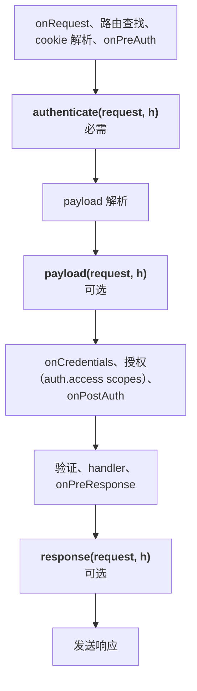
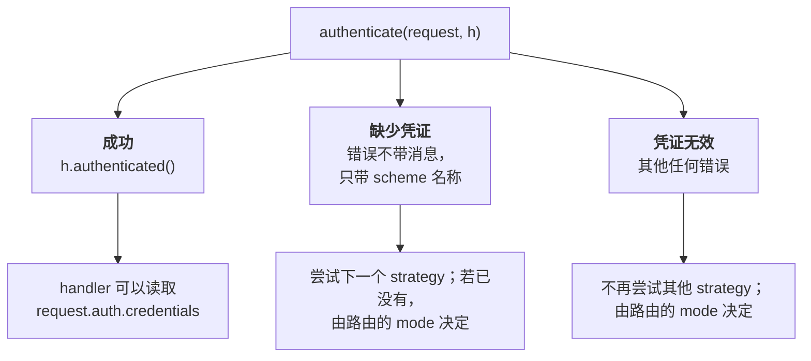
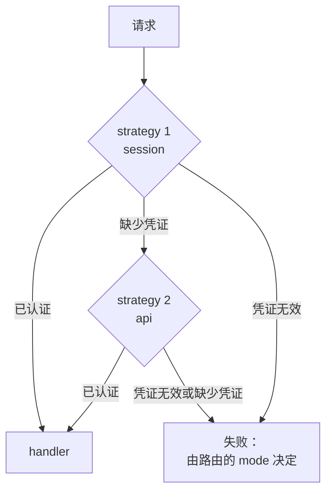
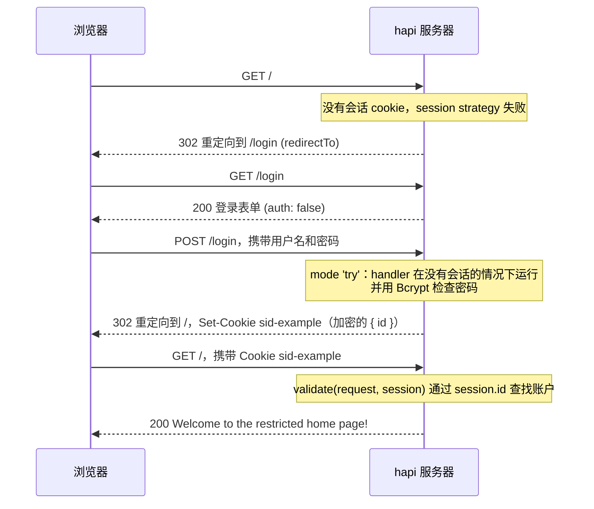
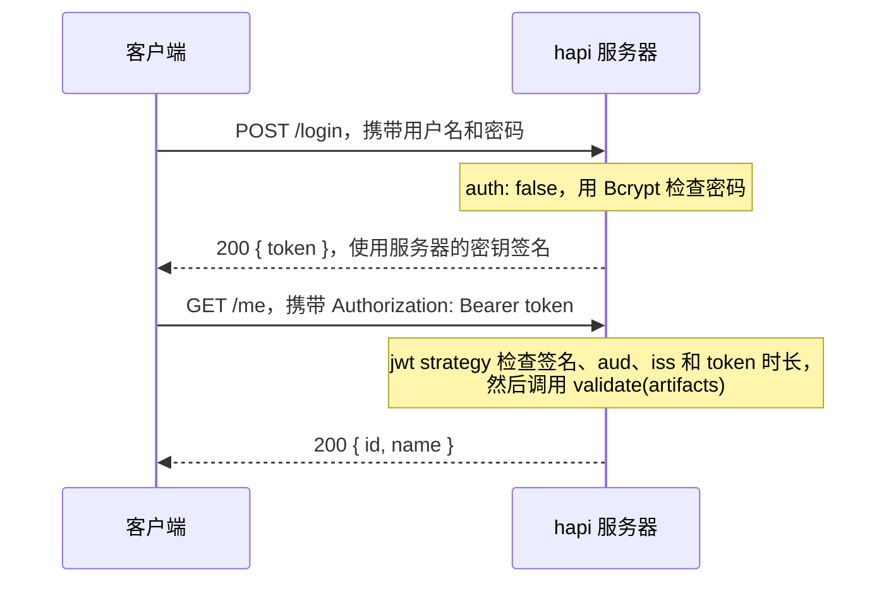

<TutorialLang />

# 身份认证

_本教程适用于 hapi v21 及更新版本_

## <a name="overview"></a> 概述

大多数现代 Web 应用都会使用某种形式的身份认证。hapi 的身份认证由两部分组成：`schemes` 和 `strategies`：

- `scheme` 是一种通用的认证方式，例如 "HTTP basic auth" 或 "session cookie"。`@hapi/basic`、`@hapi/cookie` 这样的插件各自注册一个 scheme。
- `strategy` 是带有名称和配置的 scheme，例如 "basic auth，并在我的 users 表中验证"。路由通过名称引用 strategy。

以 `@hapi/basic` 为例：插件注册 scheme，你基于它配置一个 strategy，路由再使用这个 strategy：

```ts
// Registers the 'basic' scheme.
await server.register(Basic);

server.auth.strategy('simple', 'basic', { validate });

server.route({
    method: 'GET',
    path: '/',
    options: { auth: 'simple' },
    handler: (request, h) => 'welcome',
});
```

## <a name="schemes"></a> Schemes

`scheme` 是一个签名为 `function (server, options)` 的函数。`server` 是添加该 scheme 的服务器，`options` 是基于此 scheme 创建 strategy 时传入的配置对象。这个函数返回一个 scheme 对象，hapi 会在[请求生命周期](/api#request-lifecycle)的三个时间点调用该对象上的方法：



只有 `authenticate` 接受的请求才会运行 `payload` 和 `response`。

你可以编写自己的 scheme，也可以使用 hapi 的认证插件，例如 `@hapi/basic` 或 `@hapi/cookie`。下面是一个完整的 scheme，它从请求头中读取 API token：

```ts
import Boom from '@hapi/boom';
import Hapi from '@hapi/hapi';

import type { ServerAuthScheme } from '@hapi/hapi';

declare module '@hapi/hapi' {
    interface UserCredentials {
        id: string;
        name: string;
    }
}

interface TokenOptions {
    tokens: Map<string, { id: string; name: string }>;
}

const tokenScheme: ServerAuthScheme<TokenOptions> = (server, options) => {
    return {
        authenticate: (request, h) => {
            const token = request.headers['x-api-token'];
            if (typeof token !== 'string') {
                throw Boom.unauthorized(null, 'token');
            }

            const user = options?.tokens.get(token);
            if (!user) {
                throw Boom.unauthorized('Invalid token', 'token');
            }

            return h.authenticated({ credentials: { user }, artifacts: { token } });
        },
        response: (request, h) => {
            if (!Boom.isBoom(request.response)) {
                request.response.header('x-authenticated-user', request.auth.credentials.user?.id ?? '');
            }

            return h.continue;
        },
    };
};

const server = Hapi.server({ port: 4000 });

server.auth.scheme('token', tokenScheme);
server.auth.strategy('api', 'token', {
    tokens: new Map([['a1b2c3', { id: '2133d32a', name: 'John Doe' }]]),
});

server.route({
    method: 'GET',
    path: '/me',
    options: { auth: 'api' },
    handler: (request, h) => {
        return request.auth.credentials.user;
    },
});

await server.start();
```

`ServerAuthScheme<TokenOptions>` 为 scheme 接收的 `options` 提供类型。token 特意存放在 `Map` 而不是普通对象中：在普通对象上查找客户端提供的键时，也会找到继承来的属性，这样 `constructor` 或 `toString` 这样的 token 也能通过认证。`declare module` 代码块告诉 TypeScript 凭证中包含什么：hapi 导出了一个空的 `UserCredentials` 接口供你扩展，扩展之后，每个 handler 中的 `request.auth.credentials.user` 都有了类型。

### <a name="authenticate"></a> authenticate

`authenticate` 方法的签名是 `function (request, h)`，它是 scheme 中唯一 _必需_ 的方法。`request` 与路由 handler 收到的[请求对象](/api#request)相同，`h` 是标准的[响应工具包](/api#response-toolkit)。

`authenticate` 有三种结束方式，各自通向不同的结果：



- **成功：** 返回 `h.authenticated({ credentials, artifacts })`。`credentials` 表示已认证的用户。`artifacts` 是可选的，用于存放其他认证数据，例如原始 token。之后两者分别可以通过 `request.auth.credentials` 和 `request.auth.artifacts` 访问。
- **缺少凭证：** 抛出一个不带消息、只带 scheme 名称的错误，例如 `Boom.unauthorized(null, 'token')`。hapi 会认为该请求没有携带此 scheme 的凭证，于是继续尝试路由的下一个 strategy，scheme 名称也会出现在 `WWW-Authenticate` 响应头中。
- **凭证无效：** 抛出其他任何错误，例如 `Boom.unauthorized('Invalid token', 'token')`。hapi 会停止尝试其他 strategy。既不带消息 _也_ 不带 scheme 名称的 `Boom.unauthorized()` 同样视为无效。

失败之后会发生什么，取决于路由的 [`mode`](#mode)。

除了抛出错误，你也可以返回 `h.unauthenticated(error, data)`。它的效果与抛出 `error` 相同，但可以通过 `data` 为失败的请求附加 `credentials` 和 `artifacts`，处于 `'try'` 模式的路由随后可以读取它们。不传 `data` 时，`return h.unauthenticated(error)` 与 `throw error` 完全相同。完整规则参见 [`server.auth.scheme()`](/api#server-auth-scheme-name-scheme)。推荐使用 [boom](/module/boom) 来创建这些错误。

### <a name="payload"></a> payload

`payload` 方法的签名是 `function (request, h)`。它在 payload 解析之后运行，因此可以检查 payload 本身，例如基于 payload 计算的签名。

payload 验证通过时返回 `h.continue`，失败时抛出错误。路由通过 [`payload` 路由选项](#route)开启 payload 认证。如果某个 scheme 总是需要 payload 认证，可以在其方法旁边返回 `options: { payload: true }`，这样路由就无法将其关闭。

### <a name="response"></a> response

`response` 方法的签名是 `function (request, h)`。它在 `onPreResponse` 之后、写入响应头之前运行，因此可以向 `request.response` 添加认证相关的响应头。上面的 token scheme 就用它添加了 `x-authenticated-user` 响应头。

`response` 运行时，hapi 已经把所有错误转换成了响应对象，因此错误响应也会带上这个响应头。`Boom.isBoom()` 检查将 `request.response` 收窄为响应对象，这样 `.header()` 才能通过类型检查。完成后返回 `h.continue`。如需让请求失败，抛出错误即可。

## <a name="strategies"></a> Strategies

在通过 `server.auth.strategy(name, scheme, [options])` 基于 scheme 创建 strategy 之前，scheme 不会起任何作用：

- `name` 是 strategy 的名称，路由用它来选择 strategy。
- `scheme` 是已注册 scheme 的名称。
- `options` 会作为 `options` 参数传给 scheme 函数。

一个 scheme 可以支撑多个 strategy，每个 strategy 有各自的配置：

```ts
server.auth.strategy('session', 'cookie', {
    cookie: {
        name: 'sid-example',
        password: '!wsYhFA*C2U6nz=Bu^%A@^F#SF3&kSR6',
        isSecure: false,
    },
});

server.auth.strategy('admin-session', 'cookie', {
    cookie: {
        name: 'sid-admin',
        password: 'Q7v!kW2#pL9@zR4$mT6^xB1&nD8*cF3%',
        isSecure: false,
    },
    redirectTo: '/admin/login',
    requestDecoratorName: 'adminCookieAuth',
});
```

每个 `@hapi/cookie` strategy 都会添加一个 `request.cookieAuth` 辅助对象，而 hapi 不允许重复添加同一个请求装饰，所以第二个 strategy 需要通过 `requestDecoratorName` 为其辅助对象换个名称。它的路由调用 `request.adminCookieAuth.set()`。`@types/hapi__cookie` 包（参见 [cookie](#cookie)）只为 `cookieAuth` 提供了类型，所以在 TypeScript 中还要声明改名后的辅助对象：

```ts
declare module '@hapi/hapi' {
    interface Request {
        adminCookieAuth: Request['cookieAuth'];
    }
}
```

## <a name="default"></a> 默认 Strategy

`server.auth.default()` 设置所有路由默认使用的 strategy，除非路由另有指定。它接受一个 strategy 名称，或一个与路由[认证选项](#route)格式相同的对象。默认值适用于所有 `auth` 选项中没有指定 strategy 的路由，包括在调用 `server.auth.default()` _之前_ 添加的路由。例外情况是 `auth` 只设置了 `mode` 或 `access` 的路由：hapi 会在添加路由时将其与默认值合并，所以要先调用 `server.auth.default()`。

```ts
server.auth.default('session');

server.route({
    method: 'GET',
    path: '/account',
    handler: (request, h) => 'protected by the session strategy',
});

server.route({
    method: 'GET',
    path: '/health',
    options: { auth: false },
    handler: (request, h) => 'public',
});
```

## <a name="route"></a> 路由配置

路由通过 `options.auth` 属性设置身份认证：

```ts
server.route({
    method: 'GET',
    path: '/feed',
    options: {
        auth: {
            mode: 'try',
            strategies: ['session', 'api'],
        },
    },
    handler: (request, h) => {
        if (!request.auth.isAuthenticated) {
            return 'public feed';
        }

        return `personal feed, signed in with ${request.auth.strategy}`;
    },
});
```

`options.auth` 可以是：

- `false`，关闭该路由的身份认证。
- 一个 strategy 名称，例如 `'session'`。
- 一个包含 `mode`、`strategy` 或 `strategies`，以及 `payload` 的对象。

### <a name="mode"></a> mode

`mode` 决定如何处理没有凭证或凭证错误的请求：

| `mode`               | 没有凭证                 | 凭证无效                 | 凭证有效     |
| -------------------- | ------------------------ | ------------------------ | ------------ |
| `'required'`（默认） | 401                      | 401                      | 运行 handler |
| `'optional'`         | 运行 handler，未认证状态 | 401                      | 运行 handler |
| `'try'`              | 运行 handler，未认证状态 | 运行 handler，未认证状态 | 运行 handler |

"没有凭证" 和 "凭证无效" 是 [`authenticate` 失败](#authenticate)的两种情况。失败后运行 handler 时，`request.auth.isAuthenticated` 为 `false`，`request.auth.error` 保存失败原因：如果没有任何 strategy 找到凭证，则为 `Missing authentication`；如果某个 strategy 拒绝了凭证，则为该 strategy 抛出的错误。

### <a name="strategy-and-strategies"></a> strategy 与 strategies

使用一个 strategy 时写 `strategy: 'session'`，使用多个时写 `strategies: ['session', 'api']`。hapi 按顺序尝试，只有当前一个报告缺少凭证时才会尝试下一个：



### payload

`payload` 为该路由开启 scheme 的 [`payload` 方法](#payload)：

- `false`：不对 payload 进行认证。
- `'required'` 或 `true`：payload 必须通过认证。
- `'optional'`：只有当客户端发送了 payload 认证信息时才进行检查。

它只对 scheme 带有 `payload` 方法的 strategy 有效。

## <a name="scopes"></a> Scopes

身份认证决定 _谁_ 在发起请求，scope 决定他们 _可以做什么_。strategy 把一组 scope 字符串放进 `credentials.scope`，路由在 `options.auth.access.scope` 中列出它接受的 scope，hapi 在授权阶段比较两者，这一阶段位于 `onCredentials` 之后、handler 运行之前。没有匹配 scope 的请求会得到 `403 Insufficient scope`，handler 不会运行。

scope 通常来自 strategy 的 `validate` 函数。沿用 [basic](#basic) 示例中的用户，并为每个用户添加一个 `roles` 数组：

```ts
const validate: Basic.Validate = async (request, username, password) => {
    const user = users.get(username);
    if (!user || !(await Bcrypt.compare(password, user.password))) {
        return { isValid: false, credentials: null };
    }

    return { isValid: true, credentials: { id: user.id, name: user.name, scope: user.roles } };
};
```

如果角色信息存放在别处，可以在认证之后通过 `onCredentials` 钩子添加；参见[生命周期钩子](/tutorials/zh_CN/lifecycle-hooks#credentials)。

然后由路由声明它们接受的 scope：

```ts
server.route({
    method: 'GET',
    path: '/reports',
    options: { auth: { strategy: 'simple', access: { scope: ['admin', 'analyst'] } } },
    handler: (request, h) => 'any admin or analyst',
});

server.route({
    method: 'DELETE',
    path: '/users/{id}',
    options: { auth: { strategy: 'simple', access: { scope: ['+admin', '!suspended'] } } },
    handler: (request, h) => 'an admin who is not suspended',
});

server.route({
    method: 'PUT',
    path: '/users/{id}/profile',
    options: { auth: { strategy: 'simple', access: { scope: ['admin', 'user-{params.id}'] } } },
    handler: (request, h) => 'an admin, or the user whose id is in the path',
});
```

| 路由 scope             | `credentials.scope` 必须                                                                  |
| ---------------------- | ----------------------------------------------------------------------------------------- |
| `'admin'`              | 包含 `admin`                                                                              |
| `['admin', 'analyst']` | 至少包含其中一个                                                                          |
| `'+admin'`             | 包含 `admin`，无论列表中的其他项如何                                                      |
| `'!suspended'`         | 不包含 `suspended`                                                                        |
| `'user-{params.id}'`   | 对 `/users/42` 的请求须包含 `user-42`；`query`、`payload` 和 `credentials` 也可以这样使用 |

容易忽略的 scope 规则：

- 只有已认证的请求才会检查 scope。在 `'optional'` 或 `'try'` 模式的路由上，没有凭证的请求仍然会进入 handler，此时 `request.auth.isAuthorized` 为 `false`。在执行只允许部分用户进行的操作之前，先检查它。
- `access.entity` 将路由限制为用户或应用：`'user'` 要求设置了 `credentials.user`，`'app'` 要求没有设置。当同一个 strategy 既认证人也认证机器客户端时使用它。
- `access` 可以是一组规则，请求只需满足其中之一。
- `server.auth.default()` 接受同样的 `access` 选项，因此可以让某个 scope 应用于所有路由。

完整规则参见 [`route.options.auth.access`](/api#route-options-auth-access)。

## <a name="basic"></a> basic

我们首先来看的 `scheme` 是 [@hapi/basic](/module/basic) 插件。顾名思义，`@hapi/basic` 插件使用 basic 认证来验证用户。下面是配置 `@hapi/basic` 的示例：

```ts
import Basic from '@hapi/basic';
import Bcrypt from 'bcrypt';
import Hapi from '@hapi/hapi';

const users = new Map([
    [
        'john',
        {
            username: 'john',
            password: '$2a$10$iqJSHD.BGr0E2IxQwYgJmeP3NvhPrXAeLSaGCj6IR/XU5QtjVu5Tm', // 'secret'
            name: 'John Doe',
            id: '2133d32a',
        },
    ],
]);

const validate: Basic.Validate = async (request, username, password) => {
    const user = users.get(username);
    if (!user) {
        return { credentials: null, isValid: false };
    }

    const isValid = await Bcrypt.compare(password, user.password);
    const credentials = { id: user.id, name: user.name };

    return { isValid, credentials };
};

const start = async () => {
    const server = Hapi.server({ port: 4000 });

    await server.register(Basic);

    server.auth.strategy('simple', 'basic', { validate });

    server.route({
        method: 'GET',
        path: '/',
        options: {
            auth: 'simple',
        },
        handler: function (request, h) {
            return 'welcome';
        },
    });

    await server.start();

    console.log('server running at: ' + server.info.uri);
};

start();
```

首先定义 `users` 数据库，本例中它是一个以用户名为键的 `Map`，原因见 [Schemes](#schemes)。然后定义一个验证函数，这是 [@hapi/basic](/module/basic) 特有的功能，用于确认用户提供的凭证有效。将其类型标注为 `Basic.Validate`，TypeScript 就能推断出 `request`、`username` 和 `password` 的类型，并检查你返回的对象。在这个验证函数中，使用 `Bcrypt` 将用户提供的密码与数据库中的哈希密码进行比较。

接着注册插件，插件会创建一个名为 `basic` 的 scheme。这是插件内部通过 [server.auth.scheme()](/api#server-auth-scheme-name-scheme) 完成的。

插件注册之后，使用 [server.auth.strategy()](/api#server-auth-strategy-name-scheme-options) 创建一个名为 `simple` 的 strategy，它引用名为 `basic` 的 scheme。同时传入一个选项对象，该对象会传给 scheme，用于配置其行为。

最后，让路由使用名为 `simple` 的 strategy 进行身份认证。

## <a name="cookie"></a> cookie

[@hapi/cookie](/module/cookie) 插件会在用户认证之后，把会话存放在用户浏览器中的一个加密 cookie 里。如果没有设置 `cookie.ttl`，cookie 会在浏览器关闭时失效；设置 `ttl` 可以让用户在多次浏览器会话之间保持登录。

在本例中，首页路由 "/" 受到保护，只有登录后才能访问。浏览器被重定向到登录表单，提交用户名和密码，然后携带会话 cookie 进入首页：



```ts
import Bcrypt from 'bcrypt';
import Cookie from '@hapi/cookie';
import Hapi from '@hapi/hapi';

const users = [
    {
        username: 'john',
        password: '$2a$10$iqJSHD.BGr0E2IxQwYgJmeP3NvhPrXAeLSaGCj6IR/XU5QtjVu5Tm', // 'secret'
        name: 'John Doe',
        id: '2133d32a',
    },
];

const start = async () => {
    const server = Hapi.server({ port: 4000 });

    await server.register(Cookie);

    server.auth.strategy('session', 'cookie', {
        cookie: {
            name: 'sid-example',
            password: '!wsYhFA*C2U6nz=Bu^%A@^F#SF3&kSR6',
            isSecure: false,
        },
        redirectTo: '/login',
        validate: async (request, session) => {
            if (!session || !('id' in session)) {
                return { isValid: false };
            }

            const account = users.find((user) => user.id === session.id);
            if (!account) {
                return { isValid: false };
            }

            return { isValid: true, credentials: { id: account.id, name: account.name } };
        },
    });

    server.auth.default('session');

    server.route([
        {
            method: 'GET',
            path: '/',
            handler: function (request, h) {
                return 'Welcome to the restricted home page!';
            },
        },
        {
            method: 'GET',
            path: '/login',
            handler: function (request, h) {
                return ` <html>
                            <head>
                                <title>Login page</title>
                            </head>
                            <body>
                                <h3>Please Log In</h3>
                                <form method="post" action="/login">
                                    Username: <input type="text" name="username"><br>
                                    Password: <input type="password" name="password"><br/>
                                <input type="submit" value="Login"></form>
                            </body>
                        </html>`;
            },
            options: {
                auth: false,
            },
        },
    ]);

    server.route<{ Payload: { username: string; password: string } }>({
        method: 'POST',
        path: '/login',
        handler: async (request, h) => {
            const { username, password } = request.payload;
            const account = users.find((user) => user.username === username);

            if (!account || !(await Bcrypt.compare(password, account.password))) {
                return h.redirect('/login');
            }

            request.cookieAuth.set({ id: account.id });

            return h.redirect('/');
        },
        options: {
            auth: {
                mode: 'try',
            },
        },
    });

    await server.start();

    console.log('server running at: ' + server.info.uri);
};

start();
```

`@hapi/cookie` 本身不带类型定义。如果使用 TypeScript，请通过 `npm install --save-dev @types/hapi__cookie` 安装。它会为 hapi 的 `Request` 类型添加 `request.cookieAuth`，并为 `cookie` strategy 的选项提供类型。会话以普通 `object` 的形式传入 `validate`，正是 `'id' in session` 这个检查让 TypeScript 可以读取 `session.id`。`POST /login` 路由通过 `server.route()` 的类型参数声明表单字段；这只是类型，要在运行时强制约束，请添加 [payload 验证](/tutorials/zh_CN/validation)。

首先用 `server.register` 注册 `@hapi/cookie` 插件，它会添加 `cookie` scheme。然后用 `server.auth.strategy` 基于它创建 `session` strategy，并传入三个选项：

- `cookie` 配置 cookie 本身。`name` 是 cookie 的名称 `sid-example`。`password` 用于加密 cookie，长度至少为 32 个字符。`isSecure: false` 允许 cookie 通过普通 HTTP 传输，在开发环境中没有问题；生产环境中请保留默认值 `true`。
- `redirectTo` 是未认证用户访问受保护路由时，服务器将其重定向到的地址。
- `validate` 在每个携带该 cookie 的请求上运行，检查会话是否仍然有效。这里它根据 cookie 中存储的 `id` 查找账户，因此被删除的账户会在下一次请求时被登出。

`server.auth.default('session')` 用 `session` strategy 保护所有路由。`GET /login` 通过 `auth: false` 退出认证，任何人都能看到登录表单。

`POST /login` 使用 `mode: 'try'`，因此即使用户还没有会话，handler 也会运行。它通过 `username` 查找账户，并使用 `Bcrypt` 将提交的密码与存储的哈希进行比较。任一检查失败，用户都会回到登录页。两项都通过时，`request.cookieAuth.set()` 将 `{ id }` 存入加密 cookie，用户被重定向到首页。

## <a name="jwt"></a> jwt

[@hapi/jwt](/module/jwt) 对在 `Authorization: Bearer <token>` 请求头中携带 JSON Web Token 的请求进行认证。与 `@hapi/cookie` 一样，它不在服务器上存储会话；区别在于身份信息的传递方式：

|          | `@hapi/cookie`                 | `@hapi/jwt`                             |
| -------- | ------------------------------ | --------------------------------------- |
| 发送方式 | 浏览器自动附加的 cookie        | 客户端设置的 `Authorization` 请求头     |
| 内容     | 加密：客户端无法读取           | 已签名，但持有 token 的任何人都能读取   |
| 适用场景 | 运行在你自己域名下的浏览器应用 | 由移动应用、其他服务器和 SPA 调用的 API |

不要在 JWT payload 中放入机密信息，因为签名只能防止篡改，不能防止读取。

客户端登录一次，之后每个请求都携带 token：



```ts
import Bcrypt from 'bcrypt';
import Hapi from '@hapi/hapi';
import Jwt from '@hapi/jwt';

const users = [
    {
        username: 'john',
        password: '$2a$10$iqJSHD.BGr0E2IxQwYgJmeP3NvhPrXAeLSaGCj6IR/XU5QtjVu5Tm', // 'secret'
        name: 'John Doe',
        id: '2133d32a',
    },
];

const secret = 'hR7#mX2!vQ9@kL4$wP8^zT1&nB6*cJ3%';

const start = async () => {
    const server = Hapi.server({ port: 4000 });

    await server.register(Jwt);

    server.auth.strategy('bearer', 'jwt', {
        keys: secret,
        verify: {
            aud: 'urn:audience:my-api',
            iss: 'urn:issuer:my-api',
            sub: false,
            maxAgeSec: 4 * 60 * 60,
        },
        validate: async (artifacts, request, h) => {
            const account = users.find((user) => user.id === artifacts.decoded.payload.id);
            if (!account) {
                return { isValid: false };
            }

            return { isValid: true, credentials: { id: account.id, name: account.name } };
        },
    });

    server.auth.default('bearer');

    server.route<{ Payload: { username: string; password: string } }>({
        method: 'POST',
        path: '/login',
        options: { auth: false },
        handler: async (request, h) => {
            const { username, password } = request.payload;
            const account = users.find((user) => user.username === username);

            if (!account || !(await Bcrypt.compare(password, account.password))) {
                return h.response({ error: 'Invalid username or password' }).code(401);
            }

            const token = Jwt.token.generate(
                { aud: 'urn:audience:my-api', iss: 'urn:issuer:my-api', id: account.id },
                secret,
            );

            return { token };
        },
    });

    server.route({
        method: 'GET',
        path: '/me',
        handler: (request, h) => {
            return request.auth.credentials;
        },
    });

    await server.start();

    console.log('server running at: ' + server.info.uri);
};

start();
```

注册插件，它会添加 `jwt` scheme，然后基于它创建 `bearer` strategy：

- `keys` 是用于签名 token 的密钥。当签发和验证 token 的是同一台服务器时，使用共享密钥即可。如果要接受身份提供方签发的 token，`keys` 可以指向该提供方的公钥；参见 [@hapi/jwt API](/module/jwt) 中的 `keys` 选项。
- `verify` 列出 token 必须携带的声明。`aud`（受众）和 `iss`（签发者）必须与签发 token 时使用的值一致。`maxAgeSec` 会拒绝 `iat`（签发时间）超过四小时的 token。本例中的 token 不带 `exp`；如果你的 token 带有它，默认会检查 `exp` 和 `nbf`。
- `validate` 只在签名和声明都通过后运行。它以 `artifacts.decoded.payload` 的形式接收解码后的 token，并决定哪些内容放入 `request.auth.credentials`。这里它还会检查账户是否仍然存在，因为即使账户已被删除，token 在过期前依然有效。

`POST /login` 通过 `auth: false` 退出认证，检查密码，然后返回由 `Jwt.token.generate()` 生成的 token，其 `aud` 和 `iss` 与 strategy 验证的值相同。之后客户端携带 `Authorization: Bearer <token>` 调用 `GET /me`。`artifacts.decoded.payload` 没有类型，因为 hapi 无法知道你在 token 中放了哪些声明；`validate` 正是检查这些声明并构建带类型凭证的地方。

更多 hapi 认证插件的信息，请参见[插件列表](/plugins)。
