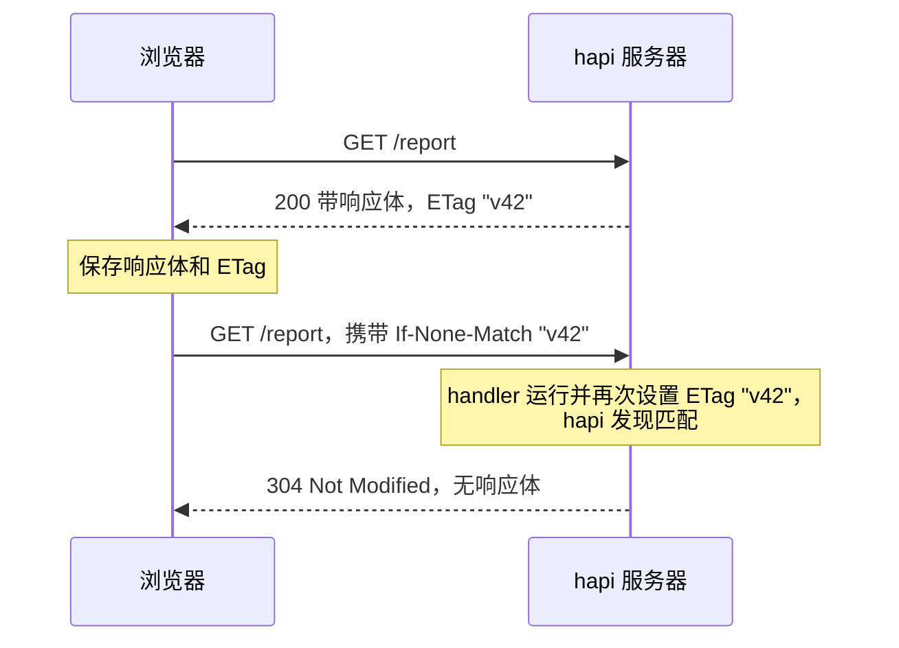
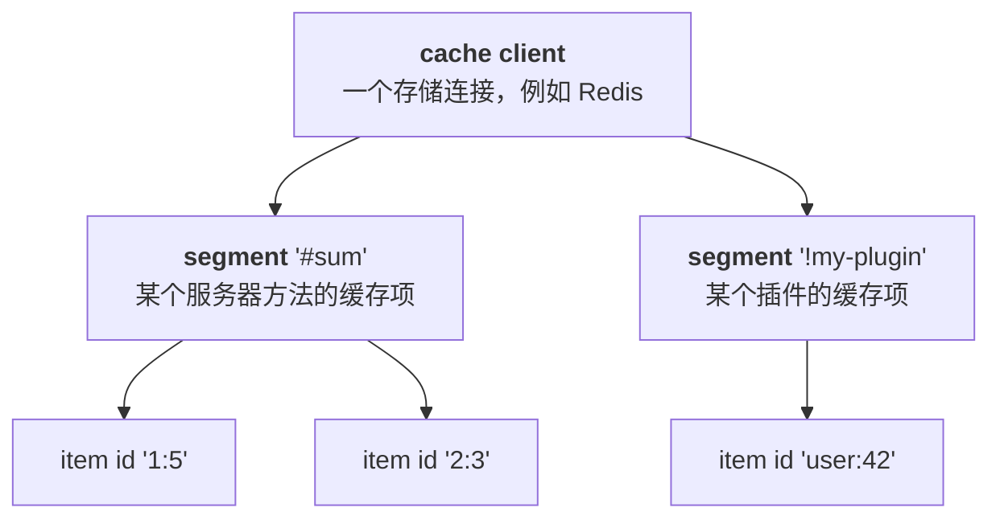
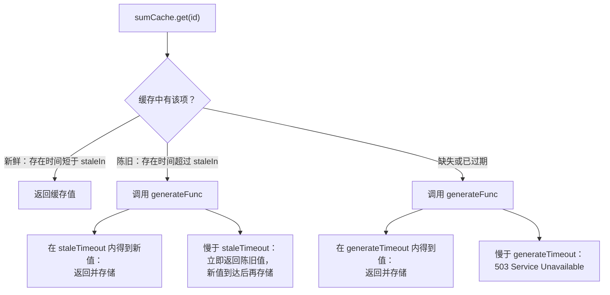

<TutorialLang />

# 缓存

_本教程适用于 hapi v21 及更新版本_

## <a name="overview"></a> 概述

hapi 在两个层面进行缓存，大多数应用两者都会用到：

| 层面                     | 副本存放位置                                     | 节省了什么                                  | 配置方式                                                                 |
| ------------------------ | ------------------------------------------------ | ------------------------------------------- | ------------------------------------------------------------------------ |
| [客户端](#client-side)   | 浏览器，或位于中间的 CDN、代理                   | 整个请求：客户端根本不会访问 hapi           | HTTP 响应头：`Cache-Control`、`ETag`、`Last-Modified`                    |
| [服务器端](#server-side) | 内存、Redis 或其他 [catbox](/module/catbox) 存储 | 开销大的工作：一次数据库查询、一次 API 调用 | `server.cache()` 或带缓存的[服务器方法](/tutorials/zh_CN/server-methods) |

## <a name="client-side"></a> 客户端缓存

HTTP 响应头告诉客户端能否复用某个响应，以及可以复用多久。MDN 的 [HTTP 缓存指南](https://developer.mozilla.org/en-US/docs/Web/HTTP/Caching)对这些响应头有深入的讲解。本节介绍 hapi 如何设置它们。

### <a name="cache-control"></a> Cache-Control

设置路由的 `cache` 选项，hapi 就会为你写入 `Cache-Control` 响应头：

```ts
server.route({
    path: '/hapi/{ttl?}',
    method: 'GET',
    handler: function (request, h) {
        const response = h.response({ be: 'hapi' });

        if (request.params.ttl) {
            response.ttl(Number(request.params.ttl));
        }

        return response;
    },
    options: {
        cache: {
            expiresIn: 30 * 1000,
            privacy: 'private',
        },
    },
});
```

`response.ttl(msec)` 会为单个响应覆盖 `expiresIn`。hapi 发送的响应头取决于具体响应：

| 请求                                            | `Cache-Control` 响应头                 |
| ----------------------------------------------- | -------------------------------------- |
| `GET /hapi`                                     | `max-age=30, must-revalidate, private` |
| `GET /hapi/5000`（调用了 `response.ttl(5000)`） | `max-age=5, must-revalidate, private`  |
| 状态码不是 200 或 204 的响应，例如 404 或 500   | `no-cache`（路由的 `cache.otherwise`） |

需要注意：

- 如果请求已通过认证，hapi 总会加上 `private`，即使路由设置了 `privacy: 'public'`。CDN 这类共享缓存永远不会存储 `private` 响应。
- 用 `h.state()` 设置的 cookie 不会改变这个响应头：hapi 在构建 `Cache-Control` 之后才写入 cookie。对于设置 cookie 的缓存路由，请自行设置 `privacy: 'private'`。
- 只有路由的 `cache.statuses`（默认为 `[200, 204]`）中列出的状态码才会带上 `max-age`。错误响应永远不会被意外缓存。

所有 `cache` 设置请参见[路由选项](/api#route-options-cache)。

### <a name="last-modified"></a> 条件请求：ETag 与 Last-Modified

条件请求让客户端可以询问 "自从我拿到副本以来，它变过吗？"，并得到一个空的 `304 Not Modified`，而不是完整的响应体：



使用 [`response.etag()`](/api#response-object) 设置 `ETag`，其值通常来自版本号或内容的哈希：

```ts
return h.response(report).etag(String(report.version));
```

或者设置 `Last-Modified`，hapi 会将它与客户端的 `If-Modified-Since` 请求头进行比较：

```ts
return h.response(report).header('Last-Modified', report.updatedAt.toUTCString());
```

需要注意：

- hapi 只在 `GET` 路由（以及方法为 `*` 的路由）上返回 `304`。
- handler 在每个请求上仍然会运行。条件请求节省的是带宽，而不是服务器的工作量。将它与[服务器端缓存](#server-side)结合使用，两者都能节省。
- [inert](/module/inert) 会为静态文件自动设置 `ETag` 和 `Last-Modified`。

## <a name="server-side"></a> 服务器端缓存

hapi 通过 [catbox](/module/catbox) 在服务器上缓存值。catbox 是一个键值存储，存储适配器可以互换：内存（默认）、[Redis](/module/catbox-redis) 和 [Memcached](/module/catbox-memcached)。

### <a name="catbox"></a> catbox

缓存项按三个层级组织：



catbox 通过两种接口访问这些缓存项：

- **[Client](/module/catbox#client)**：底层的存储连接。hapi 会为你创建一个内存 client，其他 client 可以在服务器的 `cache` 选项中添加。
- **[Policy](/module/catbox#policy)**：client 中的一个 segment，带有过期规则和一个可选的函数，用于生成缺失的值。你的代码使用 policy，它通过 [`server.cache()`](/api#server-cache-options) 创建，或者通过缓存[服务器方法](#servermethods)创建。

### <a name="client"></a> Client

在默认的内存 client 之外，添加一个名为 `my_cache` 的 Redis client：

```ts
import Hapi from '@hapi/hapi';
import { Engine as CatboxRedis } from '@hapi/catbox-redis';

const server = Hapi.server({
    port: 8000,
    cache: [
        {
            name: 'my_cache',
            provider: {
                constructor: CatboxRedis,
                options: {
                    partition: 'my_cached_data',
                    host: 'redis-cluster.domain.com',
                    port: 6379,
                    database: 0,
                    tls: {},
                },
            },
        },
    ],
});
```

- policy 通过 `cache: 'my_cache'` 按 `name` 选择这个 client。省略 `name` 则会替换默认的内存 client。
- `partition` 让本应用的键与共用同一 Redis 数据库的其他应用分开。在 Redis 中它会成为键的前缀，默认值为 `'catbox'`。
- 缓存 client 在服务器启动时连接，即在 [`server.initialize()`](/api#await-server-initialize) 或 [`server.start()`](/api#await-server-start) 中。在此之前，policy 无法读写。

### <a name="policy" /> Policy

[`server.cache(options)`](/api#server-cache-options) 创建一个 policy。下面的示例将一次缓慢加法运算的结果缓存十秒：

```ts
import Hapi from '@hapi/hapi';
import * as Hoek from '@hapi/hoek';

const add = async (a: string, b: string) => {
    await Hoek.wait(1000); // Simulates a slow database call

    return Number(a) + Number(b);
};

const start = async () => {
    const server = Hapi.server({ port: 8000 });

    const sumCache = server.cache({
        segment: 'sums',
        expiresIn: 10 * 1000,
        generateFunc: async (id) => {
            const key = typeof id === 'string' ? id : id.id;
            const [a, b] = key.split(':');

            return await add(a, b);
        },
        generateTimeout: 2000,
    });

    server.route<{ Params: { a: string; b: string } }>({
        path: '/add/{a}/{b}',
        method: 'GET',
        handler: async function (request, h) {
            const { a, b } = request.params;

            return await sumCache.get(`${a}:${b}`);
        },
    });

    await server.start();

    console.log('Server running at:', server.info.uri);
};

start();
```

`GET /add/1/5` 大约一秒后返回 `6`。十秒内再次请求，会立即从缓存中返回结果。

| 选项              | 含义                                                                                                                                                |
| ----------------- | --------------------------------------------------------------------------------------------------------------------------------------------------- |
| `segment`         | 为该 policy 的缓存项命名。在服务器根级别为必填项。在插件内部默认为 `'!' + plugin name`。除非设置 `shared: true`，两个 policy 不能共用一个 segment。 |
| `cache`           | 要使用的 client，例如 `'my_cache'`。默认为内存 client。                                                                                             |
| `expiresIn`       | 缓存项存入后的存活时间，单位为毫秒。也可以改用 `expiresAt: 'HH:MM'`，在每天的某个时刻让所有缓存项过期。                                             |
| `generateFunc`    | 当 `get()` 没有找到值时生成该值。catbox 会存储结果。                                                                                                |
| `generateTimeout` | `get()` 等待 `generateFunc` 的时长，超时后以 `503 Service Unavailable` 失败。使用 `generateFunc` 时必填；设为 `false` 则无限等待。                  |

传给 `get()` 的 id 可以是字符串，也可以是带有 `id` 字符串的对象，`generateFunc` 会原样收到它。catbox 将其类型定义为 `string | { id: string }`，所以示例在将其拆分回 `a` 和 `b` 之前先收窄了类型。

### <a name="stale"></a> 重新生成期间提供过期值

缓存项过期后，下一个调用者需要等待 `generateFunc`。为了避免等待，可以用 `staleIn` 在缓存项过期之前将其标记为陈旧。陈旧的缓存项仍然会被返回，同时 catbox 在后台重新生成它：



```ts
const reportCache = server.cache({
    segment: 'reports',
    expiresIn: 60 * 60 * 1000,
    staleIn: 10 * 60 * 1000,
    staleTimeout: 100,
    generateTimeout: 5000,
    generateFunc: async (id) => await buildReport(id),
});
```

catbox 要求 `staleIn < expiresIn`，设置了 `staleIn` 时必须设置 `staleTimeout`，并且要求 `staleTimeout < expiresIn - staleIn`。针对同一 id 的并发 `get()` 调用会共享同一次 `generateFunc` 调用，因此对某个缺失缓存项的一大波请求只会查询一次数据库。`dropOnError`、`generateOnReadError` 等错误处理设置，请参见 [policy 选项](/module/catbox#policy)。

### <a name="servermethods"></a> 服务器方法

大多数情况下，带缓存的[服务器方法](/tutorials/zh_CN/server-methods)比手写 policy 更简洁。hapi 会创建 policy，将其 segment 命名为 `'#sum'`，并根据参数构建缓存项 id：

```ts
import Hapi from '@hapi/hapi';
import * as Hoek from '@hapi/hoek';

declare module '@hapi/hapi' {
    interface ServerMethods {
        sum: (a: string, b: string) => Promise<number>;
    }
}

const add = async (a: string, b: string) => {
    await Hoek.wait(1000);

    return Number(a) + Number(b);
};

const start = async () => {
    const server = Hapi.server({ port: 8000 });

    server.method('sum', add, {
        cache: {
            expiresIn: 10 * 1000,
            generateTimeout: 2000,
        },
    });

    server.route<{ Params: { a: string; b: string } }>({
        path: '/add/{a}/{b}',
        method: 'GET',
        handler: async function (request, h) {
            const { a, b } = request.params;

            return await server.methods.sum(a, b);
        },
    });

    await server.start();
};

start();
```

- `declare module` 代码块将 `sum` 添加到 hapi 的 `ServerMethods` 接口中，这样 `server.methods.sum` 就有了类型。
- hapi 根据 `string`、`number` 和 `boolean` 类型的参数构建缓存项 id，例如 `'1:5'`。其他类型的参数需要提供 [`generateKey`](/tutorials/zh_CN/server-methods#key) 函数。

## <a name="clientandserver"></a> 客户端与服务器端缓存

将两个层面结合起来：服务器缓存会记录每个值的存储时间，这个时间正适合作为响应的 `Last-Modified`。设置 `getDecoratedValue: true` 后，带缓存的方法会返回 `{ value, cached, report }`，而不是单纯的值。如果值是刚生成的，`cached` 为 `null`：

```ts
import Hapi from '@hapi/hapi';
import * as Hoek from '@hapi/hoek';

declare module '@hapi/hapi' {
    interface ServerMethods {
        sum: (a: string, b: string) => Promise<{ value: number; cached: { stored: number } | null }>;
    }
}

const add = async (a: string, b: string) => {
    await Hoek.wait(1000);

    return Number(a) + Number(b);
};

const start = async () => {
    const server = Hapi.server({ port: 8000 });

    const cache = {
        expiresIn: 10 * 1000,
        generateTimeout: 2000,
        getDecoratedValue: true,
    };

    server.method('sum', add, { cache });

    server.route<{ Params: { a: string; b: string } }>({
        path: '/add/{a}/{b}',
        method: 'GET',
        handler: async function (request, h) {
            const { a, b } = request.params;
            const { value, cached } = await server.methods.sum(a, b);
            const lastModified = cached ? new Date(cached.stored) : new Date();

            return h.response({ sum: value }).header('Last-Modified', lastModified.toUTCString());
        },
    });

    await server.start();
};

start();
```

`cached` 和 `report` 的内容请参见 [policy API](/module/catbox#api-1)。
