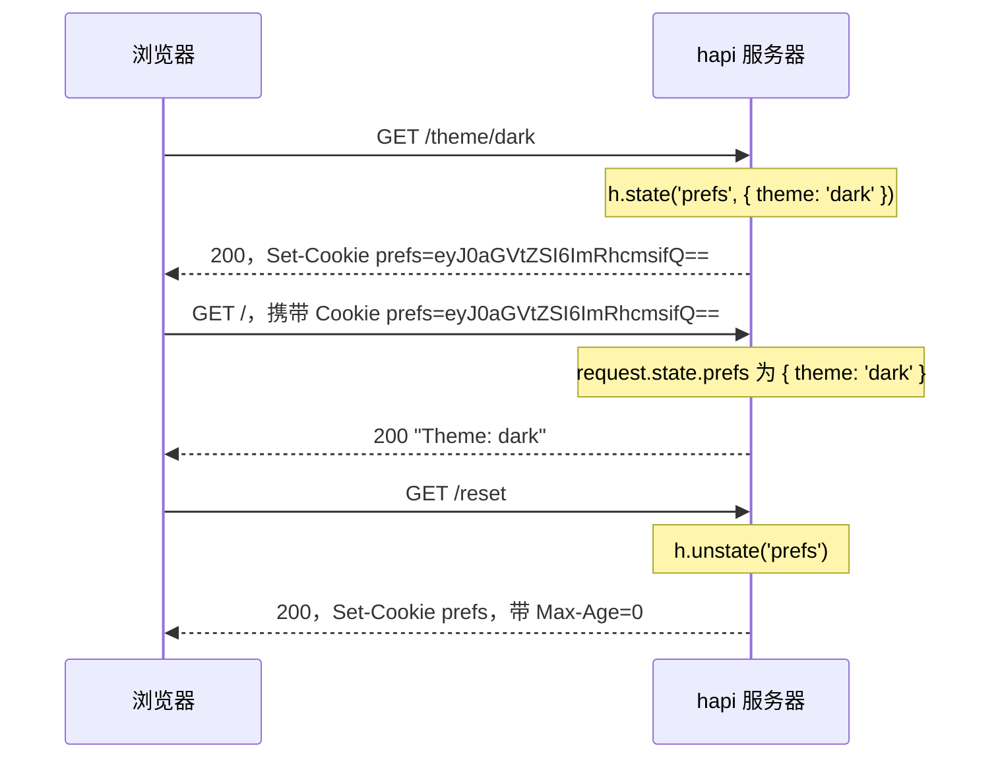

<TutorialLang />

# Cookie

_本教程适用于 hapi v21 及更新版本_

## <a name="overview"></a> 概述

hapi 将请求的 `Cookie` 请求头读入 `request.state`，并根据 `h.state()` 写出 `Set-Cookie` 响应头。每个 cookie 只需通过 `server.state()` 声明一次，声明中设置它的编码和安全标志，因此 handler 只需处理值本身：



这次交互背后的完整服务器代码：

```ts
import Hapi from '@hapi/hapi';

const server = Hapi.server({ port: 3000 });

server.state('prefs', {
    encoding: 'base64json',
    ttl: 365 * 24 * 60 * 60 * 1000,
    isSecure: process.env.NODE_ENV === 'production',
    path: '/',
});

server.route<{ Params: { theme: string } }>({
    method: 'GET',
    path: '/theme/{theme}',
    handler: (request, h) => {
        h.state('prefs', { theme: request.params.theme });
        return 'saved';
    },
});

server.route({
    method: 'GET',
    path: '/',
    handler: (request, h) => {
        const prefs = request.state.prefs;
        const theme = typeof prefs === 'object' && prefs !== null && 'theme' in prefs ? prefs.theme : 'light';

        return `Theme: ${theme}`;
    },
});

server.route({
    method: 'GET',
    path: '/reset',
    handler: (request, h) => {
        return h.response('reset').unstate('prefs');
    },
});

await server.start();
```

`request.state` 的类型是 `Record<string, unknown>`，因为 cookie 里装的是客户端发送的任意内容。`/` 的 handler 在读取 `theme` 之前先检查值的结构，否则回退到默认值。

## <a name="server"></a> 配置服务器

### <a name="server.state"></a> server.state()

[`server.state(name, [options])`](/api#server-state-name-options) 声明一个 cookie。默认值是安全的，所以大多数应用只需设置 `encoding`、`ttl` 和 `path`：

| 选项           | 默认值     | 含义                                                                                                                                |
| -------------- | ---------- | ----------------------------------------------------------------------------------------------------------------------------------- |
| `ttl`          | `null`     | 有效期，单位为毫秒。`null` 表示会话 cookie，浏览器关闭时删除。                                                                      |
| `encoding`     | `'none'`   | 值的存储方式：`'none'`（字符串）、`'base64'`、`'base64json'`（任意 JSON 值）、`'form'` 或 `'iron'`（加密，见[下文](#iron)）。       |
| `path`         | `null`     | 浏览器针对哪个 URL 路径发送该 cookie。`null` 表示不设置该属性，浏览器会使用设置它的那个请求所在的目录。全站 cookie 请设置为 `'/'`。 |
| `isSecure`     | `true`     | 只通过 HTTPS 发送。开发期间使用普通 HTTP 时设为 `false`。                                                                           |
| `isHttpOnly`   | `true`     | 对浏览器中的 JavaScript 不可见，防止跨站脚本攻击。                                                                                  |
| `isSameSite`   | `'Strict'` | 来自其他站点的请求不携带该 cookie。`'Lax'` 允许来自其他站点的顶层导航携带；`false` 表示不设置该属性。                               |
| `clearInvalid` | `false`    | 当 cookie 的值无法解析时，通知浏览器删除它。                                                                                        |
| `strictHeader` | `true`     | 拒绝不符合 [RFC 6265](https://tools.ietf.org/html/rfc6265) 的名称和值。                                                             |

其余选项（如 `domain`、`autoValue` 和签名）请参见 [`server.state()`](/api#server-state-name-options)。如需修改所有 cookie 的默认值，可以把同样的选项传给服务器的 [`state`](/api#server-options-state) 选项。

### <a name="iron"></a> 加密 cookie

`encoding: 'iron'` 使用 [iron](/module/iron) 对值进行加密和签名。客户端无法读取它，如果它被修改过，hapi 会拒绝它。凡是不想让用户看到的内容都可以这样存储，例如会话 id：

```ts
const password = process.env.COOKIE_PASSWORD;
if (!password || password.length < 32) {
    throw new Error('COOKIE_PASSWORD must be set to at least 32 characters');
}

server.state('session', {
    encoding: 'iron',
    password,
    ttl: 24 * 60 * 60 * 1000,
    path: '/',
});
```

对于登录会话，[@hapi/cookie](/module/cookie) 在此基础上更进一步：它作为一种[身份认证 strategy](/tutorials/zh_CN/auth#cookie) 来管理加密的会话 cookie。

### <a name="options.state"></a> route.options.state

路由通过 [`options.state`](/api#route-options-state) 控制 cookie 的解析：

| 选项         | 默认值    | 含义                                                                     |
| ------------ | --------- | ------------------------------------------------------------------------ |
| `parse`      | `true`    | 将 cookie 解析到 `request.state`。不读取 cookie 的路由可以设为 `false`。 |
| `failAction` | `'error'` | cookie 解析或解密失败时的处理方式。                                      |

当 cookie 的值与其编码不符，或者 iron cookie 被篡改、或是用另一个密码加密的，cookie 就会失败：

| `failAction` | 结果                                           |
| ------------ | ---------------------------------------------- |
| `'error'`    | 请求以 `400 Bad Request` 失败                  |
| `'log'`      | 请求继续，但不带该 cookie，hapi 会记录这个错误 |
| `'ignore'`   | 请求继续，但不带该 cookie                      |

如果 cookie 设置了 `clearInvalid: true`，响应还会从浏览器中删除这个坏掉的 cookie。将它与 `'log'` 或 `'ignore'` 搭配使用，携带过时 cookie（例如修改密码之前加密的 cookie）的请求就能成功，而不会先失败一次返回 400。

## <a name="setting"></a> 设置 cookie

### <a name="h.state"></a> h.state()

[`h.state(name, value, [options])`](/api#h-state-name-value-options) 可以在 handler、[pre-handler](/api#route-options-pre) 或[生命周期钩子](/tutorials/zh_CN/lifecycle-hooks)中设置 cookie。响应对象上也有同样的方法，便于链式调用：

```ts
h.state('prefs', { theme: 'dark' });

return h.response('Hello').state('prefs', { theme: 'dark' });
```

## <a name="override"></a> 覆盖选项

第三个参数只针对本次响应覆盖 cookie 声明时的选项：

```ts
return h.response('Hello').state('prefs', 'dark', { encoding: 'none' });
```

## <a name="value"></a> 读取 cookie 的值

`request.state` 保存所有已解析的 cookie，以名称为键。如果浏览器发送了两个同名 cookie，其值是一个数组。读取值的方式与概述中的示例相同：先检查结构，再使用。

## <a name="clear"></a> 清除 cookie

[`h.unstate(name)`](/api#h-unstate-name-options)，或响应对象上的 `unstate()`，通知浏览器删除该 cookie：

```ts
return h.response('Bye').unstate('prefs');
```
