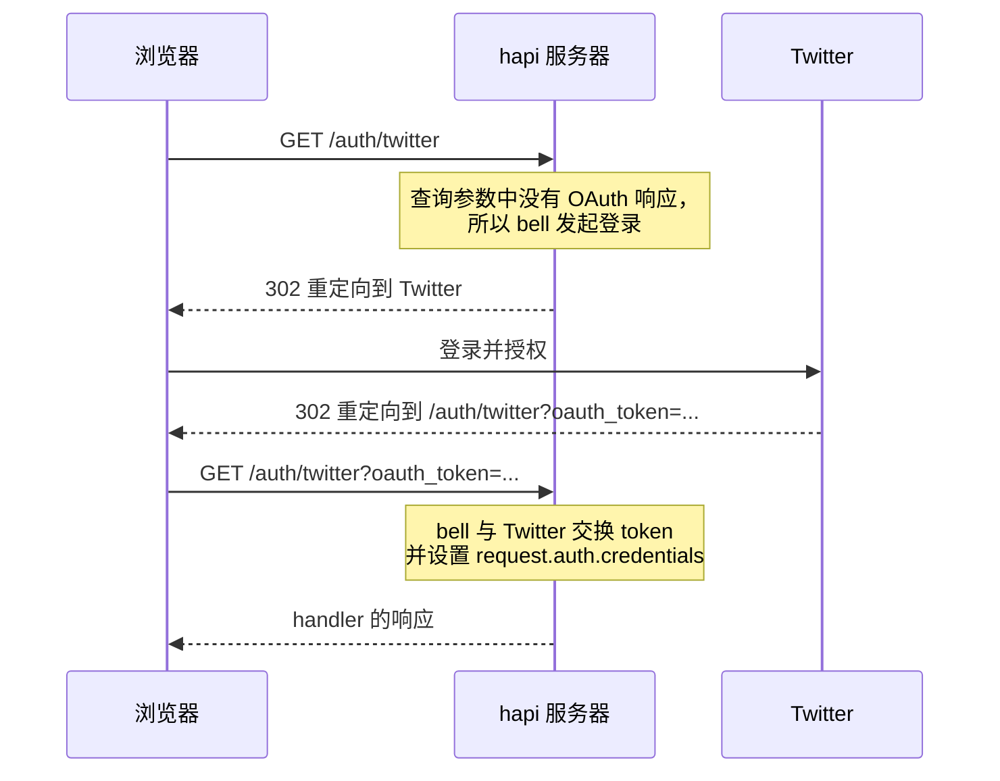

<TutorialLang />

# <a name="express-migration"></a> 从 Express 迁移到 hapi

_本指南适用于 hapi v21 及更高版本_

## <a name="overview" ></a> 概述

本指南展示如何把你在 Express 中的做法搬到 hapi 中。示例使用 Express 5。

最大的区别在于：Express 通过中间件添加功能，你需要安装它们并用 `app.use()` 排好顺序；而 hapi 把大部分功能内置在核心中，并按路由进行配置。在 hapi 确实需要插件的地方，插件也来自 hapi 团队。hapi 自身的运行时依赖全部是由同一团队维护的 `@hapi/*` 包。

| 在 Express 中使用               | 在 hapi 中使用                                                                                                                            |
| ------------------------------- | ----------------------------------------------------------------------------------------------------------------------------------------- |
| `express.json()`、`body-parser` | 内置：[payload 解析](#bodyparser)                                                                                                         |
| `cookie-parser`                 | 内置：[`server.state()`](#config)                                                                                                         |
| `express-validator`             | 内置：路由的 [`validate`](#joi)，配合 [joi](https://joi.dev)                                                                              |
| `passport`                      | 内置身份认证框架；scheme 来自 `@hapi/basic`、`@hapi/cookie`、`@hapi/jwt` 和 [bell](#bell) 等插件（[身份认证教程](/tutorials/zh_CN/auth)） |
| `cors`                          | 内置：路由的 [`cors`](/api#route-options-cors) 选项                                                                                       |
| `helmet`                        | 部分内置：路由的 [`security`](/api#route-options-security) 选项（不含 Content-Security-Policy）                                           |
| `compression`                   | 内置，默认开启                                                                                                                            |
| `app.set('view engine')`        | [vision](#vision) 插件                                                                                                                    |
| `express.static()`              | [inert](#inert) 插件                                                                                                                      |
| 自定义中间件                    | [扩展点](#extension)和[插件](#creating)                                                                                                   |
| 错误处理中间件                  | `onPreResponse` [扩展](#extension)；用抛出 [boom](#boom) 错误代替 `next(err)`                                                             |

## <a name="setup" ></a> 准备工作

### <a name="installation" ></a> 安装

|                 | Express                                 | hapi                     |
| --------------- | --------------------------------------- | ------------------------ |
| 安装            | `npm install express`                   | `npm install @hapi/hapi` |
| TypeScript 类型 | `npm install --save-dev @types/express` | 已内置                   |

### <a name="server" ></a> 创建服务器

Express：

```ts
import express from 'express';

const app = express();

app.listen(3000, function () {
    console.log('Server is running on port 3000');
});
```

hapi：

```ts
import Hapi from '@hapi/hapi';

const init = async () => {
    const server = Hapi.server({
        port: 3000,
        host: 'localhost',
    });

    await server.start();
    console.log('Server running on port 3000');
};

init();
```

在 hapi 中，`server` 对象是整个应用的中心。它的选项（端口、主机、默认路由设置）决定了服务器的行为，路由、插件和扩展都添加到它上面。`server.start()` 返回一个 promise。

## <a name="routes" ></a> 路由

Express：

```ts
app.get('/hello', function (req, res) {
    res.send('Hello World!');
});
```

hapi：

```ts
server.route({
    method: 'GET',
    path: '/hello',
    handler: (request, h) => {
        return 'Hello World!';
    },
});
```

|              | Express                     | hapi                                       |
| ------------ | --------------------------- | ------------------------------------------ |
| 定义路由     | `app.METHOD(path, handler)` | `server.route({ method, path, handler })`  |
| 发送响应     | 调用 `res.send()`           | 返回这个值                                 |
| 运行哪个路由 | 第一个注册且匹配的路由      | 最具体的匹配，与注册顺序无关               |
| 重叠的路由   | 都会注册；先注册的胜出      | 两个路由冲突时 `server.route()` 会抛出错误 |

由于 hapi 选择最具体的路由，`'/home'` 总是胜过 `'/{any*}'`，注册顺序永远不会决定由哪个路由响应。具体规则请参阅[路由教程](/tutorials/zh_CN/routing)。

### <a name="methods" ></a> 方法

| Express               | hapi                                   |
| --------------------- | -------------------------------------- |
| `app.get(path, ...)`  | `method: 'GET'`                        |
| 每个方法一个路由      | `method: ['PUT', 'POST']`              |
| `app.all(path, ...)`  | `method: '*'`                          |
| `app.head(path, ...)` | 不允许：每个 `GET` 路由都会响应 `HEAD` |

```ts
server.route({
    method: ['PUT', 'POST'],
    path: '/',
    handler: function (request, h) {
        return 'I did something!';
    },
});
```

### <a name="path" ></a> 路径

在 hapi 中，参数写在花括号里：

|          | Express 5        | hapi              |
| -------- | ---------------- | ----------------- |
| 参数     | `/users/:userId` | `/users/{userId}` |
| 可选参数 | `/hello{/:user}` | `/hello/{user?}`  |
| 通配符   | `/files/*path`   | `/files/{path*}`  |

在 hapi 中，`{user*}` 和占据整段的 `{user?}` 必须是最后一段；`{user*2}` 以及只占部分段的可选参数（例如 `/a{user?}/b`）可以出现在任意位置。

### <a name="parameters" ></a> 参数

Express：

```ts
app.get('/hello/:name', function (req, res) {
    const name = req.params.name;
    res.send('Hello ' + name);
});
```

hapi：

```ts
server.route({
    method: 'GET',
    path: '/hello/{name}',
    handler: function (request, h) {
        const name = request.params.name;
        return 'Hello ' + name;
    },
});
```

| Express      | hapi              |
| ------------ | ----------------- |
| `req.params` | `request.params`  |
| `req.query`  | `request.query`   |
| `req.body`   | `request.payload` |

### <a name="handler" ></a> Handler

Express 的 handler 接收 `req` 和 `res`，通过调用 `res` 上的方法来响应。hapi 的 handler 接收 `request` 和 `h`（[响应工具包](/api#response-toolkit)），并返回响应：

| Express                        | hapi                                                      |
| ------------------------------ | --------------------------------------------------------- |
| `res.send('text')`             | `return 'text'`                                           |
| `res.json(object)`             | `return object`                                           |
| `res.status(201).send(object)` | `return h.response(object).code(201)`                     |
| `res.set('x-name', 'value')`   | `return h.response(object).header('x-name', 'value')`     |
| `res.redirect('/')`            | `return h.redirect('/')`                                  |
| `res.cookie('name', 'value')`  | `h.state('name', 'value')`，参见 [cookie](#config)        |
| `res.sendFile(file)`           | `return h.file(file)`，参见 [inert](#inert)               |
| `res.render('index', context)` | `return h.view('index', context)`，参见 [vision](#vision) |
| `next(err)`                    | `throw Boom.notFound()`，参见 [boom](#boom)               |

当 handler 需要设置状态码或响应头时，用 `h.response()` 包装返回值：

```ts
server.route({
    method: 'POST',
    path: '/user',
    handler: function (request, h) {
        const user = {
            firstName: 'John',
            lastName: 'Doe',
            id: 123,
        };

        return h.response(user).code(201).header('location', '/user/123');
    },
});
```

hapi 会把返回的对象序列化为 JSON 并设置 `content-type`。hapi 如何把返回值变成响应，请参阅[响应编组教程](/tutorials/zh_CN/response-marshalling)。

## <a name="plugins" ></a> 中间件与插件和扩展

Express 按照你调用 `app.use()` 的顺序运行中间件。如果一个中间件依赖另一个，你需要手动保证它们的顺序，顺序错了会在处理请求时才出错。

hapi 让每个请求都经过一系列固定的步骤，也就是[请求生命周期](/api#request-lifecycle)。你不需要给中间件排序，而是把代码挂到某个具名的步骤上。下表的每一步也列出了承担相同职责的 Express 中间件：

| hapi 步骤             | 扩展点                           | Express 对应物               |
| --------------------- | -------------------------------- | ---------------------------- |
| 收到请求              | `onRequest`                      | 路由之前的 `app.use()`       |
| 查找路由、解析 cookie |                                  | `app.get()`、`cookie-parser` |
| 身份认证之前          | `onPreAuth`                      |                              |
| 身份认证              |                                  | `passport`                   |
| 解析 payload          |                                  | `express.json()`             |
| 身份认证之后          | `onCredentials`、`onPostAuth`    |                              |
| 验证                  |                                  | `express-validator`          |
| handler 之前          | `onPreHandler`                   |                              |
| handler               |                                  | 路由回调                     |
| handler 之后          | `onPostHandler`、`onPreResponse` | 错误处理中间件               |
| 响应发送之后          | `onPostResponse`                 |                              |

扩展点是你用 `server.ext()` 添加自己代码的地方。其余步骤由 hapi 根据每个路由的配置来执行。

插件取代了可复用的中间件。插件是一个具名单元，它向服务器注册路由、扩展和装饰。插件可以在 `dependencies` 属性中声明它需要的其他插件，缺少依赖时 hapi 会拒绝启动，而不是等到处理请求时才失败。请参阅[插件教程](/tutorials/zh_CN/plugins)。

### <a name="extension" ></a> 扩展点

对每个请求都运行的中间件，可以改写成扩展：

Express：

```ts
app.use(function (req, res, next) {
    console.log(req.method, req.url);
    next();
});
```

hapi：

```ts
server.ext('onRequest', function (request, h) {
    console.log(request.method, request.path);
    return h.continue;
});
```

`return h.continue` 起到 `next()` 的作用：请求继续进入下一步。如果返回接管响应（`h.response(...).takeover()`）或者抛出错误，请求就在这里结束。

hapi 有八个请求扩展点：`onRequest`、`onPreAuth`、`onCredentials`、`onPostAuth`、`onPreHandler`、`onPostHandler`、`onPreResponse` 和 `onPostResponse`。[生命周期钩子教程](/tutorials/zh_CN/lifecycle-hooks)介绍了每个扩展点的使用时机，[`server.ext()`](/api#server-ext-events) 列出了所有选项。

### <a name="creating" ></a> 创建插件

给每个请求添加辅助方法的中间件，可以改写成一个添加[装饰](/tutorials/zh_CN/decorators)的插件。插件是一个带有 `name`（或 `pkg`）和 `async register(server, options)` 函数的对象。

Express：

```ts
import type { NextFunction, Request, Response } from 'express';

declare global {
    namespace Express {
        interface Request {
            getDate(): Date;
        }
    }
}

const getDate = function (req: Request, res: Response, next: NextFunction) {
    req.getDate = function () {
        const date = new Date();
        return date;
    };

    next();
};
```

hapi：

```ts
import type { Plugin } from '@hapi/hapi';

declare module '@hapi/hapi' {
    interface ResponseToolkit {
        getDate(): Date;
    }
}

const getDate: Plugin<void> = {
    name: 'getDate',
    version: '1.0.0',
    register: async function (server, options) {
        const currentDate = function () {
            const date = new Date();
            return date;
        };

        server.decorate('toolkit', 'getDate', currentDate);
    },
};
```

- Express 中间件在每个请求上都重新设置一次 `req.getDate`。hapi 插件只在注册时调用一次 `server.decorate()`，之后每个 handler 都能使用 `h.getDate()`。
- 只有在你声明了这个新方法之后，TypeScript 才知道它的存在：Express 通过全局的 `Express.Request` 接口声明，hapi 则把它添加到 `@hapi/hapi` 的 `ResponseToolkit` 接口中。

### <a name="load" ></a> 加载插件

Express：

```ts
app.use(getDate);
```

hapi：

```ts
await server.register({
    plugin: getDate,
});
```

### <a name="options" ></a> 选项

Express 中间件接收选项的方式，是做成一个返回中间件的函数。hapi 插件则通过 `register` 的第二个参数接收选项。

Express：

```ts
import type { NextFunction, Request, Response } from 'express';

declare global {
    namespace Express {
        interface Request {
            getDate(): string;
        }
    }
}

export default function (options: { name: string }) {
    return function getDate(req: Request, res: Response, next: NextFunction) {
        req.getDate = function () {
            const date = 'Hello ' + options.name + ', the date is ' + new Date();
            return date;
        };

        next();
    };
}
```

hapi：

```ts
import type { Plugin } from '@hapi/hapi';

declare module '@hapi/hapi' {
    interface ResponseToolkit {
        getDate(): string;
    }
}

const getDate: Plugin<{ name: string }> = {
    name: 'getDate',
    version: '1.0.0',
    register: async function (server, options) {
        const currentDate = function () {
            const date = 'Hello ' + options.name + ', the date is ' + new Date();
            return date;
        };

        server.decorate('toolkit', 'getDate', currentDate);
    },
};
```

选项在注册插件时传入。`Plugin<{ name: string }>` 的类型参数为 `register` 内部的 `options` 提供类型，如果 `server.register()` 调用传入的选项与之不符，TypeScript 会报错；hapi 在运行时不会检查它们：

Express：

```ts
import getDate from './mw/getDate.ts';

app.use(getDate({ name: 'Tom' }));
```

hapi：

```ts
await server.register({
    plugin: getDate,
    options: {
        name: 'Tom',
    },
});
```

## <a name="bodyparser" ></a> body-parser

hapi 在 handler 运行之前就解析请求 payload，无需任何中间件。结果位于 `request.payload`。

| 内容类型                            | Express                         | hapi                                    |
| ----------------------------------- | ------------------------------- | --------------------------------------- |
| `application/json`                  | `app.use(express.json())`       | 默认解析                                |
| `application/x-www-form-urlencoded` | `app.use(express.urlencoded())` | 默认解析                                |
| `text/*`                            | `app.use(express.text())`       | 默认解析                                |
| `multipart/form-data`               | 单独的包，例如 `multer`         | 路由选项 `payload: { multipart: true }` |

Express：

```ts
import express from 'express';

const app = express();

app.use(express.urlencoded());

app.post('/hello', function (req, res) {
    const name = req.body.name;
    res.send('Hello ' + name);
});
```

hapi：

```ts
server.route<{ Payload: { name: string } }>({
    method: 'POST',
    path: '/hello',
    handler: function (request, h) {
        const name = request.payload.name;
        return 'Hello ' + name;
    },
});
```

`request.payload` 没有固定的结构，因为 hapi 无法知道客户端会发送什么。类型参数 `server.route<{ Payload: { name: string } }>()` 告诉 TypeScript handler 收到的是什么。它只是一个类型：要在运行时检查 payload，请添加[验证](#joi)。大小限制、超时和文件上传通过路由的 [`payload` 选项](/api#route-options-payload)设置。

## <a name="config" ></a> cookie-parser

hapi 无需中间件就能读写 cookie。Express 在每次调用 `res.cookie()` 时接收 cookie 选项，而 hapi 用 `server.state()` 为每个 cookie 定义一次，之后每个路由按名称设置它即可。

| 选项          | Express `res.cookie()` | hapi `server.state()`           |
| ------------- | ---------------------- | ------------------------------- |
| Secure 标志   | `secure`，默认关闭     | `isSecure`，默认开启            |
| HttpOnly 标志 | `httpOnly`，默认关闭   | `isHttpOnly`，默认开启          |
| SameSite      | `sameSite`             | `isSameSite`，默认为 `'Strict'` |
| 有效期        | `maxAge`（毫秒）       | `ttl`（毫秒）                   |
| 签名值        | `signed`               | `sign: { password }`            |
| 加密值        | 未内置                 | `encoding: 'iron'`              |

所有选项请参阅 [`server.state()`](/api#server-state-name-options)，另见 [Cookie 教程](/tutorials/zh_CN/cookies)。

### <a name="setCookie" ></a> 设置 cookie

Express：

```ts
import express from 'express';
import cookieParser from 'cookie-parser';

const app = express();

app.use(cookieParser());

app.get('/', function (req, res) {
    res.cookie('username', 'tom', { secure: true, httpOnly: true });
    res.send('Hello');
});
```

hapi：

```ts
import Hapi from '@hapi/hapi';

const server = Hapi.server({ port: 8000 });

server.state('username', {
    ttl: null,
    isSecure: true,
    isHttpOnly: true,
});

server.route({
    method: 'GET',
    path: '/',
    handler: function (request, h) {
        h.state('username', 'tom');
        return 'Hello';
    },
});
```

### <a name="getCookie" ></a> 读取 cookie 值

Express：

```ts
app.get('/whoami', (req, res) => {
    res.send(req.cookies.username);
});
```

hapi：

```ts
server.route({
    method: 'GET',
    path: '/whoami',
    handler: (request, h) => {
        const username = request.state.username;
        if (typeof username !== 'string') {
            return 'No username cookie';
        }

        return username;
    },
});
```

`request.state` 保存的是客户端发来的任意 cookie，所以 hapi 把每个值的类型定为 `unknown`。使用之前要先检查类型。

## <a name="bell" ></a> Passport -> bell

Express 用 Passport 处理第三方登录。hapi 使用 [bell](/module/bell)，它为 30 多个 OAuth 提供商内置了配置，包括 Twitter、Facebook、Google 和 GitHub，也支持自定义提供商。参见 [bell 提供商列表](/module/bell/providers)。

Passport 需要两个路由，一个用于发起登录，一个用于提供商的回调。bell 用一个路由同时处理两者：



Express：

```
npm install passport passport-twitter
```

如果你使用 TypeScript，还要运行 `npm install --save-dev @types/passport @types/passport-twitter`。

```ts
import passport from 'passport';
import { Strategy as TwitterStrategy } from 'passport-twitter';

passport.use(
    new TwitterStrategy(
        {
            consumerKey: TWITTER_CONSUMER_KEY,
            consumerSecret: TWITTER_CONSUMER_SECRET,
            callbackURL: '/auth/twitter/callback',
        },
        function (token, tokenSecret, profile, cb) {
            User.findOrCreate({ twitterId: profile.id }, function (err, user) {
                return cb(err, user);
            });
        },
    ),
);

passport.serializeUser(function (user, cb) {
    cb(null, user);
});

passport.deserializeUser(function (user: Express.User, cb) {
    cb(null, user);
});

app.get('/auth/twitter', passport.authenticate('twitter'));
app.get('/auth/twitter/callback', passport.authenticate('twitter', { failureRedirect: '/login' }), function (req, res) {
    res.redirect('/');
});
```

hapi：

```
npm install @hapi/bell
```

```ts
import Hapi from '@hapi/hapi';
import Bell from '@hapi/bell';

const server = Hapi.server({ port: 8000 });

await server.register(Bell);

server.auth.strategy('twitter', 'bell', {
    provider: 'twitter',
    password: 'cookie_encryption_password_secure',
    clientId: TWITTER_CONSUMER_KEY,
    clientSecret: TWITTER_CONSUMER_SECRET,
    isSecure: false,
});

server.route({
    method: '*',
    path: '/auth/twitter', // The callback endpoint registered with the provider
    handler: function (request, h) {
        if (!request.auth.isAuthenticated) {
            return `Authentication failed due to: ${request.auth.error.message}`;
        }

        // Look up or register the account, start a local session, and redirect.
        // request.auth.credentials holds the provider's profile and tokens.

        return h.redirect('/home');
    },
    options: {
        auth: {
            strategy: 'twitter',
            mode: 'try',
        },
    },
});
```

| 选项           | 含义                                                                                      |
| -------------- | ----------------------------------------------------------------------------------------- |
| `provider`     | 内置提供商配置的名称                                                                      |
| `password`     | 用于加密 bell 在两次请求之间保存的临时 cookie；至少 32 个字符                             |
| `clientId`     | 提供商分配的 OAuth client ID                                                              |
| `clientSecret` | 提供商分配的 OAuth client secret                                                          |
| `isSecure`     | cookie 的 Secure 标志。`false` 允许在开发环境中使用普通 HTTP；生产环境请保留默认值 `true` |

`mode: 'try'` 让 handler 在登录失败时也能运行，这样它可以显示错误信息，而不是只返回一个 401。发起登录的那次请求中的查询参数会出现在 `request.auth.credentials.query` 上，因此你可以让返回地址在提供商往返过程中一路带着。

## <a name="joi" ></a> express-validator -> joi

hapi 根据路由的配置，用 [joi](https://joi.dev) schema 验证请求和响应。express-validator 只检查请求；hapi 还可以检查 handler 的返回值。更多内容请参阅[验证教程](/tutorials/zh_CN/validation)。

### <a name="input" ></a> 输入验证

Express：

```
npm install express-validator
```

```ts
import express from 'express';
import { body, validationResult } from 'express-validator';

app.use(express.json());
app.use(express.urlencoded());

app.post('/post', body('post', 'Post too long').isLength({ max: 140 }), function (req, res) {
    const errors = validationResult(req);
    if (!errors.isEmpty()) {
        res.status(400).send(errors.array());
    } else {
        res.send('Blog post added!');
    }
});
```

hapi：

```
npm install joi
```

```ts
import Joi from 'joi';

server.route({
    method: 'POST',
    path: '/post',
    handler: (request, h) => {
        return 'Blog post added!';
    },
    options: {
        validate: {
            payload: Joi.object({
                post: Joi.string().max(140),
            }),
        },
    },
});
```

- handler 只有在 payload 通过验证时才会运行。否则 hapi 会自动返回 400，所以 handler 里不需要错误分支。
- 规则可以链式组合，例如 `Joi.string().min(1).max(140)`。
- `validate` 还接受 `params`、`query`、`headers` 和 `state` 的 schema。

### <a name="output" ></a> 输出验证

```ts
const bookSchema = Joi.object({
    title: Joi.string().required(),
    author: Joi.string().required(),
    isbn: Joi.string().length(10),
    pageCount: Joi.number(),
    datePublished: Joi.date().iso(),
});

server.route({
    method: 'GET',
    path: '/books',
    handler: async function (request, h) {
        return await getBooks();
    },
    options: {
        response: {
            schema: Joi.array().items(bookSchema),
            failAction: 'log',
        },
    },
});
```

`response.schema` 检查 handler 返回的图书列表。使用 `failAction: 'log'` 时，未通过 schema 的响应仍会发送，失败会被记录到日志；默认值 `'error'` 则会把它替换成 500。

## <a name="vision" ></a> app.set('view engine') -> vision

hapi 通过 [vision](/module/vision) 插件渲染模板。它可以同时支持多个模板引擎，并支持 partial、helper 和布局。更多内容请参阅[视图教程](/tutorials/zh_CN/views)。

### <a name="viewengine" ></a> 设置视图引擎

Express：

```ts
app.set('view engine', 'pug');
```

hapi：

```ts
import Vision from '@hapi/vision';
import Pug from 'pug';

await server.register(Vision);

server.views({
    engines: {
        pug: Pug,
    },
    relativeTo: import.meta.dirname,
    path: 'views',
});
```

Express 默认在 `./views` 中查找模板。在 hapi 中，你用 `relativeTo` 和 `path` 设置模板文件夹。

### <a name="view" ></a> 渲染视图

Express：

```ts
app.get('/', function (req, res) {
    res.render('index', { title: 'Homepage', message: 'Welcome' });
});
```

hapi，使用 `h.view()`：

```ts
server.route({
    method: 'GET',
    path: '/',
    handler: function (request, h) {
        return h.view('index', { title: 'Homepage', message: 'Welcome' });
    },
});
```

hapi，当路由只渲染模板时，使用 `view` handler：

```ts
server.route({
    method: 'GET',
    path: '/',
    handler: {
        view: {
            template: 'index',
            context: {
                title: 'Homepage',
                message: 'Welcome',
            },
        },
    },
});
```

## <a name="inert" ></a> express.static() -> inert

hapi 通过 [inert](/module/inert) 插件提供静态文件。它添加了 `file` 和 `directory` handler 以及 `h.file()` 方法。更多内容请参阅[静态文件服务教程](/tutorials/zh_CN/serving-files)。

下面两个示例都使用这段设置代码，它注册 inert 并设置文件路径的基准文件夹：

```ts
import Path from 'node:path';
import Hapi from '@hapi/hapi';
import Inert from '@hapi/inert';

const server = Hapi.server({
    port: 3000,
    routes: {
        files: {
            relativeTo: Path.join(import.meta.dirname, 'public'),
        },
    },
});

await server.register(Inert);
```

### <a name="single" ></a> 提供单个文件

Express：

```ts
app.get('/image', function (req, res) {
    res.sendFile('image.jpg', { root: './public' });
});
```

hapi，使用 `h.file()`：

```ts
server.route({
    method: 'GET',
    path: '/image',
    handler: function (request, h) {
        return h.file('image.jpg');
    },
});
```

hapi，使用 `file` handler：

```ts
server.route({
    method: 'GET',
    path: '/image',
    handler: {
        file: 'image.jpg',
    },
});
```

### <a name="static" ></a> 静态文件服务器

Express：

```ts
app.use(express.static('public'));
```

hapi：

```ts
server.route({
    method: 'GET',
    path: '/{param*}',
    handler: {
        directory: {
            path: '.',
        },
    },
});
```

`{param*}` 通配符匹配任意路径，`directory` handler 从 `public` 文件夹中提供匹配的文件，所以 `/logo.png` 返回 `public/logo.png`。由于 hapi 选择最具体的路由，你的其他路由仍然会胜过这个兜底路由。

## <a name="boom" ></a> 错误处理 -> boom

hapi 用 JSON 响应错误，内容由 [boom](/module/boom) 错误对象构建。Express 则返回一个 HTML 页面。对于一个没有匹配路由的 `GET /hello`：

Express：

```text
Cannot GET /hello
```

hapi：

```json
{
    "statusCode": 404,
    "error": "Not Found",
    "message": "Not Found"
}
```

### <a name="custom" ></a> 自定义消息

Express：

```ts
res.status(404).send({ status: 404, error: 'Page not found' });
```

hapi：

```ts
throw Boom.notFound('Page not found');
```

抛出的错误会变成这样的响应：

```json
{
    "statusCode": 404,
    "error": "Not Found",
    "message": "Page not found"
}
```

boom 为常见的 4xx 和 5xx 状态码都提供了函数，例如 `Boom.badRequest()`、`Boom.unauthorized()` 和 `Boom.badImplementation()`。在 handler、扩展或插件中的任何地方抛出它，hapi 都会把它变成响应。不是 boom 错误的错误会变成 500，其消息对客户端隐藏。完整列表请参阅 [boom 文档](/module/boom)。
