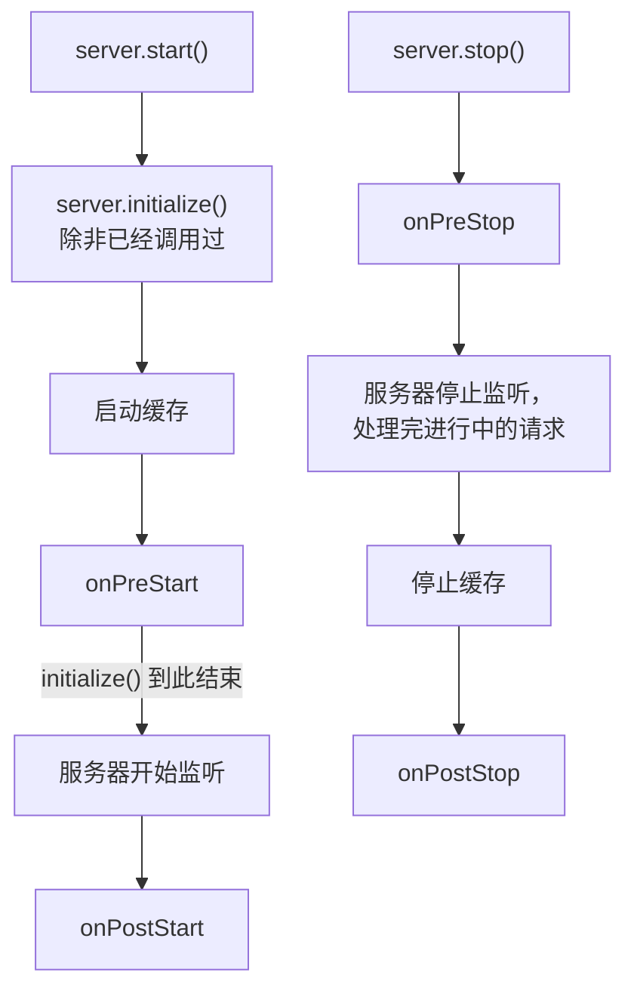
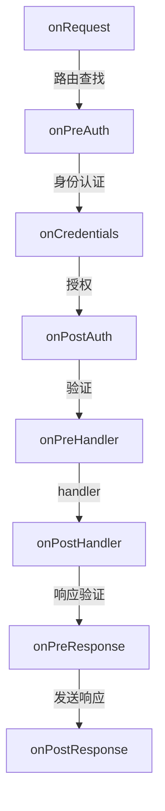

<TutorialLang />

# 生命周期钩子

_本教程适用于 hapi v21 及更新版本_

## <a name="overview"></a> 概述

hapi 让每个请求都经过同样一组固定的步骤：路由查找、身份认证、验证、handler 等等。生命周期钩子（API 参考中称为扩展点）让你可以在这个序列中某个具名的位置运行自己的函数。服务器本身还有另外四个钩子，用于启动和关闭。

大多数横切功能都是通过钩子实现的。好几个官方插件主要就是由几个钩子组成的：

| 插件                   | 钩子            | 在钩子里做什么                               |
| ---------------------- | --------------- | -------------------------------------------- |
| [yar](/module/yar)     | `onPreAuth`     | 加载会话，供身份认证使用                     |
| [yar](/module/yar)     | `onPreResponse` | 把会话保存到 cookie 中                       |
| [crumb](/module/crumb) | `onPostAuth`    | 拒绝缺少 CSRF token 或 token 错误的请求      |
| [crumb](/module/crumb) | `onPreResponse` | 把 CSRF token 添加到 HTML 页面的视图上下文中 |
| [nes](/module/nes)     | `onPreStart`    | 启动 WebSocket 心跳                          |
| [nes](/module/nes)     | `onPreStop`     | 关闭打开的 WebSocket 连接                    |

使用 [`server.ext()`](/api#server-ext-events) 添加钩子；完整的选项列表见 API 参考。

## <a name="server-hooks"></a> 服务器钩子：启动与关闭

服务器钩子在服务器启动或停止时运行一次。每个钩子接收 `server`，不返回任何值，或返回一个 promise。抛出错误会中止启动或关闭过程。



如果你还没有调用 `server.initialize()`，[`server.start()`](/api#await-server-start) 会先调用它。`initialize()` 在监听步骤之前结束，因此它会运行 `onPreStart`，但从不打开端口。这使它成为测试中的正确选择，在测试中你通过 `server.inject()` 发送请求。

| 钩子          | 运行时机                 | 用途                                           |
| ------------- | ------------------------ | ---------------------------------------------- |
| `onPreStart`  | 服务器开始监听之前       | 连接数据库、检查配置，这样一旦失败就会中止启动 |
| `onPostStart` | 服务器开始监听之后       | 需要已绑定端口的工作，例如向服务发现注册       |
| `onPreStop`   | 服务器停止监听之前       | 通知负载均衡器和长连接断开                     |
| `onPostStop`  | 进行中的请求全部完成之后 | 关闭数据库连接池以及请求正在使用的其他资源     |

数据库连接池是最常见的场景。在 `onPreStart` 中连接，数据库不可用时 `server.start()` 就会失败，而不是等到第一个请求才失败。在 `onPostStop` 中关闭，会等到进行中的请求完成查询之后：

```ts
import Hapi from '@hapi/hapi';
import { Pool } from 'pg';

import type { Plugin } from '@hapi/hapi';

const database: Plugin<{ connectionString: string }> = {
    name: 'database',
    register(server, options) {
        const pool = new Pool({ connectionString: options.connectionString });

        server.ext('onPreStart', async () => {
            await pool.query('SELECT 1');
        });

        server.ext('onPostStop', async () => {
            await pool.end();
        });

        server.expose('pool', pool);
    },
};

const server = Hapi.server({ port: 4000 });

await server.register({
    plugin: database,
    options: { connectionString: 'postgres://localhost/app' },
});

await server.start();

process.on('SIGTERM', async () => {
    await server.stop({ timeout: 10_000 });
    process.exit(0);
});
```

`server.stop({ timeout })` 给进行中的请求留出这么长的时间来完成，之后再关闭它们的连接。要与 handler 共享这样的服务（比如这个连接池），请使用[服务器装饰](/tutorials/zh_CN/decorators#server)。

服务器钩子的两条规则：

- 在调用 `initialize()` 或 `start()` 之前添加 `onPreStart`。之后再添加会抛出 `Cannot add onPreStart (after) extension after the server was initialized`。
- 当某个插件的启动工作需要另一个插件先准备好时，把它放进 [`server.dependency()`](/api#server-dependency-dependencies-after) 回调中。hapi 会在 `onPreStart` 期间、在回调所列插件之后运行它，与插件的注册顺序无关。参见插件教程中的[依赖](/tutorials/zh_CN/plugins#dependencies)一节。

## <a name="request-hooks"></a> 请求钩子

请求钩子在每个请求上运行。这八个钩子位于[请求生命周期](/api#request-lifecycle)的各个步骤之间：



`onRequest`、`onPreResponse` 和 `onPostResponse` 在每个请求上都会运行，包括 404 以及被身份认证或验证拒绝的请求。例外是被中止或通过 `h.close` 关闭的请求，它们会跳过 `onPreResponse`。只要路由配置了身份认证，`onCredentials` 就会运行，即使没有找到凭证。其余钩子只有在请求走到那一步时才会运行。

| 钩子             | 此时可以依赖的内容                                           | 典型用途                    |
| ---------------- | ------------------------------------------------------------ | --------------------------- |
| `onRequest`      | 原始路径和请求头；尚未确定路由；可以修改 URL                 | 请求 id、URL 重写、维护模式 |
| `onPreAuth`      | `request.route` 和已解析的 cookie                            | 加载身份认证将要读取的会话  |
| `onCredentials`  | `request.auth.credentials`，此时尚未检查 scope               | 从数据库添加角色或 scope    |
| `onPostAuth`     | 身份认证已完成，payload 已解析但尚未验证                     | CSRF 检查，加载租户或账户   |
| `onPreHandler`   | params、query 和 payload 已通过验证                          | 需要已验证输入的检查        |
| `onPostHandler`  | handler 的响应对象；handler 失败时会直接跳到 `onPreResponse` | 修改成功的响应              |
| `onPreResponse`  | 最终的 `request.response`，包括错误                          | 错误页面、响应头、保存会话  |
| `onPostResponse` | 响应已经发送                                                 | 指标、访问日志、清理工作    |

### <a name="return-values"></a> 钩子的返回值

请求钩子是一种[生命周期方法](/api#lifecycle-methods)：它接收 `(request, h)`，并且必须返回某个值。返回什么决定了接下来发生什么：

| 返回值                         | `onRequest`          | `onPreAuth` 到 `onPreHandler`              | `onPostHandler`、`onPreResponse`   | `onPostResponse`                  |
| ------------------------------ | -------------------- | ------------------------------------------ | ---------------------------------- | --------------------------------- |
| `h.continue`                   | 运行下一步           | 运行下一步                                 | 保留当前响应                       | 忽略                              |
| `h.response(value).takeover()` | 跳到 `onPreResponse` | 跳到路由的响应验证，然后是 `onPreResponse` | 替换响应；同类型的后续钩子被跳过   | 忽略                              |
| 一个错误，抛出或返回           | 跳到 `onPreResponse` | 跳到 `onPreResponse`                       | 替换响应；同类型的后续钩子被跳过   | 抛出的错误或返回的 boom：记录日志 |
| 其他任何值                     | 500 错误             | 500 错误                                   | 替换响应；同类型的后续钩子仍然运行 | 忽略                              |
| 什么都不返回（`undefined`）    | 500 错误             | 500 错误                                   | 500 错误                           | 忽略                              |

[`h.continue`](/api#h-continue) 是钩子表示 "这里没什么要做的" 的方式。takeover 是 handler 之前的钩子自己应答请求的方式，即使是来自 `onRequest` 的 takeover 也会经过 `onPreResponse`。完整规则见 API 参考中的[生命周期流程](/api#lifecycle-workflow)。

## <a name="patterns"></a> 常见模式

### <a name="request-id"></a> 请求 id 与耗时

请求 id 把客户端的错误报告和你的日志关联起来。下面这个插件接受客户端传来的 id，或者自己生成一个，在响应头中返回它，并记录每个请求的耗时：

```ts
import { randomUUID } from 'node:crypto';
import Boom from '@hapi/boom';

import type { Plugin } from '@hapi/hapi';

declare module '@hapi/hapi' {
    interface PluginsStates {
        'request-tracing': { id: string };
    }
}

const requestTracing: Plugin<void> = {
    name: 'request-tracing',
    register(server) {
        server.ext('onRequest', (request, h) => {
            const incoming = request.headers['x-request-id'];
            request.plugins['request-tracing'] = { id: typeof incoming === 'string' ? incoming : randomUUID() };
            return h.continue;
        });

        server.ext('onPreResponse', (request, h) => {
            const { response } = request;
            const { id } = request.plugins['request-tracing'];
            if (Boom.isBoom(response)) {
                response.output.headers['x-request-id'] = id;
            } else {
                response.header('x-request-id', id);
            }

            return h.continue;
        });

        server.ext('onPostResponse', (request, h) => {
            const { response } = request;
            const statusCode = Boom.isBoom(response) ? response.output.statusCode : response.statusCode;
            const duration = request.info.completed - request.info.received;

            request.log(['metrics'], {
                id: request.plugins['request-tracing'].id,
                path: request.path,
                statusCode,
                duration,
            });
            return h.continue;
        });
    },
};
```

- 插件把自己的每请求数据以自己的名称为键存放在 [`request.plugins`](/api#request-plugins) 中，`declare module` 代码块通过 hapi 的 `PluginsStates` 接口为这一项提供类型。[`request.app`](/api#request-app) 则留给应用自己的代码使用。
- 请求失败时，`request.response` 是一个 boom 错误，所以 `onPreResponse` 把响应头设置在 `response.output.headers` 上，而不是调用 `.header()`。
- `onPostResponse` 在响应发送之后运行，因此客户端永远不用等它，它的返回值也会被忽略。hapi 依次运行各个 `onPostResponse` 钩子，所以一个慢的钩子仍然会拖慢它后面的钩子。把通过网络发送指标这类慢操作交给队列处理，然后直接返回。
- hapi 已经记录了 [`request.info.received`](/api#request-info) 和 `request.info.completed`，因此不需要自己保存开始时间。

### <a name="rewrite"></a> 重写 URL

`onRequest` 是唯一在路由查找之前运行的钩子，所以只有在这里重写 URL 才能改变由哪个路由处理请求。[`request.setUrl()`](/api#request-seturl-url-striptrailingslash) 负责重写：

```ts
server.ext('onRequest', (request, h) => {
    if (request.path.startsWith('/api/v1/')) {
        request.setUrl(request.url.pathname.replace('/api/v1/', '/api/') + request.url.search);
    }

    return h.continue;
});
```

旧客户端继续调用 `/api/v1/users?page=2`，由 `/api/users` 路由应答，查询字符串保持不变。

### <a name="maintenance"></a> 维护模式

来自 `onRequest` 的 takeover 响应会在任何路由运行之前应答所有请求：

```ts
let maintenance = false;

server.ext('onRequest', (request, h) => {
    if (!maintenance || request.path === '/health') {
        return h.continue;
    }

    return h.response({ message: 'Down for maintenance' }).code(503).header('retry-after', '600').takeover();
});
```

健康检查仍然可以访问，这样负载均衡器就能区分计划内的停机和崩溃。

### <a name="credentials"></a> 加载角色：onCredentials 还是 onPostAuth

这两个钩子都在身份认证之后运行。区别在于它们之间的授权步骤，该步骤会检查路由的 [`auth.access.scope`](/api#route-options-auth-access-scope)（参见 [Scopes](/tutorials/zh_CN/auth#scopes)）。

当你要添加授权步骤需要看到的内容时，使用 `onCredentials`。token 通常能标识用户，但不携带用户的角色，所以你从数据库加载角色，并将其作为 scope 添加进去：

```ts
server.ext('onCredentials', async (request, h) => {
    if (!request.auth.isAuthenticated) {
        return h.continue;
    }

    const { user } = request.auth.credentials;
    if (user) {
        request.auth.credentials.scope = await loadRoles(user.id);
    }

    return h.continue;
});

server.route<{ Params: { id: string } }>({
    method: 'DELETE',
    path: '/projects/{id}',
    options: { auth: { access: { scope: 'admin' } } },
    handler: (request, h) => deleteProject(request.params.id),
});
```

只要路由配置了身份认证，`onCredentials` 就会运行，包括在 `'try'` 和 `'optional'` 路由上没有找到凭证、`request.auth.credentials` 为 `null` 的情况，所以要先检查 `request.auth.isAuthenticated`。`user.id` 依赖于[身份认证教程](/tutorials/zh_CN/auth#schemes)中展示的 `UserCredentials` 声明。

对于不改变用户权限的工作，或者必须在没有身份认证的路由上也运行的工作（例如加载 `Host` 请求头中指定的租户），使用 `onPostAuth`。在 `auth: false` 的路由上，`onCredentials` 永远不会运行。

### <a name="errors"></a> 统一的错误响应

`onPreResponse` 能看到每个即将发出的响应，所以这里是改变错误外观的地方。用自己的响应替换错误的钩子必须保留错误的响应头，例如 401 上的 `WWW-Authenticate`：

```ts
import Boom from '@hapi/boom';

server.ext(
    'onPreResponse',
    (request, h) => {
        const { response } = request;
        if (!Boom.isBoom(response)) {
            return h.continue;
        }

        const { statusCode, payload, headers } = response.output;
        const reply = h.response({ error: payload.message }).code(statusCode);
        for (const [name, value] of Object.entries(headers)) {
            if (value !== undefined) {
                reply.header(name, String(value));
            }
        }

        return reply;
    },
    { before: ['request-tracing'] },
);
```

新的响应会替换错误，在此之后运行的 `onPreResponse` 钩子看到的是新响应。有了 `before: ['request-tracing']`，[请求 id 钩子](#request-id)会在这个钩子之后运行，并把它的响应头添加到新响应上。没有这个选项的话，请求 id 钩子会先把响应头设置在错误上，只能靠上面复制响应头的代码来保留它。对于会替换响应的钩子，顺序尤其重要。[响应编组教程](/tutorials/zh_CN/response-marshalling#errors)中有完整的错误格式和 HTML 错误页面。

## <a name="ordering"></a> 顺序与作用范围

默认情况下，同类型的钩子按添加顺序运行，服务器钩子、插件钩子和路由钩子一起计算。有三个选项可以改变钩子能看到哪些请求以及何时运行。

**`before` 和 `after`** 接受插件名称，用于确定你的插件钩子相对于这些插件钩子的顺序。读取 yar 所加载会话的插件可以这样写：

```ts
server.ext('onPreAuth', loadPreferences, { after: ['@hapi/yar'] });
```

**`sandbox: 'plugin'`** 将钩子限制在其插件所添加的路由上。它适用于除 `onRequest` 之外的所有请求钩子，因为它运行时 hapi 还不知道路由：

```ts
import type { Plugin } from '@hapi/hapi';

const adminPanel: Plugin<void> = {
    name: 'admin-panel',
    register(server) {
        server.ext('onPreHandler', auditAdminAccess, { sandbox: 'plugin' });

        server.route({ method: 'GET', path: '/admin', handler: (request, h) => 'admin' });
    },
};
```

**路由级钩子** 写在路由的 [`options.ext`](/api#route-options-ext) 中，只对该路由运行：

```ts
server.route({
    method: 'POST',
    path: '/uploads',
    options: {
        ext: {
            onPreHandler: { method: checkStorageQuota },
        },
    },
    handler: (request, h) => saveUpload(request.payload),
});
```

`server.ext()` 也接受数组，这样一个插件的钩子可以集中放在一处：

```ts
server.ext([
    { type: 'onRequest', method: assignRequestId },
    { type: 'onPreResponse', method: addRequestIdHeader },
    { type: 'onPostResponse', method: recordMetrics },
]);
```

## <a name="typing"></a> 为钩子添加类型

直接写在 `server.ext()` 中的钩子不需要类型注解：TypeScript 会根据钩子名称推断出 `request` 和 `h`，对服务器钩子则推断出 `server`。单独定义的钩子是一个 `Lifecycle.Method`：

```ts
import Boom from '@hapi/boom';

import type { Lifecycle } from '@hapi/hapi';

const checkStorageQuota: Lifecycle.Method = async (request, h) => {
    if (!request.auth.isAuthenticated) {
        throw Boom.unauthorized();
    }

    const quota = await getQuota(request.auth.credentials.user?.id);
    if (quota.used >= quota.limit) {
        throw Boom.forbidden('Storage quota exceeded');
    }

    return h.continue;
};
```

要为钩子存放在请求上的数据提供类型，可以像[请求 id 示例](#request-id)那样扩展 `PluginsStates`，在应用代码中则为 `request.app` 扩展 `RequestApplicationState`。`user?.id` 依赖于[身份认证教程](/tutorials/zh_CN/auth#schemes)中展示的 `UserCredentials` 声明。
