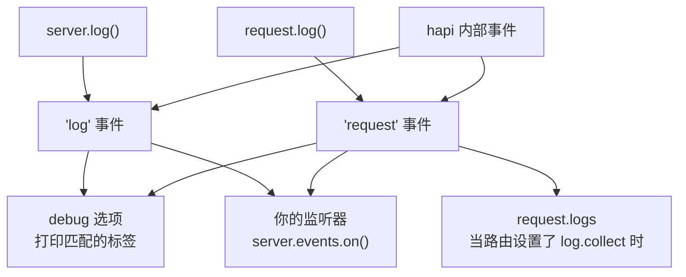

<TutorialLang />

# 日志

_本教程适用于 hapi v21 及更新版本_

## <a name="overview"></a> 概述

除了默认的 [`debug`](#debug) 选项会把你自己代码中的错误打印到控制台之外，hapi 不会把日志写到任何地方。它把每次日志调用转换成 `server.events` 上的一个事件，由你决定如何处理这些事件：打印出来、发送到日志服务，或者按请求收集。



## <a name="methods"></a> 内置方法

日志方法有两个。根据代码运行的位置选择对应的方法：

| 方法                                                              | 适用场景                                      | 触发的事件  |
| ----------------------------------------------------------------- | --------------------------------------------- | ----------- |
| [`request.log(tags, [data])`](/api#request-log-tags-data)         | 有请求可用时：handler、扩展、认证 scheme      | `'request'` |
| [`server.log(tags, [data])`](/api#server-log-tags-data-timestamp) | 没有请求可用时：启动阶段、插件的 `register()` | `'log'`     |

两者接受相同的两个主要参数：

- `tags`：一个字符串或字符串数组，例如 `['error', 'database', 'read']`。hapi 使用标签而不是日志级别，所以你可以按任意组合进行过滤：所有带 `database` 标签的事件，或者只要同时带有 `error` 和 `database` 的事件。
- `data`：可选。可以是一条消息、一个对象或一个 `Error`。如果传入一个函数，hapi 只在有监听器接收该事件时才调用它，因此在没人监听时，开销大的数据不会产生任何成本。

### <a name="request.log"></a> request.log()

```ts
server.route({
    method: 'GET',
    path: '/users/{id}',
    handler: async (request, h) => {
        request.log(['users', 'read'], { id: request.params.id });

        return { id: request.params.id };
    },
});
```

以这种方式记录的每个事件都带有请求的 id，因此你可以把同一个请求的事件归到一起。

### <a name="server.log"></a> server.log()

```ts
import Hapi from '@hapi/hapi';

const server = Hapi.server({ port: 3000 });

await server.start();

server.log(['startup'], `Server running at ${server.info.uri}`);
```

## <a name="display"></a> 获取和显示日志

在 [`server.events`](/api#server-events) 上监听。除了你自己的调用之外，hapi 也会在同样的通道上触发它自己的事件：

| 事件         | `event.channel` | 来源                                           |
| ------------ | --------------- | ---------------------------------------------- |
| `'log'`      | `'app'`         | 你的 `server.log()` 调用                       |
| `'log'`      | `'internal'`    | hapi：因服务器负载而拒绝请求、客户端连接错误   |
| `'request'`  | `'app'`         | 你的 `request.log()` 调用                      |
| `'request'`  | `'internal'`    | hapi：身份认证失败、handler 错误、无效的请求头 |
| `'request'`  | `'error'`       | hapi：每个以 500 结束的请求触发一次            |
| `'response'` | 无              | hapi：每个请求在响应发送之后触发一次           |

内部标签的完整列表见 API 参考中的 [`'log'`](/api#log-event) 和 [`'request'`](/api#request-event) 事件。

典型的配置会打印应用事件、报告 500 错误，并为每个请求写一行访问日志：

```ts
server.events.on('log', (event, tags) => {
    console.log(event.timestamp, event.tags, event.data ?? event.error);
});

server.events.on({ name: 'request', channels: 'app' }, (request, event, tags) => {
    console.log(request.info.id, event.tags, event.data ?? event.error);
});

server.events.on({ name: 'request', channels: 'error' }, (request, event, tags) => {
    console.error(`Request ${request.info.id} failed:`, event.error);
});

server.events.on('response', (request) => {
    const duration = request.info.completed - request.info.received;

    console.log(`${request.method.toUpperCase()} ${request.path} ${request.raw.res.statusCode} ${duration}ms`);
});
```

- `tags` 是一个对象，每个标签对应一个值为 `true` 的键，所以用 `if (tags.error)` 就能快速判断。
- `event.data` 和 `event.error` 不会同时出现：作为 `data` 传入的 `Error` 会以 `event.error` 的形式到达。
- 条件对象 `{ name: 'request', channels: 'error' }` 只订阅一个通道。不使用它，你会收到全部三个通道的事件。

hapi 在响应发送之后触发 `'response'`，并且不会等待监听器返回的 promise。对于需要 hapi 按顺序等待的异步工作，请使用 `onPostResponse` 扩展；参见[生命周期钩子](/tutorials/zh_CN/lifecycle-hooks)。

### <a name="collecting-the-logs-of-one-request"></a> 收集单个请求的日志

如果要在请求内部读取该请求的事件，请在路由上设置 `log.collect`。之后为该请求记录的每个事件都会存入 `request.logs`：

```ts
server.route({
    method: 'GET',
    path: '/',
    options: {
        log: {
            collect: true,
        },
    },
    handler: function (request, h) {
        request.log(['step'], 'loaded user');
        request.log(['step'], 'loaded orders');

        return { steps: request.logs.length };
    },
});
```

不设置 `log.collect` 时，`request.logs` 始终为空。

## <a name="debug"></a> 调试模式（仅用于开发）

服务器选项 [`debug`](/api#server-options-debug) 通过 `console.error()` 把匹配的事件打印到控制台，无需编写监听器代码。它只改变打印的内容，不改变触发的事件。

| 选项            | 默认值               | 打印内容                                                                     |
| --------------- | -------------------- | ---------------------------------------------------------------------------- |
| `debug.request` | `['implementation']` | 带有其中任一标签的 `'request'` 事件。默认值会打印由代码缺陷导致的 500 错误。 |
| `debug.log`     | 无                   | 带有其中任一标签的 `'log'` 事件。                                            |
| `debug: false`  |                      | 什么都不打印                                                                 |

每个列表可以是标签、表示所有事件的 `'*'`，或者表示不打印的 `false`。在开发时打印所有请求错误：

```ts
import Hapi from '@hapi/hapi';

const server = Hapi.server({ debug: { request: ['error'] } });
```

## <a name="plugins"></a> 日志插件

在生产环境中，请使用替你监听这些事件的插件，例如输出结构化 JSON 日志的 [hapi-pino](https://www.npmjs.com/package/hapi-pino)、[New Relic](https://newrelic.com/instant-observability/hapi/2124da5b-0174-457a-be5a-e0068673b2b5)，或其他任何 [hapi 日志插件](/plugins#logging)。
