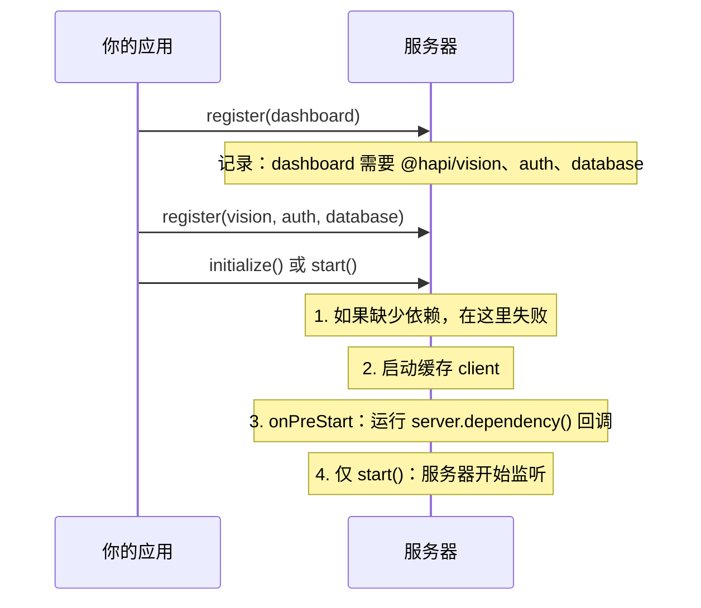

<TutorialLang />

# 插件

_本教程适用于 hapi v21 及更新版本_

## <a name="overview"></a> 概述

插件是 hapi 应用中经过打包、可以注册到服务器上的一部分：一组路由、一个身份认证 scheme、一个日志记录器、一个模板引擎。hapi 生态的大部分内容都以插件的形式发布（[inert](/module/inert)、[vision](/module/vision)、[@hapi/basic](/module/basic)），把你自己的应用拆分成插件，可以让每个部分彼此隔离、便于测试。

插件在其 `register` 函数中接收服务器，并通过常规的服务器 API 修改它。对插件作者来说最重要的几个 API：

| 服务器 API                                                               | 插件添加的内容                                         | 教程                                             |
| ------------------------------------------------------------------------ | ------------------------------------------------------ | ------------------------------------------------ |
| [`server.route()`](/api#server-route-route)                              | 路由                                                   | [路由](/tutorials/zh_CN/routing)                 |
| [`server.ext()`](/api#server-ext-events)                                 | 在每个请求的某个步骤，或在服务器启动和停止时运行的代码 | [生命周期钩子](/tutorials/zh_CN/lifecycle-hooks) |
| [`server.decorate()`](/api#server-decorate-type-property-method-options) | `server`、`request` 或 `h` 上的新方法                  | [装饰器](/tutorials/zh_CN/decorators)            |
| [`server.auth.scheme()`](/api#server-auth-scheme-name-scheme)            | 一个身份认证 scheme                                    | [身份认证](/tutorials/zh_CN/auth)                |
| [`server.method()`](/api#server-method-name-method-options)              | 共享的、可缓存的函数                                   | [服务器方法](/tutorials/zh_CN/server-methods)    |
| [`server.expose()`](/api#server-expose-key-value-options)                | 其他插件从 `server.plugins[name]` 读取的值             |                                                  |

## <a name="create"></a> 创建插件

插件是一个带有 `name` 和异步 `register(server, options)` 函数的对象：

```ts
import type { Plugin } from '@hapi/hapi';

const myPlugin: Plugin<void> = {
    name: 'myPlugin',
    version: '1.0.0',
    register: async function (server, options) {
        server.route({
            method: 'GET',
            path: '/test',
            handler: function (request, h) {
                return 'hello, world';
            },
        });
    },
};
```

注册之后，`GET /test` 会返回 `'hello, world'`。

`Plugin<T>` 接受插件选项的类型。这个插件没有选项，所以是 `Plugin<void>`。为插件标注类型后，TypeScript 会推断出 `register` 中 `server` 和 `options` 的类型，并检查插件是否有 `name` 或 `pkg`。

插件对象的属性：

| 属性           | 含义                                                                            |
| -------------- | ------------------------------------------------------------------------------- |
| `register`     | 必需。负责设置插件。注册过程会等待它完成，如果它抛出错误，注册就会失败。        |
| `name`         | 除非设置了 `pkg`，否则必需。在服务器上必须唯一。已发布的插件使用其 npm 包名。   |
| `version`      | 仅供参考。其他插件可以读取它，[依赖](#dependencies)可以要求某个版本范围。       |
| `pkg`          | 你的 `package.json`，用来提供 `name` 和 `version`，无需手动设置。               |
| `dependencies` | 必须同时注册的插件。参见[依赖](#dependencies)。                                 |
| `requirements` | 支持的 `node` 和 `hapi` 版本范围，例如 `{ hapi: '>=21' }`。超出范围时注册失败。 |
| `multiple`     | 为 `true` 时允许在同一个服务器上多次注册该插件。                                |
| `once`         | 为 `true` 时重复注册会被静默忽略，而不是报错。                                  |

### <a name="module"></a> 将插件发布为模块

插件模块导出插件对象，可以作为默认导出，也可以作为名为 `plugin` 的具名导出。`pkg` 从 `package.json` 中读取名称和版本：

```ts
import Pkg from './package.json' with { type: 'json' };

import type { Plugin } from '@hapi/hapi';

export const plugin: Plugin<void> = {
    pkg: Pkg,
    register: async function (server, options) {
        server.route({
            method: 'GET',
            path: '/test',
            handler: function (request, h) {
                return 'hello, world';
            },
        });
    },
};
```

两种导出形式 hapi 都接受：`server.register()` 接受一个插件对象，或一个 `plugin` 属性为插件对象的模块。

### <a name="register"></a> 插件选项

`options` 就是调用方在注册时传入的内容，原样传递。用 `Plugin<Options>` 为它标注类型：

```ts
import Pkg from './package.json' with { type: 'json' };

import type { Plugin } from '@hapi/hapi';

interface Options {
    name: string;
}

export const plugin: Plugin<Options> = {
    pkg: Pkg,
    register: async function (server, options) {
        server.route({
            method: 'GET',
            path: '/test',
            handler: function (request, h) {
                return `Hello ${options.name}`;
            },
        });
    },
};
```

`options.name` 是 `string` 类型，如果某个 `server.register()` 调用传入的选项与 `Options` 不符，TypeScript 会报错；hapi 在运行时不会检查它们。

## <a name="loading"></a> 加载插件

使用 [`server.register()`](/api#await-server-register-plugins-options) 注册插件。可以传入插件本身，或者一个带有 `plugin` 和 `options` 的对象，或者由两者组成的数组：

```ts
import Hapi from '@hapi/hapi';
import { plugin as MyPlugin } from 'myplugin';
import { plugin as YourPlugin } from 'yourplugin';

const start = async function () {
    const server = Hapi.server();

    await server.register(YourPlugin);

    await server.register({
        plugin: MyPlugin,
        options: {
            name: 'Bob',
        },
    });

    await server.register([{ plugin: YourPlugin }, { plugin: MyPlugin, options: { name: 'Bob' } }]);
};
```

数组中的插件按顺序依次注册。每个 `register` 函数完成后，下一个才会开始。

### <a name="registration"></a> 注册选项

`server.register()` 的第二个参数配置 hapi 如何注册插件。它 _不会_ 传给插件：

| 选项            | 效果                                                             |
| --------------- | ---------------------------------------------------------------- |
| `routes.prefix` | 为插件添加的每个路由加上路径前缀。`/test` 变为 `/plugins/test`。 |
| `routes.vhost`  | 为插件添加的每个路由应用一个虚拟主机。                           |
| `once`          | 为 `true` 时，如果插件已经注册，则跳过它，而不是抛出错误。       |

```ts
import Hapi from '@hapi/hapi';
import { plugin as MyPlugin } from 'myplugin';

const start = async function () {
    const server = Hapi.server();

    await server.register(MyPlugin, {
        routes: {
            prefix: '/plugins',
        },
    });
};
```

前缀可以嵌套：如果一个以 `/api` 为前缀注册的插件又以 `/v1` 为前缀注册了一个子插件，子插件的路由就会以 `/api/v1` 开头。完整列表参见 [`server.register()`](/api#await-server-register-plugins-options)。

## <a name="scope"></a> 插件能影响什么、不能影响什么

每个插件都有自己的 [`server.realm`](/api#server-realm)：一个存放只在插件内部生效的设置的容器。插件做的其他所有事情都会改变整个服务器：

| 改动                                                                                        | 作用范围                         |
| ------------------------------------------------------------------------------------------- | -------------------------------- |
| 注册选项中的路由前缀和 vhost                                                                | 该插件的路由及其子插件           |
| [`server.bind()`](/api#server-bind-context)、[`server.path()`](/api#server-path-relativeto) | 该插件添加的路由、handler 和扩展 |
| 带 `options.sandbox: 'plugin'` 的请求[生命周期钩子](/tutorials/zh_CN/lifecycle-hooks)       | 该插件的路由                     |
| 不带 `sandbox` 的请求生命周期钩子                                                           | **服务器上的每个路由**           |
| [装饰](/tutorials/zh_CN/decorators)、服务器方法、认证 strategy、`server.auth.default()`     | **整个服务器**                   |

一个添加 `onPreResponse` 钩子来格式化自身错误的插件应当传入 `sandbox: 'plugin'`，否则它也会重新格式化其他所有插件的错误。

## <a name="dependencies"></a> 依赖

需要另一个插件的插件应当声明这一依赖，而不是依赖注册顺序：

```ts
import type { Plugin } from '@hapi/hapi';

declare module '@hapi/hapi' {
    interface PluginProperties {
        database: { migrate: () => Promise<void> };
    }
}

export const plugin: Plugin<void> = {
    name: 'dashboard',
    dependencies: ['@hapi/vision', 'auth'],
    register: async function (server, options) {
        server.dependency('database', async (server) => {
            await server.plugins.database.migrate();
        });
    },
};
```

hapi 在服务器初始化时检查依赖，而不是在插件注册时检查，所以插件可以按任意顺序注册：



- `dependencies` 是一个名称列表，或者一个从名称到版本范围的对象，例如 `{ '@hapi/vision': '7.x' }`。
- [`server.dependency(names, after)`](/api#server-dependency-dependencies-after) 在 `register` 内部声明同样的依赖，并接受一个 `after` 函数。hapi 在服务器启动期间、所有列出的插件都注册之后运行 `after`。需要使用其他插件 API 的初始化工作可以放在这里。
- 如果 `after` 依赖出现循环，hapi 会抛出错误。

`server.plugins.database` 是 `database` 插件通过 [`server.expose()`](/api#server-expose-key-value-options) 发布的内容。hapi 无法知道它的结构，所以 `declare module` 代码块把它添加到 hapi 的 `PluginProperties` 接口中。
