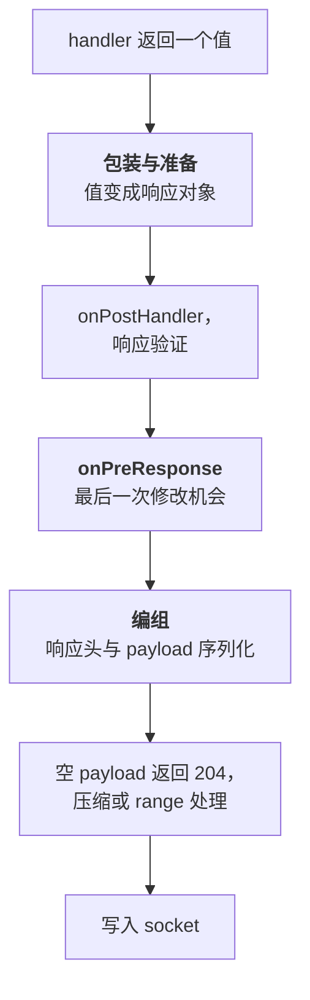

<TutorialLang />

# <a name="response-marshalling"></a> 响应编组

_本教程适用于 hapi v21 及更高版本_

## <a name="overview"></a> 概述

handler 返回一个值：字符串、对象、流或错误。响应编组（response marshalling）指的是 hapi 把这个值变成 HTTP 响应的全部过程：选定状态码、设置响应头、序列化 payload、压缩，最后写入 socket。

了解这个过程，你就知道代码该放在哪里。统一的错误格式、HTML 错误页、缓存响应头、压缩、CSV 这类自定义响应类型、用于监控的字节计数器，每一项都对应编组流程中的一个特定位置。[响应对象](/api#response-object)和[响应工具包](/api#response-toolkit)的 API 文档列出了所有方法。

## <a name="pipeline"></a> 从返回值到字节

编组分为两个阶段，中间是 `onPreResponse` 扩展点：



编组步骤按固定顺序执行，这决定了每项设置能看到哪些响应头：

1. 根据 payload 类型设置 `content-type`
2. CORS 和安全相关的响应头（如果路由启用了它们）
3. 来自 [`h.entity()`](/api#h-entity-options) 的 ETag 和 `last-modified`，然后在 GET 路由上做 304 检查
4. 根据路由的 `cache` 选项设置 `cache-control`
5. 来自 [`h.state()`](/api#h-state-name-value-options) 以及带 `autoValue` 的 cookie 的 `set-cookie`
6. payload 序列化和 `content-length`
7. 身份认证 scheme 的 `response()` 方法，放在最后执行，因此它能读取上面所有的响应头

这种划分在实际中很重要：

- **在 `onPreResponse` 之前**，响应是一个响应对象或一个 [boom](/module/boom) 错误，你可以检查、修改或替换它。包装与准备阶段产生的错误，例如文件不存在，会以 boom 错误的形式到达 `onPreResponse`。
- **在 `onPreResponse` 之后**，hapi 序列化 payload 并计算响应头。这个阶段出现的错误，例如 `JSON.stringify()` 无法处理的对象，会变成 500，而 `onPreResponse` 永远看不到它。让 payload 保持为纯数据，编组就不会失败。

[请求生命周期](/api#request-lifecycle)各步骤的顺序在[生命周期钩子](/tutorials/zh_CN/lifecycle-hooks)教程中介绍。

## <a name="return-values"></a> 返回什么，hapi 发送什么

| handler 返回        | 状态码            | 默认 `content-type`               | 说明                                                                                                                                                               |
| ------------------- | ----------------- | --------------------------------- | ------------------------------------------------------------------------------------------------------------------------------------------------------------------ |
| 字符串              | 200，为空时为 204 | `text/html; charset=utf-8`        | 纯文本请设置 `.type('text/plain')`                                                                                                                                 |
| 对象或数组          | 200               | `application/json; charset=utf-8` | 使用 `JSON.stringify()` 和路由的 [`json` 选项](#json)序列化                                                                                                        |
| `Buffer`            | 200               | `application/octet-stream`        |                                                                                                                                                                    |
| 可读流              | 200               | `application/octet-stream`        | 以分块方式发送。不能是对象模式。如果流带有 `statusCode` 和 `headers`，会被复制到响应上                                                                             |
| `null`              | 204               | 无                                | 将路由的 `response.emptyStatusCode` 设为 `200` 可改为发送 200                                                                                                      |
| `undefined`         | 500               |                                   | handler 必须返回某个值；hapi 会记录 "handler method did not return a value"                                                                                        |
| `Error`             | 500               | `application/json; charset=utf-8` | 错误消息对客户端隐藏                                                                                                                                               |
| boom 错误           | 错误自身的状态码  | `application/json; charset=utf-8` | `{ statusCode, error, message }`；5xx 的消息会被隐藏                                                                                                               |
| `h.response(value)` | 与 `value` 相同   | 与 `value` 相同                   | 可链式调用 `.code()`、`.header()`、`.type()` 及其他[响应对象](/api#response-object)方法                                                                            |
| `h.redirect(uri)`   | 302               | `text/html; charset=utf-8`        | 响应体为空。`.permanent()` 得到 301，`.rewritable(false)` 得到 307，两者同时使用得到 308。307 和 308 要求客户端用同样的方法重发请求，所以重定向后的 POST 仍是 POST |

- `Readable.from(array)` 创建的是对象模式的流，hapi 会以 500 拒绝它。传入 `{ objectMode: false }`，或者返回 `Fs.createReadStream()` 这样的字节流。
- 带有 `statusCode` 和 `headers` 属性的流，例如 [wreck](/module/wreck) 返回的 HTTP 响应，会把自身的状态码和响应头传递下去。因此一个简单的代理只需一行 handler，同时也意味着上游的 404 会变成你的 404。

## <a name="shaping"></a> 用 h.response() 定制响应

默认行为合适时，直接返回普通值。不合适时，用 [`h.response()`](/api#h-response-value) 包装这个值，再链式调用需要的方法：

```ts
import Hapi from '@hapi/hapi';

const server = Hapi.server({ port: 4000 });

server.route<{ Payload: { name: string } }>({
    method: 'POST',
    path: '/users',
    handler: (request, h) => {
        const user = { id: '2133d32a', name: request.payload.name };

        return h.response(user).created(`/users/${user.id}`).header('x-request-id', request.info.id);
    },
});

server.route({
    method: 'GET',
    path: '/robots.txt',
    handler: (request, h) => {
        return h.response('User-agent: *\nDisallow: /admin\n').type('text/plain');
    },
});
```

`.created()` 一次调用就把状态码设为 201 并设置 `location` 响应头。

## <a name="errors"></a> 错误

每个错误最终都会成为一个 boom 对象。hapi 用 `Boom.boomify()` 包装普通的 `Error`，赋予它 500 状态码，而 boom 会对客户端隐藏所有 5xx 错误的消息。用户看到的是 `An internal server error occurred`，hapi 则把真实错误作为 `'request'` 事件在 `'error'` 频道上发出；如何记录它请参阅[日志](/tutorials/zh_CN/logging)。如果希望客户端看到错误消息，就抛出 boom 错误，例如 `Boom.notFound('No such user')`。

boom 错误的响应来自它的 `output` 属性：

```ts
import Boom from '@hapi/boom';

const error = Boom.notFound('No such user');

error.output.statusCode; // 404
error.output.payload; // { statusCode: 404, error: 'Not Found', message: 'No such user' }
error.output.headers; // {}, or headers such as WWW-Authenticate from auth errors
```

### <a name="a-consistent-error-format"></a> 统一的错误格式

API 往往需要使用自己的错误格式，而不是 boom 的格式。在 `onPreResponse` 中进行转换，所有错误都会经过这里，包括未知路由的 404 和插件抛出的错误：

```ts
import Boom from '@hapi/boom';
import Hapi from '@hapi/hapi';

const server = Hapi.server({ port: 4000 });

server.ext('onPreResponse', (request, h) => {
    const { response } = request;
    if (!Boom.isBoom(response)) {
        return h.continue;
    }

    const { statusCode, payload, headers } = response.output;
    const reply = h.response({
        error: {
            status: statusCode,
            code: payload.error,
            message: payload.message,
            requestId: request.info.id,
        },
    });

    reply.code(statusCode);
    for (const [name, value] of Object.entries(headers)) {
        if (value !== undefined) {
            reply.header(name, String(value));
        }
    }

    return reply;
});
```

记得把 `output.headers` 复制到新的响应上。认证错误在这里带有 `WWW-Authenticate`，`Boom.methodNotAllowed()` 可能带有 `Allow`。`payload.message` 已经是可以安全展示的消息：对于 5xx 错误，boom 已经把它替换成了通用文本。

### <a name="html-error-pages"></a> HTML 错误页

渲染 HTML 的网站可以在同一个钩子里返回错误页面；[视图教程](/tutorials/zh_CN/views#errors)展示了如何用 @hapi/vision 实现。如果一个应用同时提供页面和 API，就对 API 路由跳过错误页，例如用 `request.path.startsWith('/api/')` 判断，这样 API 客户端仍然收到 JSON。

## <a name="custom"></a> 自定义响应类型

发送文件和模板的插件并不返回字符串。[@hapi/inert](/module/inert) 和 [@hapi/vision](/module/vision) 用 [`request.generateResponse()`](/api#request-generateresponse-source-options) 创建响应，它接收一个源值和可选的处理函数。`prepare` 和 `marshal` 分别在流程的两个阶段运行，`close` 在响应结束时运行，无论响应是被发送还是被替换：

| 插件   | `variety` | `prepare` 在 `onPreResponse` 之前运行                                    | `marshal` 在 `onPreResponse` 之后运行                            |
| ------ | --------- | ------------------------------------------------------------------------ | ---------------------------------------------------------------- |
| inert  | `'file'`  | 打开文件；设置 `content-length`、`content-type`、`last-modified` 和 ETag | 返回读取流，或预压缩文件（`.gz`，或 `lookupMap` 中的其他扩展名） |
| vision | `'view'`  | 加载并编译模板                                                           | 用上下文渲染模板；设置 `content-type`                            |

这种划分是有意为之。文件不存在时会在 `prepare` 阶段失败，因此它会以 404 的形式到达 `onPreResponse`，由你的错误处理器来格式化。读取文件或渲染模板这些开销较大的工作在 `marshal` 中进行，此时 `onPreResponse` 已经有机会替换响应。inert 还传入了 `close`，即使 `onPreResponse` 钩子替换了响应，它也会关闭文件；打开了某种资源的自定义响应同样需要这样一个函数。

你可以用同样的机制实现自己的格式。下面是一个 CSV 响应：

```ts
import Hapi from '@hapi/hapi';

import type { Request } from '@hapi/hapi';

const field = (value: string) => (/[",\n]/.test(value) ? `"${value.replaceAll('"', '""')}"` : value);

const csv = (request: Request, rows: string[][]) => {
    return request
        .generateResponse(rows, {
            variety: 'csv',
            marshal: async () => rows.map((row) => row.map(field).join(',')).join('\n'),
        })
        .type('text/csv');
};

const server = Hapi.server({ port: 4000 });

server.route({
    method: 'GET',
    path: '/users.csv',
    handler: (request, h) => {
        return csv(request, [
            ['id', 'name'],
            ['2133d32a', 'John Doe'],
        ]);
    },
});
```

`field()` 会给包含逗号、引号或换行符的值加上引号，这样它们就不会把一行拆开。如果想在任意 handler 中以 `h.csv(rows)` 的方式调用，可以用装饰器把它添加到响应工具包上；请参阅[装饰器](/tutorials/zh_CN/decorators)教程。

## <a name="json"></a> JSON 序列化

对象使用 `JSON.stringify()` 序列化。路由的 [`json` 选项](/api#route-options-json)控制序列化方式：

```ts
import Hapi from '@hapi/hapi';

const server = Hapi.server({
    port: 4000,
    routes: {
        json: {
            space: process.env.NODE_ENV === 'production' ? 0 : 2,
        },
    },
});

server.route({
    method: 'GET',
    path: '/widget-config',
    options: {
        json: { escape: true },
    },
    handler: (request, h) => {
        return { title: '</script><script>alert(1)</script>' };
    },
});
```

- `space` 用于缩进输出。可读的 JSON 在开发时有用，但在生产环境中会多占字节。
- `escape: true` 把 `<`、`>` 和 `&` 写成 `\u003c`、`\u003e` 和 `\u0026`，同时转义 U+2028 和 U+2029 行分隔符。凡是 JSON 会被嵌入 HTML 页面的路由都应启用它，这样包含 `</script>` 的值就无法闭合外层的 script 标签。
- `replacer` 会传给 `JSON.stringify()`，`suffix` 会追加到输出末尾。单个响应可以用 `.spaces()`、`.replacer()` 和 `.suffix()` 覆盖它们。

不要依赖 `replacer` 去移除密码哈希这类敏感数据。应当只用你打算发送的字段来构建响应对象，并用[响应验证](#validation)来发现错误。

## <a name="caching"></a> 缓存与条件请求

路由的 [`cache` 选项](/api#route-options-cache)在编组期间设置 `cache-control`：

```ts
server.route({
    method: 'GET',
    path: '/articles/{id}',
    options: {
        cache: { expiresIn: 60 * 1000, privacy: 'public' },
    },
    handler: (request, h) => {
        const article = { id: request.params.id, version: 7, body: '...' };

        const notModified = h.entity({ etag: `${article.id}-${article.version}` });
        if (notModified) {
            return notModified;
        }

        return article;
    },
});
```

- `cache` 生成 `cache-control: max-age=60, must-revalidate, public`。当请求已认证时，hapi 会自动把它改为 `private`。用 `h.state()` 设置 cookie 不会改变它，而 yar 和 @hapi/cookie 这类会话插件正是这样设置 cookie 的，所以在设置 cookie 的路由上，要么使用 `privacy: 'private'`，要么完全不设置 `cache`。否则共享缓存可能存下某个用户的 cookie，再把它交给另一个用户。
- [`h.entity()`](/api#h-entity-options) 会把 ETag 与请求的 `If-None-Match` 请求头进行比较。两者匹配时，它返回一个 304 响应，handler 也就不必构建响应体。不匹配时，它设置 `etag` 响应头并且不返回任何值。

ETag 应基于某个计算成本低、且内容一变它就变的值，例如版本号或更新时间戳。对整个响应体做哈希可以节省带宽，但省不掉构建响应体的工作。

## <a name="compression"></a> 压缩

满足以下所有条件时，hapi 会用 gzip 或 deflate 压缩响应：

- 客户端发送了匹配的 `Accept-Encoding` 请求头，
- 内容类型可压缩（文本、JSON、JavaScript、SVG 等；图片和压缩包不算），
- payload 至少为 [`compression.minBytes`](/api#server-options-compression-minbytes)（默认 1024 字节），或者大小未知，例如流。

hapi 还会添加 `vary: accept-encoding`，让缓存把压缩和未压缩的副本分开存放。要支持 Brotli，请用 [`server.encoder()`](/api#server-encoder-encoding-encoder) 注册一个编码器：

```ts
import Zlib from 'node:zlib';

import Hapi from '@hapi/hapi';

const server = Hapi.server({ port: 4000 });

server.encoder('br', (options) => Zlib.createBrotliCompress(options));
```

此后只要客户端接受 `br`，hapi 就会优先使用它。路由的 [`compression` 选项](/api#route-options-compression)可以向编码器传递设置，例如用 `compression: { br: { params: { [Zlib.constants.BROTLI_PARAM_QUALITY]: 4 } } }` 以压缩率换取速度。如果 payload 已经压缩过，例如从磁盘读取的 `.gz` 文件，就用 `.compressed('gzip')` 标记它，hapi 会设置相应的响应头，不再改动这些字节。

## <a name="validation"></a> 响应验证

[响应验证](/api#route-options-response)会在 `onPreResponse` 之前用 schema 检查 payload。它能发现返回了错误结构的 handler，包括那些本不该离开服务器的字段：

```ts
import Hapi from '@hapi/hapi';
import Joi from 'joi';

const server = Hapi.server({ port: 4000 });

const User = Joi.object({
    id: Joi.string().required(),
    name: Joi.string().required(),
});

server.route({
    method: 'GET',
    path: '/users/{id}',
    options: {
        response: {
            schema: User,
            sample: process.env.NODE_ENV === 'production' ? 10 : 100,
            failAction: process.env.NODE_ENV === 'production' ? 'log' : 'error',
        },
    },
    handler: (request, h) => {
        return { id: request.params.id, name: 'John Doe' };
    },
});
```

- 使用默认的 `failAction: 'error'` 时，未通过 schema 的 payload 会变成 500。在开发和测试中使用它，让错误尽早暴露。
- `failAction: 'log'` 会照常发送原始 payload，并以 `validation`、`response` 和 `error` 标签记录这次失败。在生产环境中，这能避免 schema 写错导致服务中断，但 payload 仍然会发出去，包括 schema 拒绝的字段。
- `sample` 只验证一定百分比的响应，用来限制繁忙路由上的开销。

如果想移除未知字段而不是拒绝它们，请设置 `modify: true` 和 `options: { stripUnknown: true }`，并去掉 `sample`。使用 `modify` 时，验证成为响应逻辑的一部分，所以 hapi 会验证每一个响应，不接受 `sample`。

## <a name="measuring"></a> 测量响应

响应对象在写出过程中会发出[事件](/api#response-events)：每个数据块触发 `'peek'`，结束时触发 `'finish'`。插件可以利用它们记录响应大小：

```ts
import Boom from '@hapi/boom';
import Hapi from '@hapi/hapi';

const server = Hapi.server({ port: 4000 });

server.ext('onPreResponse', (request, h) => {
    const { response } = request;
    if (Boom.isBoom(response)) {
        return h.continue;
    }

    let bytes = 0;
    response.events.on('peek', (chunk) => {
        bytes += Buffer.byteLength(chunk);
    });
    response.events.once('finish', () => {
        request.log(['metrics'], { path: request.path, bytes });
    });

    return h.continue;
});
```

`'peek'` 看到的是压缩前的 payload，所以 `bytes` 是未压缩的大小。这里跳过了错误响应：boom 错误会在编组期间、也就是这个钩子运行之后，才变成新的响应对象。如果要统计整个请求的耗时，请使用 `onPostResponse` 扩展或服务器的 `'response'` 事件，详见[生命周期钩子](/tutorials/zh_CN/lifecycle-hooks)和[日志](/tutorials/zh_CN/logging)。
