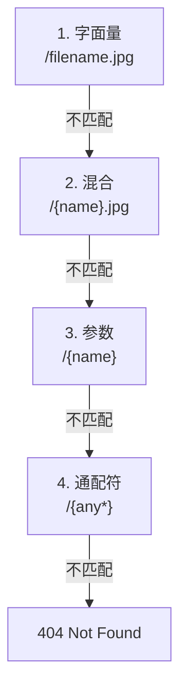

<TutorialLang />

# <a name="routing"></a> 路由

_本教程适用于 hapi v21 及更高版本_

## <a name="overview"></a> 概述

一个路由需要三样东西：`method`、`path` 和 `handler`。用 [`server.route()`](/api#server-route-route) 添加路由：

```ts
server.route({
    method: 'GET',
    path: '/',
    handler: (request, h) => {
        return 'Hello World!';
    },
});
```

`server.route()` 也接受路由对象数组，因此你可以一次注册多个路由。

## <a name="methods"></a> 方法

`method` 可以是除 `HEAD` 以外的任何 HTTP 方法（GET 路由会响应 HEAD 请求），也可以是方法数组，或者用 `'*'` 表示所有方法：

```ts
server.route({
    method: ['PUT', 'POST'],
    path: '/',
    handler: (request, h) => {
        return 'I did something!';
    },
});
```

`GET` 路由同样会响应 `HEAD` 请求，所以你永远不需要单独定义 `HEAD` 路由。

## <a name="path"></a> 路径

把路径中的某一段用 `{}` 包起来，就能把它捕获为命名参数。它的值可以在 `request.params` 中取得：

```ts
import * as Hoek from '@hapi/hoek';

server.route<{ Params: { user: string } }>({
    method: 'GET',
    path: '/hello/{user}',
    handler: (request, h) => {
        return `Hello ${Hoek.escapeHtml(request.params.user)}!`;
    },
});
```

请求 `/hello/ferris` 会返回 `Hello ferris!`。

- hapi 会对参数值做 URI 解码，所以 `/hello/a%20b` 得到 `request.params.user === 'a b'`。
- 这个值直接来自 URL。把它放进 HTML 之前要先转义，就像上面调用 [Hoek](/module/hoek) 的 `escapeHtml()` 那样，或者用 [joi](/tutorials/zh_CN/validation) 验证它。
- 从 hapi 21.4.10 开始，`request.params` 的值默认类型为 `unknown`。类型参数 `server.route<{ Params: { user: string } }>()` 声明了它的结构，因此在 handler 中 `request.params.user` 是 `string`。同一个类型参数还接受 `Query`、`Payload`、`Headers` 以及下文介绍的其他请求部分。

### <a name="optionalParameters"></a> 参数类型

| 路径                | 匹配                                 | `request.params`                    |
| ------------------- | ------------------------------------ | ----------------------------------- |
| `/hello/{user}`     | `/hello/ferris`                      | `{ user: 'ferris' }`                |
| `/hello/{user?}`    | `/hello`、`/hello/ferris`            | `{}` 或 `{ user: 'ferris' }`        |
| `/hello/{user*2}`   | `/hello/john/doe`（恰好两段）        | `{ user: 'john/doe' }`              |
| `/files/{path*}`    | `/files`、`/files/a`、`/files/a/b/c` | `{}` 或 `{ path: 'a/b/c' }`         |
| `/{filename}.{ext}` | `/photo.jpg`                         | `{ filename: 'photo', ext: 'jpg' }` |

添加路由时 hapi 会强制执行以下规则：

- `{user*}` 和占据整段的可选参数 `{user?}` 必须是路径的最后一段。`{user*2}` 以及只占部分段的可选参数（例如 `/a{user?}/b`）可以出现在任意位置。
- 同一段中的两个参数之间需要有字面分隔符：`{filename}.{ext}` 有效，`{filename}{ext}` 无效。
- 一个参数名在同一路径中只能出现一次。
- 方法相同且路径等价的两个路由会冲突，`server.route()` 会抛出错误。`/{name}` 和 `/{other}` 是等价的。

### <a name="multiParameters"></a> 多段参数

多段参数保存的是用 `/` 连接起来的匹配段，所以要拆分它才能得到各个部分：

```ts
server.route<{ Params: { user: string } }>({
    method: 'GET',
    path: '/hello/{user*2}',
    handler: (request, h) => {
        const [first, last] = request.params.user.split('/');

        return `Hello ${first} ${last}!`;
    },
});
```

请求 `/hello/john/doe` 会返回 `Hello john doe!`。

### <a name="specificity"></a> 哪个路由胜出

hapi 并不按照你添加路由的顺序逐个尝试。对路径的每一段，它按从最具体到最不具体的顺序尝试各种匹配方式，当路径的剩余部分匹配不上时，再退回到下一种方式：



注册了这四个路由后：

| 请求            | 响应的路由      |
| --------------- | --------------- |
| `/filename.jpg` | `/filename.jpg` |
| `/photo.jpg`    | `/{name}.jpg`   |
| `/photo`        | `/{name}`       |
| `/a/b`          | `/{any*}`       |

路径默认区分大小写：在上面的路由下，`/Filename.jpg` 由 `/{name}.jpg` 响应。在服务器上把 [`router.isCaseSensitive`](/api#server-options-router) 设为 `false` 可以改变这一点。

## <a name="query"></a> 查询参数

`request.query` 保存解析后的查询字符串。对于 `/?name=ferris&location=chicago`：

```ts
server.route<{ Query: { name: string } }>({
    method: 'GET',
    path: '/',
    handler: (request, h) => {
        return `Hello ${request.query.name}!`;
    },
});
```

hapi 内置的解析器不认识嵌套键：`/?foo[bar]=baz` 得到的是 `{ 'foo[bar]': 'baz' }`。要解析嵌套键，请把服务器的 `query.parser` 设为 [qs](https://github.com/ljharb/qs) 这样的解析器：

```ts
import Hapi from '@hapi/hapi';
import Qs from 'qs';

const server = Hapi.server({
    port: 3000,
    host: 'localhost',
    query: {
        parser: (query) => Qs.parse(query),
    },
});

server.route({
    method: 'GET',
    path: '/',
    handler: (request, h) => {
        return request.query;
    },
});

await server.start();
console.log('Server running on %s', server.info.uri);
```

现在 `/?foo[bar]=baz` 返回 `{ "foo": { "bar": "baz" } }`。解析器接收的是 hapi 已经解析过的查询对象，例如 `{ 'foo[bar]': 'baz' }`，而不是原始字符串。任何函数都可以，只要它返回一个参数名到值的对象。

## <a name="requestpayload"></a> 请求 payload

解析后的 payload 位于 `request.payload`。hapi 会根据 `Content-Type` 请求头解析 JSON、表单编码和文本格式的 payload。multipart payload需要路由选项 `payload: { multipart: true }`；没有它会得到 `415 Unsupported Media Type`：

```ts
server.route<{ Payload: { username: string; password: string } }>({
    method: 'POST',
    path: '/signup',
    handler: (request, h) => {
        return `Welcome ${request.payload.username}!`;
    },
});
```

类型参数只是告诉 TypeScript 数据的结构。在你添加 [payload 验证](/tutorials/zh_CN/validation)之前，运行时不会做任何检查。

## <a name="handler"></a> Handler

handler 接收两个参数：

- `request` 包含传入请求的全部信息：`params`、`query`、`payload`、`headers`、`auth` 等。请参阅 [请求对象](/api#request)。
- `h` 是[响应工具包](/api#response-toolkit)，提供 `h.response()` 和 `h.redirect()` 等方法。

handler 的返回值就是响应：

| handler 返回                     | 响应                                                     |
| -------------------------------- | -------------------------------------------------------- |
| 字符串                           | `200`，`text/html; charset=utf-8`                        |
| 对象或数组                       | `200`，`application/json; charset=utf-8`                 |
| `Buffer`                         | `200`，`application/octet-stream`                        |
| 可读流                           | `200`，流会通过管道传给客户端                            |
| 带链式调用的 `h.response(value)` | 完全控制，例如 `h.response('created').code(201)`         |
| 抛出的错误                       | 错误响应，除非是 [boom](/module/boom) 错误，否则为 `500` |

handler 必须返回一个值、一个 promise，或者抛出错误。[响应编组](/tutorials/zh_CN/response-marshalling)介绍了 hapi 如何把这些值变成实际发送的字节。

箭头函数不能使用 `this`，所以以箭头函数编写的 handler 要从 [`h.context`](/api#h-context) 读取 [`server.bind()`](/api#server-bind-context) 设置的值。

## <a name="options"></a> 选项

method、path 和 handler 之外的一切都放在路由的 `options` 中：

```ts
import Joi from 'joi';

server.route<{ Payload: { username: string; password: string } }>({
    method: 'POST',
    path: '/signup',
    options: {
        auth: false,
        validate: {
            payload: Joi.object({
                username: Joi.string().min(1).max(20).required(),
                password: Joi.string().min(7).required(),
            }),
        },
    },
    handler: (request, h) => {
        return `Welcome ${request.payload.username}!`;
    },
});
```

| 选项       | 控制内容                                  | 了解更多                                         |
| ---------- | ----------------------------------------- | ------------------------------------------------ |
| `auth`     | 应用哪个身份认证 strategy                 | [身份认证](/tutorials/zh_CN/auth)                |
| `validate` | 对 params、query、payload、headers 的检查 | [验证](/tutorials/zh_CN/validation)              |
| `cache`    | 响应的 `Cache-Control` 响应头             | [缓存](/tutorials/zh_CN/caching)                 |
| `payload`  | payload 解析、大小限制、文件上传          | [路由 payload 选项](/api#route-options-payload)  |
| `pre`      | 在 handler 之前运行的方法                 | [路由 pre 选项](/api#route-options-pre)          |
| `ext`      | 仅作用于该路由的生命周期钩子              | [生命周期钩子](/tutorials/zh_CN/lifecycle-hooks) |

完整列表见[路由选项参考](/api#route-options)。

## <a name="missing"></a> 404 处理

没有路由匹配时，hapi 返回一个 `404` JSON 错误。如果想发送自己的响应，可以添加一个兜底路由。`{any*}` 通配符是最不具体的匹配，所以它只响应其他路由都不接的请求：

```ts
server.route({
    method: '*',
    path: '/{any*}',
    handler: (request, h) => {
        return h.response('404 Error! Page Not Found!').code(404);
    },
});
```

兜底路由只覆盖未匹配的路径。已匹配的路由抛出的 `404`，例如 handler 抛出 `Boom.notFound()`，永远不会到达它。如果要自定义所有 `404`，不论它由谁产生，请在 `onPreResponse` 钩子中修改响应；请参阅[生命周期钩子](/tutorials/zh_CN/lifecycle-hooks)。
