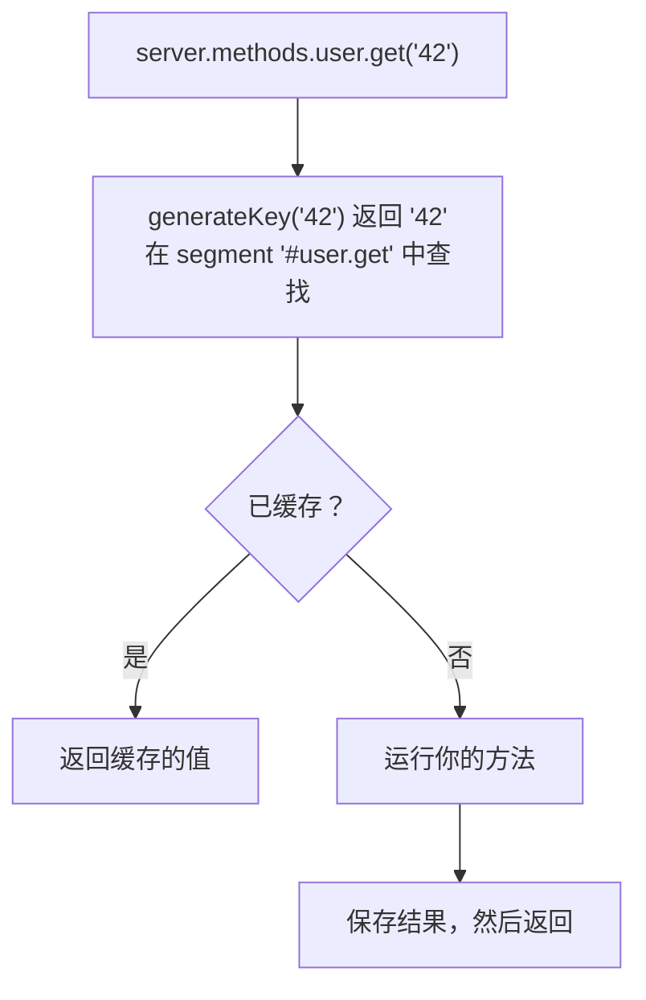

<TutorialLang />

# <a name="server-methods"></a> 服务器方法

_本教程适用于 hapi v21 及更高版本_

## <a name="overview"></a> 概述

服务器方法是用 [`server.method()`](/api#server-method-name-method-options) 注册到服务器上的函数，凡是能拿到服务器的地方都可以调用它：路由 handler、插件、扩展。以下情况适合使用服务器方法：

- 多个路由或插件需要同一个函数，而你不想让每个地方都去导入它。
- 函数开销较大，其结果可以缓存。只需一个选项就能为它启用 hapi 的[缓存](/tutorials/zh_CN/caching)。

```ts
import Hapi from '@hapi/hapi';

declare module '@hapi/hapi' {
    interface ServerMethods {
        add: (x: number, y: number) => number;
    }
}

const server = Hapi.server({ port: 3000 });

server.method('add', (x: number, y: number) => x + y);

server.route({
    method: 'GET',
    path: '/',
    handler: (request, h) => {
        return { sum: request.server.methods.add(1, 2) };
    },
});

await server.start();
```

- `server.methods.add` 就是注册的函数。在 handler 中，通过 `request.server.methods` 就能访问它，无需在作用域内持有 `server` 变量。
- hapi 不知道你注册了哪些方法，所以 TypeScript 需要在 hapi 的 `ServerMethods` 接口中声明它们。`declare module` 代码块可以放在项目的任意模块中。
- 方法对整个服务器是全局的：在某个插件中注册的方法，其他所有插件和路由都能使用。

## <a name="server.method"></a> server.method()

`server.method()` 既可以接收位置参数，也可以接收一个对象（或对象数组，用于一次注册多个方法）：

```ts
server.method('add', add, {});

server.method({
    name: 'add',
    method: add,
    options: {},
});
```

### <a name="name"></a> 名称

名称中带点号会注册一个嵌套方法：

```ts
server.method('math.add', add);

server.methods.math.add(1, 2);
```

在 `ServerMethods` 中把它声明为嵌套对象：`math: { add: (x: number, y: number) => number }`。名称的每一段都必须是合法的 JavaScript 标识符。

### <a name="method"></a> 方法

方法可以接收任意参数，也可以是 `async` 函数。返回结果，或者抛出错误。

```ts
server.method('user.get', async (id: string) => {
    return await db.users.findById(id);
});
```

## <a name="options"></a> 选项

| 选项                  | 用途                                             |
| --------------------- | ------------------------------------------------ |
| [`cache`](#cache)     | 缓存方法的结果                                   |
| [`generateKey`](#key) | 当参数不是字符串、数字或布尔值时，用它构建缓存键 |
| [`bind`](#bind)       | 设置方法内部的 `this`                            |

### <a name="cache"></a> 缓存

设置了 `cache` 选项后，调用方法时会先经过缓存：



```ts
server.method('user.get', getUser, {
    cache: {
        expiresIn: 60 * 1000,
        staleIn: 30 * 1000,
        staleTimeout: 100,
        generateTimeout: 2000,
    },
});
```

需要了解的几点：

- `generateTimeout` 是必填项。它是调用方等待你的方法的时长，超时后会得到 `503`。
- 带缓存的方法总是返回 promise，即使方法本身是同步的。在 `ServerMethods` 中把它的返回类型声明为 `Promise`，并用 `await` 调用。
- hapi 把缓存项存放在名为 `'#'` 加方法名的 segment 中。设置 `cache: 'my_cache'` 可以改用[具名缓存客户端](/tutorials/zh_CN/caching#client)，而不是默认的内存缓存。
- 其他选项（`expiresAt`、`staleIn`、`staleTimeout`、`segment`）与 [`server.cache()`](/api#server-cache-options) 相同。[缓存教程](/tutorials/zh_CN/caching#stale)介绍了过期值是如何提供的。

#### <a name="changing-the-ttl-per-result"></a> 按结果修改 TTL

hapi 会在你的参数之后多传一个参数：`flags` 对象。设置 `flags.ttl` 可以修改这一个结果的缓存时长，设为 `0` 则完全不缓存：

```ts
const getUser = async function (id: string, flags: { ttl: number }) {
    const user = await db.users.findById(id);
    if (!user) {
        flags.ttl = 0; // don't cache "not found"
    }

    return user;
};
```

hapi 没有导出 `flags` 的类型，所以示例中直接内联声明了类型。

#### <a name="removing-a-cached-result"></a> 移除缓存的结果

每个带缓存的方法都有一个 `cache.drop()` 函数。用相同的参数调用它即可移除对应的结果，例如在更新数据之后：

```ts
await db.users.update(id, changes);
await server.methods.user.get.cache?.drop(id);
```

hapi 把 `cache` 定义为可选属性，因为不带缓存的方法没有它，所以这里要用 `?.`。

### <a name="key"></a> 生成自定义键

hapi 通过用 `:` 连接各个参数来构建缓存键，这只对字符串、数字和布尔值有效。用其他类型的参数调用带缓存的方法会以 `500` 错误失败。对于其他参数，请提供 `generateKey`：

```ts
const sum = function (numbers: number[]) {
    return numbers.reduce((total, item) => total + item, 0);
};

server.method('sum', sum, {
    cache: {
        expiresIn: 60 * 1000,
        generateTimeout: 100,
    },
    generateKey: (numbers: number[]) => numbers.join(','),
});
```

`generateKey` 接收与方法相同的参数，并且必须返回字符串。

### <a name="bind"></a> 绑定

`bind` 设置方法内部的 `this`。用它可以把数据库客户端之类的依赖交给方法，而不必把它加到参数里（放在参数里它还会成为缓存键的一部分）：

```ts
const lookup = async function (this: typeof db, id: string) {
    return await this.users.findById(id);
};

server.method('lookup', lookup, { bind: db });
```

- TypeScript 的 `this` 参数声明了 `this` 的类型。它在编译时会被擦除，不属于方法的参数。
- `bind` 对箭头函数无效，箭头函数保留自己的 `this`。
- 不设置 `bind` 时，`this` 是当前插件或服务器中用 [`server.bind()`](/api#server-bind-context) 设置的上下文。

## <a name="server.methods"></a> server.methods

所有已注册的方法都在 [`server.methods`](/api#server-methods) 上，在 handler 中也可以通过 `request.server.methods` 访问：

```ts
server.route<{ Params: { id: string } }>({
    method: 'GET',
    path: '/users/{id}',
    handler: async (request, h) => {
        return await request.server.methods.user.get(request.params.id);
    },
});
```

本教程中用到的每个方法都需要在 `ServerMethods` 中有对应条目。带缓存的方法要用 hapi 的 `CachedServerMethod` 类型包装，它会加上 `cache.drop()` 和 `cache.stats`：

```ts
import type { CachedServerMethod } from '@hapi/hapi';

declare module '@hapi/hapi' {
    interface ServerMethods {
        add: (x: number, y: number) => number;
        math: {
            add: (x: number, y: number) => number;
        };
        lookup: (id: string) => Promise<User | null>;
        sum: CachedServerMethod<(numbers: number[]) => Promise<number>>;
        user: {
            get: CachedServerMethod<(id: string) => Promise<User | null>>;
        };
    }
}
```
