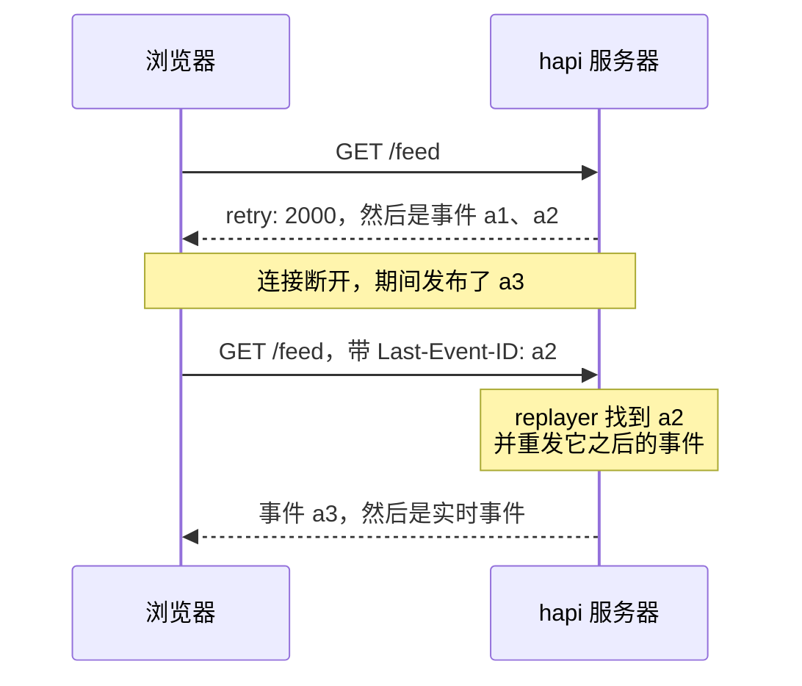
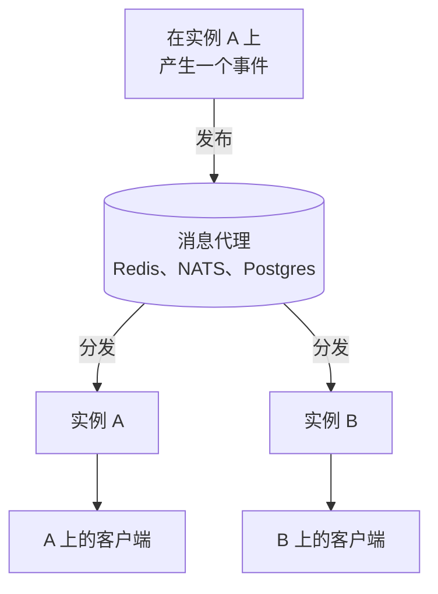

<TutorialLang />

# 服务器发送事件

_本教程适用于 hapi v21 及更高版本_

## <a name="overview"></a> 概述

服务器发送事件（Server-Sent Events，SSE）让服务器通过一个普通的 HTTP 响应向客户端推送事件流。浏览器用内置的 `EventSource` API 打开它，连接断开时它也会自动重连。[@hapi/sse](/module/sse) 为 hapi 提供 SSE 支持。

## <a name="when"></a> 何时使用 SSE

|              | SSE                                        | [WebSocket](/tutorials/zh_CN/websockets)             | 轮询                   |
| ------------ | ------------------------------------------ | ---------------------------------------------------- | ---------------------- |
| 方向         | 只能从服务器到客户端                       | 双向                                                 | 客户端询问，服务器应答 |
| 传输方式     | 普通的 HTTP 响应                           | 协议升级                                             | 普通的 HTTP 请求       |
| 重连         | `EventSource` 内置，从最后一个事件 id 续传 | nes 客户端会重连并重新订阅；离线期间发送的消息会丢失 | 不需要                 |
| 能否穿过代理 | 可以，需关闭缓冲                           | 代理必须支持协议升级                                 | 可以                   |
| 延迟         | 即时                                       | 即时                                                 | 最长为一个轮询间隔     |

当服务器有新消息、而客户端只负责接收时，选择 SSE：任务进度、通知、实时仪表盘、日志尾随，以及 AI 模型逐 token 的输出。如果客户端也需要持续发送消息，请使用 WebSocket。客户端只是偶尔发送数据时，可以用 SSE 接收事件流，其余操作用普通的 `POST` 请求完成。

## <a name="setup"></a> 安装与配置

```sh
npm install @hapi/sse
```

```ts
import Hapi from '@hapi/hapi';
import { SsePlugin } from '@hapi/sse';

const server = Hapi.server({ port: 3000 });

await server.register(SsePlugin);
```

插件提供两种打开事件流的方式：

| 用途               | handler 模式：`handler: { sse: { stream } }` | 订阅：`server.sse.subscription()`     |
| ------------------ | -------------------------------------------- | ------------------------------------- |
| 由谁产生事件       | 你的 `stream` 函数，只服务于这一个连接       | 任何代码，通过 `server.sse.publish()` |
| 典型的事件流       | 单个任务的进度、一次 AI 响应、日志尾随       | 通知、实时信息流、聊天室              |
| 每个连接收到的事件 | 每个客户端各不相同                           | 同一个事件发给所有订阅者              |
| 重连后的续传       | 你读取 `session.lastEventId` 并接着发送      | 由 replayer 重发客户端错过的事件      |

## <a name="handler"></a> handler 模式：每个请求一条事件流

使用 `sse` handler 的路由会为每个连接运行一次你的 `stream` 函数。你 `push()` 的每一项都会即时送达客户端：

```ts
server.route({
    method: 'GET',
    path: '/jobs/{id}/progress',
    handler: {
        sse: {
            stream: async (request, session) => {
                for await (const update of watchJob(String(request.params.id))) {
                    session.push(update, 'progress', String(update.percent));
                }

                await session.complete();
            },
        },
    },
});
```

每次 `push(data, event, id)` 都会在线路上产生一个事件。对象以 JSON 发送：

```text
event: progress
id: 50
data: {"percent":50}
```

`complete()` 发送最后一个 `complete` 事件并结束响应。仅仅结束响应并不能让浏览器停下来，因为 `EventSource` 把每一次连接关闭都当作意外断开并重新连接。客户端必须在收到 `complete` 时自己关闭连接：

```ts
const source = new EventSource('/jobs/7/progress');

source.addEventListener('progress', (event) => {
    const { percent } = JSON.parse(event.data);
    console.log(`${percent}%`);
});

source.addEventListener('complete', () => source.close());
```

如果没有 `close()`，浏览器会在 `retry` 延迟之后重新连接，事件流又从头开始。

除非用 `--experimental-eventsource` 启动，否则 Node.js 没有全局的 `EventSource`。在 Node 中，请使用这个参数或 [`eventsource`](https://www.npmjs.com/package/eventsource) 包；客户端代码与浏览器中完全相同。

## <a name="subscriptions"></a> 订阅：一个事件发给多个客户端

订阅是一条路由，客户端连接到它，你的代码向它发布事件。路径可以带参数，这样每个用户或每个房间都有自己的事件流：

```ts
import Joi from 'joi';

server.sse.subscription('/rooms/{room}/messages');

server.route<{ Params: { room: string }; Payload: { text: string } }>({
    method: 'POST',
    path: '/rooms/{room}/messages',
    options: {
        validate: {
            params: Joi.object({ room: Joi.string().alphanum().max(50).required() }),
            payload: Joi.object({ text: Joi.string().max(2000).required() }),
        },
    },
    handler: async (request, h) => {
        const message = { text: request.payload.text, at: new Date().toISOString() };
        const delivered = await server.sse.publish(`/rooms/${request.params.room}/messages`, message, {
            event: 'message',
            matchMode: 'literal',
        });

        return { delivered };
    },
});
```

- `matchMode: 'literal'` 只把事件发给连接到这个确切路径的客户端，所以发到 `/rooms/lobby/messages` 的消息只会到达 lobby，不会到达其他房间。参见 [`server.sse.publish()`](/module/sse#server-sse-publish-path-data-opts)。
- 这条路由只发布它[验证](/tutorials/zh_CN/validation)过的字段，从不发布原始 payload。像任何写入数据的路由一样，为它配置相同的[路由身份认证](/tutorials/zh_CN/auth)。
- `publish()` 返回事件送达的客户端数量。

订阅还支持 `filter`、`onSubscribe`、`refuse` 和 `maxSessions`；参见 [`server.sse.subscription()`](/module/sse#server-sse-subscription-path-config)。

## <a name="reconnect"></a> 重连与 `Last-Event-ID`

连接断开后，浏览器会等待服务器发来的 `retry` 时间，然后重新连接，并在 `Last-Event-ID` 请求头中带上它收到的最后一个事件的 id：



浏览器会发送这个请求头，但只有你的服务器能据此行动，两种模式的做法不同：

- **订阅：** 为订阅配置一个 replayer，它把最近的事件保存在内存中，并重发客户端最后一个 id 之后的所有事件。一个 replayer 为整个订阅只保存一份历史，由所有路径和所有客户端共享，因此只在不带路径参数的订阅上使用它，例如公开的 `/feed`。对于按用户或按房间划分的事件流，请像 handler 模式那样从数据库续传。

    ```ts
    import { FiniteReplayer } from '@hapi/sse';

    server.sse.subscription('/feed', {
        replay: new FiniteReplayer({ size: 100 }),
    });

    await server.sse.publish('/feed', item, { event: 'news', id: item.id });
    ```

- **handler 模式：** 在 `stream` 中读取 `session.lastEventId` 并从那里继续，例如在数据库中查询比该 id 更新的记录。

如果客户端的最后一个 id 已经不在缓冲区中，例如服务器重启之后，replayer 会重发它保存的全部事件，所以要给事件设置客户端可以用来去重的 id。[事件重放](/module/sse#event-replay)说明了每种 replayer 保存哪些内容。重放缓冲区位于单个进程的内存中；参见[扩展到多个实例](#scaling)。

## <a name="disconnect"></a> 事件流结束时的清理

事件流会一直保持打开，直到某一方关闭它，所以为某个连接启动的任何工作都必须在事件流结束时停止，无论是客户端离开、事件流完成，还是服务器正在关闭：

```ts
import type { Session } from '@hapi/sse';

const openStreams = new Map<Session, () => void>();

server.route({
    method: 'GET',
    path: '/jobs/{id}/progress',
    handler: {
        sse: {
            stream: async (request, session) => {
                const watcher = watchJob(String(request.params.id));
                openStreams.set(session, () => watcher.stop());
                request.events.once('disconnect', () => watcher.stop());

                try {
                    for await (const update of watcher) {
                        session.push(update, 'progress', String(update.percent));
                    }

                    if (session.isOpen) {
                        await session.complete();
                    }
                } finally {
                    watcher.stop();
                    openStreams.delete(session);
                }
            },
        },
    },
});

server.ext('onPreStop', () => {
    for (const [session, stop] of openStreams) {
        stop();
        session.close();
    }
});
```

- **客户端离开：** `request.events` 触发 `'disconnect'`，它会停止 watcher 并结束循环。
- **事件流在服务器端结束：** `finally` 块会运行，因此 `Map` 中永远不会留下已结束的事件流。
- **服务器关闭：** `onPreStop` [服务器钩子](/tutorials/zh_CN/lifecycle-hooks#server-hooks)停止所有 watcher 并关闭所有事件流，这样 `server.stop()` 不必等到 `timeout` 用完就能结束。
- **订阅：** 使用订阅的 `onUnsubscribe`，或者插件的 `onSessionClose` 钩子来处理所有订阅事件流。插件会自行把客户端从订阅中移除。

## <a name="proxies"></a> 代理、缓冲与空闲超时

生产环境中的大多数 SSE 问题，都来自服务器和浏览器之间的某个环节扣住了事件，或者关闭了一个安静的连接。插件会处理其中一部分：

| 问题                                      | 插件的做法                                                | 你要做的                                                       |
| ----------------------------------------- | --------------------------------------------------------- | -------------------------------------------------------------- |
| 代理缓冲响应，事件成批到达                | 发送 `X-Accel-Buffering: no` 和 `Cache-Control: no-cache` | 在不遵守这些响应头的代理中关闭响应缓冲                         |
| 压缩会扣住事件，直到积累了足够的字节      | 每次写入后刷新 gzip 和 deflate                            | 无需操作；即使经过压缩，事件也会逐个到达                       |
| 负载均衡器或代理关闭空闲过久的连接        | 每 15 秒发送一行 `:` 注释                                 | 让 `keepAlive.interval` 小于链路上最短的空闲超时               |
| 浏览器对每个域名只允许 6 个 HTTP/1.1 连接 | 无                                                        | 通过 HTTP/2 提供站点（通常在代理上配置），让事件流共享一个连接 |

## <a name="auth"></a> 身份认证

SSE 事件流就是普通的 hapi 路由，所以常规的[路由身份认证](/tutorials/zh_CN/auth)同样适用，包括 scope。对于订阅，通过 `auth` 选项传入：

```ts
server.sse.subscription('/users/{userId}/notifications', {
    auth: { strategy: 'session', access: { scope: 'user-{params.userId}' } },
});

await server.sse.publish(`/users/${userId}/notifications`, notification, {
    event: 'notification',
    matchMode: 'literal',
});
```

使用 `user-{params.userId}` 这个 scope，用户只能打开自己的通知事件流；其他人会收到 `403`。参见 [Scopes](/tutorials/zh_CN/auth#scopes)。发布时使用 `matchMode: 'literal'`，让每条通知只到达对应用户的事件流。

`EventSource` 无法设置请求头，所以不能在 `Authorization` 中携带 bearer token。可选的方案：

| 方式                             | 优点                             | 注意事项                                                                                 |
| -------------------------------- | -------------------------------- | ---------------------------------------------------------------------------------------- |
| cookie 会话，例如 `@hapi/cookie` | 浏览器会自动发送，重连时也会发送 | 跨域事件流需要 `new EventSource(url, { withCredentials: true })` 以及允许携带凭证的 CORS |
| 把 token 放在查询字符串中        | 适用于任何客户端                 | URL 会出现在服务器和代理的访问日志中；请使用专为这条事件流签发的短期 token               |
| 使用流式响应体的 `fetch()`       | 可以发送任意请求头               | 失去 `EventSource` 的重连和 `Last-Event-ID` 处理，必须自己实现                           |

对于部署在你自己域名下的浏览器应用，cookie 是最简单的选择。

## <a name="scaling"></a> 扩展到多个实例

两个服务器实例之间不共享内存。SSE 事件流是由某一个进程持有的打开的连接：连接到实例 A 的客户端只存在于 A 上，实例 B 无法向它写入。在 A 上发布的事件只会到达 A 的客户端。这一点对每个 SSE 库和每个托管服务商都成立：每个进程只能写入它自己持有的连接。

已连接的客户端、重放缓冲区，以及默认情况下已完成事件流的记录，都保存在这块进程内存中。横向扩展需要在实例之间传递消息。Redis、NATS 或 Postgres `LISTEN`/`NOTIFY` 这类发布/订阅后端会把每个事件分发给所有实例，再由每个实例写入它自己打开的事件流：



使用 Redis：

```ts
import { createClient } from 'redis';

interface RoomMessage {
    room: string;
    text: string;
    at: string;
}

const publisher = createClient({ url: process.env.REDIS_URL });
const subscriber = publisher.duplicate();
publisher.on('error', (err) => server.log(['redis', 'error'], err));
subscriber.on('error', (err) => server.log(['redis', 'error'], err));
await Promise.all([publisher.connect(), subscriber.connect()]);

await subscriber.subscribe('rooms', async (raw) => {
    const message: RoomMessage = JSON.parse(raw);
    await server.sse.publish(`/rooms/${message.room}/messages`, message, { event: 'message', matchMode: 'literal' });
});

const publishToRoom = async (message: RoomMessage) => {
    await publisher.publish('rooms', JSON.stringify(message));
};
```

`POST` 路由改为调用 `publishToRoom()` 而不是 `server.sse.publish()`，每个实例（包括处理该请求的那个实例）都会向自己的事件流发布。

- 有了消息代理之后，每个实例都会发布每一个事件，因此每个实例的 replayer 都保存着相同的历史，重连的客户端可以在任何实例上续传。只有实例启动之前的事件会缺失，而[重连](#reconnect)一节中可去重的 id 已经覆盖了这种情况。
- 把插件的 `completion.cache` 选项指向一个共享缓存，例如 catbox-redis，这样每个实例都能识别已完成的订阅事件流。
- `maxDuration` 会在设定的时间后（带随机抖动）关闭每条事件流，然后客户端重新连接。这样在你增加实例之后，长期存在的事件流会重新分散开，而不是一直留在旧实例上。

## <a name="next"></a> 后续步骤

- [@hapi/sse API 参考](/module/sse)：所有选项、`Session`、replayer、针对慢客户端的[背压](/module/sse#backpressure)，以及[内置的安全防护](/module/sse#security)。
- 当客户端也需要发送消息时，参见 [WebSocket](/tutorials/zh_CN/websockets)。
- [生命周期钩子](/tutorials/zh_CN/lifecycle-hooks)：`onPreStop` 及其他服务器钩子。
