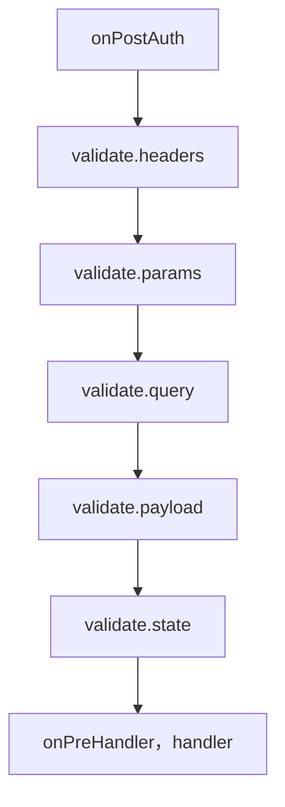

<TutorialLang />

# <a name="validation"></a> 验证

_本教程适用于 hapi v21 及更高版本，以及 joi v16 及更高版本_

## <a name="overview"></a> 概述

hapi 会在你的 handler 运行之前检查请求头、路径参数、查询参数、payload 和 cookie，也可以在响应发送之前检查它。你描述哪些内容是允许的，通常用一个 [joi](https://joi.dev) schema，其余的一律由 hapi 拒绝。

## <a name="joi"></a> Joi

安装并导入 joi：

```sh
npm install joi
```

```ts
import Joi from 'joi';
```

joi 自带 TypeScript 类型，所以无需另外安装 `@types` 包。

## <a name="input"></a> 输入验证

输入规则写在路由的 `options.validate` 中。hapi 在身份认证之后、handler 之前按以下顺序执行它们，并在第一个失败的规则处停止（参见 [failAction](#failaction)）：



| 键        | 验证对象                  | 验证成功后替换    |
| --------- | ------------------------- | ----------------- |
| `headers` | `request.headers`         | `request.headers` |
| `params`  | `request.params`          | `request.params`  |
| `query`   | `request.query`           | `request.query`   |
| `payload` | `request.payload`         | `request.payload` |
| `state`   | `request.state`（cookie） | `request.state`   |

每个键可以接受：

| 值                           | 含义                                                                            |
| ---------------------------- | ------------------------------------------------------------------------------- |
| `true` 或不设置（默认）      | 允许任何值                                                                      |
| `false`                      | 不允许任何值                                                                    |
| joi schema                   | 值必须符合该 schema                                                             |
| 函数                         | 你自己的验证器，参见[自定义验证器](#alternatives)                               |
| 由 joi schema 组成的普通对象 | 只有在调用 `server.validator(Joi)` 之后才允许；否则 `server.route()` 会抛出错误 |

验证会用验证后的值替换请求中的值，因此 joi 的类型转换和默认值会传到你的 handler 中。查询 `?limit=5` 到达时是字符串 `'5'`，经过 `Joi.number()` 之后，handler 看到的是数字 `5`。原始值保留在 [`request.orig`](/api#request-orig) 上。

### <a name="pathparams"></a> 路径参数

```ts
server.route<{ Params: { name: string } }>({
    method: 'GET',
    path: '/hello/{name}',
    handler: (request, h) => {
        return `Hello ${request.params.name}!`;
    },
    options: {
        validate: {
            params: Joi.object({
                name: Joi.string().min(3).max(10),
            }),
        },
    },
});
```

`/hello/jennifer` 返回 `Hello jennifer!`。`/hello/a` 和 `/hello/thisnameiswaytoolong` 返回：

```json
{
    "statusCode": 400,
    "error": "Bad Request",
    "message": "Invalid request params input"
}
```

### <a name="queryparams"></a> 查询参数

```ts
server.route<{ Query: { limit: number } }>({
    method: 'GET',
    path: '/posts',
    handler: (request, h) => {
        return posts.slice(0, request.query.limit);
    },
    options: {
        validate: {
            query: Joi.object({
                limit: Joi.number().integer().min(1).max(100).default(10),
            }),
        },
    },
});
```

- `limit` 必须是 1 到 100 之间的整数，客户端不传时默认为 10。
- `/posts?limit=15&offset=15` 会以 `400` 失败：`Joi.object()` schema 会拒绝它没有列出的键。要么列出你接受的每个参数，要么给 schema 加上 `.unknown()` 让其他键通过。
- 类型参数 `Query: { limit: number }` 告诉 TypeScript handler 收到的是什么。hapi 不会从 joi schema 推断类型，所以你需要自己保持两者一致。

### <a name="payloadparams"></a> Payload

```ts
server.route({
    method: 'POST',
    path: '/post',
    handler: (request, h) => {
        return 'Blog post added';
    },
    options: {
        validate: {
            payload: Joi.object({
                post: Joi.string().min(1).max(140),
                date: Joi.date().required(),
            }),
        },
    },
});
```

`post` 必须是 1 到 140 个字符，`date` 是必填项，并且必须是 JavaScript 能解析为日期的值，例如 `'2026-10-25'`。joi 会对它做转换，所以 handler 收到的是一个 `Date` 对象。验证失败时返回 `400`，消息为 `Invalid request payload input`。

### <a name="headers"></a> 请求头

```ts
server.route({
    method: 'GET',
    path: '/hello/{name}',
    handler: (request, h) => {
        return `Hello ${request.params.name}!`;
    },
    options: {
        validate: {
            headers: Joi.object({
                cookie: Joi.string().required(),
            }),
            options: {
                allowUnknown: true,
            },
        },
    },
});
```

浏览器和代理会添加很多请求头，所以 请求头 schema 几乎总是需要 `allowUnknown: true`。`validate.options` 会把 joi 选项传给该路由上的所有输入 schema。`request.headers` 中的请求头名称都是小写的，所以在 schema 中也要用小写书写。

### <a name="failaction"></a> 验证失败时

由 `validate.failAction` 决定会发生什么：

| `failAction`      | 结果                                                                             |
| ----------------- | -------------------------------------------------------------------------------- |
| `'error'`（默认） | 返回 `400` 和通用消息，例如 `Invalid request query input`                        |
| `'log'`           | 记录一个带有 `validation`、`error` 和来源标签的 `request` 事件，然后运行 handler |
| `'ignore'`        | 直接运行 handler                                                                 |
| 函数              | `(request, h, err)`：抛出错误，或者返回一个接管响应（takeover response）         |

使用 `'log'` 和 `'ignore'` 时，handler 收到的是原始的、未经验证的值：`?limit=500` 到达时是字符串 `'500'`，而不是数字。

默认的 `400` 不会透露是哪个字段失败了，这样客户端就无法探测你的 schema。在开发阶段，或者客户端需要详细信息的 API 上，可以在 `failAction` 函数中重新抛出详细的错误：

```ts
server.route({
    method: 'GET',
    path: '/posts',
    handler: (request, h) => posts,
    options: {
        validate: {
            query: Joi.object({
                limit: Joi.number().integer().max(100),
            }),
            failAction: (request, h, err) => {
                throw err;
            },
        },
    },
});
```

现在 `/posts?limit=500` 会返回 joi 的消息以及失败的键：

```json
{
    "statusCode": 400,
    "error": "Bad Request",
    "message": "\"limit\" must be less than or equal to 100",
    "validation": { "source": "query", "keys": ["limit"] }
}
```

要把同一个 `failAction` 应用到所有路由，请在服务器的 `routes.validate` 选项中设置它。参见 API 参考中的 [`failAction`](/api#failaction-configuration)。

## <a name="output"></a> 响应验证

`options.response` 会在 handler 之后、`onPreResponse` 之前检查 handler 的返回值。用它来确保接口符合文档中约定的契约。[hapi-swagger](https://github.com/glennjones/hapi-swagger) 这类插件也会读取这些 schema，为每个接口的输出生成文档。

```ts
const bookSchema = Joi.object({
    title: Joi.string().required(),
    author: Joi.string().required(),
    isbn: Joi.string().length(10),
    pageCount: Joi.number(),
    datePublished: Joi.date().iso(),
});

server.route({
    method: 'GET',
    path: '/books',
    handler: async (request, h) => {
        return await getBooks();
    },
    options: {
        response: {
            schema: Joi.array().items(bookSchema),
            failAction: 'log',
        },
    },
});
```

| 选项         | 作用                                                                                                 |
| ------------ | ---------------------------------------------------------------------------------------------------- |
| `schema`     | 适用于所有响应的规则，取值与输入规则相同                                                             |
| `status`     | 按状态码设置的规则，例如 `{ 201: created, 202: Joi.object({ original, updated }) }`；会覆盖 `schema` |
| `failAction` | `'error'`（默认）返回 `500`；也可以是 `'log'`、`'ignore'` 或函数                                     |
| `sample`     | 要验证的响应百分比，`0` 到 `100`，用于在繁忙路由上节省 CPU                                           |
| `modify`     | 为 `true` 时，验证后的值会替换响应，因此 joi 的转换和 `stripUnknown` 会生效                          |
| `options`    | 这些 schema 使用的 joi 选项，例如 `stripUnknown`                                                     |

响应验证会跳过或拒绝的情况：

- 错误响应（状态码 `400` 及以上）不会被验证，除非 `status` 中为该状态码设置了 schema。
- 只有普通值（对象、数组、字符串）可以被验证。为流或文件响应设置响应 schema 会以 `500` 失败。

`modify: true` 搭配 `stripUnknown: true`，是防止密码哈希这类字段从接口泄露出去的实用办法：

```ts
server.route({
    method: 'GET',
    path: '/me',
    handler: (request, h) => {
        return { id: '2133d32a', name: 'John Doe', passwordHash: '$2a$10$...' };
    },
    options: {
        response: {
            schema: Joi.object({
                id: Joi.string(),
                name: Joi.string(),
            }).options({ stripUnknown: true }),
            modify: true,
        },
    },
});
```

客户端收到的是 `{ "id": "2133d32a", "name": "John Doe" }`。

## <a name="alternatives"></a> 自定义验证器

任何规则都可以是一个函数 `async (value, options)`，而不是 joi schema：

- 抛出错误表示验证失败，由 `failAction` 处理。
- 返回一个值，用它替换被验证的值。原始值保留在 `request.orig` 上。
- 什么都不返回，则保持原值不变。

```ts
server.route({
    method: 'GET',
    path: '/items',
    handler: (request, h) => request.query,
    options: {
        validate: {
            query: async (value) => {
                if (typeof value !== 'object' || value === null || !('ids' in value) || typeof value.ids !== 'string') {
                    throw new Error('ids is required');
                }

                return { ids: value.ids.split(',') };
            },
        },
    },
});
```

`/items?ids=1,2,3` 返回 `{ "ids": ["1", "2", "3"] }`。抛出的错误会变成 `400`，与 joi 验证失败时一样。
