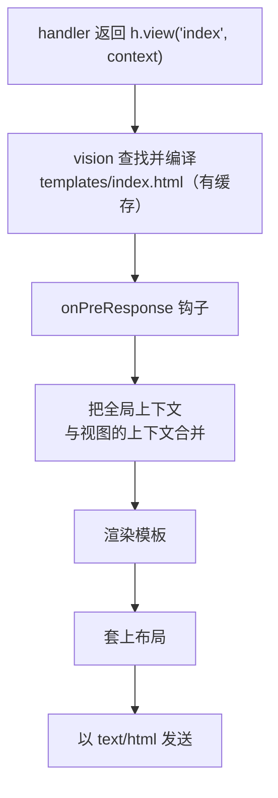

<TutorialLang />

# <a name="views"></a> 视图

_本教程适用于 hapi v21 及更高版本_

## <a name="overview"></a> 概述

hapi 通过 [vision](/module/vision) 插件渲染 HTML 模板。vision 支持任何带有 `compile` 函数的模板引擎，包括 handlebars、pug 和 ejs（`compile` 签名不同的引擎，例如 nunjucks，需要用[引擎](#engines)一节介绍的小包装器），并支持 partial、helper 和布局。

## <a name="vision"></a> Vision

安装 vision 和一个模板引擎：

```sh
npm install @hapi/vision handlebars
```

注册 vision 后会多出：

| 内容                                  | 用途                             |
| ------------------------------------- | -------------------------------- |
| `server.views(options)`               | 配置引擎、模板文件夹和布局       |
| `h.view(template, context)`           | 在 handler 中渲染模板            |
| `view` handler                        | 只渲染模板的路由                 |
| `server.render()`、`request.render()` | 把模板渲染成字符串，例如用于邮件 |

导入 `@hapi/vision` 也会把这些内容加入 hapi 的 TypeScript 类型。完整 API 见 [vision API 参考](/module/vision)。

## <a name="server"></a> 配置服务器

```ts
import Hapi from '@hapi/hapi';
import Vision from '@hapi/vision';
import Handlebars from 'handlebars';

const server = Hapi.server({ port: 3000 });

await server.register(Vision);

server.views({
    engines: {
        html: Handlebars,
    },
    relativeTo: import.meta.dirname,
    path: 'templates',
});

server.route({
    method: 'GET',
    path: '/',
    handler: (request, h) => {
        return h.view('index', { title: 'My home page' });
    },
});

await server.start();
```

- `engines` 把文件扩展名映射到引擎：以 `.html` 结尾的文件用 handlebars 渲染。
- `path` 是存放模板的文件夹，从 `relativeTo` 开始解析。ES 模块中没有 `__dirname`；`import.meta.dirname` 就是当前文件所在的文件夹。
- `h.view('index', ...)` 渲染 `templates/index.html`。只注册了一个引擎时，可以省略扩展名。

### <a name="lifecycle"></a> 视图是如何渲染的

`h.view()` 不会立即渲染任何内容。它返回一个视图响应，由 vision 在 hapi 发送响应时进行渲染：



这个顺序在实际中意味着：

- 模板不存在时，handler 一返回就会以 `500` 失败，早于任何 `onPreResponse` 钩子。
- `onPreResponse` 钩子在渲染之前运行，所以它仍然可以把视图替换成其他响应，例如错误页。参见下文的[错误页](#errors)。
- [响应编组](/tutorials/zh_CN/response-marshalling)介绍了所有响应类型都遵循的这种先准备、后渲染的划分。

## <a name="options"></a> server.views() 选项

| 选项                  | 默认值         | 作用                                                              |
| --------------------- | -------------- | ----------------------------------------------------------------- |
| `engines`             | 必填           | 扩展名到引擎的映射，例如 `{ html: Handlebars, pug: Pug }`         |
| `path`                | 无             | 存放模板的文件夹（或文件夹数组）                                  |
| `relativeTo`          | 工作目录       | 其他所有路径选项的基准文件夹                                      |
| `partialsPath`        | 无             | 存放 partial 的文件夹                                             |
| `helpersPath`         | 无             | 存放 helper 模块的文件夹                                          |
| `layout`              | `false`        | `true` 表示使用 `layout.html`，也可以是其他布局文件的名称         |
| `layoutPath`          | 无             | 存放布局的文件夹                                                  |
| `context`             | 无             | 合并到每个视图中的上下文；可以是对象，也可以是接收 request 的函数 |
| `isCached`            | `true`         | `false` 表示每个请求都重新读取并编译模板；在开发时很方便          |
| `defaultExtension`    | 唯一的那个引擎 | `h.view()` 收到不带扩展名的名称时使用的扩展名                     |
| `compileMode`         | `'sync'`       | 对于 `compile` 接收回调的引擎，使用 `'async'`                     |
| `allowAbsolutePaths`  | `false`        | 允许使用绝对路径的模板名                                          |
| `allowInsecureAccess` | `false`        | 允许模板名中出现 `../`                                            |

在 `server.views()` 上设置的选项会应用到所有引擎：

```ts
server.views({
    engines: { html: Handlebars },
    relativeTo: import.meta.dirname,
    path: 'templates',
    isCached: process.env.NODE_ENV === 'production',
});
```

这里模板从 `templates/` 加载，在非生产环境中 vision 每个请求都会重新读取并编译模板，因此修改模板后无需重启就能看到效果。

### <a name="engines"></a> 引擎

引擎是任何带有 `compile` 函数的对象：

| `compileMode`    | `compile` 签名                                | 返回                                                                                                   |
| ---------------- | --------------------------------------------- | ------------------------------------------------------------------------------------------------------ |
| `'sync'`（默认） | `compile(template, compileOptions)`           | `render(context, runtimeOptions)`，它返回 HTML                                                         |
| `'async'`        | `compile(template, compileOptions, callback)` | 调用 `callback(err, render)`；`render(context, runtimeOptions, callback)` 会调用 `callback(err, html)` |

`compileOptions` 和 `runtimeOptions` 是透传给引擎的 `server.views()` 选项。API 不匹配的引擎可以包装成一个带有这种 `compile` 函数的对象。

注册了多个引擎时，`h.view()` 需要带上扩展名（`h.view('index.pug')`），除非你把 `defaultExtension` 设为最常用的那个。

### <a name="paths"></a> 路径

对于这样的文件夹结构：

```
templates/
    index.html
    layout/
        layout.html
    helpers/
        fortune.js
```

配置如下：

```ts
server.views({
    engines: {
        html: Handlebars,
    },
    relativeTo: import.meta.dirname,
    path: 'templates',
    layoutPath: 'templates/layout',
    helpersPath: 'templates/helpers',
});
```

### <a name="global"></a> 全局上下文

`context` 会合并到每个视图的上下文中，两者设置了同一个键时，以视图自己的上下文为准。传入函数可以按请求计算上下文，例如在每个页面上显示已登录的用户：

```ts
server.views({
    engines: {
        html: Handlebars,
    },
    relativeTo: import.meta.dirname,
    path: 'templates',
    context: (request) => ({
        siteName: 'My personal site',
        user: request?.auth.credentials?.user ?? null,
    }),
});
```

在请求之外用 `server.render()` 渲染时，`request` 为 undefined，所以函数中要先检查它。

### <a name="helpers"></a> 视图 helper

对于支持 helper 的引擎，例如 handlebars，`helpersPath` 中的每个模块都会成为一个以文件名命名的 helper。下面这个 helper 保存为 `templates/helpers/fortune.js`，它会随机返回一句签语：

```js
export default function () {
    const fortunes = [
        'Heisenberg may have slept here...',
        'Wanna buy a duck?',
        'Say no, then negotiate.',
        'Time and tide wait for no man.',
        'To teach is to learn.',
        'Never ask the barber if you need a haircut.',
        'You will forget that you ever knew me.',
        'You will be run over by a beer truck.',
        'Fortune favors the lucky.',
        'Have a nice day!',
    ];

    const x = Math.floor(Math.random() * fortunes.length);
    return fortunes[x];
}
```

helper 仍然是 JavaScript 文件：vision 用 `require()` 加载它们，并且会跳过扩展名没有在 Node.js 的 `require.extensions` 中注册的文件，而其中不包括 `.ts`。

在 `templates/index.html` 中使用它：

```html
<h1>Your fortune</h1>
<p>{{fortune}}</p>
```

### <a name="layouts"></a> 布局

vision 的布局功能默认关闭，因为很多引擎有自己的布局系统。两者选其一即可。要开启 vision 的布局：

```ts
server.views({
    engines: {
        html: Handlebars,
    },
    relativeTo: import.meta.dirname,
    path: 'templates',
    layout: true,
    layoutPath: 'templates/layout',
});
```

`templates/layout/layout.html` 用 `content` 标出每个视图插入的位置：

```html
<html>
    <body>
        {{{content}}}
    </body>
</html>
```

而视图只包含它自己的那部分：

```html
<div>Content</div>
```

| 目的                     | 做法                                                      |
| ------------------------ | --------------------------------------------------------- |
| 使用另一个默认布局       | 在 `server.views()` 中设置 `layout: 'another_default'`    |
| 为某个视图使用另一个布局 | `h.view('myview', context, { layout: 'another_layout' })` |
| 渲染某个视图时不使用布局 | `h.view('myview', context, { layout: false })`            |

开启布局时，你的上下文中不能有 `content` 键；vision 用这个名字存放渲染后的视图，冲突时会以 `500` 失败。可以用 `layoutKeyword` 选项修改这个名字。

## <a name="render"></a> 渲染视图

### <a name="hview"></a> h.view()

当 handler 需要先做一些工作，例如加载数据时，使用 [`h.view()`](/module/vision#h-view-template-context-options)：

```ts
server.route({
    method: 'GET',
    path: '/',
    handler: (request, h) => {
        return h.view('index', { title: 'My home page' });
    },
});
```

`h.view()` 返回一个普通的响应对象，所以你可以链式调用 `.code()`、`.header()` 以及其他[响应对象](/api#response-object)方法。

### <a name="viewhandler"></a> View handler

当路由只渲染模板时，使用 `view` handler：

```ts
server.route({
    method: 'GET',
    path: '/',
    handler: {
        view: {
            template: 'index',
            context: {
                title: 'My home page',
            },
        },
    },
});
```

`handler: { view: 'index' }` 是简写形式。view handler 总是会把 `params`、`payload`、`query` 和 `pre` 加入上下文，所以 `/users/{id}` 上的模板无需任何 handler 代码就能输出 `params.id`。

## <a name="errors"></a> 错误页

hapi 用 JSON 响应错误。渲染 HTML 的网站通常希望改用 HTML 错误页。由于渲染发生在 `onPreResponse` 之后，在这里注册的钩子可以把任何错误换成一个视图：

```ts
import Boom from '@hapi/boom';

server.ext('onPreResponse', (request, h) => {
    const response = request.response;
    if (!Boom.isBoom(response)) {
        return h.continue;
    }

    const { statusCode, payload } = response.output;

    return h.view('error', { statusCode, message: payload.message }).code(statusCode);
});
```

现在请求一个不存在的页面会得到 `templates/error.html`，它在布局中渲染，状态码为 `404`。这个钩子也会捕获 handler 抛出的错误以及验证失败。关于 `onPreResponse` 的更多内容，请参阅[生命周期钩子](/tutorials/zh_CN/lifecycle-hooks)。
