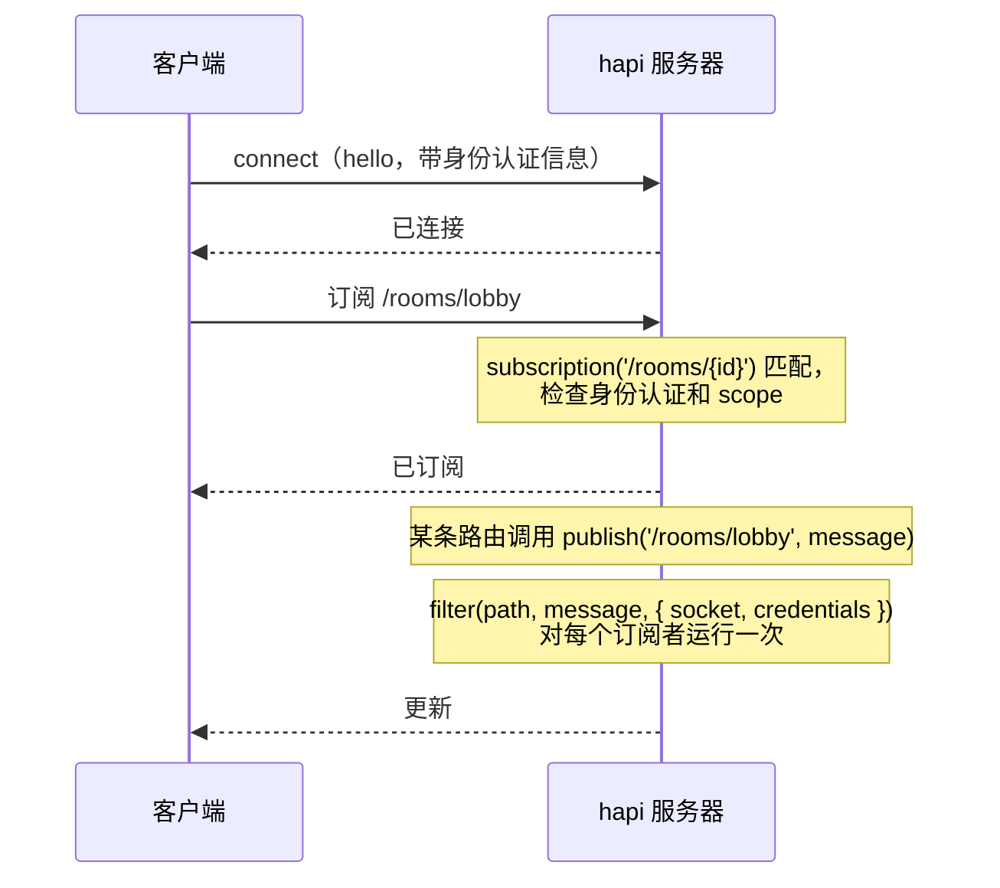
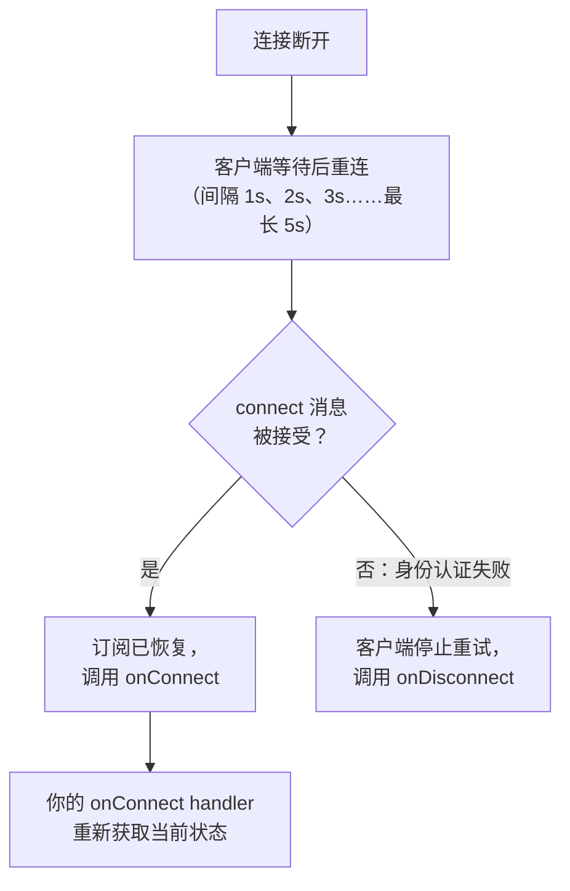
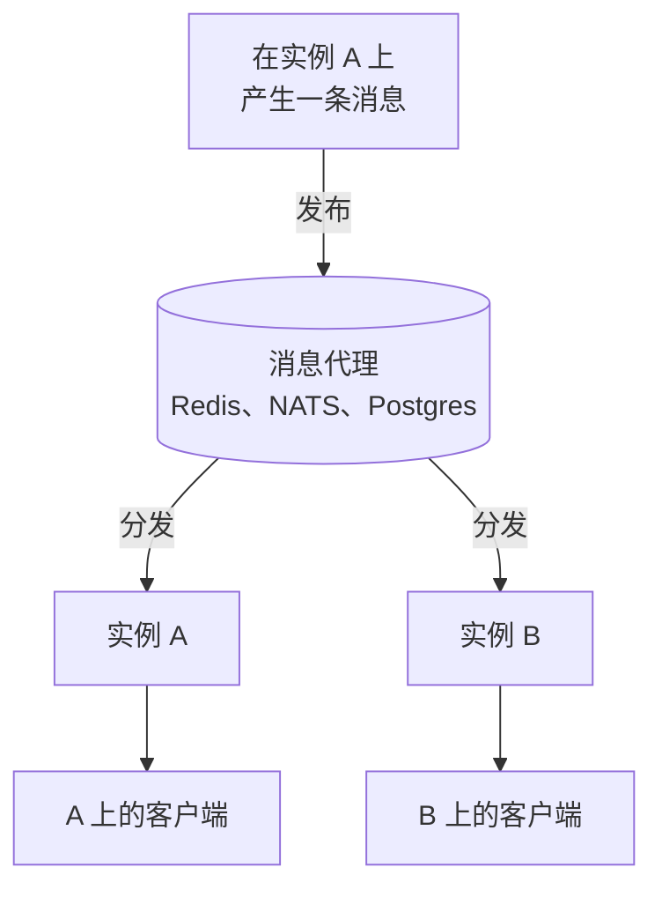

<TutorialLang />

# WebSocket

_本教程适用于 hapi v21 及更高版本_

## <a name="overview"></a> 概述

[@hapi/nes](/module/nes) 为 hapi 服务器添加一个 WebSocket 端点。已连接的客户端可以通过这一个 socket 做三件事：

- **调用你的路由。** `client.request()` 运行一条普通的 hapi 路由，包括它的验证、身份认证 scope 和 handler，并通过 socket 返回响应。
- **订阅更新。** 客户端订阅 `/rooms/lobby` 这样的路径，服务器向该路径发布消息。
- **接收推送。** 服务器向单个 socket 发送消息，或者向所有 socket 广播。

## <a name="when"></a> 何时使用 WebSocket

| 方式                                   | 方向                   | 适用场景                                                   |
| -------------------------------------- | ---------------------- | ---------------------------------------------------------- |
| 轮询普通路由                           | 客户端询问，服务器应答 | 每隔几分钟更新一次，或者实时性没有额外价值的场景           |
| [服务器发送事件](/tutorials/zh_CN/sse) | 只能从服务器到客户端   | 实时信息流、进度、通知；使用普通 HTTP，能穿过大多数代理    |
| 使用 nes 的 WebSocket                  | 双向，一个连接         | 聊天、协作、游戏：客户端频繁发送消息，并期待服务器推送回来 |

如果客户端只负责接收，SSE 运维起来更简单。当客户端也会频繁发送消息，或者你希望请求和更新共用一个连接（这在移动网络上很重要）时，选择 WebSocket。

## <a name="setup"></a> 安装与配置

```sh
npm install @hapi/nes
```

一个聊天室服务器：消息通过一条路由发布，房间的每个订阅者都会收到，另一条路由返回最近的历史消息。

```ts
import Hapi from '@hapi/hapi';
import Joi from 'joi';
import Nes from '@hapi/nes';

interface ChatMessage {
    room: string;
    text: string;
    at: string;
}

const history = new Map<string, ChatMessage[]>();

const server = Hapi.server({ port: 4000 });

await server.register(Nes);

server.subscription('/rooms/{id}');

const roomParams = Joi.object({ id: Joi.string().alphanum().max(50).required() });

server.route<{ Params: { id: string }; Payload: { text: string } }>({
    method: 'POST',
    path: '/rooms/{id}/messages',
    options: {
        validate: {
            params: roomParams,
            payload: Joi.object({ text: Joi.string().max(2000).required() }),
        },
    },
    handler: (request, h) => {
        const message: ChatMessage = {
            room: request.params.id,
            text: request.payload.text,
            at: new Date().toISOString(),
        };

        const messages = history.get(message.room) ?? [];
        history.set(message.room, [...messages, message].slice(-50));

        server.publish(`/rooms/${message.room}`, message);
        return h.response(message).code(201);
    },
});

server.route<{ Params: { id: string } }>({
    method: 'GET',
    path: '/rooms/{id}/messages',
    options: { validate: { params: roomParams } },
    handler: (request, h) => history.get(request.params.id) ?? [],
});

await server.start();
```

nes 与你的 HTTP 路由监听同一个端口。这些路由在普通 HTTP 下也能使用，因此其他服务无需打开 socket 就能向房间发布消息。`POST` 路由只发布它[验证](/tutorials/zh_CN/validation)过的字段，从不发布原始 payload。

Node.js 中的客户端：

```ts
import Nes from '@hapi/nes';

const client = new Nes.Client('ws://localhost:4000');
await client.connect();

await client.subscribe('/rooms/lobby', (message) => {
    console.log('lobby:', message);
});

await client.request({ method: 'POST', path: '/rooms/lobby/messages', payload: { text: 'hello' } });
```

在浏览器中，单独导入客户端文件，这样你的打包结果就不会带上服务器插件：

```ts
import { Client } from '@hapi/nes/lib/client.js';

const client = new Client(`wss://${location.host}`);
await client.connect();
```

订阅 handler收到的消息类型是 `unknown`。服务器可以发布任何内容，所以在使用之前要检查它的结构，就像处理 `fetch()` 的响应一样。

## <a name="requests"></a> 通过 socket 调用路由

`client.request()` 让路由走完完整的 hapi [请求生命周期](/api#request-lifecycle)：验证、`auth.access` scope、扩展点和 handler。nes 通过 [`server.inject()`](/api#await-server-inject-options) 实现这一点，并传入该 socket 在连接时认证得到的凭证。请求选项和响应结构参见 [`client.request()`](/module/nes#await-client-request-options)。

在 handler 中，对于 socket 请求，`request.socket` 是 nes 的 socket；对于普通 HTTP 请求，它是 `null`，所以使用前要先检查。

当客户端已经持有一个连接、而你想省掉一次额外的 HTTP 往返时，使用 socket 请求。对于以接收为主的页面，普通 HTTP 请求加一个订阅更容易调试。

## <a name="push"></a> 推送更新

nes 提供三种向客户端发送消息的方式：

| 方法                            | 谁会收到                | 适用场景                         |
| ------------------------------- | ----------------------- | -------------------------------- |
| `server.publish(path, message)` | 订阅了匹配路径的 socket | 几乎所有情况：房间、文档、信息流 |
| `socket.send(message)`          | 单个 socket             | 回复以及针对单个连接的通知       |
| `server.broadcast(message)`     | 所有已连接的 socket     | 很少用：维护警告、强制刷新       |

通常你需要的是订阅，因为由客户端说明它关心什么，服务器只发送这些内容。



订阅的 `filter` 针对每个 socket 决定是否发送这条更新。filter 需要、但客户端不应看到的数据，通过 `internal` 传入：

```ts
server.subscription('/documents/{id}', {
    filter: (path, message, options) => {
        return options.internal === options.credentials?.id;
    },
});

server.publish('/documents/42', { title: 'Q3 plan' }, { internal: '2133d32a' });
```

只有文档的所有者会收到这条更新，而所有者 id 永远不会到达任何客户端。filter 比较的是 `credentials.id`，它由身份认证教程中的 [bearer strategy](/tutorials/zh_CN/auth#jwt) 设置。

每次发布时，filter 都会为每个订阅者运行一次，所以只在其中做内存中的检查。如果要改变每个用户看到的内容，filter 可以返回 `{ override: message }` 而不是 `true`。

## <a name="auth"></a> 身份认证

nes 没有自己的身份认证机制。它复用你的 hapi [身份认证 strategy](/tutorials/zh_CN/auth)：socket 在连接时进行认证，该 socket 上的每个请求和订阅都使用这些凭证。

插件的 `auth.type` 选项决定客户端如何证明自己的身份：

| `auth.type`        | 客户端如何认证                                                                                          | 适用于                                 |
| ------------------ | ------------------------------------------------------------------------------------------------------- | -------------------------------------- |
| `'direct'`（默认） | 在 connect 消息中发送普通的 HTTP 认证请求头：`client.connect({ auth: { headers: { authorization } } })` | 使用 bearer token 或 basic 认证的 API  |
| `'token'`          | 先通过 HTTP 调用 `GET /nes/auth`，拿到一个密封的 token，再把它传给 `client.connect({ auth: token })`    | 无法依赖 cookie 的客户端，例如移动应用 |
| `'cookie'`         | 先通过 HTTP 调用 `GET /nes/auth`，它会设置一个加密的 cookie，浏览器在 WebSocket 升级时发送这个 cookie   | 已经在使用 cookie 会话的浏览器应用     |

使用 `'direct'` 时，nes 会用 `auth.route` 中的 strategy 处理这些请求头；如果没有设置 `auth.route`，则使用服务器的[默认 strategy](/tutorials/zh_CN/auth#default)。以身份认证教程中的 [bearer strategy](/tutorials/zh_CN/auth#jwt) 作为默认 strategy：

```ts
const client = new Nes.Client('wss://api.example.com');
await client.connect({ auth: { headers: { authorization: `Bearer ${token}` } } });
```

- **不带凭证连接。** 如果身份认证 strategy 的 mode 是 `'required'`，不带 `auth` 连接的客户端会被拒绝，并返回 `Connection requires authentication`。否则它会以未认证状态连接，只有需要身份认证的路由和订阅会拒绝它。
- **会过期的 token。** `@hapi/jwt` strategy 会在 socket 打开期间重新检查 token，频率最多为每个 `auth.minAuthVerifyInterval` 一次（默认为心跳间隔）。token 过期后，服务器关闭 socket，客户端的重连会被拒绝并返回 `Token maximum age exceeded`，客户端随即停止重试。请在旧 token 过期之前发送新的 token：

    ```ts
    await client.reauthenticate({ headers: { authorization: `Bearer ${freshToken}` } });
    ```

    如果 strategy 的 scheme 没有 `verify()` 方法，socket 在整个生命周期内都会沿用连接时的凭证。

- **保护订阅。** 没有 `auth` 选项的订阅会使用默认 strategy 及其 mode，但不会使用默认 strategy 的 `access` 中的 scope。这些 scope 仍然保护着 socket 请求。为每个受保护的订阅设置它自己的 `auth.scope`，它接受所列 scope 中的任意一个；[路由 scope](/tutorials/zh_CN/auth#scopes) 支持的 `+` 和 `!` 前缀在这里不可用。
- **为 `'token'` 和 `'cookie'` 设置 `auth.password`。** 如果不设置，nes 会在进程启动时随机选一个密码，于是 token 和 cookie 在重启后失效，一个实例也无法读取另一个实例密封的内容。
- **使用 cookie 认证时设置 `origin`。** WebSocket 升级不经过 CORS 检查，而且同级子域名算作同一站点，因此 nes cookie 的 `SameSite=Strict` 拦不住它们。`origin` 会拒绝来自其他任何源的升级请求，包括不发送 `Origin` 请求头的客户端，例如上面的 Node.js 客户端。

```ts
import Hapi from '@hapi/hapi';
import Nes from '@hapi/nes';

import type { Nes as NesTypes } from '@hapi/nes';

const cookiePassword = process.env.NES_COOKIE_PASSWORD;
if (!cookiePassword || cookiePassword.length < 32) {
    throw new Error('NES_COOKIE_PASSWORD must be set to at least 32 characters');
}

const server = Hapi.server({ port: 4000 });

const nesOptions = {
    auth: { type: 'cookie', password: cookiePassword } satisfies NesTypes.PluginOptions['auth'],
    origin: ['https://app.example.com'],
};

await server.register({ plugin: Nes, options: nesOptions });
```

## <a name="reconnect"></a> 重连与错过的更新

移动网络经常断开连接，客户端会自动重连：



- 客户端会按上面的间隔不断重试，直到重新连上，除非你在 `client.connect()` 中限制了 `retries`。
- 重连时，客户端会重新发送它的订阅，所以你的 handler无需任何代码就能继续工作。
- **客户端断开期间发布的更新会丢失。** nes 不会为它们排队。如果错过更新会造成问题，请在 `onConnect` 中加载当前状态：

```ts
const refreshRoom = async (room: string) => {
    const { payload } = await client.request<ChatMessage[]>(`/rooms/${room}/messages`);
    render(payload);
};

client.onConnect = () => {
    refreshRoom('lobby').catch((err) => console.error('Could not refresh the room', err));
};
```

- 服务器每 15 秒 ping 一次每个客户端，如果客户端在 5 秒内没有应答就断开它；如果 ping 不再到达，客户端会断开并重新连接。会关闭空闲连接的负载均衡器和代理，其空闲超时需要长于 ping 间隔，否则连接会莫名其妙地断开。

## <a name="scaling"></a> 扩展到多个实例

两个服务器实例之间不共享内存。实例 A 持有的 WebSocket 连接在实例 B 上并不存在，所以在 A 上调用 `server.publish()` 或 `server.broadcast()` 只会到达连接到 A 的客户端。在负载均衡器后面运行两个实例时，发到 A 的消息永远不会到达连接到 B 的客户端。这一点对每个 WebSocket 库和每个托管服务商都成立：每个进程只能写入它自己持有的连接。

横向扩展需要在实例之间传递消息。Redis、NATS 或 Postgres `LISTEN`/`NOTIFY` 这类发布/订阅后端会把每条消息分发给所有实例，再由每个实例投递给它自己的连接：



使用 Redis：

```ts
import { createClient } from 'redis';

const publisher = createClient({ url: process.env.REDIS_URL });
const subscriber = publisher.duplicate();
publisher.on('error', (err) => server.log(['redis', 'error'], err));
subscriber.on('error', (err) => server.log(['redis', 'error'], err));
await Promise.all([publisher.connect(), subscriber.connect()]);

await subscriber.subscribe('chat', (raw) => {
    const message: ChatMessage = JSON.parse(raw);
    server.publish(`/rooms/${message.room}`, message);
});

const publishToRoom = async (message: ChatMessage) => {
    await publisher.publish('chat', JSON.stringify(message));
};
```

`POST` 路由改为调用 `publishToRoom()` 而不是 `server.publish()`，每个实例（包括处理该请求的那个实例）都会向自己的 socket 发布。

- WebSocket 连接会一直留在它所连接的实例上，因此 socket 本身不需要会话粘滞。对于 `'token'` 和 `'cookie'` 认证类型，要在每个实例上设置相同的 `auth.password`，因为 `/nes/auth` 请求可能落在与 socket 不同的实例上。
- `server.eachSocket()` 同样只作用于本进程。

## <a name="cleanup"></a> 清理

每个连接的状态与 socket 同生共死。socket 消失时要释放它：

- 插件选项中的 `onDisconnection` 会在任意 socket 关闭时运行。
- `server.subscription()` 选项中的 `onUnsubscribe` 会在客户端取消订阅或断开连接时运行，这里适合停止只为该订阅者做的工作，例如轮询循环。
- `server.stop()` 会关闭所有 socket。客户端会看到连接断开并开始重连，这正是滚动部署时你想要的：它们会连到另一个实例上。

## <a name="typescript"></a> TypeScript

nes 自带插件和客户端的类型。导入 `@hapi/nes` 会把 `server.subscription()`、`server.publish()`、`server.broadcast()`、`server.eachSocket()` 和 `request.socket` 添加到 hapi 的类型中。`client.request()` 通过类型参数接收 payload 的类型，例如 `client.request<ChatMessage[]>(path)`；它不会在运行时检查，所以对不受你控制的数据要进行验证。

## <a name="next"></a> 后续步骤

- [@hapi/nes API 参考](/module/nes)：所有插件选项、[socket 身份认证](/module/nes#socket-auth)以及完整的客户端 API。
- 当客户端只负责接收时，参见[服务器发送事件](/tutorials/zh_CN/sse)。
- [身份认证](/tutorials/zh_CN/auth)：nes 复用的 strategy 和 scope。
